#  TopoTopo

TopoTopo is an open-source procedural geometry engine. You describe geometry as a node graph in JSON; the engine
cooks it headless and deterministic, and exports it to Unreal, Blender and Houdini. Built for LLM agents through MCP,
and for people through the CLI. It runs on Node and WebAssembly with no GPU, every cook is reproducible from the
graph and its seeds, and the core is browser-ready.

- **200+ node types**: generators, curves and splines (Bezier/NURBS), sweeps, deformers, attributes and groups, polygon
  modelling (bevel, knife, bridge, quad fill), UVs (xatlas unwrap, LSCM), remeshing (isotropic, quad, voxel) and LOD,
  scattering and instancing, robust booleans, Voronoi fracture, an SDF/implicit toolkit and sampled SDF grids,
  heightfield terrain (masks, hydraulic and thermal erosion, roads, scattering), procedural textures and bakes,
  cloth draping and inflation (XPBD), L-systems, text, loops, a frame solver, in-graph checks, and code nodes. TopoTopo's
  own packages, kits of ready-made generators (walls, houses, roofs, stairs, props, trees, rocks, roads, PCG helpers), are
  used like nodes. Every node documents its params and carries an example that is cooked in the tests.
- **Familiar to Houdini users**: SOP-style nodes, attributes, groups and `.geo` export; Houdini node names work as
  aliases. Blender Geometry Nodes and Unreal PCG users will recognise the rest.
- **Rust/WASM kernels**: a straight skeleton (pitched roofs and polygon offsets from any footprint, holes included),
  sampled SDF grids with CSG, morphology and sharp dual contouring (`voxel_remesh`), field-aligned quad remeshing
  (`remesh_quad`), and heightfield erosion and drainage (virtual-pipe and stream-power models, D8/D-infinity flow) are
  compiled from a Rust crate in [kernels/](kernels) to WebAssembly: deterministic, no native build.
- **Time**: every cook happens at a frame. Only time-dependent nodes re-cook when the frame changes, and the `solver`
  node advances a simulation frame by frame from its cached previous state.
- **Agent and MCP support**: TopoTopo ships an MCP server, so LLM agents can build graphs in one call, read text
  summaries, look at a multi-view **render**, edit incrementally with content-hash caching, and verify their work with
  `assert`, `explain` and `diff`. JS escape hatches (`wrangle` with `@P` syntax, `script`, `sdf_expr`) cover what the
  node library does not.
- **Pipeline output**: glTF/GLB through gltf-transform (materials from the `material` node with embedded base colour,
  normal, roughness and ORM maps, including textures generated in the graph, vertex colours, uv, custom attributes, polylines and points; optional meshopt compression
  and quantization), Houdini `.geo` (every attribute and group, packed prims as `PackedGeometry`), CSV point streams
  with Unreal PCG columns, points JSON, USDA (UsdPreviewSurface materials), OBJ, PLY, STL and lossless JSON, with
  Y/Z-up and scale. Mesh splitting follows the `name` attribute, for Unreal, Blender and Houdini. The `file` node reads
  the same formats back (glTF with meshopt and external buffers, `.geo` and uncompressed `.bgeo`, CSV).

  **Scene and folder import.** Give the `file` node a GLB/glTF scene, a `.blend` file, or a folder of models.
  Scene empties become points, shared meshes stay packed, and object names, hierarchy paths and custom properties
  arrive as attributes. `.blend` uses Blender's own headless exporter (install Blender; `TOPOTOPO_BLENDER` selects
  the executable). Folders load supported files in name order; `name` is the file stem, or `<stem>/<name>` for files
  with multiple object names, ready for `copy_to_points {variants: 'name'}`.

- **Instancing**: packed primitives (Houdini's packed prims) keep a million copies as a million points plus one shared
  mesh: `copy_to_points {pack: true}` (with variants), `pack`, `unpack`. Transforms, merges, deletes and attribute nodes
  work on the instances; other nodes unpack them automatically with a warning. GLB export writes
  `EXT_mesh_gpu_instancing` with per-instance attributes, USDA a `PointInstancer` with per-instance primvars, CSV and
  points JSON an instance stream (one row per instance with its transform and a `Mesh` column, plus a sidecar and one
  GLB per source mesh, for Unreal PCG), and the renderer draws them within a triangle budget.
- **Terrain**: heightfield volumes with noise, masks, erosion (droplet, virtual pipes, stream power, thermal), drainage
  maps, roads and scatter; export as Unreal Landscape heightmaps (16-bit PNG or RAW `.r16` with a JSON sidecar holding
  the import scale) and 8-bit weight layers, or as one `unreal_landscape` bundle: heightmap, every layer, a manifest
  with the exact Landscape import settings, the meshes and the instance stream.
- **Textures**: a Substance-Designer-style image node family (noise, patterns, cells, shapes, blends, levels, warps,
  normal and AO from height, channel packing) and bakes from meshes in uv space (AO, curvature, thickness, normals and
  height from a high-res mesh, island ids, masks, vertex colour). Your own PNGs (8 or 16 bit, grey or colour) load as
  images with `image_file` and go through the same nodes. Images travel with the geometry, materials reference them as
  `image:<name>`, and glTF/USD exports carry them, so assets ship with textures whose licence is the graph's.
- **Live preview and controls**: a local three.js page that refreshes whenever a graph changes. Click any node to
  see its result. A graph's exposed `params` appear as sliders, checkboxes, selects and colour pickers; dragging one
  re-cooks only the nodes that read it, the newest value replacing a cook still running, and the page shows which
  node is cooking and for how long, with a Stop button. Drop your own files
  anywhere on the page: they land in the workspace `inputs/` folder (with `topotopo view`, the `inputs/` folder beside
  the graph file), show as grey reference layers (a PNG as a flat picture), and `file` nodes read them as
  `inputs/<name>`.

**Documentation:** [topotopo.dev](https://topotopo.dev) has the node reference, TopoTopo's own packages, the example
gallery and the release notes, generated from this repository (`npm run site`).

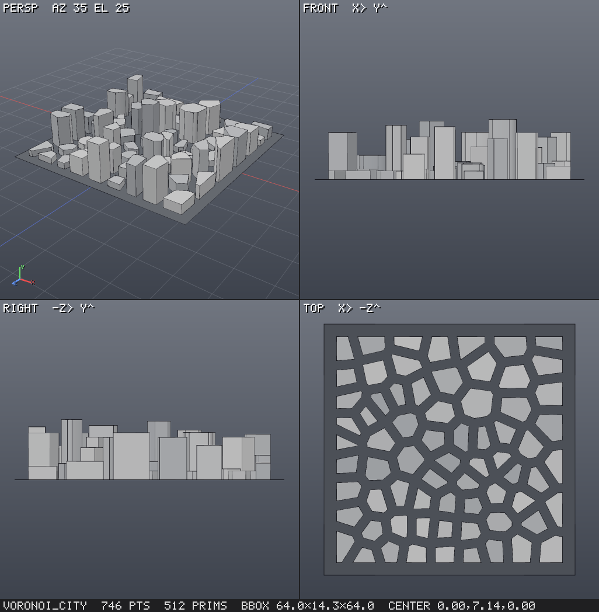

## Setup

Requires Node ≥ 22.18.

**As a package.** The npm package ships compiled JavaScript (`dist/`) with a `topotopo` command:

```bash
npx topotopo --catalog                                      # node types by category
npx topotopo --help-node scatter                            # one node's params, defaults and example
npx topotopo --help-topic export                            # a help topic (the MCP help tool's text)
npx topotopo graph.json --render out.png --export out.glb   # cook, render, export
npx topotopo graph.json --export-all                        # every output's export target, into exports/ beside it
npx topotopo view graph.json                                # live 3D viewer, re-cooks on save; drops go to inputs/ beside it
npx topotopo mcp --workspace /absolute/path/to/workspace    # the MCP server over stdio
```

The current release is v0.3 ([release notes](docs/release/v0.3-release-notes.md)); v0.2 was the first tagged release
([release notes](docs/release/v0.2-release-notes.md)). To try unreleased changes, build the tarball from a clone: `npm pack`, then
`npm install -g ./topotopo-<version>.tgz` (or into a project).
`import { Engine } from 'topotopo'` gives the engine API (`src/index.ts`) with its type declarations.

**From a clone.** Development runs the TypeScript sources directly (Node type stripping); there is no build step for
working on the code or running the tests. `npm run build` (run by `npm pack`) compiles `src/` to `dist/` for the package.

```bash
npm install
```

```bash
npm test
```

`npm test` cooks every node type and checks geometry invariants, compares golden fingerprints, runs random-graph
property tests and a wrangle fuzz, checks the node reference is current and cooks every node's documented example,
round-trips every file format and runs the MCP server end to end, the way a real client would. See
[Testing](#testing). To re-render the examples into `examples/renders`:

```bash
npm run showcase
```

To browse the examples in the live 3D viewer without an MCP client:

```bash
npm run preview
```

The viewer's left panel has three tabs: **Scene** (the graph's nodes and guides), **Outputs** and **Inputs**, and a
fourth, **Packages**, when the graphs belong to a project that uses packages (see [Packages](#packages)).
**Outputs**, the default, shows all graphs' main results, named deliverables and their textures; click one to
inspect it alone, and **Scene** in the top bar restores the scene. Publish extra results in graph JSON with
`"outputs": {"rotor": {"node": "rotor_final", "label": "Rotor"}}`, keeping `"output"` as the default. Each card says
what the result is, decided from what it cooks to (a mesh with its points and prims, a heightfield such as
"heightfield 2049 × 2049, 2 m", packed instances, points, curves, an image, or several of these) and its size, and
offers only the formats that write it, each with a line saying what it writes (a heightfield: 16-bit PNG or RAW
heightmap with its JSON sidecar, mask PNGs, the Unreal Landscape bundle; a mesh: GLB, glTF, USD, OBJ …).
**Download** gets the result in the format you pick as a browser download: the file itself, or one zip when the
format writes several files (a heightmap and its sidecar, a textures folder). **Export** writes it into `exports/`:
the first click asks for a format and a file there and stores that target in the graph (`"export": "glb"`, or
`{"format": "obj", "path": "parts/rotor.obj", "up_axis": "z"}`, on the graph or on an output); later clicks overwrite
the same file, the card's details give its full path, and **Export all** writes every target. MCP `export {output}`
and the CLI's `--export-all` write the same targets. Downloads and exports both carry the record of how they were
made (see below); in the Saved files and Inputs lists a sidecar or `.source.json` shows with the file it describes.
A heightfield's details have a layer picker: the terrain shows that layer (the mask by default) in red. **Inputs**
lists your files in `inputs/`, with **Add input** (or drop files anywhere on the page); the agent is told about new
ones in its next tool answer. Images open in a 2D viewer with layers and channels (generated textures default to
RGB; use A to inspect packed alpha/AO); JPEG/WebP are for viewing only. For `topotopo view graph.json`, `inputs/`
and `exports/` are beside that graph.

The **Controls** panel holds the graph's exposed vars. Above them, and in the status bar, the cook in progress: the
node cooking and the time so far, then the last cook's time, or the failing node and its message. **Stop** ends a cook
at the next node (long nodes such as erosion stop between their iterations; others finish first, and the line says
so); the view keeps the last finished result. Changing a value while a cook runs starts over with the newest value.
With `topotopo view graph.json` the graph file stays as you wrote it: the values you tune are kept by the viewer,
through exports, output switches and saves of the file (a value goes back to the file's only when its declaration in
`params` changes or the var is removed). A mark shows each value that differs from the file; ↺ takes one back,
**Reset all** takes all of them back, and **Save values** writes them into the file's `vars`. The viewer's writes to
the file (saved values, export targets) change only those values: formatting, key order and number spellings stay.

The default **TopoTopo** keymap uses right-drag orbit around the surface beneath the cursor, middle-drag pan and
wheel zoom toward the cursor. F/A frame, 1–4 select cameras, 5–7 change shading, O toggles orthographic and Space
toggles quad view. Maya, Houdini and Blender presets, including previously saved choices, remain available.

**Threads.** Heavy per-element work (noise displacement, attribute noise, occlusion rays, point wrangles) runs in
chunks on a pool of worker threads, and independent graph branches cook concurrently. The output is the same bit for
bit with or without it. `TOPOTOPO_WORKERS` sets the number of threads (default: CPU threads − 1; `0` turns the pool
off). Threads start on first use and stop after 30 s idle (`TOPOTOPO_WORKERS_IDLE_MS`); small inputs stay on the main
thread.

### Connect to Claude Code
With the package, the server is the `mcp` subcommand of the `topotopo` command:

```bash
claude mcp add topotopo -- npx -y topotopo mcp --workspace /absolute/path/to/workspace
```

From a clone, the repository includes [.mcp.json](.mcp.json) (it runs `node src/mcp/server.ts`), so opening a Claude
Code session in this folder offers the `topotopo` server. To register a clone from anywhere, use an absolute path:

```bash
claude mcp add topotopo -- node /absolute/path/to/topotopo/src/mcp/server.ts --workspace /absolute/path/to/topotopo/workspace
```

### Other MCP clients (Claude Desktop, …)
With the package:
```json
{
  "mcpServers": {
    "topotopo": {
      "command": "npx",
      "args": ["-y", "topotopo", "mcp", "--workspace", "C:/path/to/workspace"]
    }
  }
}
```
From a clone, run the sources instead: `"command": "node"`, `"args": ["C:/path/to/topotopo/src/mcp/server.ts",
"--workspace", "C:/path/to/topotopo/workspace"]` (`node src/cli.ts mcp …` is the same server).

Options: `--viewer` (start the live preview immediately), or set `TOPOTOPO_PORT`, `TOPOTOPO_WORKSPACE`,
`TOPOTOPO_SCRIPT_TIMEOUT_MS`, `TOPOTOPO_SIM_TIMEOUT_MS` and `TOPOTOPO_WORKERS`. The server exits when the client closes its stdin.

The workspace folder holds `graphs/` (one JSON file per graph), `assets/` (saved assets), `inputs/` and `exports/`.
`inputs/` is where you put your own material: meshes, guide curves and points, blockouts and PNG masks from Blender,
Houdini or Unreal (glTF, OBJ, STL, PLY, .geo, CSV, PNG). The agent's `inputs` tool lists and describes them, and a
`file` node reads one as `inputs/<file>` (a PNG as an image for the texture nodes). Naming objects `path.river`, `zone.park`, `site.well`, `volume.no_trees` or
`blockout.house` tells the agent what they mean (help topic `inputs`).

When the server starts, it makes the workspace a project (a `project.json`, so that its graphs can use packages,
TopoTopo's own among them) if the folder is in no project and holds nothing but these four folders, or nothing at all,
as a new workspace does. A folder with anything else in it, such as a repository or a folder of your own files, stays as
it is until you say so: `library {action: "init"}` (or `topotopo init <folder>`) makes it a project.

## MCP tools

| tool | purpose |
|---|---|
| `catalog` | node types by category (filter/search), with the outputs of the packages the project uses and of TopoTopo's own packages |
| `help` | exact node docs (params, defaults, ranges, aliases, examples) and topics: graph, inputs, expressions, time, wrangle, groups, attributes, sdf, heightfield, textures, loops, instancing, rbd, pcg, curves, particles, assets, packages, uv, render, export, verify, cloth, library, recipes; a package output's sliders, inputs, version and note |
| `build` | create/replace a graph and cook it; `dry_run`, `mode: "merge"`, optional `render`, `frame` (also on edit, inspect, render, export); `params` declare the vars a person tunes (type, desc, min, max, options, label, step), shown as controls in the viewer |
| `edit` | incremental ops: set, add, insert-after, remove (auto-rewire), connect, rename, replace, output, vars, bypass |
| `inputs` | `list` the files in the workspace `inputs/` folder (kind, size, date, counts, bbox, object names; PNG size and bit depth) and `describe` one: polygons vs open polylines vs loose points vs packed prims, bbox, attributes, groups, every `name` / `role` value, materials |
| `inspect` | one-screen summary (counts, triangles, bbox to the millimetre, parts, materials, images, uv state, open edges), `detail: "budget"` (triangles per part, per LOD and per node), `detail: "scene"` (the glb export read back: nodes, sockets, parents, meshes, materials, images), attribute stats, topology health (a closed solid or why not: open edges counted after welding uv/normal seam splits, non-manifold edges, flipped faces, inward pieces, degenerate faces, each with the part and world position of the first one and the fix; pieces, volume, genus, render/export triangle slivers), element listings, images (size and per-layer ranges), `detail: "uv"` (exact uv overlaps split into in-tile, tiling and across-LOD overlap with parts and positions, collapsed and out-of-tile triangles, charts, utilization, per-piece texel density; `json: true`) |
| `render` | PNG with persp/front/right/top views (every 3D view fits the bounds; `zoom` is relative to that fit), three-quarter views (`front_left`, `back_right`, …), `size: "1600x600"` for wide views, `transparent` background, `grid: false`, a reference image behind the views (`underlay`, `underlay_opacity`, `underlay_fit`), scene empties as labelled dots (`sockets`), `turntable`, a `uv` view (`quad_uv`), uv checker, a `texture` view of images and `textures: true` for base colour maps on meshes, colour by attribute (+ `legend`), group highlight, flipped normals in blue; opt-in overlays: `section` view and `clip` plane with filled caps, edge overlays (`wireframe` all / hard / boundary / groups), `glyphs` (N, up, orient, v), group / piece / attribute labels and point / prim numbers, `shading` flat / matcap / ao, `shading: "pbr"` (the exported metallic-roughness material with its base colour, normal, orm and roughness maps under a fixed studio rig; deterministic, `exposure` in stops), `scale: 2`, `view_labels: false` (no view labels or axis gizmo, as in the kits' thumbnails), `heightfield_res` (heightfield quads drawn per side, default 256, or `"full"`), `heightfield_layer` (the heightfield layer drawn in red, default the mask, or `"none"`); a footer line names what is shown (help topic `render`) |
| `export` | glb / gltf / obj / usda / ply / stl / json / geo / csv / points.json (packed instances: instance rows + meshes sidecar + one GLB per source); heightfields: png16 / r16 (+ JSON sidecar with the Unreal import numbers) / mask_png / unreal_landscape (a directory bundle); images: textures (one PNG per image; glb/gltf embed and usda writes the textures materials use); every export records its source (graph, vars, seeds, frame, version) to be made again |
| `graphs` | list / get / delete / rename / duplicate workspace graphs (stored as JSON in `workspace/graphs`) |
| `assets` | save a graph with vars as a reusable node type (like an HDA); list / get / delete; `fork` copies a package output's graph (TopoTopo's own included) into the workspace's assets to edit |
| `explain` | describe a node's geometry in words: "reads as" summary, pieces, watertight, genus, flipped normals, symmetry planes, principal axis, wall thickness, degenerate faces, attributes, groups |
| `diff` | compare two graphs, nodes or frames: counts, bbox delta, attribute/group changes, heightfields, images and SDF grids, Hausdorff and mean distance, verdict; `render: true` adds an overlay (grey same, blue only b, orange only a) |
| `preview` | start the live viewer and return its URL |
| `library` | the person's libraries of projects (the gallery): `list` / `get` (with thumbnail) / `create` / `set` / `bake`, and `open`, which makes a project the workspace of every tool and the viewer, or `init`, which makes the open workspace a project; the open project's packages: `packages`, `search` (the outputs of every library by words, kind and tag, and whether the project can use them), `use`, `follow` (a package's working folder for the session), `publish` (with `check: true` a dry run), `outdated` (newer versions and their notes) and `update` (a before/after with overlay renders, applied when the person says so) |

## Graph format

```json
{
  "vars": { "count": 200 },
  "nodes": {
    "ground": { "type": "terrain", "params": { "size": [30, 30], "height": 3 } },
    "pts":    { "type": "scatter", "in": ["ground"], "params": { "count": "=count", "seed": 1 } },
    "rock":   { "type": "sphere", "params": { "type": "ico", "level": 2, "radius": 0.3 } },
    "rough":  { "type": "noise_displace", "in": ["rock"], "params": { "amplitude": 0.08, "frequency": 4 } },
    "rocks":  { "type": "copy_to_points", "in": ["rough", "pts"] },
    "out":    { "type": "merge", "in": ["ground", "rocks"] }
  }
}
```

The conventions are Houdini's: Y-up, metres, degrees, and attributes such as `P N Cd uv pscale orient up width name class`.

Any param can be an expression: a string starting with `=` is evaluated as JavaScript with the graph `vars`
(`"=count * 2"`), the cook time (`frame`, `time`, `fps`, `timeInc`) and functions that read other nodes of the same
graph: `npoints('pts')`, `nprims`, `nvertices`, `bbox('base').size.y` (also `min`, `max`, `center`), `centroid`,
`detail('n', 'attr')`, `point('n', i, 'P')`, `prim('n', i, 'attr')` and `ch('box1/size')` for another node's param.
Referenced nodes become dependencies: they are cooked first, editing them re-cooks the reader, and unknown names or
cycles are reported before cooking. Node names must be string literals; these functions are not available in `vars`.
Expressions run in a sandbox that sees only these names, `Math`, the conversions (`Number`, `parseFloat`, `parseInt`,
`String`, `Boolean`, `isFinite`, `isNaN`) and the helpers listed by `help {topic: "expressions"}`.

Code reads graph vars the same way, by their bare name: `wrangle`, `script`, `sdf_expr`, `heightfield_layer`, the
parametric nodes and the expressions of `group` and `assert` (`@P.y += height`, not `vars.height`). Vars are read-only,
and a node re-cooks when a var its code names changes. A var's name must be one code can read: not a JavaScript
keyword, a helper (`noise`, `rand`, `length` …), a built-in or the time (`frame`, `time`); validation names the clash.

Group patterns look like `top`, `!top`, `0-10` or `@P.y>0.5`. A wrangle snippet looks like this (`amplitude` and `seed`
are graph vars):

```js
@P.y += noise(mul(@P, 2)) * amplitude;
@Cd = hsv2rgb(rand(@ptnum, seed), 0.6, 1);
if (@P.y < 0) removepoint(0, @ptnum);
```

## Security

A graph is code: `"=expr"` params and the code of `wrangle`, `script`, `sdf_expr` and similar nodes are JavaScript
taken from the graph JSON. On Node, expressions and wrangles run sandboxed in separate `vm` realms with a timeout
(`TOPOTOPO_SCRIPT_TIMEOUT_MS`, default 30 s): an expression sees only graph vars, the cook time, `Math` and the
documented helpers (no `process`, `require`, `import`, `fetch` or `globalThis`), and a runaway loop fails its node
instead of hanging the process. The same timeout covers `script`, `heightfield_layer` and the parametric nodes, an
`sdf_expr` field wherever it is sampled (`sdf_to_mesh` and `sdf_grid` run their whole sampling under it), and reading
whatever such code throws. Params that count something have upper bounds (larger values are clamped), and the
long-running nodes (`rbd_settle`, `rbd_stack`, `drape`, `inflate`, `particles`, `heightfield_erode`, `remesh_quad`) stop
with an error after `TOPOTOPO_SIM_TIMEOUT_MS` (default 10 minutes; the WASM calls of the last two only when the worker
pool is on). That contains mistakes, not attackers: sandboxed code can still allocate memory and burn CPU until the
timeout, combinations of large params and inputs can still exhaust memory, and a `vm` realm is not a hard security
boundary. Do not cook graphs from untrusted sources in a privileged process.

## Node types

Image cutouts and atlases: [workflow guide](docs/image-cutouts.md), [example graph](examples/image_cutouts.json).
Four general nodes crop images, trace masks, extend edge pixels and pack aligned maps. Material alpha masking
is preserved in GLB and shown in the live and headless previews.

| category | nodes |
|---|---|
| generate | `box` `grid` `sphere` `tube` `torus` `platonic` `points` `point_grid` `parametric_surface` `terrain` `lsystem` `text` |
| curve | image contours `trace_image`; `parametric_curve` `line` `circle` `curve` `spiral` `shape2d` `resample` `carve` `ends` `sweep` `polywire` `revolve` `extrude` `offset_curve` `boolean2d` `fill` `loft` `voronoi2d` `triangulate2d` `bezier` `nurbs` (Bezier/NURBS curve prims, evaluated exactly wherever they are used) `convert_curve` `spline_fit` `fillet_curve` `offset_curve_3d` `project_curve` `curve_attribs` `straight_skeleton` (skeleton, polygon offset, pitched roof) |
| transform | `transform` `match_size` `mirror` |
| deform | `noise_displace` `twist` `bend` `taper` `smooth` `peak` `jitter` `ray` `soft_transform` `lattice` `path_deform` `point_deform` `rest` |
| attribute | `attrib_create` `attrib_randomize` `attrib_promote` `attrib_delete` `attrib_rename` `attrib_copy` `attrib_transfer` `attrib_array` `attrib_noise` `color` `material` `measure` `connectivity` (float/int tuples, strings, and float[]/int[]/string[] array attributes) |
| measure | `curvature` `occlusion` (ambient occlusion, cavity, thickness) `distance` `assert` (in-graph checks: watertight, counts, bbox, edge length, degenerate, self-intersections, attributes, groups, expression) |
| group | `group` `delete` `group_promote` `group_expand` `group_combine` `group_delete` `group_rename` (point, vertex, prim and edge groups) |
| topology | `sort` `normal` `fuse` `clean` `reverse` `facet` `triangulate` `subdivide` `poly_extrude` `solidify` (constant-thickness shell, mitred folds, rims; invalid results are errors) `poly_bevel` `grid_split` `fill_holes` `bound` `decimate` `remesh` (voxel) `remesh_isotropic` `remesh_quad` (field-aligned, quad-dominant) `mesh_repair` `lod` `knife` `polysplit` `edge_divide` `dissolve` `edge_collapse` `polybridge` `polyfill` |
| copy | `copy_xform` `scatter` (count or density per m², density attribute + 0..1 mask, blue noise, relaxation, exact min distance, per-prim cap) `copy_to_points` (real copies or packed instances; variants by attribute or weights) `pack` `unpack` |
| pcg | `mask` (slope, height, curvature, occlusion, distance, direction, noise, attribute, group, inside; combine) `attribute_from_map` (PNG → attribute by uv or planar projection) `orient` (orient/N/up from normals, a surface, curve tangents, a direction or target; random yaw, tilt, scale) `points_along_curve` `cluster` (k-means, radius) `prune` (overlap, density, expression, near geometry) |
| solid | `convex_hull` `boolean` `clip` `minkowski` `smooth_solid` `voronoi_fracture` `slice` |
| sdf | `sdf_shape` `sdf_expr` `sdf_combine` `sdf_modify` `sdf_from_mesh` `sdf_to_mesh` (implicit, lazily sampled); sampled grids (Rust/WASM): `sdf_grid` `grid_combine` `grid_offset` `grid_blur` `grid_dilate` `grid_erode` `grid_resample` `grid_to_mesh` (sharp dual contouring or marching cubes) `grid_to_sdf` `voxel_remesh` |
| heightfield | `heightfield` `heightfield_noise` `heightfield_from_mesh` `heightfield_from_image` `heightfield_to_mesh` `heightfield_to_sdf` `heightfield_remap` `heightfield_blur` `heightfield_terrace` `heightfield_clip` `heightfield_cutout` `heightfield_layer` `heightfield_mask_by_feature` `heightfield_mask_by_object` `heightfield_mask_noise` `heightfield_mask_blur` `heightfield_mask_expand` `heightfield_erode` `heightfield_fill_sinks` `heightfield_flow` `heightfield_project` `heightfield_path` `heightfield_scatter` `heightfield_resample` `heightfield_transform` `heightfield_crop` (grids in XZ with named layers; tiles cropped from a map match it; export `png16`/`r16`/`mask_png` for Unreal Landscape) |
| uv | `uv_project` `uv_transform` `uv_unwrap` (xatlas) `uv_flatten` (LSCM) `uv_layout` `uv_autoseam` |
| texture | generators `tex_noise` `tex_pattern` `tex_cells` `tex_gradient` `tex_shape` `tex_splatter` `tex_scratches` `tex_text`; PNG files `image_file`; filters `tex_blend` `tex_levels` `tex_curves` `tex_blur` `tex_warp` `tex_transform` `tex_edge_detect` `tex_invert` `tex_threshold` `tex_histogram_scan` `tex_normal_from_height` `tex_height_to_ao` `tex_channel` (ORM packing) `tex_colorize` `tex_tile_sampler` `tex_output`; cutouts and atlases `tex_crop` `tex_dilate` `tex_pack`; bakes in uv space `bake_ao` `bake_curvature` `bake_thickness` `bake_position` `bake_normal` `bake_world_normal` `bake_height` `bake_island_id` `bake_mask` `bake_vertex_color`; `texture_to_material` `tex_to_heightfield` `heightfield_to_tex` (images are 2D float layers carried on the geometry; glb/usda embed them, export format `textures` writes PNGs) |
| sim | `particles` (Houdini POPs in one node: emission from points, gravity, drag, wind, curl noise, point/heightfield/SDF fields, attraction, floor and mesh collisions with die/slide/bounce, trails as polylines; steps with the frame, each frame's state cached; bit-identical on the worker pool) `rbd_settle` (drop pieces onto a terrain, container or ground until they rest; Rapier rigid bodies, packed instances stay packed) `rbd_stack` (drop them one at a time into piles) `drape` (XPBD cloth: colliders, floor, pins, wind, self collision) `inflate` (pressure: cushions, balloons) |
| code | `wrangle` `script` |
| flow | `merge` `switch` `null` `input` `foreach` `solver` `graph_ref` (plus saved assets) |
| io | `file` (obj, stl, ply, glb/gltf, geo/bgeo, csv, points.json, json), `scene_null` (named scene empty / attachment socket: a meshless glTF node under the root, an empty or a mesh) |
| package | the outputs of packages by full name, TopoTopo's own among them: `topotopo/architecture/stairs` `topotopo/architecture/house` `topotopo/architecture/roof_skeleton` `topotopo/props/crate` `topotopo/nature/tree_lowpoly` `topotopo/nature/forest_patch` `topotopo/street/road_strip` …; every one is listed with its thumbnail under [TopoTopo's own packages](#topotopos-own-packages) |

Every node's inputs, parameters (types, defaults, ranges, options, aliases) and outputs are listed in the generated
[node reference](docs/nodes.md).

## Examples

[examples/](examples) holds the showcase graphs, each rendered by `npm run showcase` into [examples/renders](examples/renders):
rocks on terrain, an L-system tree, a Voronoi-fractured sphere, an SDF creature, a procedural building (foreach,
grid_split, inset/extrude windows), an engraved sign (text + boolean), a Voronoi city, spiral stairs (copy_xform + sweep), wrangle waves, a CSG
bracket, a solver growth animation (rendered at the frame named by its `meta.frame`), polygon editing (loop cuts, knife,
bridge, quad fill, dissolve), bevels (rounded box, chamfered top edges, a star with a rounded rim), a UV toolkit demo, and a
render-overlay demo (`render_modes`: section view, hard edges, normal glyphs, group labels, matcap). A graph's `meta.render`
takes any `render` tool option. The forest example is the PCG chain (mask → scatter → orient → prune → packed copies of three weighted tree variants from 30,000 candidates), `pcg_scatter` puts lamp posts along a road and cluster-coloured rocks away from it, and `terrain_erosion` is an eroded
heightfield with a road and rocks on its steep slopes. `unreal_demo` is the Unreal 5.8 demo scene: an eroded 253 × 253 heightfield that fits an
Unreal Landscape exactly, weight layers, a road, and packed trees and rocks with variants and materials; `npm run export:demo` writes its file set
(landscape bundle, `scene.glb`, `scene.usda`, `scene.geo`, `instances.csv` with meshes) to `out/unreal_demo/`.
`splines` shows the curve toolkit: a NURBS road projected onto bumpy ground, a boardwalk with filleted corners and
offset handrails, and a Bezier letter extruded. `street_block` is a street block built only from TopoTopo's own packages
(see [TopoTopo's own packages](#topotopos-own-packages)). `textures` is a brick wall material made only from texture
nodes and the props kit's crate with baked AO and curvature turned into worn paint on its edges and an ORM map,
rendered with `textures: true` next to the texture view.
`house_city` spawns the architecture kit's `house` on a grid of lots with per-lot parameters, and `skeleton_roofs` shows
straight-skeleton roofs (an L-shaped house, a courtyard roof around a hole, nested offsets). `deformers` (lattice,
path_deform, soft_transform), `measures` (curvature, occlusion, distance, assert) and `remesh_lod` (isotropic remesh,
repair, LOD levels) cover their node families; `voxel_remesh` compares sharp dual contouring with marching cubes on a
sampled SDF grid, `quad_remesh` shows field-aligned quads on a noisy sphere, a bevelled box, a rock and a tube, and
`erosion_models` erodes one ridged terrain four ways (TypeScript and WASM droplets, virtual pipes, pipes plus stream
power), and `terrain_tiles` bends escarpments and a river with domain-warped noise, with one tile of the map cooked on
its own (`heightfield_crop`) floating above the area it matches. `particles` runs particles down an eroded massif from emitters on its ridges (the heightfield as gradient field and
collision surface, curl noise, sliding contacts; trails coloured by age) next to a fountain bouncing on a plane.
`rbd_settle` drops the nature kit's rocks onto the rocks_on_terrain landscape until they rest (rigid bodies) and piles
crates on a pad with `rbd_stack`. `drape` is the cloth family: a tarp draped over a stack of the props kit's crates, a
banner pinned between two poles in the wind, and a box inflated into a cushion.

To cook a graph from the command line:

```bash
node src/cli.ts examples/tree.json --render out/tree.png --export out/tree.glb
node src/cli.ts examples/csg_bracket.json --render out/bracket.png --section x:0.3 --wireframe hard --labels groups --shading matcap
node src/cli.ts examples/csg_bracket.json --views front --size 1600x700 --underlay ref.png --render out/compare.png   # a reference image behind the view
node src/cli.ts examples/street_block.json --inspect budget   # triangles per part, per LOD and per node
node src/cli.ts examples/street_block.json --inspect scene   # what the glb export holds: nodes, sockets, materials, images
node src/cli.ts examples/terrain_erosion.json --node road --export out/terrain.png   # 16-bit heightmap + terrain.json (Unreal)
node src/cli.ts examples/unreal_demo.json --node landscape --format unreal_landscape --export out/level   # Landscape bundle
node src/cli.ts examples/forest.json --node forest --export out/trees.csv --pcg   # instance rows + trees.meshes.json + trees_meshes/*.glb
node src/cli.ts examples/rocks_on_terrain.json --var seed=11 --var rock_count=300 --render out/rocks.png   # vars for one run
node src/cli.ts view examples/unreal_demo.json   # live viewer at http://127.0.0.1:7341: node list, per-node geometry, re-cook on save
node src/cli.ts --help-topic export   # a help topic; --catalog ends with the list
```

`--var name=value` sets a graph var for one run without editing the file (repeat it; numbers, `true`/`false` and JSON
values are parsed, other text is a string; an unknown name lists the graph's vars). `--output <name>` renders, exports
and inspects a named output (the graph's `"outputs"`) instead of the default one. Renders draw heightfields at up to
256 quads per side, so a 513 × 513 field shows at 257 × 257 and the footer says so; `--heightfield-res full` draws
every sample. They show the mask layer in red; `--heightfield-layer flow` shows another layer (`none`: none).

Every export records how it was made in a `source` block: the graph's name and the SHA-256 of its JSON as cooked, the
output and node, frame and fps, every var after overrides, the seeds the graph sets, the format and options, and the
TopoTopo version. Heightmaps (`png16`, `r16`) keep it in their `.json` sidecar, instance rows in `<name>.meshes.json`
and the Unreal Landscape bundle in `landscape.json`; every other export writes `<file>.source.json` next to the file (a
`textures` folder gets `source.json` inside it), and glTF also carries it in `asset.extras.source`. The same graph,
values and options give the same bytes, so the manifest is enough to make the export again: pass its output
(`--output`) or node (`--node`), `--frame`, `--fps` and one `--var name=<value as JSON>` per var (help topic `export`).

Animated graphs cook at a frame (`--frame 40`) or over a range. With `--frames`, output paths may contain `{frame}` or
`{frame:04}`; without a pattern, `.0001`-style frame numbers are inserted before the extension:

```bash
node src/cli.ts examples/solver_growth.json --frames 1-48 --render "out/growth_{frame:04}.png" --export out/growth.glb
```

## Unreal Engine 5.8

The optional [TopoTopoPCG plugin](integrations/unreal/TopoTopoPCG/README.md) reads CSV or `points.json`
directly into PCG, resolves mesh names through the instance sidecar and editable asset mappings, and provides a
**TopoTopo Instance Spawner** backed by Unreal's Static Mesh Spawner. **Tools > Import TopoTopo scene** imports
the GLB prototypes and materials, places the CSV instances as HISM components, and can import an exact-fit
Landscape heightmap. Generate the sample with `npm run export:demo`; the plugin README gives installation,
the two-node PCG graph, coordinates, automation tests and editor verification steps. It is separate from the npm
package; copy it into your Unreal project's `Plugins/` directory.

## Gallery

Keep projects in libraries on your PC and browse them as a website: `topotopo gallery` serves every library's projects
at http://127.0.0.1:7340 with a page, a thumbnail and an iframe embed for each, so a board or wiki can link a concept
to the model. A project is a workspace folder with a `project.json` (title, tags, links) and `attachments/` for
concept art; previews bake by themselves when its graphs change, and agents reach every library through the MCP
`library` tool.

```bash
topotopo library add game D:/game-assets
topotopo library new game props/lantern --title "Lantern" --tags prop
topotopo gallery
```

Each project has a page at `/p/<library>/<id>`, a thumbnail at `/p/<library>/<id>/thumb.png` and an embed for boards at
`/embed/<library>/<id>`. A package's page lists its versions with their notes and dates and the outputs it publishes
with their kinds and tags, a project's page the packages it uses, and the grid marks packages with their full name; its
search finds their outputs by name, kind and tag as well.

## Packages

A project can use the published outputs of other projects by name, as node types: `{"type": "studio/trees/pine"}`, or
`studio/trees` for the package's default output, with the output's vars as params and its input nodes as inputs. The
author names the package once in `project.json` (`"package": "studio/trees"`) and publishes versions: each is a frozen
copy in the project's `versions/` folder, numbered big.small by what changed for the projects that use it (a removed or
renamed output, slider or input, a narrower range or a removed option makes a big version). A project that uses a
package keeps its own copy of the version it uses in `packages/` and names it in `project.json`, so it cooks the same
on every machine and what it uses never changes by itself. It finds packages in the libraries its `project.json` lists
(`"libraries": ["../shared/library", "game"]`) and in TopoTopo's built-in library, `topotopo`, which every project looks
in and which holds TopoTopo's own packages (a newer version in a TopoTopo release shows as an update); the first graph
that names one adds it. Only a project uses packages: `topotopo init` (MCP: `library {action: "init"}`) makes a folder
one, and the MCP server makes a new or empty workspace one when it starts. A package's own graphs name its other
outputs the same way, a kit's house of the kit's walls: they resolve to the same version, with no entry in `uses`, and
outputs that name each other in a loop are refused. To tune a package while looking at a project that uses it,
`--follow studio/trees` (or the MCP `library` tool's `follow`) uses the package's working folder for one session.
Exports record the package versions they used.

Every published output says what it is. Publishing cooks it and records its kind (`mesh`, `instances`, `points`,
`curves`, `terrain`, `textures`, `volume`, or `scene` for several of these), its tags and its description, from the
graph's `outputs`: `{"pine": {"node": "out", "kind": "mesh", "tags": ["conifer", "low-poly"], "description": "…"}}`.
A `kind` written there is checked: publishing refuses an output of another kind, or one that cooks to nothing, and
build and the viewer warn before that. An output of another kind than before makes the version big; tags and
descriptions are small changes. `topotopo publish --check` (MCP: `publish {check: true}`) runs every check and says
the version number it would get, its changes, blocks and warnings, writing nothing. `topotopo search conifer --kind
mesh` (MCP: `library {action: "search"}`) finds outputs in TopoTopo's built-in library, the libraries the project lists
and every registered library, and says for each whether the project can use it or which `"libraries"` entry its
`project.json` needs.

`topotopo outdated` lists the newer versions of what a project uses, with their notes. `topotopo update studio/trees`
shows a before/after first: every place the project uses the package, cooked with the version in use and the new one,
what changed and the notes in between, without writing anything; the same command with `--apply` updates it (a big
version is named with `--to`, and the before/after says what the project's graphs must change).

In the live viewer (`topotopo edit levels/forest`, or `topotopo view` on a graph in a project) the **Packages** tab
lists what the project uses with the newer versions and their notes, and the Scene tree marks the nodes of a package
that has an update. **Before/after** cooks each place with the version in use (a) and the new one (b), shown alone in
the view as a, as b or both overlaid, with what changed; **Update** applies it and the scene cooks again, and after a
big version the list of what the graphs must change stays in view. **Use the trees I'm editing** follows the
package's working folder for that viewer session only, so every save there cooks the scene again; saving a working
folder while the viewer is open offers it.

```bash
topotopo init props/trees --package studio/trees
topotopo publish props/trees --check
topotopo publish props/trees --note "first version"
topotopo search conifer --kind mesh
topotopo use studio/trees levels/forest
topotopo packages levels/forest
topotopo outdated levels/forest
topotopo update studio/trees levels/forest
topotopo update studio/trees levels/forest --apply
```

`topotopo --help-topic packages` (MCP: `help {topic: "packages"}`) has the details.

## TopoTopo's own packages

TopoTopo comes with packages of its own, four kits of ready-made generators in its built-in library
([library/](library)), used by full name like any package's outputs. `topotopo/architecture` has walls with windows
and doors, whole houses, roofs (gable, hip, and straight-skeleton roofs for any footprint), stairs, railings, pillars,
arches, floors, trusses and scaffolds; `topotopo/nature` rocks, cliffs, trees, bushes and logs, and forests, grass and
rock fields that dress a surface; `topotopo/props` barrels, crates, pallets, sandbag walls and pipe runs;
`topotopo/street` roads, lamp posts, bollards, benches, street signs, fences and cables:

```json
{ "nodes": { "stairs": { "type": "topotopo/architecture/stairs", "params": { "steps": 16, "style": "open" } } } }
```

TopoTopo carries them built in, so they work offline and every project finds them without listing a library: the first
graph that names an output copies its kit's version into the project's `packages/` and locks it, as for any package,
and a newer version in a TopoTopo release shows as an update (`topotopo outdated`) instead of changing a scene by
itself. A graph outside a project cannot use them: `topotopo init` makes its folder one (the MCP server makes a new or
empty workspace one). Each output documents its typed parameters (`help {nodes: ["topotopo/architecture/stairs"]}`, or
[docs/nodes.md](docs/nodes.md#package-nodes)), puts its pivot at the base (Y up, metres), and tags every piece with
`name` and `material` attributes, so exports split and shade cleanly. Outputs that follow a curve (`railing`, `fence`,
`pipe_run`, `road_strip`) take it as input 0 and those that dress a surface (`scatter_rocks`, `forest_patch`,
`grass_clumps`) take the surface as input 0; without an input they build a default one, which is what the thumbnails
show. A kit's pieces build on each other (the house is the kit's walls and roof), and a kit's default output
(`topotopo/nature` alone, or `topotopo/nature/kit`) lines its outputs up. Every output has its kind pinned and tags
a game developer searches by (`conifer`, `modular`, `masonry`, `street-furniture`): `topotopo search --tag
street-furniture`. `assets {action: "fork", name: "topotopo/architecture/stairs"}` copies
an output's graph into the project's assets to edit. [examples/street_block.json](examples/street_block.json) builds a
street block from the kits alone (transform, merge and copy nodes just place them):

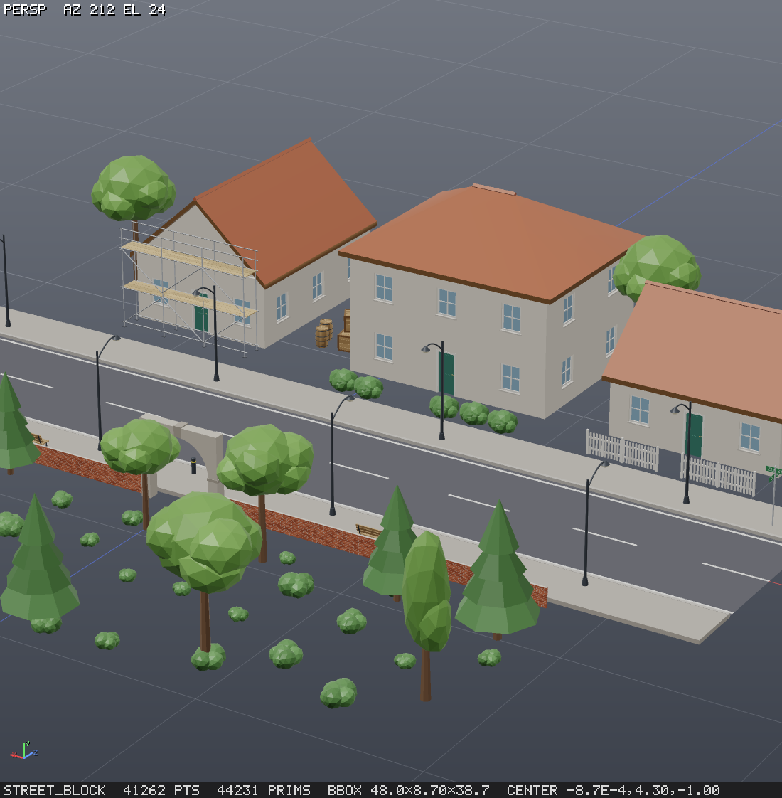

`npm run kits` rewrites the kits' line-ups, their thumbnails and the tables below. `npm run kits -- --publish nature
--note "..."` publishes a kit's next version, numbered as for any package (TopoTopo's own packages are published there
and nowhere else), and `npm test` fails while a kit's working folder differs from its newest version.
`node test/kits.ts` cooks every output at its defaults and at the ends of every numeric range.

<!-- kits:start (generated by npm run kits) -->

**topotopo/architecture** 1.1: walls with windows and doors, houses on any footprint, gable, hip and straight-skeleton roofs, stairs and spiral stairs, railings, pillars and arches, brick walls, tiled and hexagonal floors, trusses and scaffolds.

| | | | |
|---|---|---|---|
| 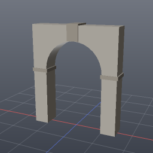<br>`topotopo/architecture/arch` | 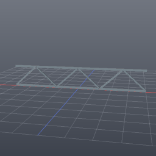<br>`topotopo/architecture/beam_truss` | <br>`topotopo/architecture/brick_wall` | <br>`topotopo/architecture/door_frame` |
| 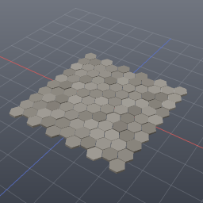<br>`topotopo/architecture/hex_grid_floor` | 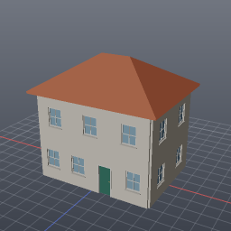<br>`topotopo/architecture/house` | 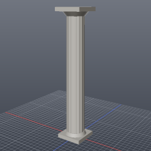<br>`topotopo/architecture/pillar` | 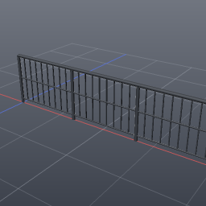<br>`topotopo/architecture/railing` |
| <br>`topotopo/architecture/roof_gable` | 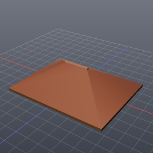<br>`topotopo/architecture/roof_hip` | <br>`topotopo/architecture/roof_skeleton` | 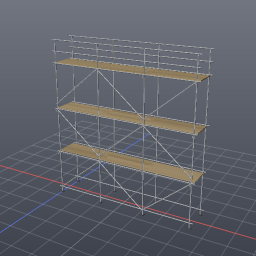<br>`topotopo/architecture/scaffold` |
| 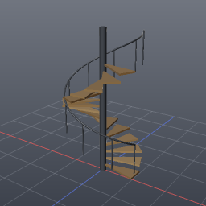<br>`topotopo/architecture/spiral_stairs` | 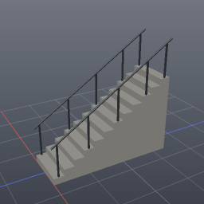<br>`topotopo/architecture/stairs` | <br>`topotopo/architecture/tile_floor` | 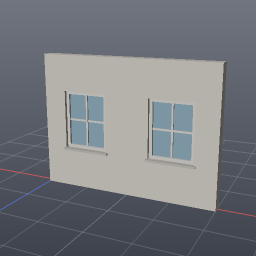<br>`topotopo/architecture/wall_segment` |
| 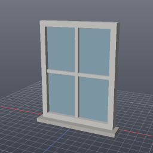<br>`topotopo/architecture/window_frame` |  |  |  |

**topotopo/nature** 1.1: rocks and cliff blocks, low-poly trees, bushes and logs, and forests, grass clumps and scattered rocks that dress a surface.

| | | | |
|---|---|---|---|
| <br>`topotopo/nature/bush` | 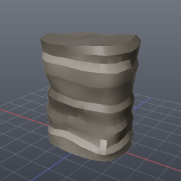<br>`topotopo/nature/cliff_block` | 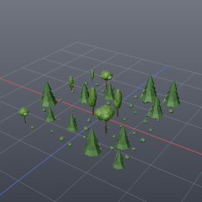<br>`topotopo/nature/forest_patch` | 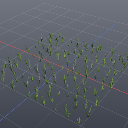<br>`topotopo/nature/grass_clumps` |
| 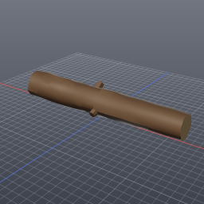<br>`topotopo/nature/log` | 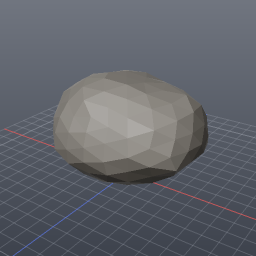<br>`topotopo/nature/rock` | 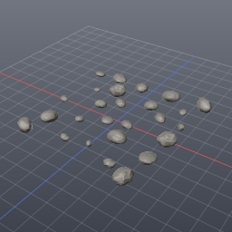<br>`topotopo/nature/scatter_rocks` | 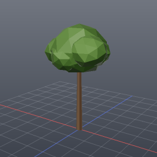<br>`topotopo/nature/tree_lowpoly` |

**topotopo/props** 1.1: barrels, crates, pallets, sandbag walls and pipe runs.

| | | | |
|---|---|---|---|
| 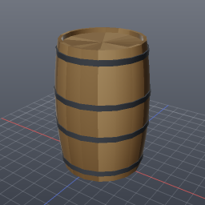<br>`topotopo/props/barrel` | 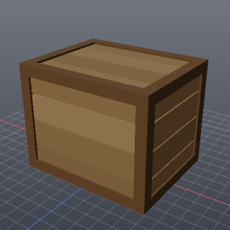<br>`topotopo/props/crate` | 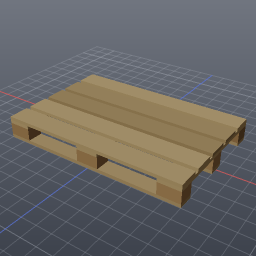<br>`topotopo/props/pallet` | <br>`topotopo/props/pipe_run` |
| <br>`topotopo/props/sandbag_wall` |  |  |  |

**topotopo/street** 1.1: roads with kerbs and sidewalks, lamp posts, bollards, benches, street signs, fences and hanging cables.

| | | | |
|---|---|---|---|
| 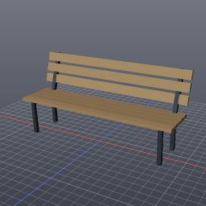<br>`topotopo/street/bench` | 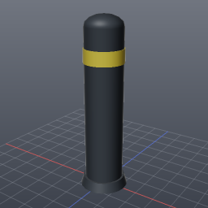<br>`topotopo/street/bollard` | 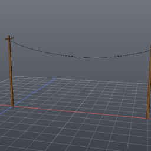<br>`topotopo/street/cable` | 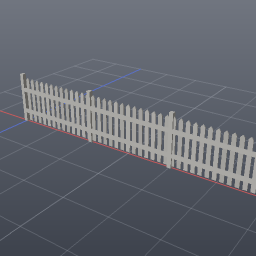<br>`topotopo/street/fence` |
| 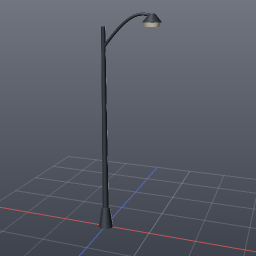<br>`topotopo/street/lamp_post` | <br>`topotopo/street/road_strip` | 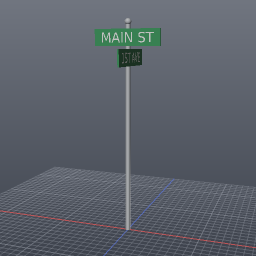<br>`topotopo/street/sign_post` |  |

<!-- kits:end -->

## Testing

`npm test` runs these layers in order; each can also run alone.

| layer | command | what it checks |
|---|---|---|
| smoke | `npm run test:smoke [-- filter]` | every node type cooks on its fixture inputs and passes the geometry invariants (`checkGeo`) |
| golden | `npm run test:golden [-- filter]` | every node fixture, every `examples/*.json` graph and every output of TopoTopo's own packages matches its fingerprint in `test/golden/` |
| property | `npm run test:property` | 150 random node chains: no exception escapes the engine, invariants hold, cooks are deterministic, the cache returns the same result after a param is changed and restored; plus a wrangle fuzz (random, malformed and never-ending snippets), hostile `=expr` expressions (escapes and endless loops, pool off and on), hostile code params (`heightfield_layer`, `sdf_expr`, parametric nodes), `sdf_expr` fields that hang only when `sdf_to_mesh`/`sdf_grid` sample them, and thrown values whose message never comes back (wrangle, script; also with a poisoned realm) |
| docs | `npm run test:docs` | `docs/nodes.md` matches the node definitions; this README's node table lists every node type |
| examples | `npm run test:examples [-- filter]` | every node type has an `example` (shown by `help` and in `docs/nodes.md`) and it cooks without errors or warnings: a node spec on the node's fixture inputs, a graph as written |
| io | `node test/io.ts` | export → import round trips for every format |
| interop | `npm run test:interop` | glTF (validator), Houdini `.geo`/`.bgeo`, CSV/PCG and points JSON round trips; instance rows and their Unreal transforms, per-instance glTF/USD attributes, packed `.geo`, textures, the Unreal Landscape bundle, `export:demo` |
| uv | `npm run test:uv` | unwrap/flatten/layout: finite uv in 0..1, topology kept, LSCM angle error, no island overlaps, uniform texel density, GLB round trip, uv view size |
| render | `node test/render.ts` | every render option renders at the expected size; pixel probes for edge overlays, section caps (incl. inside-out), clip, glyphs, labels, legends, shading, the footer line, `view_labels: false`; default output unchanged by the new code paths |
| remesh | `npm run test:remesh` | remesh_isotropic edge lengths, watertightness, Cd continuity, box features, adaptive size, group/boundary/seams, timing; decimate seams, lock_border, points; mesh_repair winding, duplicates, holes, non-manifold split, slivers, self-intersections; lod levels and names |
| quad remesh | `node test/remeshquad.ts` | Rust/WASM quad extraction, provenance, continuous UVs and seams, groups, determinism and pool parity; `node bench/remeshquad.ts` measures the 100k-triangle case |
| mcp | `node test/mcp.ts` | the MCP server end to end over stdio |
| arrays | `node test/arrays.ts` | array attributes: storage, merge and builder rules, wrangle `f[]@`/`i[]@`/`s[]@` and helpers, `attrib_array`, JSON, inspect, fingerprints, every node type fed array attributes |
| packed | `node test/packed.ts` | packed prims: model (clone, subsets, merge dedup, builder, bbox), pack/unpack round trips, packed copies equal real copies, transforms, auto-unpack, JSON/GLB/USD, render budget, every node type fed instances |
| heightfield | `node test/heightfield.ts` | heightfields: the volume model, every heightfield node's behaviour (round trips, masks, crops and tiles that match the whole map, erosion determinism and mass conservation, the same erosion settings at three spacings, roads, scattering), the erosion speed target (512² × 100 iterations), png16/r16/mask_png export through the PNG decoder, render/inspect hooks, MCP export |
| pcg | `npm run test:pcg` | scatter v2 (density counts, density attribute and mask ratios, relaxation, exact min_distance, per-prim cap, emitted attributes, prim uv, seeds, legacy defaults), every mask feature and combine mode, attribute_from_map on generated 8/16-bit and RGB PNGs (projections, filters, wrap, file stamp), orient modes against surface normals and copy_to_points, points_along_curve arc spacing, cluster k-means/radius, prune overlap/density/expression/near geometry, copy_to_points variant weights and packed = real copies |
| splines | `npm run test:splines` | Bezier against its closed form, a rational NURBS circle, de Boor = de Casteljau, arc length, closest point, exact Bezier ⇄ NURBS conversions, interpolation and fitting; spline prims through clone/merge/subsets/JSON; auto-conversion and its warning; every spline node's behaviour (fillet arcs, constant 3D offset along a helix, projection onto a plane and a heightfield, monotonic curveu); render and export; every node type fed spline prims |
| kits | `npm run test:kits [-- filter]` | every output of TopoTopo's own packages, cooked as a project that uses its kit: typed, documented params; cooks at its defaults (cold cache, under 1 s), at both ends of every numeric range, with every enum option and flipped bool, and on its fixture curve or surface; `name` and `material` on every prim; pivot; promised watertightness; each kit's line-up, thumbnails and README table current, and its working folder its newest version; `assets` fork / list / get / delete; the catalog and help |
| textures | `npm run test:textures` | texture nodes and bakes: generators deterministic and tileable (every noise basis repeats at u + 1), blend modes against known values, blur keeps the mean, normal maps (flat = (0.5, 0.5, 1), slope directions, OpenGL/DirectX, resolution-independent strength), AO of a plane white and of a box interior dark, curvature bright on bevels, padding, island ids = xatlas charts, normals and height from a high-res mesh, texture_to_material and ORM packing, glTF embeds PNGs (validator), USD writes files, the textures format, the texture view and texture sampling, merge/clone/JSON, fingerprints, pool on/off identical, 2048² noise timing |
| particles | `npm run test:particles` | the particles node: emission counts and lifetimes, attribute and group carry, determinism, pool on/off bit-identical (noise, fields, mesh and floor collisions, trails), particles never below the floor or a mesh and never inside a closed one, spheres kept pscale off a mesh, trail lengths/curveu/ages, max_particles, max_births (step cap, batched runs = one run), frames = one long run (resume, jump back, substeps, moving emitter), point/heightfield/SDF fields, wind, attraction, analytic Perlin gradients and divergence-free curl noise, 100k particles × 200 steps |
| rbd | `npm run test:rbd` | rbd_settle / rbd_stack: rocks rest on the ground plane, a terrain mesh and a heightfield (exact hulls checked independently: no vertex below the surface or inside another piece beyond 5 mm / 1 cm; reduced hulls within 5 % of a radius), every piece settled and touching something, bit-identical across cooks, engines and pool on/off, input order independent (also coincident pieces of different shapes), packed = unpacked, static `active` = 0 pieces, initial `v`, fallen pieces and `delete_fallen`, the overlap warning, `ground_plane` auto, `max_pieces`, a 12-crate pile that keeps every crate, animate (frame 1, resumed frames, last frame = settled), every collision shape, and the 1,000-piece timing |
| limits | `npm run test:limits` | resource limits: every int param that counts something has a max (absurd counts such as `resample {count: 1e15}` are clamped instead of running the process out of heap; `point_grid` refuses huge products), and the long-running nodes (rbd_settle, rbd_stack, drape, inflate, particles, heightfield_erode, remesh_quad) stop with an error naming them at `engine.simTimeoutMs`, pool off and on (the WASM calls of remesh_quad and the erosion kernels on a pool worker, same bits as on the cooking thread) |
| cloth | `npm run test:cloth` | drape and inflate: pinned cloth hangs without NaN or stretch (with and without tethers), draped cloth rests outside a box and above the floor within the thickness with its rest lengths kept, sharp box corners stay under the cloth, open colliders from both sides, determinism and pool on/off bit-identical, max_points, pins input and pin_snap, the pin attribute, wind, self collision stacking two layers, inflate volume monotonic in pressure, stencil/colouring/chain helpers |
| pool | `npm run test:pool` | worker pool: lazy start, close, transfer round trips, every ported node bit-identical with the pool on and off, concurrent branches and shared in-flight cooks, the lazy switch, kernel errors, crashes and timeouts, the size threshold, the CLI and MCP server exiting; `test:pool` also runs the golden layer with every kernel forced onto the pool. `npm test` passes with `TOPOTOPO_WORKERS=0` and with the default |

Fixtures (source geometry, per-node inputs and params) live in `test/fixtures.ts`; `fixtureGraphFor(type)` builds the
graph every layer uses to cook a node.

**Golden fingerprints.** A fingerprint holds counts, the bbox (rounded to 1e-4), the attribute schema and group names
per class, and hashes of positions (quantised to 1e-5), topology and every attribute (1e-4). They are stable across runs
and tolerant to float noise, and there is one JSON file per node or example, so a change shows up as a readable git
diff. When a change to geometry output is intended:

```bash
npm run test:update            # rewrite test/golden/*.json (removes files for deleted nodes)
npm run test:update -- sweep   # only names containing "sweep"
git diff test/golden           # review what changed, then commit it with the code
```

A failing golden prints each changed field with its old and new value. Nothing depends on the machine: the `text`
node defaults to the bundled `assets/fonts/DejaVuSans.ttf`, so its fingerprint is the same everywhere.

**Property tests and fuzz.** `node test/property.ts --count 1000 --seed 7` explores more graphs; a failure prints
the graph JSON and the `--seed S --only I` flags to reproduce it. `--strict` also fails on node errors that look like
internal JS errors. `node test/fuzz.ts --count 500` runs more wrangle snippets.

**Node reference.** `npm run docs` regenerates [docs/nodes.md](docs/nodes.md) from the `NodeDef`s. Commit it with any
node or param change; `npm test` fails while it is stale.

**Benchmarks.** `npm run bench` times named cooks (scatter, copy, packed copy, unpack, subdivide, boolean, noise,
wrangle, SDF meshing, triangulate, merge, fuse) against targets from the roadmap and prints a Markdown table. `--quick` uses smaller sizes,
`--filter name` selects cases. Results go to `bench/last.json`; `bench/baseline.json` is a reference run (informational,
never failing). Compare with the thread pool off: `TOPOTOPO_WORKERS=0 npm run bench -- --filter noise`.
`node bench/expr.ts` cooks graphs with 1000 `"=expr"` params (cold and cached) to time the expression sandbox.

CI (`.github/workflows/ci.yml`) runs `npm run typecheck`, `npm test`, `npm run build`, `npm run pack:test` and
`npm run site:check` on Linux and Windows (Node 22, plus Node 24 on Linux) for every pull request and every push to
`main`. `test/portability.ts` (part of `npm test`) covers what one platform cannot see: generated files that must not
depend on the locale, exact file-name case, a symlinked checkout and LF line endings.

**Package.** `npm run pack:test` builds and packs the npm tarball, installs it into an empty project in a temp
directory and uses it from there: the `topotopo` bin (help, cooking an example with a render), the library import and
its types, the built-in library of TopoTopo's own packages (a project's first use copies a kit from it), the bundled font,
the worker pool, the WASM kernels and the MCP server over stdio. It takes about a minute and is not part of
`npm test`; run it before a release (see [CONTRIBUTING.md](CONTRIBUTING.md)).

## Layout

`src/core` holds the geometry model and algorithms. `src/graph` holds the node system and cooking engine, and `src/nodes`
the node library. The renderer is in `src/render`, import/export in `src/io`, and the MCP server, tools and docs in
`src/mcp`. `src/viewer` has the live preview, `src/gallery` the gallery website of project libraries, and `src/host` the Node
host (sandbox, files, fonts).
`dist/` (not in git) is the compiled package: `npm run build` mirrors
`src/` there one to one, so the built-in library, fonts, kernels and worker entry are found relative to either.

## Support

TopoTopo is free and stays free. If it saves you time, you can sponsor its maintenance through
[GitHub Sponsors](https://github.com/sponsors/faxlab). Sponsorship funds maintainer time and comes with no
obligations either way.

## Licence

Apache-2.0 (see [LICENSE](LICENSE)). Third-party components and their licence texts are listed in [NOTICE](NOTICE).
Contributions follow [CONTRIBUTING.md](CONTRIBUTING.md) and the [code of conduct](CODE_OF_CONDUCT.md).
