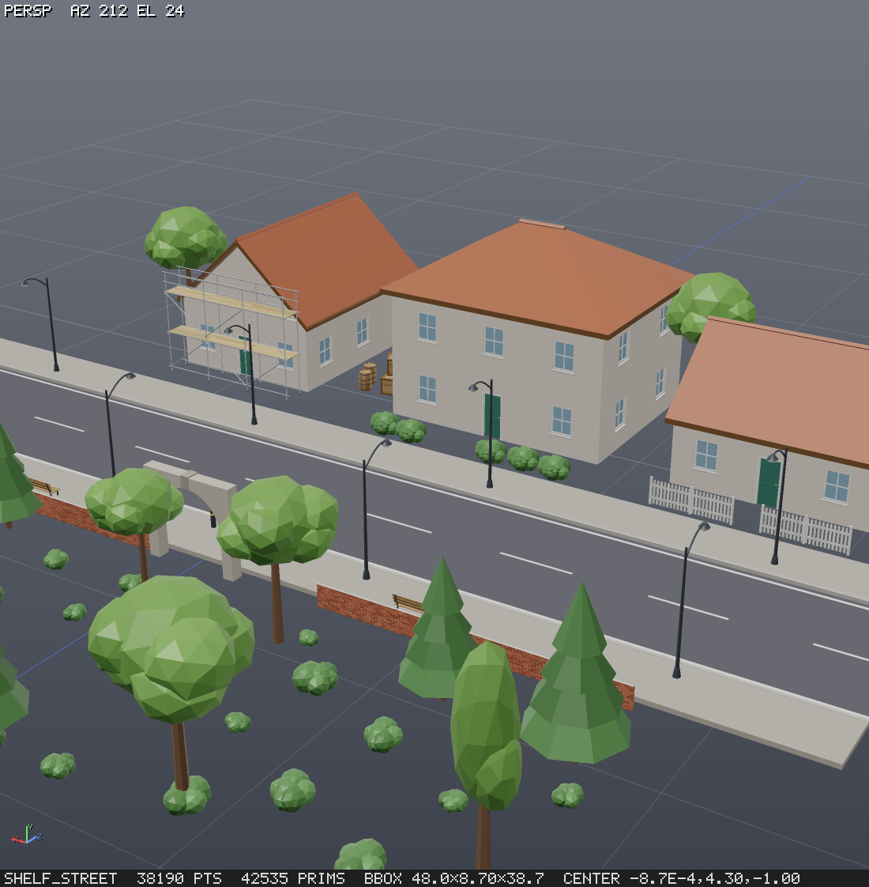

# Polyforge

A procedural geometry engine: Houdini-style node graphs, headless, deterministic, exports to Unreal, Blender and
Houdini. You build JSON node graphs; the engine cooks them into geometry. It runs on Node and WebAssembly with no
GPU, every cook is reproducible from the graph and its seeds, and the core is browser-ready.

- **over 100 node types**: generators, curves and sweeps, deformers, attributes and groups, polygon modelling, scattering and
  instancing, robust booleans, Voronoi fracture, an SDF/implicit toolkit, heightfield terrain (masks, hydraulic and
  thermal erosion, roads, scattering), L-systems, text, loops, a frame solver, assets, and code nodes.
- **Time**: every cook happens at a frame. Only time-dependent nodes re-cook when the frame changes, and the `solver`
  node advances a simulation frame by frame from its cached previous state.
- **Agent and MCP support**: Polyforge ships an MCP server, so LLM agents can build graphs in one call, read text
  summaries, look at a multi-view **render**, edit incrementally with content-hash caching, and verify their work with
  `assert`, `explain` and `diff`. JS escape hatches (`wrangle` with `@P` syntax, `script`, `sdf_expr`) cover what the
  node library does not.
- **Pipeline output**: glTF/GLB through gltf-transform (materials from the `material` node with embedded base colour,
  normal and roughness maps, vertex colours, uv, custom attributes, polylines and points; optional meshopt compression
  and quantization), Houdini `.geo` (every attribute and group, packed prims as `PackedGeometry`), CSV point streams
  with Unreal PCG columns, points JSON, USDA (UsdPreviewSurface materials), OBJ, PLY, STL and lossless JSON, with
  Y/Z-up and scale. Mesh splitting follows the `name` attribute, for Unreal, Blender and Houdini. The `file` node reads
  the same formats back (glTF with meshopt and external buffers, `.geo` and uncompressed `.bgeo`, CSV).
- **Instancing**: packed primitives (Houdini's packed prims) keep a million copies as a million points plus one shared
  mesh: `copy_to_points {pack: true}` (with variants), `pack`, `unpack`. Transforms, merges, deletes and attribute nodes
  work on the instances; other nodes unpack them automatically with a warning. GLB export writes
  `EXT_mesh_gpu_instancing` with per-instance attributes, USDA a `PointInstancer` with per-instance primvars, CSV and
  points JSON an instance stream (one row per instance with its transform and a `Mesh` column, plus a sidecar and one
  GLB per source mesh, for Unreal PCG), and the renderer draws them within a triangle budget.
- **Terrain**: heightfield volumes with noise, masks, droplet erosion, roads and scatter; export as Unreal Landscape
  heightmaps (16-bit PNG or RAW `.r16` with a JSON sidecar holding the import scale) and 8-bit weight layers, or as one
  `unreal_landscape` bundle: heightmap, every layer, a manifest with the exact Landscape import settings, the meshes and
  the instance stream.
- **Live preview**: a local three.js page that refreshes whenever a graph changes. Click any node to see its result.

The design notes, including whether the browser is a limitation, are in [docs/DESIGN.md](docs/DESIGN.md).


## Setup

Requires Node ≥ 22.18 (it runs the TypeScript sources directly; no build step).

```bash
npm install
```

```bash
npm test
```

`npm test` cooks every node type and checks geometry invariants, compares golden fingerprints, runs random-graph
property tests and a wrangle fuzz, checks the node reference is current, round-trips every file format and runs the
MCP server end to end, the way a real client would. See [Testing](#testing). To re-render the examples into
`examples/renders`:

```bash
npm run showcase
```

To browse the examples in the live 3D viewer without an MCP client:

```bash
npm run preview
```

### Connect to Claude Code
The repository includes [.mcp.json](.mcp.json), so opening a Claude Code session in this folder offers the `polyforge` server.
To register it from anywhere, use an absolute path:

```bash
claude mcp add polyforge -- node /absolute/path/to/polyforge/src/mcp/server.ts --workspace /absolute/path/to/polyforge/workspace
```

### Other MCP clients (Claude Desktop, …)
```json
{
  "mcpServers": {
    "polyforge": {
      "command": "node",
      "args": ["C:/path/to/polyforge/src/mcp/server.ts", "--workspace", "C:/path/to/polyforge/workspace"]
    }
  }
}
```
Options: `--viewer` (start the live preview immediately), or set `POLYFORGE_PORT`, `POLYFORGE_WORKSPACE` and
`POLYFORGE_SCRIPT_TIMEOUT_MS`.

## MCP tools

| tool | purpose |
|---|---|
| `catalog` | node types by category (filter/search) |
| `help` | exact node docs (params, defaults, ranges, aliases, examples) and topics: graph, expressions, time, wrangle, groups, attributes, sdf, heightfield, loops, instancing, pcg, curves, assets, uv, render, export, verify, recipes |
| `build` | create/replace a graph and cook it; `dry_run`, `mode: "merge"`, optional `render`, `frame` (also on edit, inspect, render, export) |
| `edit` | incremental ops: set, add, insert-after, remove (auto-rewire), connect, rename, replace, output, vars, bypass |
| `inspect` | summary, attribute stats, topology health (watertight, pieces, volume, genus), element listings |
| `render` | PNG with persp/front/right/top views, `turntable`, a `uv` view (`quad_uv`), uv checker, colour by attribute (+ `legend`), group highlight, flipped normals in blue; opt-in overlays: `section` view and `clip` plane with filled caps, edge overlays (`wireframe` all / hard / boundary / groups), `glyphs` (N, up, orient, v), group / piece / attribute labels and point / prim numbers, `shading` flat / matcap / ao, `scale: 2`; a footer line names what is shown (help topic `render`) |
| `export` | glb / gltf / obj / usda / ply / stl / json / geo / csv / points.json (packed instances: instance rows + meshes sidecar + one GLB per source); heightfields: png16 / r16 (+ JSON sidecar with the Unreal import numbers) / mask_png / unreal_landscape (a directory bundle) |
| `graphs` | list / get / delete / rename / duplicate workspace graphs (stored as JSON in `workspace/graphs`) |
| `assets` | save a graph with vars as a reusable node type (like an HDA); list / get / delete; `fork` copies a shelf asset into the workspace to edit |
| `explain` | describe a node's geometry in words: "reads as" summary, pieces, watertight, genus, flipped normals, symmetry planes, principal axis, wall thickness, degenerate faces, attributes, groups |
| `diff` | compare two graphs, nodes or frames: counts, bbox delta, attribute/group changes, Hausdorff and mean distance, verdict; `render: true` adds an overlay (grey same, blue only b, orange only a) |
| `preview` | start the live viewer and return its URL |

## Graph format

```json
{
  "vars": { "count": 200 },
  "nodes": {
    "ground": { "type": "terrain", "params": { "size": [30, 30], "height": 3 } },
    "pts":    { "type": "scatter", "in": ["ground"], "params": { "count": "=count", "seed": 1 } },
    "rock":   { "type": "sphere", "params": { "type": "ico", "level": 2, "radius": 0.3 } },
    "rough":  { "type": "noise_displace", "in": ["rock"], "params": { "amplitude": 0.08, "frequency": 4 } },
    "rocks":  { "type": "copy_to_points", "in": ["rough", "pts"] },
    "out":    { "type": "merge", "in": ["ground", "rocks"] }
  }
}
```

The conventions are Houdini's: Y-up, metres, degrees, and attributes such as `P N Cd uv pscale orient up width name class`.

Any param can be an expression: a string starting with `=` is evaluated as JavaScript with the graph `vars`
(`"=count * 2"`), the cook time (`frame`, `time`, `fps`, `timeInc`) and functions that read other nodes of the same
graph: `npoints('pts')`, `nprims`, `nvertices`, `bbox('base').size.y` (also `min`, `max`, `center`), `centroid`,
`detail('n', 'attr')`, `point('n', i, 'P')`, `prim('n', i, 'attr')` and `ch('box1/size')` for another node's param.
Referenced nodes become dependencies: they are cooked first, editing them re-cooks the reader, and unknown names or
cycles are reported before cooking. Node names must be string literals; these functions are not available in `vars`.

Group patterns look like `top`, `!top`, `0-10` or `@P.y>0.5`. A wrangle snippet looks like this:

```js
@P.y += noise(mul(@P, 2)) * 0.1;
@Cd = hsv2rgb(rand(@ptnum), 0.6, 1);
if (@P.y < 0) removepoint(0, @ptnum);
```

## Node types

| category | nodes |
|---|---|
| generate | `box` `grid` `sphere` `tube` `torus` `platonic` `points` `point_grid` `parametric_surface` `terrain` `lsystem` `text` |
| curve | `parametric_curve` `line` `circle` `curve` `spiral` `shape2d` `resample` `carve` `ends` `sweep` `polywire` `revolve` `extrude` `offset_curve` `boolean2d` `fill` `loft` `voronoi2d` `triangulate2d` `bezier` `nurbs` (Bezier/NURBS curve prims, evaluated exactly wherever they are used) `convert_curve` `spline_fit` `fillet_curve` `offset_curve_3d` `project_curve` `curve_attribs` |
| transform | `transform` `match_size` `mirror` |
| deform | `noise_displace` `twist` `bend` `taper` `smooth` `peak` `jitter` `ray` `soft_transform` `lattice` `path_deform` `point_deform` `rest` |
| attribute | `attrib_create` `attrib_randomize` `attrib_promote` `attrib_delete` `attrib_rename` `attrib_copy` `attrib_transfer` `attrib_array` `attrib_noise` `color` `material` `measure` `connectivity` (float/int tuples, strings, and float[]/int[]/string[] array attributes) |
| measure | `curvature` `occlusion` (ambient occlusion, cavity, thickness) `distance` `assert` (in-graph checks: watertight, counts, bbox, edge length, degenerate, self-intersections, attributes, groups, expression) |
| group | `group` `delete` `group_promote` `group_expand` `group_combine` `group_delete` `group_rename` (point, vertex, prim and edge groups) |
| topology | `sort` `normal` `fuse` `clean` `reverse` `facet` `triangulate` `subdivide` `poly_extrude` `poly_bevel` `grid_split` `fill_holes` `bound` `decimate` `remesh` (voxel) `remesh_isotropic` `mesh_repair` `lod` `knife` `polysplit` `edge_divide` `dissolve` `edge_collapse` `polybridge` `polyfill` |
| copy | `copy_xform` `scatter` (count or density per m², density attribute + 0..1 mask, blue noise, relaxation, exact min distance, per-prim cap) `copy_to_points` (real copies or packed instances; variants by attribute or weights) `pack` `unpack` |
| pcg | `mask` (slope, height, curvature, occlusion, distance, direction, noise, attribute, group, inside; combine) `attribute_from_map` (PNG → attribute by uv or planar projection) `orient` (orient/N/up from normals, a surface, curve tangents, a direction or target; random yaw, tilt, scale) `points_along_curve` `cluster` (k-means, radius) `prune` (overlap, density, expression, near geometry) |
| solid | `convex_hull` `boolean` `clip` `minkowski` `smooth_solid` `voronoi_fracture` `slice` |
| sdf | `sdf_shape` `sdf_expr` `sdf_combine` `sdf_modify` `sdf_from_mesh` `sdf_to_mesh` |
| heightfield | `heightfield` `heightfield_noise` `heightfield_from_mesh` `heightfield_from_image` `heightfield_to_mesh` `heightfield_to_sdf` `heightfield_remap` `heightfield_blur` `heightfield_terrace` `heightfield_clip` `heightfield_cutout` `heightfield_layer` `heightfield_mask_by_feature` `heightfield_mask_by_object` `heightfield_mask_noise` `heightfield_mask_blur` `heightfield_mask_expand` `heightfield_erode` `heightfield_project` `heightfield_path` `heightfield_scatter` `heightfield_resample` `heightfield_transform` (grids in XZ with named layers; export `png16`/`r16`/`mask_png` for Unreal Landscape) |
| uv | `uv_project` `uv_transform` `uv_unwrap` (xatlas) `uv_flatten` (LSCM) `uv_layout` `uv_autoseam` |
| code | `wrangle` `script` |
| flow | `merge` `switch` `null` `input` `foreach` `solver` `graph_ref` (plus saved assets) |
| io | `file` (obj, stl, ply, glb/gltf, geo/bgeo, csv, points.json, json) |
| shelf | 35 graph assets used like nodes (see [Shelf](#shelf)): `wall_segment` `window_frame` `door_frame` `stairs` `spiral_stairs` `railing` `fence` `pillar` `arch` `roof_gable` `roof_hip` `brick_wall` `tile_floor` `hex_grid_floor` `scaffold` `beam_truss` `crate` `barrel` `pallet` `log` `rock` `cliff_block` `tree_lowpoly` `bush` `lamp_post` `bollard` `bench` `sign_post` `sandbag_wall` `cable` `pipe_run` `road_strip` `scatter_rocks` `forest_patch` `grass_clumps` |

Every node's inputs, parameters (types, defaults, ranges, options, aliases) and outputs are listed in the generated
[node reference](docs/nodes.md).

## Examples

[examples/](examples) has twenty-three graphs, each rendered by `node test/showcase.ts` into [examples/renders](examples/renders):
rocks on terrain, an L-system tree, a Voronoi-fractured sphere, an SDF creature, a procedural building (foreach,
grid_split, inset/extrude windows), an engraved sign (text + boolean), a Voronoi city, spiral stairs (copy_xform + sweep), wrangle waves, a CSG
bracket, a solver growth animation (rendered at the frame named by its `meta.frame`), polygon editing (loop cuts, knife,
bridge, quad fill, dissolve), bevels (rounded box, chamfered top edges, a star with a rounded rim), a UV toolkit demo, and a
render-overlay demo (`render_modes`: section view, hard edges, normal glyphs, group labels, matcap). A graph's `meta.render`
takes any `render` tool option. The forest example is the PCG chain (mask → scatter → orient → prune → packed copies of three weighted tree variants from 30,000 candidates), `pcg_scatter` puts lamp posts along a road and cluster-coloured rocks away from it, and `terrain_erosion` is an eroded
heightfield with a road and rocks on its steep slopes. `unreal_demo` is the Unreal 5.8 demo scene: an eroded 253 × 253 heightfield that fits an
Unreal Landscape exactly, weight layers, a road, and packed trees and rocks with variants and materials; `npm run export:demo` writes its file set
(landscape bundle, `scene.glb`, `scene.usda`, `scene.geo`, `instances.csv` with meshes) to `out/unreal_demo/`.
`splines` shows the curve toolkit: a NURBS road projected onto bumpy ground, a boardwalk with filleted corners and
offset handrails, and a Bezier letter extruded. `shelf_street` is a street block built only from shelf assets (see
[Shelf](#shelf)).

To cook a graph from the command line:

```bash
node src/cli.ts examples/tree.json --render out/tree.png --export out/tree.glb
node src/cli.ts examples/csg_bracket.json --render out/bracket.png --section x:0.3 --wireframe hard --labels groups --shading matcap
node src/cli.ts examples/terrain_erosion.json --node road --export out/terrain.png   # 16-bit heightmap + terrain.json (Unreal)
node src/cli.ts examples/unreal_demo.json --node landscape --format unreal_landscape --export out/level   # Landscape bundle
node src/cli.ts examples/forest.json --node forest --export out/trees.csv --pcg   # instance rows + trees.meshes.json + trees_meshes/*.glb
```

Animated graphs cook at a frame (`--frame 40`) or over a range. With `--frames`, output paths may contain `{frame}` or
`{frame:04}`; without a pattern, `.0001`-style frame numbers are inserted before the extension:

```bash
node src/cli.ts examples/solver_growth.json --frames 1-48 --render "out/growth_{frame:04}.png" --export out/growth.glb
```

## Shelf

[shelf/](shelf) holds 35 ready-made graph assets (Polyforge's answer to a shelf of HDAs): walls with windows and doors,
roofs, stairs, railings and fences, bricks and tiles, props, trees and rocks, and PCG helpers that dress a road or a
terrain. The engine registers them on startup as node types of category `shelf`, so a graph uses one like any node:

```json
{ "nodes": { "stairs": { "type": "stairs", "params": { "steps": 16, "style": "open" } } } }
```

Each asset documents its typed parameters (`help {nodes: ["stairs"]}`, or [docs/nodes.md](docs/nodes.md#shelf-nodes)),
puts its pivot at the base (Y up, metres), and tags every piece with `name` and `material` attributes, so exports split
and shade cleanly. Assets that follow a curve (`railing`, `fence`, `pipe_run`, `road_strip`) take it as input 0 and
those that dress a surface (`scatter_rocks`, `forest_patch`, `grass_clumps`) take the surface as input 0; without an
input they build a default one, which is what the thumbnails show. A workspace asset with the same name overrides a
shelf asset; `assets {action: "fork", name: "stairs"}` copies one into the workspace as a graph to edit and save back.
[examples/shelf_street.json](examples/shelf_street.json) builds a street block from shelf assets only (transform, merge
and copy nodes just place them):



`npm run shelf` rewrites `shelf/index.json` (the list the engine loads, also over HTTP), the thumbnails and the table
below; `node test/shelf.ts` cooks every asset at its defaults and at the ends of every numeric range.

<!-- shelf:start (generated by npm run shelf) -->

**architecture**

| | | | | | |
|---|---|---|---|---|---|
| <br>`arch` | <br>`beam_truss` | <br>`brick_wall` | <br>`door_frame` | <br>`fence` | <br>`hex_grid_floor` |
| <br>`pillar` | <br>`railing` | <br>`roof_gable` | <br>`roof_hip` | <br>`scaffold` | <br>`spiral_stairs` |
| <br>`stairs` | <br>`tile_floor` | <br>`wall_segment` | <br>`window_frame` |  |  |

**props**

| | | | | | |
|---|---|---|---|---|---|
| <br>`barrel` | <br>`bench` | <br>`bollard` | <br>`bush` | <br>`cable` | <br>`cliff_block` |
| <br>`crate` | <br>`lamp_post` | <br>`log` | <br>`pallet` | <br>`pipe_run` | <br>`rock` |
| <br>`sandbag_wall` | <br>`sign_post` | <br>`tree_lowpoly` |  |  |  |

**terrain**

| | | | | | |
|---|---|---|---|---|---|
| <br>`forest_patch` | <br>`grass_clumps` | <br>`road_strip` | <br>`scatter_rocks` |  |  |

<!-- shelf:end -->

## Testing

`npm test` runs these layers in order; each can also run alone.

| layer | command | what it checks |
|---|---|---|
| smoke | `npm run test:smoke [-- filter]` | every node type cooks on its fixture inputs and passes the geometry invariants (`checkGeo`) |
| golden | `npm run test:golden [-- filter]` | every node fixture, every `examples/*.json` graph and every shelf asset matches its fingerprint in `test/golden/` |
| property | `npm run test:property` | 150 random node chains: no exception escapes the engine, invariants hold, cooks are deterministic, the cache returns the same result after a param is changed and restored; plus a wrangle fuzz (random, malformed and never-ending snippets) |
| docs | `npm run test:docs` | `docs/nodes.md` matches the node definitions |
| io | `node test/io.ts` | export → import round trips for every format |
| interop | `npm run test:interop` | glTF (validator), Houdini `.geo`/`.bgeo`, CSV/PCG and points JSON round trips; instance rows and their Unreal transforms, per-instance glTF/USD attributes, packed `.geo`, textures, the Unreal Landscape bundle, `export:demo` |
| uv | `npm run test:uv` | unwrap/flatten/layout: finite uv in 0..1, topology kept, LSCM angle error, no island overlaps, uniform texel density, GLB round trip, uv view size |
| render | `node test/render.ts` | every render option renders at the expected size; pixel probes for edge overlays, section caps (incl. inside-out), clip, glyphs, labels, legends, shading, the footer line; default output unchanged by the new code paths |
| remesh | `npm run test:remesh` | remesh_isotropic edge lengths, watertightness, Cd continuity, box features, adaptive size, group/boundary/seams, timing; decimate seams, lock_border, points; mesh_repair winding, duplicates, holes, non-manifold split, slivers, self-intersections; lod levels and names |
| mcp | `node test/mcp.ts` | the MCP server end to end over stdio |
| arrays | `node test/arrays.ts` | array attributes: storage, merge and builder rules, wrangle `f[]@`/`i[]@`/`s[]@` and helpers, `attrib_array`, JSON, inspect, fingerprints, every node type fed array attributes |
| packed | `node test/packed.ts` | packed prims: model (clone, subsets, merge dedup, builder, bbox), pack/unpack round trips, packed copies equal real copies, transforms, auto-unpack, JSON/GLB/USD, render budget, every node type fed instances |
| heightfield | `node test/heightfield.ts` | heightfields: the volume model, every heightfield node's behaviour (round trips, masks, erosion determinism and mass conservation, roads, scattering), the erosion speed target (512² × 100 iterations), png16/r16/mask_png export through the PNG decoder, render/inspect hooks, MCP export |
| pcg | `npm run test:pcg` | scatter v2 (density counts, density attribute and mask ratios, relaxation, exact min_distance, per-prim cap, emitted attributes, prim uv, seeds, legacy defaults), every mask feature and combine mode, attribute_from_map on generated 8/16-bit and RGB PNGs (projections, filters, wrap, file stamp), orient modes against surface normals and copy_to_points, points_along_curve arc spacing, cluster k-means/radius, prune overlap/density/expression/near geometry, copy_to_points variant weights and packed = real copies |
| splines | `npm run test:splines` | Bezier against its closed form, a rational NURBS circle, de Boor = de Casteljau, arc length, closest point, exact Bezier ⇄ NURBS conversions, interpolation and fitting; spline prims through clone/merge/subsets/JSON; auto-conversion and its warning; every spline node's behaviour (fillet arcs, constant 3D offset along a helix, projection onto a plane and a heightfield, monotonic curveu); render and export; every node type fed spline prims |
| shelf | `npm run test:shelf [-- filter]` | every shelf asset: typed, documented params; cooks at its defaults (cold cache, under 1 s), at both ends of every numeric range, with every enum option and flipped bool, and on its fixture curve or surface; `name` and `material` on every prim; pivot; promised watertightness; index, thumbnails and README table current; workspace override precedence; `assets` list / delete / fork |

Fixtures (source geometry, per-node inputs and params) live in `test/fixtures.ts`; `fixtureGraphFor(type)` builds the
graph every layer uses to cook a node.

**Golden fingerprints.** A fingerprint holds counts, the bbox (rounded to 1e-4), the attribute schema and group names
per class, and hashes of positions (quantised to 1e-5), topology and every attribute (1e-4). They are stable across runs
and tolerant to float noise, and there is one JSON file per node or example, so a change shows up as a readable git
diff. When a change to geometry output is intended:

```bash
npm run test:update            # rewrite test/golden/*.json (removes files for deleted nodes)
npm run test:update -- sweep   # only names containing "sweep"
git diff test/golden           # review what changed, then commit it with the code
```

A failing golden prints each changed field with its old and new value. Nothing depends on the machine: the `text`
node defaults to the bundled `assets/fonts/DejaVuSans.ttf`, so its fingerprint is the same everywhere.

**Property tests and fuzz.** `node test/property.ts --count 1000 --seed 7` explores more graphs; a failure prints
the graph JSON and the `--seed S --only I` flags to reproduce it. `--strict` also fails on node errors that look like
internal JS errors. `node test/fuzz.ts --count 500` runs more wrangle snippets.

**Node reference.** `npm run docs` regenerates [docs/nodes.md](docs/nodes.md) from the `NodeDef`s. Commit it with any
node or param change; `npm test` fails while it is stale.

**Benchmarks.** `npm run bench` times named cooks (scatter, copy, packed copy, unpack, subdivide, boolean, noise,
wrangle, SDF meshing, triangulate, merge, fuse) against targets from the roadmap and prints a Markdown table. `--quick` uses smaller sizes,
`--filter name` selects cases. Results go to `bench/last.json`; `bench/baseline.json` is a reference run (informational,
never failing).

CI (`.github/workflows/ci.yml`) runs `npm run typecheck` and `npm test` on Node 22 and 24 for every push and pull request.

## Layout

`src/core` holds the geometry model and algorithms. `src/graph` holds the node system and cooking engine, and `src/nodes`
the node library. The renderer is in `src/render`, import/export in `src/io`, and the MCP server, tools and docs in
`src/mcp`. `src/viewer` has the live preview, and `src/host` the Node host (sandbox, files, fonts). The structure is
described in [docs/DESIGN.md](docs/DESIGN.md).

## Licence

Apache-2.0 (see [LICENSE](LICENSE)). Third-party components and their licence texts are listed in [NOTICE](NOTICE).
Contributions follow [CONTRIBUTING.md](CONTRIBUTING.md) and the [code of conduct](CODE_OF_CONDUCT.md).
