<!-- Generated by scripts/gen-docs.ts from the node definitions. Do not edit by hand: run `npm run docs`. -->

# TopoTopo node reference

219 node types and 37 shelf assets. Node types and parameter names are case- and underscore-insensitive and accept the listed
aliases. Every parameter can also be an `"=expr"` string evaluated with the graph vars. The same definitions drive
validation, the MCP `catalog`/`help` tools and this page.

## Contents

- [generate](#generate-nodes): [box](#box) · [grid](#grid) · [lsystem](#lsystem) · [parametric_surface](#parametric_surface) · [platonic](#platonic) · [point_grid](#point_grid) · [points](#points) · [sphere](#sphere) · [terrain](#terrain) · [text](#text) · [torus](#torus) · [tube](#tube)
- [curve](#curve-nodes): [bezier](#bezier) · [boolean2d](#boolean2d) · [carve](#carve) · [circle](#circle) · [convert_curve](#convert_curve) · [curve](#curve) · [curve_attribs](#curve_attribs) · [ends](#ends) · [extrude](#extrude) · [fill](#fill) · [fillet_curve](#fillet_curve) · [line](#line) · [loft](#loft) · [nurbs](#nurbs) · [offset_curve](#offset_curve) · [offset_curve_3d](#offset_curve_3d) · [parametric_curve](#parametric_curve) · [polywire](#polywire) · [project_curve](#project_curve) · [resample](#resample) · [revolve](#revolve) · [shape2d](#shape2d) · [spiral](#spiral) · [spline_fit](#spline_fit) · [straight_skeleton](#straight_skeleton) · [sweep](#sweep) · [triangulate2d](#triangulate2d) · [voronoi2d](#voronoi2d)
- [transform](#transform-nodes): [match_size](#match_size) · [mirror](#mirror) · [transform](#transform)
- [deform](#deform-nodes): [bend](#bend) · [jitter](#jitter) · [lattice](#lattice) · [noise_displace](#noise_displace) · [path_deform](#path_deform) · [peak](#peak) · [point_deform](#point_deform) · [ray](#ray) · [rest](#rest) · [smooth](#smooth) · [soft_transform](#soft_transform) · [taper](#taper) · [twist](#twist)
- [attribute](#attribute-nodes): [attrib_array](#attrib_array) · [attrib_copy](#attrib_copy) · [attrib_create](#attrib_create) · [attrib_delete](#attrib_delete) · [attrib_noise](#attrib_noise) · [attrib_promote](#attrib_promote) · [attrib_randomize](#attrib_randomize) · [attrib_rename](#attrib_rename) · [attrib_transfer](#attrib_transfer) · [color](#color) · [connectivity](#connectivity) · [material](#material) · [measure](#measure)
- [measure](#measure-nodes): [assert](#assert) · [curvature](#curvature) · [distance](#distance) · [occlusion](#occlusion)
- [group](#group-nodes): [delete](#delete) · [group](#group) · [group_combine](#group_combine) · [group_delete](#group_delete) · [group_expand](#group_expand) · [group_promote](#group_promote) · [group_rename](#group_rename)
- [topology](#topology-nodes): [bound](#bound) · [clean](#clean) · [decimate](#decimate) · [dissolve](#dissolve) · [edge_collapse](#edge_collapse) · [edge_divide](#edge_divide) · [facet](#facet) · [fill_holes](#fill_holes) · [fuse](#fuse) · [grid_split](#grid_split) · [knife](#knife) · [lod](#lod) · [mesh_repair](#mesh_repair) · [normal](#normal) · [poly_bevel](#poly_bevel) · [poly_extrude](#poly_extrude) · [polybridge](#polybridge) · [polyfill](#polyfill) · [polysplit](#polysplit) · [remesh](#remesh) · [remesh_isotropic](#remesh_isotropic) · [remesh_quad](#remesh_quad) · [reverse](#reverse) · [sort](#sort) · [subdivide](#subdivide) · [triangulate](#triangulate)
- [copy](#copy-nodes): [copy_to_points](#copy_to_points) · [copy_xform](#copy_xform) · [pack](#pack) · [scatter](#scatter) · [unpack](#unpack)
- [solid](#solid-nodes): [boolean](#boolean) · [clip](#clip) · [convex_hull](#convex_hull) · [minkowski](#minkowski) · [slice](#slice) · [smooth_solid](#smooth_solid) · [voronoi_fracture](#voronoi_fracture)
- [sdf](#sdf-nodes): [grid_blur](#grid_blur) · [grid_combine](#grid_combine) · [grid_dilate](#grid_dilate) · [grid_erode](#grid_erode) · [grid_offset](#grid_offset) · [grid_resample](#grid_resample) · [grid_to_mesh](#grid_to_mesh) · [grid_to_sdf](#grid_to_sdf) · [sdf_combine](#sdf_combine) · [sdf_expr](#sdf_expr) · [sdf_from_mesh](#sdf_from_mesh) · [sdf_grid](#sdf_grid) · [sdf_modify](#sdf_modify) · [sdf_shape](#sdf_shape) · [sdf_to_mesh](#sdf_to_mesh) · [voxel_remesh](#voxel_remesh)
- [heightfield](#heightfield-nodes): [heightfield](#heightfield) · [heightfield_blur](#heightfield_blur) · [heightfield_clip](#heightfield_clip) · [heightfield_cutout](#heightfield_cutout) · [heightfield_erode](#heightfield_erode) · [heightfield_flow](#heightfield_flow) · [heightfield_from_image](#heightfield_from_image) · [heightfield_from_mesh](#heightfield_from_mesh) · [heightfield_layer](#heightfield_layer) · [heightfield_mask_blur](#heightfield_mask_blur) · [heightfield_mask_by_feature](#heightfield_mask_by_feature) · [heightfield_mask_by_object](#heightfield_mask_by_object) · [heightfield_mask_expand](#heightfield_mask_expand) · [heightfield_mask_noise](#heightfield_mask_noise) · [heightfield_noise](#heightfield_noise) · [heightfield_path](#heightfield_path) · [heightfield_project](#heightfield_project) · [heightfield_remap](#heightfield_remap) · [heightfield_resample](#heightfield_resample) · [heightfield_scatter](#heightfield_scatter) · [heightfield_terrace](#heightfield_terrace) · [heightfield_to_mesh](#heightfield_to_mesh) · [heightfield_to_sdf](#heightfield_to_sdf) · [heightfield_transform](#heightfield_transform)
- [uv](#uv-nodes): [uv_autoseam](#uv_autoseam) · [uv_flatten](#uv_flatten) · [uv_layout](#uv_layout) · [uv_project](#uv_project) · [uv_transform](#uv_transform) · [uv_unwrap](#uv_unwrap)
- [code](#code-nodes): [script](#script) · [wrangle](#wrangle)
- [flow](#flow-nodes): [foreach](#foreach) · [graph_ref](#graph_ref) · [input](#input) · [merge](#merge) · [null](#null) · [solver](#solver) · [switch](#switch)
- [io](#io-nodes): [file](#file)
- [pcg](#pcg-nodes): [attribute_from_map](#attribute_from_map) · [cluster](#cluster) · [mask](#mask) · [orient](#orient) · [points_along_curve](#points_along_curve) · [prune](#prune)
- [shelf](#shelf-nodes): [arch](#arch) · [barrel](#barrel) · [beam_truss](#beam_truss) · [bench](#bench) · [bollard](#bollard) · [brick_wall](#brick_wall) · [bush](#bush) · [cable](#cable) · [cliff_block](#cliff_block) · [crate](#crate) · [door_frame](#door_frame) · [fence](#fence) · [forest_patch](#forest_patch) · [grass_clumps](#grass_clumps) · [hex_grid_floor](#hex_grid_floor) · [house](#house) · [lamp_post](#lamp_post) · [log](#log) · [pallet](#pallet) · [pillar](#pillar) · [pipe_run](#pipe_run) · [railing](#railing) · [road_strip](#road_strip) · [rock](#rock) · [roof_gable](#roof_gable) · [roof_hip](#roof_hip) · [roof_skeleton](#roof_skeleton) · [sandbag_wall](#sandbag_wall) · [scaffold](#scaffold) · [scatter_rocks](#scatter_rocks) · [sign_post](#sign_post) · [spiral_stairs](#spiral_stairs) · [stairs](#stairs) · [tile_floor](#tile_floor) · [tree_lowpoly](#tree_lowpoly) · [wall_segment](#wall_segment) · [window_frame](#window_frame)
- [sim](#sim-nodes): [drape](#drape) · [inflate](#inflate)
- [texture](#texture-nodes): [bake_ao](#bake_ao) · [bake_curvature](#bake_curvature) · [bake_height](#bake_height) · [bake_island_id](#bake_island_id) · [bake_mask](#bake_mask) · [bake_normal](#bake_normal) · [bake_position](#bake_position) · [bake_thickness](#bake_thickness) · [bake_vertex_color](#bake_vertex_color) · [bake_world_normal](#bake_world_normal) · [heightfield_to_tex](#heightfield_to_tex) · [tex_blend](#tex_blend) · [tex_blur](#tex_blur) · [tex_cells](#tex_cells) · [tex_channel](#tex_channel) · [tex_colorize](#tex_colorize) · [tex_curves](#tex_curves) · [tex_edge_detect](#tex_edge_detect) · [tex_gradient](#tex_gradient) · [tex_height_to_ao](#tex_height_to_ao) · [tex_histogram_scan](#tex_histogram_scan) · [tex_invert](#tex_invert) · [tex_levels](#tex_levels) · [tex_noise](#tex_noise) · [tex_normal_from_height](#tex_normal_from_height) · [tex_output](#tex_output) · [tex_pattern](#tex_pattern) · [tex_scratches](#tex_scratches) · [tex_shape](#tex_shape) · [tex_splatter](#tex_splatter) · [tex_text](#tex_text) · [tex_threshold](#tex_threshold) · [tex_tile_sampler](#tex_tile_sampler) · [tex_to_heightfield](#tex_to_heightfield) · [tex_transform](#tex_transform) · [tex_warp](#tex_warp) · [texture_to_material](#texture_to_material)

## generate nodes

### box

category: `generate` · aliases: `cube`

Axis-aligned box (watertight quads, optional divisions, box-mapped uv).

**Inputs**

None (generator).

**Parameters**

| name | type | default | min..max | options | aliases | description |
|---|---|---|---|---|---|---|
| `size` | vec3 | `[1,1,1]` |  |  | `scale`, `dims` | edge lengths X Y Z (a single number = uniform) |
| `center` | vec3 | `[0,0,0]` |  |  | `t`, `translate`, `position`, `pos`, `origin` | center position |
| `divisions` | ivec3 | `[1,1,1]` | 1.. |  | `divs`, `div` | quads along X Y Z |

**Writes:** vertex uv

**Example**

```json
{
  "type": "box",
  "params": {
    "size": [
      2,
      1,
      1
    ],
    "center": [
      0,
      0.5,
      0
    ]
  }
}
```

### grid

category: `generate`

Flat grid of quads (default lies on the XZ ground plane facing +Y).

**Inputs**

None (generator).

**Parameters**

| name | type | default | min..max | options | aliases | description |
|---|---|---|---|---|---|---|
| `size` | vec2 | `[4,4]` |  |  |  | width and depth |
| `divisions` | ivec2 | `[10,10]` | 1.. |  | `rows`, `cols`, `res`, `resolution` | quads along each side |
| `plane` | enum | `"xz"` |  | `xz`, `xy`, `yz` |  | orientation plane (xz = ground, facing +Y; xy = facing +Z; yz = facing +X) |
| `center` | vec3 | `[0,0,0]` |  |  | `t`, `translate`, `position`, `pos`, `origin` | center position |

**Writes:** point uv

**Example**

```json
{
  "type": "grid",
  "params": {
    "size": [
      10,
      6
    ],
    "divisions": [
      20,
      12
    ]
  }
}
```

### lsystem

category: `generate` · aliases: `l_system`, `turtle`, `plant`, `tree`

Lindenmayer system: grammar rewriting + 3D turtle → branching curves (with width) and leaf points. Plants, trees, fractals.

Turtle starts at the origin heading +Y. Symbols: F/G draw forward, f/g move without drawing, + - yaw, & ^ pitch, \ / roll, | turn around, [ ] push/pop branch, ! shrink width (width_scale), " scale step (step_scale), J K M emit leaf points (groups J/K/M + leaves) with N/up/orient/pscale. A number in parentheses overrides the step or angle: F(0.5) +(10). Rules: {"F": "FF-[-F+F]+[+F-F]"}; stochastic: {"F": [["F[+F]F", 0.6], ["F[-F]F", 0.4]]}.

**Inputs**

None (generator).

**Parameters**

| name | type | default | min..max | options | aliases | description |
|---|---|---|---|---|---|---|
| `axiom` | string | `"A"` |  |  | `premise`, `start` | start string |
| `rules` | json | `{"A":"F[&+A][&-A][^A]","F":"F"}` |  |  |  | rewrite rules: {symbol: replacement} or {symbol: [[replacement, weight], ...]} |
| `generations` | int | `5` | 0..16 |  | `iterations`, `depth` | rewrite iterations |
| `angle` | float | `28` |  |  |  | turn angle in degrees |
| `step` | float | `0.3` |  |  | `length`, `step_size` | forward step length |
| `step_scale` | float | `0.9` |  |  |  | multiplier applied by " |
| `width` | float | `0.08` |  |  |  | initial branch diameter (point attribute width) |
| `width_scale` | float | `0.7` |  |  |  | multiplier applied by ! |
| `auto_taper` | bool | `true` |  |  |  | also shrink width and step on each [ branch |
| `branch_scale` | float | `0.85` |  |  |  | auto_taper step multiplier per branch level |
| `angle_variance` | float | `0` | 0.. |  |  | random ± degrees added to every turn |
| `step_variance` | float | `0` | 0..1 |  |  | random ± fraction on every step |
| `tropism` | vec3 | `[0,-1,0]` |  |  |  | bending direction (e.g. gravity) |
| `tropism_strength` | float | `0` |  |  |  | bending amount per step (0 = off; ~0.05-0.3) |
| `seed` | float | `0` |  |  |  | random seed |
| `max_length` | int | `400000` | 1.. |  |  | safety cap on the expanded string length |

**Writes:** polylines with point width/depth, prim depth; leaf points in groups leaves, J, K, M with N, up, orient, pscale

**Example**

```json
{
  "type": "lsystem",
  "params": {
    "generations": 4,
    "angle": 25,
    "tropism_strength": 0.1,
    "seed": 2
  }
}
```

### parametric_surface

category: `generate`

Surface from a JS expression of (u, v) returning [x,y,z]; optional wrapping for closed surfaces.

**Inputs**

None (generator).

**Parameters**

| name | type | default | min..max | options | aliases | description |
|---|---|---|---|---|---|---|
| `expr` | code | `"[(1+0.5*cos(v*TAU))*cos(u*TAU), 0.5*sin(v*TAU), (1+0.5*cos(v*TAU))*sin(u*TAU)]"` |  |  |  | JS expression of u, v returning [x,y,z] |
| `u_range` | vec2 | `[0,1]` |  |  |  | u start/end |
| `v_range` | vec2 | `[0,1]` |  |  |  | v start/end |
| `divisions` | ivec2 | `[48,24]` | 1.. |  |  | quads along u and v |
| `wrap_u` | bool | `false` |  |  |  | u is periodic: join last column to first (no seam) |
| `wrap_v` | bool | `false` |  |  |  | v is periodic |
| `flip` | bool | `false` |  |  |  | reverse face winding |

**Writes:** vertex uv

**Example**

```json
{
  "type": "parametric_surface",
  "params": {
    "expr": "[(u - 0.5) * 4, 0.25 * sin(u * TAU * 2), (v - 0.5) * 2]",
    "divisions": [
      64,
      16
    ]
  }
}
```

### platonic

category: `generate`

Platonic solids: tetrahedron, cube, octahedron, dodecahedron, icosahedron.

**Inputs**

None (generator).

**Parameters**

| name | type | default | min..max | options | aliases | description |
|---|---|---|---|---|---|---|
| `shape` | enum | `"icosahedron"` |  | `tetrahedron`, `cube`, `octahedron`, `dodecahedron`, `icosahedron` |  | solid type |
| `radius` | float | `1` |  |  |  | circumradius |
| `center` | vec3 | `[0,0,0]` |  |  | `t`, `translate`, `position`, `pos`, `origin` | center position |

**Example**

```json
{
  "type": "platonic",
  "params": {
    "shape": "dodecahedron",
    "radius": 0.5
  }
}
```

### point_grid

category: `generate` · aliases: `lattice_points`, `points_from_volume`

3D lattice of points (optionally jittered) — e.g. for scattering, voxel art, instancing.

**Inputs**

None (generator).

**Parameters**

| name | type | default | min..max | options | aliases | description |
|---|---|---|---|---|---|---|
| `counts` | ivec3 | `[5,1,5]` | 1.. |  |  | points along X Y Z |
| `size` | vec3 | `[4,0,4]` |  |  |  | extent along X Y Z |
| `center` | vec3 | `[0,0,0]` |  |  | `t`, `translate`, `position`, `pos`, `origin` | center position |
| `jitter` | float | `0` | 0.. |  |  | random offset as a fraction of the spacing |
| `seed` | float | `0` |  |  |  | random seed |

**Example**

```json
{
  "type": "point_grid",
  "params": {
    "counts": [
      10,
      1,
      10
    ],
    "size": [
      9,
      0,
      9
    ],
    "jitter": 0.3,
    "seed": 1
  }
}
```

### points

category: `generate` · aliases: `add`, `point`

Explicit points (and optional per-point attributes) from lists. No primitives.

**Inputs**

None (generator).

**Parameters**

| name | type | default | min..max | options | aliases | description |
|---|---|---|---|---|---|---|
| `positions` | json | `[[0,0,0]]` |  |  | `points`, `pts`, `P` | list of [x,y,z] (2-number entries are placed on the ground: [x, 0, z]) |
| `attribs` | json | `{}` |  |  |  | per-point attributes: {"pscale": [1, 0.5], "Cd": [[1,0,0],[0,1,0]], "name": ["a","b"]} |
| `polyline` | enum | `"none"` |  | `none`, `open`, `closed` |  | also connect the points as a polyline / polygon |

**Example**

```json
{
  "type": "points",
  "params": {
    "positions": [
      [
        0,
        0,
        0
      ],
      [
        1,
        0,
        0
      ],
      [
        1,
        1,
        0
      ]
    ],
    "attribs": {
      "pscale": [
        1,
        2,
        3
      ]
    }
  }
}
```

### sphere

category: `generate`

Sphere: polar uv-sphere, geodesic icosphere, or quad sphere. Watertight, with point normals.

**Inputs**

None (generator).

**Parameters**

| name | type | default | min..max | options | aliases | description |
|---|---|---|---|---|---|---|
| `type` | enum | `"uv"` |  | `uv`, `ico`, `quad` |  | uv = latitude/longitude, ico = geodesic triangles, quad = spherified cube |
| `radius` | float | `1` | 0.. |  | `rad`, `r` | radius |
| `scale` | vec3 | `[1,1,1]` |  |  |  | non-uniform scale (ellipsoid) |
| `center` | vec3 | `[0,0,0]` |  |  | `t`, `translate`, `position`, `pos`, `origin` | center position |
| `rows` | int | `16` | 2.. |  |  | uv: latitude bands |
| `cols` | int | `32` | 3.. |  | `columns`, `segments` | uv: longitude segments |
| `level` | int | `3` | 0..7 |  | `frequency`, `subdivisions` | ico: subdivision level (20*4^level triangles) |
| `divisions` | int | `8` | 1.. |  |  | quad: quads per cube-face edge |

**Writes:** point N; uv (uv type)

**Example**

```json
{
  "type": "sphere",
  "params": {
    "type": "quad",
    "radius": 0.5,
    "divisions": 6
  }
}
```

### terrain

category: `generate` · aliases: `landscape`

Terrain mesh: a ground grid displaced by fractal noise, with height attribute and normals (for erosion, masks and Unreal heightmaps use the heightfield nodes).

**Inputs**

None (generator).

**Parameters**

| name | type | default | min..max | options | aliases | description |
|---|---|---|---|---|---|---|
| `size` | vec2 | `[20,20]` |  |  |  | extent in X and Z |
| `divisions` | ivec2 | `[128,128]` | 1.. |  | `resolution`, `res` | grid resolution (quads) |
| `height` | float | `3` |  |  | `amplitude`, `amp` | vertical scale (amplitude) |
| `frequency` | float | `0.12` |  |  | `freq` | base noise frequency (features per unit) |
| `noise` | enum | `"simplex"` |  | `perlin`, `simplex`, `value`, `worley` |  | base noise |
| `fractal` | enum | `"fbm"` |  | `fbm`, `ridged`, `turbulence`, `none` |  | layering mode (ridged = mountain ridges) |
| `octaves` | int | `6` | 1..12 |  |  | fractal octaves |
| `roughness` | float | `0.5` |  |  |  | amplitude gain per octave |
| `lacunarity` | float | `2` |  |  |  | frequency gain per octave |
| `offset` | vec3 | `[0,0,0]` |  |  |  | noise space offset (scroll the terrain) |
| `terrace` | float | `0` | 0.. |  |  | terrace step height (0 = off) |
| `floor` | float | `-1000000000` |  |  |  | clamp heights below this (flat water/valley floor) |
| `falloff` | float | `0` | 0..1 |  |  | island falloff: lower the edges (0 = off, 1 = strong) |
| `seed` | float | `0` |  |  |  | random seed |
| `center` | vec3 | `[0,0,0]` |  |  | `t`, `translate`, `position`, `pos`, `origin` | center position |

**Writes:** point height (0..1), point N, point uv

**Example**

```json
{
  "type": "terrain",
  "params": {
    "size": [
      40,
      40
    ],
    "divisions": [
      96,
      96
    ],
    "height": 6,
    "fractal": "ridged",
    "falloff": 0.5,
    "seed": 3
  }
}
```

### text

category: `generate` · aliases: `font`, `type`, `lettering`

Text from a TrueType/OpenType font: filled faces, outlines, or extruded solid. Lies in the XY plane facing +Z.

**Inputs**

None (generator).

**Parameters**

| name | type | default | min..max | options | aliases | description |
|---|---|---|---|---|---|---|
| `text` | string | `"TopoTopo"` |  |  |  | text (use \\n for new lines) |
| `font` | string | `""` |  |  |  | font file path or system family name ("" = the bundled DejaVu Sans, identical on every machine) |
| `size` | float | `1` |  |  |  | font size (em height in units) |
| `align` | enum | `"center"` |  | `left`, `center`, `right` |  | horizontal alignment |
| `valign` | enum | `"bottom"` |  | `baseline`, `center`, `bottom`, `top` |  | vertical alignment |
| `depth` | float | `0` | 0.. |  |  | extrusion depth (> 0 makes a solid) |
| `output` | enum | `"auto"` |  | `auto`, `faces`, `outlines`, `solid` |  | auto = solid if depth > 0, else faces |
| `line_spacing` | float | `1.2` |  |  |  | line height as a multiple of size |
| `curve_segments` | int | `6` | 1..32 |  |  | segments per glyph curve |
| `center` | vec3 | `[0,0,0]` |  |  | `t`, `translate`, `position`, `pos`, `origin` | center position |

**Example**

```json
{
  "type": "text",
  "params": {
    "text": "OPEN",
    "size": 0.5,
    "depth": 0.1
  }
}
```

### torus

category: `generate`

Torus (ring) around the Y axis.

**Inputs**

None (generator).

**Parameters**

| name | type | default | min..max | options | aliases | description |
|---|---|---|---|---|---|---|
| `radius` | float | `1` |  |  | `major_radius`, `R` | major radius (center of tube) |
| `radius2` | float | `0.25` |  |  | `minor_radius`, `tube_radius`, `r` | minor radius (tube thickness) |
| `rows` | int | `16` | 3.. |  |  | segments around the tube |
| `cols` | int | `48` | 3.. |  |  | segments around the ring |
| `center` | vec3 | `[0,0,0]` |  |  | `t`, `translate`, `position`, `pos`, `origin` | center position |

**Writes:** vertex uv

**Example**

```json
{
  "type": "torus",
  "params": {
    "radius": 1.5,
    "radius2": 0.3,
    "rows": 12,
    "cols": 36
  }
}
```

### tube

category: `generate` · aliases: `cylinder`, `cone`

Cylinder / cone / frustum along an axis, optional end caps (watertight when capped).

**Inputs**

None (generator).

**Parameters**

| name | type | default | min..max | options | aliases | description |
|---|---|---|---|---|---|---|
| `radius` | float | `0.5` | 0.. |  | `rad`, `r` | radius (both ends unless radius_top is set) |
| `radius_top` | float | `-1` |  |  |  | top radius; -1 = same as radius; 0 = cone apex |
| `height` | float | `1` |  |  | `h`, `length` | length along the axis |
| `rows` | int | `1` | 1.. |  |  | segments along the axis |
| `cols` | int | `24` | 3.. |  | `columns`, `segments`, `sides` | segments around |
| `caps` | bool | `true` |  |  |  | close the ends with n-gons |
| `axis` | enum | `"y"` |  | `y`, `x`, `z` |  | axis direction |
| `center` | vec3 | `[0,0,0]` |  |  | `t`, `translate`, `position`, `pos`, `origin` | center position |

**Writes:** vertex uv

**Example**

```json
{
  "type": "tube",
  "params": {
    "radius": 0.3,
    "radius_top": 0.1,
    "height": 2,
    "cols": 16
  }
}
```

## curve nodes

### bezier

category: `curve` · aliases: `bezier_curve`, `beziercurve`

Bezier curve prim from control points (CVs) and an order; evaluates exactly wherever it is used.

Houdini Curve SOP in Bezier mode (a BezierCurve prim). Segments of `order` CVs share their end CVs: 7 CVs of order 4 make two cubic segments (CVs 0-3 and 3-6); a closed curve wraps back to CV 0 (segments × (order-1) CVs). The CVs are ordinary points: transform, deformers, wrangles and attribute nodes move or edit them, and point attributes (Cd, width, Pw weights) blend along the curve. Nodes that need polylines get the evaluated curve automatically (with a note); convert_curve/resample choose the resolution. With an input, each polyline/polygon (or, without prims, all points in order) becomes a Bezier prim on those points.

**Inputs**

| # | name | optional | multi | description |
|---|---|---|---|---|
| 0 | `points` | yes | no | optional: polylines/polygons (or ordered points) whose points become CVs |

**Parameters**

| name | type | default | min..max | options | aliases | description |
|---|---|---|---|---|---|---|
| `points` | json | `[[0,0,0],[0.6,1.2,0],[1.6,1.2,0],[2.2,0,0],[2.8,-1.2,0],[3.8,-1.2,0],[4.4,0,0]]` |  |  | `cvs`, `positions`, `pts` | CVs [[x,y,z], …] when no input is connected (2-number entries → [x, 0, z]) |
| `order` | int | `4` | 2..11 |  |  | order = degree + 1 (4 = cubic, 3 = quadratic, 2 = linear) |
| `closed` | bool | `false` |  |  |  | closed curve (wraps back to the first CV; regular with a multiple of order-1 CVs) |
| `weights` | json | `[]` |  |  |  | rational weight per CV (point attribute Pw; [] = all 1); larger pulls the curve toward the CV |

**Writes:** Bezier prims (prim spline_order; point Pw with weights)

**Example**

```json
{
  "type": "bezier",
  "params": {
    "points": [
      [
        0,
        0,
        0
      ],
      [
        1,
        2,
        0
      ],
      [
        3,
        2,
        0
      ],
      [
        4,
        0,
        0
      ]
    ],
    "order": 4
  }
}
```

### boolean2d

category: `curve` · aliases: `curve_boolean`, `shape_boolean`

2D boolean of closed shapes in a plane (union / subtract / intersect / xor).

**Inputs**

| # | name | optional | multi | description |
|---|---|---|---|---|
| 0 | `a` | no | no | shapes A |
| 1 | `b` | yes | no | shapes B (optional: union of A with itself) |

**Parameters**

| name | type | default | min..max | options | aliases | description |
|---|---|---|---|---|---|---|
| `operation` | enum | `"union"` |  | `union`, `subtract`, `intersect`, `xor` | `op`, `mode` | boolean op |
| `output` | enum | `"faces"` |  | `outlines`, `faces` |  | faces = filled (holes cut, triangulated where needed); outlines = closed contour polygons |
| `plane` | enum | `"auto"` |  | `auto`, `xz`, `xy`, `yz` |  | shape plane |

**Example**

```json
{
  "nodes": {
    "plate": {
      "type": "shape2d",
      "params": {
        "shape": "rounded_rect",
        "size": [
          3,
          1.5
        ],
        "corner_radius": 0.2
      }
    },
    "hole": {
      "type": "circle",
      "params": {
        "radius": 0.4,
        "segments": 32
      }
    },
    "cut": {
      "type": "boolean2d",
      "in": [
        "plate",
        "hole"
      ],
      "params": {
        "operation": "subtract"
      }
    }
  },
  "output": "cut"
}
```

### carve

category: `curve`

Trim curves to a portion of their length (u range 0..1).

**Inputs**

| # | name | optional | multi | description |
|---|---|---|---|---|
| 0 | `curves` | no | no | polylines (Bezier/NURBS curves are evaluated first) |

**Parameters**

| name | type | default | min..max | options | aliases | description |
|---|---|---|---|---|---|---|
| `start` | float | `0` | 0..1 |  |  | start u (0..1 of arc length) |
| `end` | float | `0.5` | 0..1 |  |  | end u |

**Example**

```json
{
  "nodes": {
    "path": {
      "type": "spiral",
      "params": {
        "turns": 2
      }
    },
    "part": {
      "type": "carve",
      "in": [
        "path"
      ],
      "params": {
        "start": 0.25,
        "end": 0.75
      }
    }
  },
  "output": "part"
}
```

### circle

category: `curve` · aliases: `arc`, `ellipse`

Circle / ellipse / arc. Full circles are closed polygons (faces); arcs or open=true give polylines.

**Inputs**

None (generator).

**Parameters**

| name | type | default | min..max | options | aliases | description |
|---|---|---|---|---|---|---|
| `radius` | float | `1` |  |  | `rad`, `r` | radius |
| `scale` | vec2 | `[1,1]` |  |  |  | ellipse scale along the plane axes |
| `segments` | int | `32` | 3.. |  | `divisions`, `divs`, `points` | number of segments |
| `plane` | enum | `"xz"` |  | `xz`, `xy`, `yz` |  | orientation plane (xz = ground, facing +Y; xy = facing +Z; yz = facing +X) |
| `center` | vec3 | `[0,0,0]` |  |  | `t`, `translate`, `position`, `pos`, `origin` | center position |
| `arc` | vec2 | `[0,360]` |  |  |  | begin/end angle in degrees (anything < 360 makes an open arc) |
| `open` | bool | `false` |  |  |  | output an open polyline instead of a closed polygon face |

**Example**

```json
{
  "type": "circle",
  "params": {
    "radius": 2,
    "segments": 48,
    "arc": [
      0,
      180
    ]
  }
}
```

### convert_curve

category: `curve` · aliases: `convert`, `curve_convert`

Convert curves between polyline, Bezier and NURBS (exact between spline types; fit to pass through points).

Houdini Convert SOP for curves. Spline → polyline evaluates the curve (adaptive by tolerance, or segments per span); closed splines become closed polygons. Bezier ↔ NURBS is exact (multiple knots / blossoming; a short last Bezier segment is degree-elevated). Polyline → spline uses the points as CVs, or with fit passes through them (NURBS: global interpolation; Bezier: smooth cubic segments). Attributes follow (CV blends). Use convert to polyline before nodes that need a specific resolution; others convert automatically.

**Inputs**

| # | name | optional | multi | description |
|---|---|---|---|---|
| 0 | `curves` | no | no | polylines, polygons, Bezier or NURBS curves |

**Parameters**

| name | type | default | min..max | options | aliases | description |
|---|---|---|---|---|---|---|
| `to` | enum | `"polyline"` |  | `polyline`, `bezier`, `nurbs` | `type`, `target` | target type |
| `order` | int | `4` | 2..11 |  |  | order of curves made from polylines (fit Bezier is always cubic) |
| `fit` | bool | `false` |  |  | `interpolate` | polylines → spline: pass through the points instead of using them as CVs |
| `parameterization` | enum | `"centripetal"` |  | `uniform`, `chord`, `centripetal` |  | knots of NURBS made from polylines (parameterisation: uniform (even), chord (follows point distances), centripetal (√distances; best for sharp turns)) |
| `segments` | int | `0` | 0.. |  | `divisions`, `lod` | to polyline: segments per knot span / Bezier segment; 0 = adaptive (tolerance) |
| `tolerance` | float | `0` | 0.. |  |  | to polyline: largest chord-to-curve distance; 0 = 1/2000 of each curve's CV box diagonal |
| `group` | group (prim) | `""` |  |  |  | prim group pattern to affect ("" = all). e.g. "top", "!top", "0-9", "@P.y>0" |

**Example**

```json
{
  "type": "convert_curve",
  "params": {
    "to": "polyline",
    "tolerance": 0.001
  }
}
```

### curve

category: `curve` · aliases: `polyline`, `path`, `spline`

Curve through explicit points; optional Catmull-Rom smoothing; open or closed.

**Inputs**

None (generator).

**Parameters**

| name | type | default | min..max | options | aliases | description |
|---|---|---|---|---|---|---|
| `points` | json | `[[0,0,0],[1,0.5,0],[2,0,0]]` |  |  | `positions`, `pts` | list of [x,y,z] (2-number entries → [x, 0, z] on the ground) |
| `closed` | bool | `false` |  |  |  | close the curve (makes a polygon) |
| `smooth` | bool | `false` |  |  |  | Catmull-Rom interpolate through the points |
| `subdivisions` | int | `8` | 1.. |  |  | smooth: samples per segment |

**Example**

```json
{
  "type": "curve",
  "params": {
    "points": [
      [
        0,
        0,
        0
      ],
      [
        2,
        0,
        1
      ],
      [
        4,
        0,
        -1
      ],
      [
        6,
        0,
        0
      ]
    ],
    "smooth": true,
    "subdivisions": 12
  }
}
```

### curve_attribs

category: `curve` · aliases: `curveu`, `curve_attributes`, `orient_along_curve`, `orientalongcurve`

Write curveu, arclength, tangent, frames (N/up), curvature, segment index and ramps along curves.

Houdini Orient Along Curve plus the measure/attribute parts of Resample. Per point of each curve: curveu (0..1 by arc length), arclength (distance from the start), tangentu (unit tangent), with frame: N = tangent and up = rotation-minimising up (what copy_to_points needs to align copies along the curve; sweep reads up), curvature (1/radius; polylines: circle through the point and its neighbours), segment (index of the edge that starts at the point; splines: knot span / Bezier segment). ramp_attrib evaluates `ramp` at curveu into a float attribute (e.g. width for polywire, pscale for copies). On Bezier/NURBS prims the values are written on the CVs, evaluated on the curve at each CV's natural parameter (Greville abscissa).

**Inputs**

| # | name | optional | multi | description |
|---|---|---|---|---|
| 0 | `curves` | no | no | polylines, polygons, Bezier or NURBS curves |

**Parameters**

| name | type | default | min..max | options | aliases | description |
|---|---|---|---|---|---|---|
| `curveu` | bool | `true` |  |  |  | write point curveu (0..1 by arc length) |
| `arclength` | bool | `true` |  |  | `length` | write point arclength (distance from the curve start) |
| `tangent` | bool | `true` |  |  |  | write point tangentu (unit tangent) |
| `frame` | bool | `false` |  |  | `orient`, `frames` | write point N (= tangent) and up (rotation-minimising), for copy_to_points/sweep |
| `curvature` | bool | `false` |  |  |  | write point curvature (1/radius) |
| `segment` | bool | `false` |  |  |  | write point int segment (edge / span index) |
| `up` | vec3 | `[0,1,0]` |  |  |  | initial up of the rotation-minimising frames (an input point attribute up steers them per point instead) |
| `ramp_attrib` | string | `""` |  |  | `attrib`, `name` | float point attribute to fill with ramp(curveu), e.g. "width" ("" = none) |
| `ramp` | ramp | `[[0,1],[1,1]]` |  |  |  | value along the curve (u 0..1) for ramp_attrib |
| `ramp_scale` | float | `1` |  |  |  | multiplier of the ramp values |
| `group` | group (prim) | `""` |  |  |  | prim group pattern to affect ("" = all). e.g. "top", "!top", "0-9", "@P.y>0" |

**Writes:** point curveu, arclength, tangentu, N + up (frame), curvature, segment, ramp_attrib

**Example**

```json
{
  "type": "curve_attribs",
  "params": {
    "frame": true,
    "ramp_attrib": "width",
    "ramp": [
      [
        0,
        0.3
      ],
      [
        1,
        0.05
      ]
    ]
  }
}
```

### ends

category: `curve` · aliases: `unroll`

Convert between closed polygons and open polylines (unroll outlines / close curves).

**Inputs**

| # | name | optional | multi | description |
|---|---|---|---|---|
| 0 | `geo` | no | no | polygons or polylines (Bezier/NURBS curves are evaluated first) |

**Parameters**

| name | type | default | min..max | options | aliases | description |
|---|---|---|---|---|---|---|
| `mode` | enum | `"unroll"` |  | `unroll`, `close`, `open` |  | unroll: polygon → polyline outline (ends meet); close: polyline → polygon; open: polygon → polyline (drops closing edge) |
| `group` | group (prim) | `""` |  |  |  | prim group pattern to affect ("" = all). e.g. "top", "!top", "0-9", "@P.y>0" |

**Example**

```json
{
  "nodes": {
    "ring": {
      "type": "circle",
      "params": {
        "radius": 1,
        "segments": 32
      }
    },
    "outline": {
      "type": "ends",
      "in": [
        "ring"
      ],
      "params": {
        "mode": "unroll"
      }
    }
  },
  "output": "outline"
}
```

### extrude

category: `curve` · aliases: `linear_extrude`, `extrude2d`

Extrude flat closed shapes into solids (holes supported). Quad sides + n-gon caps; groups top/bottom/side.

**Inputs**

| # | name | optional | multi | description |
|---|---|---|---|---|
| 0 | `shapes` | no | no | closed polygons lying in a plane (e.g. shape2d, circle, text) |

**Parameters**

| name | type | default | min..max | options | aliases | description |
|---|---|---|---|---|---|---|
| `height` | float | `1` |  |  | `depth`, `distance`, `h` | extrusion distance along the plane normal |
| `divisions` | int | `1` | 1.. |  |  | segments along the extrusion |
| `twist` | float | `0` |  |  |  | twist in degrees (about each shape centroid) |
| `scale_top` | vec2 | `[1,1]` |  |  |  | scale of the top cap (taper); [0,0] = pyramid |
| `center` | bool | `false` |  |  |  | extrude symmetrically about the shape plane |
| `plane` | enum | `"auto"` |  | `auto`, `xz`, `xy`, `yz` |  | shape plane (auto = flattest axis) |
| `caps` | bool | `true` |  |  |  | add top/bottom caps |

**Writes:** prim groups top, bottom, side

**Example**

```json
{
  "nodes": {
    "star": {
      "type": "shape2d",
      "params": {
        "shape": "star",
        "radius": 1,
        "inner_radius": 0.5,
        "sides": 5
      }
    },
    "solid": {
      "type": "extrude",
      "in": [
        "star"
      ],
      "params": {
        "height": 0.3,
        "scale_top": [
          0.8,
          0.8
        ]
      }
    }
  },
  "output": "solid"
}
```

### fill

category: `curve` · aliases: `fill_curves`, `fill_outlines`

Fill closed outlines into faces, cutting holes (even-odd), e.g. text outlines or nested shapes.

**Inputs**

| # | name | optional | multi | description |
|---|---|---|---|---|
| 0 | `outlines` | no | no | closed polygons/polylines in a plane |

**Parameters**

| name | type | default | min..max | options | aliases | description |
|---|---|---|---|---|---|---|
| `rule` | enum | `"EvenOdd"` |  | `EvenOdd`, `NonZero` |  | fill rule for overlapping contours |
| `plane` | enum | `"auto"` |  | `auto`, `xz`, `xy`, `yz` |  | plane |

**Example**

```json
{
  "nodes": {
    "glyph": {
      "type": "text",
      "params": {
        "text": "B",
        "output": "outlines"
      }
    },
    "face": {
      "type": "fill",
      "in": [
        "glyph"
      ]
    }
  },
  "output": "face"
}
```

### fillet_curve

category: `curve` · aliases: `curve_fillet`, `polyline_fillet`, `polyfillet`

Round, chamfer or Bezier-blend the corners of polylines and polygons (3D, any plane per corner).

Like Houdini's PolyPath/fillet tools for curves (Fillet SOP is for surfaces). Each corner whose turn exceeds angle_min (and whose point is in group) is replaced by an arc of `radius` tangent to both edges (round), a straight cut at the same tangent points (chamfer) or a quadratic Bezier through the corner's handle (bezier). clamp shrinks radii that do not fit between neighbouring corners. Corners of open curves at their ends are never filleted. Attributes are blended from the corner and its neighbours; new points join point group "fillet". Bezier/NURBS input is converted to polylines first (a smooth curve has no corners).

**Inputs**

| # | name | optional | multi | description |
|---|---|---|---|---|
| 0 | `curves` | no | no | polylines or polygons |

**Parameters**

| name | type | default | min..max | options | aliases | description |
|---|---|---|---|---|---|---|
| `radius` | float | `0.2` | 0.. |  | `rad`, `r` | fillet radius (chamfer/bezier: the same tangent points) |
| `type` | enum | `"round"` |  | `round`, `chamfer`, `bezier` | `shape`, `mode` | corner shape |
| `segments` | int | `6` | 1.. |  | `divisions` | segments per round/bezier corner |
| `angle_min` | float | `1` | 0..180 |  |  | leave corners that turn less than this (degrees) |
| `group` | group (point) | `""` |  |  |  | corner points to fillet ("" = all), e.g. "@P.y>0", "0-4" |
| `clamp` | bool | `true` |  |  |  | shrink radii that do not fit between neighbouring corners |
| `radius_attrib` | string | `""` |  |  |  | optional point float attribute multiplying the radius per corner |

**Writes:** point group fillet (new corner points)

**Example**

```json
{
  "type": "fillet_curve",
  "params": {
    "radius": 0.5,
    "segments": 8
  }
}
```

### line

category: `curve`

Straight polyline from an origin along a direction.

**Inputs**

None (generator).

**Parameters**

| name | type | default | min..max | options | aliases | description |
|---|---|---|---|---|---|---|
| `origin` | vec3 | `[0,0,0]` |  |  | `start`, `center` | start point |
| `direction` | vec3 | `[0,1,0]` |  |  | `dir` | direction (normalised) |
| `length` | float | `1` |  |  | `dist` | length |
| `points` | int | `2` | 2.. |  | `count`, `npts` | number of points |

**Example**

```json
{
  "type": "line",
  "params": {
    "direction": [
      1,
      0,
      0
    ],
    "length": 5,
    "points": 11
  }
}
```

### loft

category: `curve` · aliases: `skin`

Skin a surface through a sequence of curves (in prim order). Curves are resampled to equal counts.

**Inputs**

| # | name | optional | multi | description |
|---|---|---|---|---|
| 0 | `curves` | no | no | two or more curves, in order |

**Parameters**

| name | type | default | min..max | options | aliases | description |
|---|---|---|---|---|---|---|
| `closed` | bool | `false` |  |  |  | connect the last curve back to the first |
| `caps` | bool | `false` |  |  |  | cap the first and last curves (when they are closed) |

**Writes:** vertex uv

**Example**

```json
{
  "nodes": {
    "a": {
      "type": "circle",
      "params": {
        "radius": 1,
        "segments": 32
      }
    },
    "b": {
      "type": "circle",
      "params": {
        "radius": 0.5,
        "segments": 32,
        "center": [
          0,
          1,
          0
        ]
      }
    },
    "c": {
      "type": "circle",
      "params": {
        "radius": 0.8,
        "segments": 32,
        "center": [
          0,
          2,
          0
        ]
      }
    },
    "rings": {
      "type": "merge",
      "in": [
        "a",
        "b",
        "c"
      ]
    },
    "skin": {
      "type": "loft",
      "in": [
        "rings"
      ],
      "params": {
        "caps": true
      }
    }
  },
  "output": "skin"
}
```

### nurbs

category: `curve` · aliases: `nurbs_curve`, `nurbscurve`

NURBS curve prim from control points (CVs), order, knots and weights; or through points with fit.

Houdini Curve SOP in NURBS mode (a NURBCurve prim). Open curves have n + order knots (automatic: clamped, so the curve starts and ends on its end CVs); closed curves are periodic with n + 1 breakpoints. fit:true makes the curve pass through the points (global interpolation; the CVs are computed). The CVs are ordinary points (transform/deform/wrangle move them, attributes blend along the curve); nodes that need polylines get the evaluated curve automatically. With an input, each polyline/polygon (or all points in order) becomes a NURBS prim.

**Inputs**

| # | name | optional | multi | description |
|---|---|---|---|---|
| 0 | `points` | yes | no | optional: polylines/polygons (or ordered points) whose points become CVs (or are interpolated with fit) |

**Parameters**

| name | type | default | min..max | options | aliases | description |
|---|---|---|---|---|---|---|
| `points` | json | `[[0,0,0],[1,0,1.5],[2.5,0.5,1.5],[3,1,0],[4.5,0.5,-0.5],[5.5,0,0.5]]` |  |  | `cvs`, `positions`, `pts` | CVs [[x,y,z], …] when no input is connected (2-number entries → [x, 0, z]) |
| `order` | int | `4` | 2..11 |  |  | order = degree + 1 (4 = cubic); lowered when there are fewer CVs |
| `closed` | bool | `false` |  |  |  | closed (periodic) curve |
| `knots` | json | `[]` |  |  |  | explicit knots: open n + order non-decreasing values, closed n + 1 breakpoints; [] = automatic |
| `parameterization` | enum | `"uniform"` |  | `uniform`, `chord`, `centripetal` | `knot_spacing`, `parameterisation` | automatic knot spacing (parameterisation: uniform (even), chord (follows point distances), centripetal (√distances; best for sharp turns)) |
| `weights` | json | `[]` |  |  |  | rational weight per CV (point attribute Pw; [] = all 1) |
| `fit` | bool | `false` |  |  | `interpolate`, `through_points` | interpolate: the curve passes through the points (CVs computed) instead of using them as CVs |

**Writes:** NURBS prims (prim spline_order, prim float[] knots; point Pw with weights)

**Example**

```json
{
  "type": "nurbs",
  "params": {
    "points": [
      [
        0,
        0,
        0
      ],
      [
        2,
        0,
        2
      ],
      [
        4,
        0,
        0
      ],
      [
        6,
        0,
        2
      ]
    ],
    "fit": true
  }
}
```

### offset_curve

category: `curve` · aliases: `polyexpand2d`, `offset2d`, `inset2d`

2D offset (grow/shrink) of closed shapes, like PolyExpand2D. Negative distance = inset.

**Inputs**

| # | name | optional | multi | description |
|---|---|---|---|---|
| 0 | `shapes` | no | no | closed polygons in a plane |

**Parameters**

| name | type | default | min..max | options | aliases | description |
|---|---|---|---|---|---|---|
| `distance` | float | `0.1` |  |  | `offset`, `dist` | offset distance (negative shrinks) |
| `join` | enum | `"round"` |  | `round`, `miter`, `square` |  | corner style |
| `segments` | int | `16` | 3.. |  |  | segments per full circle for round joins |
| `output` | enum | `"outlines"` |  | `outlines`, `faces` |  | outlines = closed polygons per contour; faces = filled with holes cut |
| `plane` | enum | `"auto"` |  | `auto`, `xz`, `xy`, `yz` |  | shape plane |

**Example**

```json
{
  "nodes": {
    "plan": {
      "type": "shape2d",
      "params": {
        "shape": "L",
        "size": [
          4,
          3
        ],
        "thickness": 1.2
      }
    },
    "inner": {
      "type": "offset_curve",
      "in": [
        "plan"
      ],
      "params": {
        "distance": -0.2,
        "join": "miter"
      }
    }
  },
  "output": "inner"
}
```

### offset_curve_3d

category: `curve` · aliases: `curve_offset`, `offset3d`, `polyoffset`

Offset curves sideways in 3D (rotation-minimising frame or a fixed plane normal): rails, kerbs, parallel paths.

Each edge moves by distance along its side vector direction × up (positive = to the right of the direction of travel, like side_offset of points_along_curve), where up comes from a rotation-minimising frame started at `up` (point attribute up overrides) or, with frame "plane", is the fixed `up` normal (keeps both rails level on a sloped path). Corners: mitre (sharp; beyond mitre_limit × distance becomes bevel), round or bevel on the outer side; inner corners always meet at the mitre point. lift raises the result along up. both:true writes the -distance offset too (prim int side ±1) — a double rail for sweep. Bezier/NURBS curves are sampled first. offset_curve is the 2D (Clipper) offset of closed shapes in a plane: use it for outlines/insets of flat shapes, this one for open 3D paths.

**Inputs**

| # | name | optional | multi | description |
|---|---|---|---|---|
| 0 | `curves` | no | no | polylines/polygons (Bezier/NURBS curves are sampled adaptively) |

**Parameters**

| name | type | default | min..max | options | aliases | description |
|---|---|---|---|---|---|---|
| `distance` | float | `0.25` |  |  | `offset`, `dist` | side offset, positive = right of the direction of travel (negative = left) |
| `lift` | float | `0` |  |  | `height`, `up_offset` | offset along up (e.g. rail height) |
| `frame` | enum | `"rmf"` |  | `rmf`, `plane` |  | rmf = rotation-minimising frame along each curve; plane = fixed up normal |
| `up` | vec3 | `[0,1,0]` |  |  | `normal`, `plane_normal` | initial up (rmf) or the plane normal (plane) |
| `corner` | enum | `"mitre"` |  | `mitre`, `round`, `bevel` | `join`, `corners` | outer corner style |
| `mitre_limit` | float | `4` | 1.. |  | `miter_limit` | mitres longer than this × distance are bevelled |
| `round_segments` | int | `4` | 1.. |  |  | segments per 90° of round corners |
| `both` | bool | `false` |  |  | `both_sides`, `double` | also output the -distance offset (two rails; prim int side = +1 / -1) |
| `keep_input` | bool | `false` |  |  |  | keep the input curves as well |
| `group` | group (prim) | `""` |  |  |  | prim group pattern to affect ("" = all). e.g. "top", "!top", "0-9", "@P.y>0" |

**Writes:** prim int side (+1 / -1) with both

**Example**

```json
{
  "type": "offset_curve_3d",
  "params": {
    "distance": 0.6,
    "lift": 1,
    "both": true
  }
}
```

### parametric_curve

category: `curve`

Curve from a JS expression of t returning [x,y,z] (e.g. helices, knots, Lissajous).

**Inputs**

None (generator).

**Parameters**

| name | type | default | min..max | options | aliases | description |
|---|---|---|---|---|---|---|
| `expr` | code | `"[cos(t*TAU), t, sin(t*TAU)]"` |  |  |  | JS expression (or body with return) of t (and i) returning [x,y,z]. Snippet helpers available. |
| `range` | vec2 | `[0,1]` |  |  |  | t start and end |
| `count` | int | `100` | 2.. |  | `points`, `segments` | number of points |
| `closed` | bool | `false` |  |  |  | closed curve (polygon) |

**Example**

```json
{
  "type": "parametric_curve",
  "params": {
    "expr": "[(2+cos(3*t))*cos(2*t), sin(3*t), (2+cos(3*t))*sin(2*t)]",
    "range": [
      0,
      6.2832
    ],
    "count": 400,
    "closed": true
  }
}
```

### polywire

category: `curve` · aliases: `wire`, `tubes`

Turn curves into tubes. Per-point radius from "width" (diameter) or pscale. Great for branches, cables, wireframes.

**Inputs**

| # | name | optional | multi | description |
|---|---|---|---|---|
| 0 | `curves` | no | no | polylines (or polygon edges); Bezier/NURBS curves are sampled adaptively |

**Parameters**

| name | type | default | min..max | options | aliases | description |
|---|---|---|---|---|---|---|
| `radius` | float | `0.05` |  |  | `rad`, `wire_radius` | tube radius (used when no width attribute) |
| `divisions` | int | `8` | 3.. |  | `sides`, `cols` | sides around the tube |
| `caps` | bool | `true` |  |  |  | cap the tube ends |
| `use_width` | bool | `true` |  |  |  | use point "width" attribute (diameter) when present |

**Writes:** vertex uv; prim groups caps, sides

**Example**

```json
{
  "nodes": {
    "tree": {
      "type": "lsystem",
      "params": {
        "generations": 4
      }
    },
    "branches": {
      "type": "polywire",
      "in": [
        "tree"
      ],
      "params": {
        "divisions": 6
      }
    }
  },
  "output": "branches"
}
```

### project_curve

category: `curve` · aliases: `curve_project`, `ray_curve`, `projectcurve`

Project curves onto a surface or heightfield (along a direction or to the closest point): roads and paths on terrain.

Houdini Ray SOP applied to curves. Optionally resamples each curve by spacing first (splines exactly), so the projected curve follows the surface between the original points. direction mode casts rays (both ways with bidirectional); closest snaps to the nearest surface point. Writes point hit (1/0) and N (surface normal at the hit); misses stay where they are or are deleted. lift raises the result along the normal. Targets: polygons (input 1), or a heightfield (sampled exactly for vertical rays, through its preview mesh otherwise). sample picks the heightfield surface for vertical rays: bilinear, or unreal_triangles (each cell split along its (0,0)–(1,1) diagonal in heightmap index space, column = X, row = Z: the surface of an Unreal Landscape imported from the field's png16/r16 export), so a road lies exactly on the Landscape.

**Inputs**

| # | name | optional | multi | description |
|---|---|---|---|---|
| 0 | `curves` | no | no | curves (or points) to project |
| 1 | `target` | no | no | surface mesh or heightfield |

**Parameters**

| name | type | default | min..max | options | aliases | description |
|---|---|---|---|---|---|---|
| `mode` | enum | `"direction"` |  | `direction`, `closest` |  | rays along direction, or the closest surface point |
| `direction` | vec3 | `[0,-1,0]` |  |  | `dir` | ray direction (mode direction) |
| `bidirectional` | bool | `true` |  |  |  | also cast the opposite direction (the nearer hit wins) |
| `spacing` | float | `0` | 0.. |  | `resample`, `length` | resample curves to this segment length first (0 = keep the points) |
| `lift` | float | `0` |  |  |  | offset from the surface along its normal |
| `max_distance` | float | `1000000000` | 0.. |  |  | ignore hits further than this |
| `misses` | enum | `"keep"` |  | `keep`, `delete` |  | points without a hit: stay where they are (hit 0) or are deleted |
| `normals` | bool | `true` |  |  |  | write point N from the surface |
| `smooth_normals` | bool | `true` |  |  |  | N (and lift) from the interpolated vertex normals of the surface (60° cusp); false = the normal of the hit face |
| `group` | group (point) | `""` |  |  |  | point group pattern to affect ("" = all). e.g. "top", "!top", "0-9", "@P.y>0" |
| `sample` | enum | `"bilinear"` |  | `bilinear`, `unreal_triangles` | `sampling`, `sample_mode` | heightfield target, vertical rays: bilinear, or unreal_triangles = Unreal Landscape's triangles (each cell cut along its (0,0)–(1,1) diagonal in heightmap index space, column = X, row = Z) |

**Writes:** point hit (int), N (surface normal)

**Example**

```json
{
  "type": "project_curve",
  "params": {
    "spacing": 0.25,
    "lift": 0.05
  }
}
```

### resample

category: `curve`

Resample curves (and polygon outlines) to even spacing; optional smoothing. Adds curveu.

Bezier/NURBS prims are sampled on the true curve, evenly by arc length (treat_splines "exact"; their CV attributes are blended with the curve's own basis weights), or along their control polygon ("control_polygon"); either way the result is a polyline.

**Inputs**

| # | name | optional | multi | description |
|---|---|---|---|---|
| 0 | `curves` | no | no | polylines, polygons or Bezier/NURBS curves |

**Parameters**

| name | type | default | min..max | options | aliases | description |
|---|---|---|---|---|---|---|
| `mode` | enum | `"length"` |  | `length`, `count` |  | segment length or a fixed segment count per curve |
| `length` | float | `0.1` | 0.000001.. |  | `seglen`, `segment_length` | target segment length |
| `count` | int | `20` | 1.. |  | `segments` | segments per curve (mode=count) |
| `smooth` | bool | `false` |  |  |  | Catmull-Rom smooth before resampling (polylines) |
| `group` | group (prim) | `""` |  |  |  | prim group pattern to affect ("" = all). e.g. "top", "!top", "0-9", "@P.y>0" |
| `tangent` | bool | `false` |  |  |  | also write point tangentu (unit tangent) |
| `treat_splines` | enum | `"exact"` |  | `exact`, `control_polygon` |  | Bezier/NURBS prims: sample the curve itself by arc length (exact) or their control polygon as a polyline |

**Writes:** point curveu (0..1 along each curve), optional tangentu

**Example**

```json
{
  "nodes": {
    "path": {
      "type": "curve",
      "params": {
        "points": [
          [
            0,
            0,
            0
          ],
          [
            3,
            0,
            2
          ],
          [
            6,
            0,
            0
          ]
        ]
      }
    },
    "even": {
      "type": "resample",
      "in": [
        "path"
      ],
      "params": {
        "length": 0.25,
        "smooth": true,
        "tangent": true
      }
    }
  },
  "output": "even"
}
```

### revolve

category: `curve` · aliases: `lathe`

Lathe: revolve profile curves (drawn in XY, x = radius) around the Y axis. Profiles touching the axis close up.

**Inputs**

| # | name | optional | multi | description |
|---|---|---|---|---|
| 0 | `profile` | no | no | curves in the XY plane (x = distance from the axis) |

**Parameters**

| name | type | default | min..max | options | aliases | description |
|---|---|---|---|---|---|---|
| `segments` | int | `32` | 3.. |  | `divisions`, `cols` | segments around |
| `angle` | vec2 | `[0,360]` |  |  |  | start/end angle in degrees |
| `caps` | bool | `false` |  |  |  | cap partial revolves (closed profiles) |
| `flip` | bool | `false` |  |  |  | reverse face orientation |

**Writes:** vertex uv

**Example**

```json
{
  "nodes": {
    "profile": {
      "type": "curve",
      "params": {
        "points": [
          [
            0,
            0,
            0
          ],
          [
            0.4,
            0,
            0
          ],
          [
            0.25,
            0.6,
            0
          ],
          [
            0.45,
            1.2,
            0
          ],
          [
            0,
            1.2,
            0
          ]
        ],
        "smooth": true
      }
    },
    "vase": {
      "type": "revolve",
      "in": [
        "profile"
      ],
      "params": {
        "segments": 48
      }
    }
  },
  "output": "vase"
}
```

### shape2d

category: `curve` · aliases: `rect`, `rectangle`, `ngon`, `star`, `polygon2d`

Flat 2D shapes as closed polygons: rect, rounded_rect, ngon, star, gear, cross, L, U.

**Inputs**

None (generator).

**Parameters**

| name | type | default | min..max | options | aliases | description |
|---|---|---|---|---|---|---|
| `shape` | enum | `"rect"` |  | `rect`, `rounded_rect`, `ngon`, `star`, `gear`, `cross`, `L`, `U` |  | shape type |
| `size` | vec2 | `[1,1]` |  |  |  | rect/rounded_rect/cross/L/U: width and depth |
| `radius` | float | `0.5` |  |  |  | ngon/star/gear: outer radius |
| `inner_radius` | float | `0.25` |  |  |  | star/gear: inner radius |
| `sides` | int | `6` | 3.. |  | `points`, `teeth` | ngon sides / star points / gear teeth |
| `corner_radius` | float | `0.1` | 0.. |  |  | rounded_rect corner radius |
| `corner_segments` | int | `6` | 1.. |  |  | rounded_rect segments per corner |
| `thickness` | float | `0.25` |  |  |  | cross/L/U arm thickness |
| `rotate` | float | `0` |  |  |  | rotation in degrees within the plane |
| `plane` | enum | `"xz"` |  | `xz`, `xy`, `yz` |  | orientation plane (xz = ground, facing +Y; xy = facing +Z; yz = facing +X) |
| `center` | vec3 | `[0,0,0]` |  |  | `t`, `translate`, `position`, `pos`, `origin` | center position |

**Example**

```json
{
  "type": "shape2d",
  "params": {
    "shape": "gear",
    "radius": 1,
    "inner_radius": 0.8,
    "sides": 16
  }
}
```

### spiral

category: `curve` · aliases: `helix`

Helix / spiral curve rising along +Y.

**Inputs**

None (generator).

**Parameters**

| name | type | default | min..max | options | aliases | description |
|---|---|---|---|---|---|---|
| `radius` | float | `1` |  |  |  | start radius |
| `radius_end` | float | `-1` |  |  |  | end radius (-1 = same as radius) |
| `height` | float | `2` |  |  |  | total rise |
| `turns` | float | `3` |  |  |  | number of turns |
| `points_per_turn` | int | `32` | 3.. |  |  | resolution |
| `clockwise` | bool | `false` |  |  |  | turn direction when seen from above |
| `center` | vec3 | `[0,0,0]` |  |  | `t`, `translate`, `position`, `pos`, `origin` | center position |

**Example**

```json
{
  "type": "spiral",
  "params": {
    "radius": 1,
    "radius_end": 0.3,
    "height": 3,
    "turns": 5
  }
}
```

### spline_fit

category: `curve` · aliases: `fit_curve`, `curve_fit`, `fitcurve`

Least-squares NURBS through ordered points: smooth noisy polylines, compress dense curves to few CVs.

Houdini Fit SOP (approximation). Each polyline/polygon (or, without prims, all points in order) is approximated by a B-spline: cv_count CVs, or (cv_count 0) the fewest CVs that keep every point within tolerance (interpolating at worst). Open curves keep their end points. smoothing adds a penalty on the CVs' second differences (0 = none; around 1 irons out noise; larger flattens). Parameters are corrected (re-projected) twice. Output NURBS prims, or polylines sampled from the fit. Writes prim fit_error.

**Inputs**

| # | name | optional | multi | description |
|---|---|---|---|---|
| 0 | `points` | no | no | polylines/polygons (each fitted), or ordered points without prims (one curve) |

**Parameters**

| name | type | default | min..max | options | aliases | description |
|---|---|---|---|---|---|---|
| `order` | int | `4` | 2..11 |  |  | order of the fitted curve (4 = cubic) |
| `cv_count` | int | `0` | 0.. |  | `cvs`, `count` | number of CVs; 0 = as few as the tolerance allows |
| `tolerance` | float | `0.01` | 0.. |  | `tol`, `max_error` | largest allowed distance from a point to the curve (cv_count 0) |
| `smoothing` | float | `0` | 0.. |  | `smooth` | second-difference penalty on the CVs (0 = none, ~1 smooths noise) |
| `parameterization` | enum | `"centripetal"` |  | `uniform`, `chord`, `centripetal` |  | parameterisation: uniform (even), chord (follows point distances), centripetal (√distances; best for sharp turns) |
| `closed` | enum | `"auto"` |  | `auto`, `open`, `closed` |  | auto = as the input prim (open for point clouds) |
| `output` | enum | `"nurbs"` |  | `nurbs`, `polyline` |  | NURBS prims or polylines sampled from the fit |
| `segments` | int | `0` | 0.. |  |  | polyline output: segments per knot span; 0 = adaptive (tolerance / 4) |
| `group` | group (prim) | `""` |  |  |  | prim group pattern to affect ("" = all). e.g. "top", "!top", "0-9", "@P.y>0" |

**Writes:** prim fit_error (largest distance from an input point to the fitted curve)

**Example**

```json
{
  "type": "spline_fit",
  "params": {
    "tolerance": 0.02,
    "smoothing": 0.5
  }
}
```

### straight_skeleton

category: `curve`

Straight skeleton, polygon offsets and pitched roofs from planar footprints, including holes.

Input closed polygons lie on XZ at a constant Y. Containment uses even/odd nesting to detect holes, including doubled bridges in one primitive. Positive offset distances move inward. Roof pitch attributes use the outgoing edge of each point (or one pitch for the whole source primitive). Output edge numbers follow input primitive and corner order.

**Inputs**

| # | name | optional | multi | description |
|---|---|---|---|---|
| 0 | `footprint` | no | no | Closed planar footprints, with nested contours for holes. |

**Parameters**

| name | type | default | min..max | options | aliases | description |
|---|---|---|---|---|---|---|
| `mode` | enum | `"skeleton"` |  | `skeleton`, `offset`, `roof` |  | Emit skeleton and contour arcs, offset contours, or roof faces. |
| `distance` | float | `0.2` |  |  |  | Offset distance in metres: positive inward, negative outward. |
| `pitch` | float | `30` | 0.01..90 |  |  | Roof pitch in degrees (greater than 0, up to 90 for a gable); overridden by pitch_attrib when set. |
| `pitch_attrib` | string | `""` |  |  |  | Scalar point or primitive pitch attribute, in degrees; point values belong to outgoing edges. |
| `height_cap` | float | `0` | 0.. |  |  | Maximum roof height above the footprint; 0 leaves the ridge uncapped. |
| `group` | group (prim) | `""` |  |  |  | Footprint primitives to process; unselected primitives pass through. |

**Writes:** Skeleton: prim int kind (0 skeleton, 1 contour). Roof: prim int edge (input contour edge; -1 for a height cap). Source attributes and groups follow contour provenance.

**Example**

```json
{
  "nodes": {
    "footprint": {
      "type": "curve",
      "params": {
        "closed": true,
        "points": [
          [
            0,
            0,
            0
          ],
          [
            6,
            0,
            0
          ],
          [
            6,
            0,
            2
          ],
          [
            2,
            0,
            2
          ],
          [
            2,
            0,
            5
          ],
          [
            0,
            0,
            5
          ]
        ]
      }
    },
    "roof": {
      "type": "straight_skeleton",
      "in": [
        "footprint"
      ],
      "params": {
        "mode": "roof",
        "pitch": 35
      }
    }
  },
  "output": "roof"
}
```

### sweep

category: `curve`

Sweep a cross-section along curves using rotation-minimising frames (tubes, ribbons, rails, mouldings).

**Inputs**

| # | name | optional | multi | description |
|---|---|---|---|---|
| 0 | `backbone` | no | no | curves to sweep along (Bezier/NURBS curves are sampled adaptively) |
| 1 | `profile` | yes | no | cross-section curve drawn in the XY plane (optional; one per backbone or a single shared one) |

**Parameters**

| name | type | default | min..max | options | aliases | description |
|---|---|---|---|---|---|---|
| `shape` | enum | `"circle"` |  | `circle`, `square`, `ribbon`, `half_circle` |  | built-in profile when no profile input |
| `radius` | float | `0.1` |  |  | `width`, `rad` | built-in profile radius / half width |
| `divisions` | int | `12` | 2.. |  | `sides`, `cols` | built-in profile segments |
| `caps` | bool | `true` |  |  |  | cap open ends (closed profiles only) |
| `twist` | float | `0` |  |  |  | total twist in degrees along each curve |
| `scale_ramp` | ramp | `[[0,1],[1,1]]` |  |  |  | profile scale along the curve (u 0..1); point pscale also multiplies |
| `up` | vec3 | `[0,1,0]` |  |  |  | initial up vector (point attribute "up" overrides per point) |
| `uv_length` | bool | `false` |  |  |  | v coordinate in world length instead of 0..1 |

**Writes:** vertex uv; prim groups caps, sides

**Example**

```json
{
  "nodes": {
    "path": {
      "type": "curve",
      "params": {
        "points": [
          [
            0,
            0,
            0
          ],
          [
            1,
            1,
            0
          ],
          [
            3,
            1.5,
            1
          ],
          [
            4,
            3,
            1
          ]
        ],
        "smooth": true
      }
    },
    "horn": {
      "type": "sweep",
      "in": [
        "path"
      ],
      "params": {
        "radius": 0.3,
        "divisions": 16,
        "scale_ramp": [
          [
            0,
            1
          ],
          [
            1,
            0.1
          ]
        ]
      }
    }
  },
  "output": "horn"
}
```

### triangulate2d

category: `curve` · aliases: `delaunay`, `triangulate_2d`

Delaunay-triangulate points projected on a plane (keeps 3D positions) — terrain from point samples, meshes from scatters.

**Inputs**

| # | name | optional | multi | description |
|---|---|---|---|---|
| 0 | `points` | no | no | points |

**Parameters**

| name | type | default | min..max | options | aliases | description |
|---|---|---|---|---|---|---|
| `plane` | enum | `"xz"` |  | `xz`, `xy`, `yz` |  | orientation plane (xz = ground, facing +Y; xy = facing +Z; yz = facing +X) |
| `max_edge` | float | `0` | 0.. |  |  | drop triangles with an edge longer than this (0 = keep all) |

**Example**

```json
{
  "nodes": {
    "pts": {
      "type": "point_grid",
      "params": {
        "counts": [
          12,
          1,
          12
        ],
        "size": [
          10,
          0,
          10
        ],
        "jitter": 0.4
      }
    },
    "hills": {
      "type": "noise_displace",
      "in": [
        "pts"
      ],
      "params": {
        "mode": "direction",
        "amplitude": 1,
        "frequency": 0.3
      }
    },
    "mesh": {
      "type": "triangulate2d",
      "in": [
        "hills"
      ],
      "params": {
        "max_edge": 2
      }
    }
  },
  "output": "mesh"
}
```

### voronoi2d

category: `curve` · aliases: `voronoi_cells`, `voronoi_2d`

2D Voronoi cells around points (on a plane), clipped to a rectangle; site attributes copied to cells. City blocks, cracks, tiles.

**Inputs**

| # | name | optional | multi | description |
|---|---|---|---|---|
| 0 | `sites` | yes | no | points (optional: random sites are generated) |

**Parameters**

| name | type | default | min..max | options | aliases | description |
|---|---|---|---|---|---|---|
| `count` | int | `30` | 1.. |  |  | random sites when no input |
| `size` | vec2 | `[10,10]` |  |  |  | clip rectangle size (centered at center); [0,0] = sites bbox + 10% |
| `center` | vec3 | `[0,0,0]` |  |  | `t`, `translate`, `position`, `pos`, `origin` | center position |
| `plane` | enum | `"xz"` |  | `xz`, `xy`, `yz` |  | orientation plane (xz = ground, facing +Y; xy = facing +Z; yz = facing +X) |
| `inset` | float | `0` | 0.. |  |  | shrink each cell (gap between cells) |
| `relax` | int | `0` | 0..50 |  |  | Lloyd relaxation iterations (more even cells) |
| `seed` | float | `0` |  |  |  | random seed |

**Writes:** closed polygons with prim class (cell id) and site attributes

**Example**

```json
{
  "type": "voronoi2d",
  "params": {
    "count": 40,
    "size": [
      20,
      20
    ],
    "inset": 0.2,
    "relax": 2,
    "seed": 1
  }
}
```

## transform nodes

### match_size

category: `transform` · aliases: `matchsize`, `fit`, `align`, `center`

Align / fit the bounding box: e.g. sit on the ground (justify y=min), center, or scale to a target size.

**Inputs**

| # | name | optional | multi | description |
|---|---|---|---|---|
| 0 | `geo` | no | no | geometry to move |
| 1 | `reference` | yes | no | optional geometry to match (its bbox becomes the target) |

**Parameters**

| name | type | default | min..max | options | aliases | description |
|---|---|---|---|---|---|---|
| `justify` | json | `["center","min","center"]` |  |  |  | per axis X,Y,Z: "min" \| "center" \| "max" \| "none". Default sits the object centered on the ground. |
| `target` | vec3 | `[0,0,0]` |  |  |  | target position for the justified bbox points |
| `scale_to_fit` | bool | `false` |  |  |  | scale uniformly so the largest dimension equals target_size |
| `target_size` | float | `1` |  |  |  | size for scale_to_fit |

**Example**

```json
{
  "type": "match_size",
  "params": {
    "justify": [
      "center",
      "min",
      "center"
    ],
    "scale_to_fit": true,
    "target_size": 2
  }
}
```

### mirror

category: `transform`

Mirror across a plane; optionally keep the original and weld the seam.

**Inputs**

| # | name | optional | multi | description |
|---|---|---|---|---|
| 0 | `geo` | no | no | geometry |

**Parameters**

| name | type | default | min..max | options | aliases | description |
|---|---|---|---|---|---|---|
| `axis` | enum | `"x"` |  | `x`, `y`, `z`, `custom` |  | mirror plane normal axis |
| `normal` | vec3 | `[1,0,0]` |  |  |  | custom plane normal |
| `origin` | vec3 | `[0,0,0]` |  |  |  | point on the mirror plane |
| `keep_original` | bool | `true` |  |  |  | output original + mirrored copy |
| `fuse` | float | `0.00001` | 0.. |  |  | weld points on the seam within this distance (0 = off) |

**Example**

```json
{
  "nodes": {
    "box": {
      "type": "box",
      "params": {
        "divisions": [
          2,
          2,
          2
        ]
      }
    },
    "half": {
      "type": "clip",
      "in": [
        "box"
      ],
      "params": {
        "normal": [
          1,
          0,
          0
        ],
        "keep": "below"
      }
    },
    "both": {
      "type": "mirror",
      "in": [
        "half"
      ],
      "params": {
        "axis": "x"
      }
    }
  },
  "output": "both"
}
```

### transform

category: `transform` · aliases: `xform`, `move`, `rotate`, `scale`

Translate / rotate (degrees) / scale about a pivot. Also transforms N, v, up, orient, SDF volumes and packed instances.

**Inputs**

| # | name | optional | multi | description |
|---|---|---|---|---|
| 0 | `geo` | no | no | geometry to transform |

**Parameters**

| name | type | default | min..max | options | aliases | description |
|---|---|---|---|---|---|---|
| `translate` | vec3 | `[0,0,0]` |  |  | `t`, `move`, `offset`, `position` | translation |
| `rotate` | vec3 | `[0,0,0]` |  |  | `r`, `rot`, `rotation` | rotation in degrees about X, Y, Z |
| `scale` | vec3 | `[1,1,1]` |  |  | `s` | scale (a single number = uniform) |
| `uniform_scale` | float | `1` |  |  | `uniformscale`, `scale_uniform` | extra uniform scale multiplier |
| `pivot` | vec3 | `[0,0,0]` |  |  | `p` | pivot for rotation and scale |
| `pivot_mode` | enum | `"param"` |  | `param`, `centroid`, `bbox_min`, `bbox_center_bottom` |  | where the pivot comes from |
| `order` | enum | `"srt"` |  | `srt`, `str`, `rst`, `rts`, `tsr`, `trs` | `xord` | transform order (srt = scale, then rotate, then translate) |
| `rotate_order` | enum | `"xyz"` |  | `xyz`, `xzy`, `yxz`, `yzx`, `zxy`, `zyx` | `rord` | rotation order |
| `group` | group (point) | `""` |  |  |  | point group to transform ("" = all) |

**Example**

```json
{
  "type": "transform",
  "params": {
    "translate": [
      0,
      1,
      0
    ],
    "rotate": [
      0,
      45,
      0
    ],
    "uniform_scale": 2
  }
}
```

## deform nodes

### bend

category: `deform`

Bend along an axis into an arc of the given angle (like a simple-deform bend).

**Inputs**

| # | name | optional | multi | description |
|---|---|---|---|---|
| 0 | `geo` | no | no | geometry |

**Parameters**

| name | type | default | min..max | options | aliases | description |
|---|---|---|---|---|---|---|
| `axis` | enum | `"y"` |  | `y`, `x`, `z` |  | the length axis that gets bent |
| `toward` | enum | `"x"` |  | `x`, `y`, `z`, `-x`, `-y`, `-z` |  | direction the end bends toward |
| `angle` | float | `90` |  |  |  | total bend angle in degrees |

**Example**

```json
{
  "type": "bend",
  "params": {
    "axis": "y",
    "toward": "x",
    "angle": 90
  }
}
```

### jitter

category: `deform`

Random offset per point (deterministic by seed).

**Inputs**

| # | name | optional | multi | description |
|---|---|---|---|---|
| 0 | `geo` | no | no | geometry |

**Parameters**

| name | type | default | min..max | options | aliases | description |
|---|---|---|---|---|---|---|
| `scale` | vec3 | `[0.05,0.05,0.05]` |  |  | `amount`, `amplitude` | max offset per axis (single number = uniform) |
| `seed` | float | `0` |  |  |  | random seed |
| `group` | group (point) | `""` |  |  |  | point group pattern to affect ("" = all). e.g. "top", "!top", "0-9", "@P.y>0" |

**Example**

```json
{
  "type": "jitter",
  "params": {
    "scale": 0.02,
    "seed": 5
  }
}
```

### lattice

category: `deform` · aliases: `latticedeform`, `ffd`

Free-form deformation: bend geometry by moving the points of a coarse lattice box (trilinear or Bezier).

Embeds the geometry in a lattice and moves it with the lattice. Three inputs: geo, rest lattice, deformed lattice (same point count and order). The rest lattice can be any axis-aligned grid of points (point_grid, box or bound with divisions, any spacing); the interior nodes a box lacks are filled harmonically. Two inputs: input 2 is the DEFORMED lattice; its rest is its "rest" attribute if present, else the bounding box of geo with `divisions` (box order when the lattice has faces, point_grid order when it is points only), so geo → bound(divisions) → bend → lattice is the simplest graph. Points outside the lattice are extrapolated. Houdini: Lattice SOP; interp = bernstein is the classic Sederberg–Parry FFD (assumes evenly spaced rest nodes).

**Inputs**

| # | name | optional | multi | description |
|---|---|---|---|---|
| 0 | `geo` | no | no | geometry to deform |
| 1 | `lattice` | no | no | rest lattice (axis-aligned point_grid / box / bound); with only two inputs: the deformed lattice |
| 2 | `deformed` | yes | no | deformed lattice: the rest lattice with its points moved (same count and order) |

**Parameters**

| name | type | default | min..max | options | aliases | description |
|---|---|---|---|---|---|---|
| `divisions` | ivec3 | `[2,2,2]` | 1.. |  | `divs`, `div` | two-input form without a "rest" attribute: lattice divisions, matching the box/bound (or point_grid counts - 1) that was deformed; inferred with a warning when they do not match |
| `interp` | enum | `"trilinear"` |  | `trilinear`, `bernstein` | `interpolation`, `mode` | trilinear = piecewise per lattice cell (local); bernstein = smooth Bezier volume over the whole lattice (global; evenly spaced lattices) |
| `group` | group (point) | `""` |  |  |  | points to deform ("" = all) |

**Example**

```json
{
  "nodes": {
    "column": {
      "type": "tube",
      "params": {
        "radius": 0.25,
        "height": 3,
        "rows": 30,
        "center": [
          0,
          1.5,
          0
        ]
      }
    },
    "cage": {
      "type": "bound",
      "in": [
        "column"
      ],
      "params": {
        "divisions": [
          1,
          4,
          1
        ]
      }
    },
    "bent": {
      "type": "bend",
      "in": [
        "cage"
      ],
      "params": {
        "angle": 70
      }
    },
    "out": {
      "type": "lattice",
      "in": [
        "column",
        "bent"
      ],
      "params": {
        "divisions": [
          1,
          4,
          1
        ]
      }
    }
  }
}
```

### noise_displace

category: `deform` · aliases: `mountain`, `displace`, `noise`

Displace points with fractal noise (Houdini Mountain): along normals, a fixed direction, or in 3D.

**Inputs**

| # | name | optional | multi | description |
|---|---|---|---|---|
| 0 | `geo` | no | no | geometry to deform |

**Parameters**

| name | type | default | min..max | options | aliases | description |
|---|---|---|---|---|---|---|
| `amplitude` | float | `0.2` |  |  | `amp`, `height`, `strength` | displacement strength |
| `frequency` | vec3 | `[1,1,1]` |  |  | `freq` | noise frequency per axis (single number = uniform) |
| `offset` | vec3 | `[0,0,0]` |  |  |  | noise space offset |
| `mode` | enum | `"normal"` |  | `normal`, `direction`, `3d`, `curl` |  | normal = along N; direction = along "direction"; 3d = independent noise per axis; curl = divergence-free flow |
| `direction` | vec3 | `[0,1,0]` |  |  |  | direction for mode=direction |
| `noise` | enum | `"perlin"` |  | `perlin`, `simplex`, `value`, `worley` |  | base noise |
| `fractal` | enum | `"fbm"` |  | `fbm`, `ridged`, `turbulence`, `none` |  | fractal layering |
| `octaves` | int | `3` | 1..12 |  |  | octaves |
| `roughness` | float | `0.5` |  |  |  | gain per octave |
| `lacunarity` | float | `2` |  |  |  | frequency gain per octave |
| `centered` | bool | `true` |  |  |  | noise in [-1,1] (false shifts to [0,1]: only pushes outward) |
| `seed` | float | `0` |  |  |  | random seed |
| `mask_attrib` | string | `""` |  |  |  | point float attribute that scales the amplitude per point |
| `store` | string | `""` |  |  |  | also store the scalar noise value in this point attribute ("" = off) |
| `rest_attrib` | string | `"rest"` |  |  |  | sample the noise at this point vec3 attribute instead of P when it exists, so the pattern sticks to deforming geometry (see the rest node; "" = always P) |
| `group` | group (point) | `""` |  |  |  | point group pattern to affect ("" = all). e.g. "top", "!top", "0-9", "@P.y>0" |

**Example**

```json
{
  "type": "noise_displace",
  "params": {
    "amplitude": 0.15,
    "frequency": 3,
    "fractal": "ridged",
    "seed": 2
  }
}
```

### path_deform

category: `deform` · aliases: `pathdeform`, `curve_deform`, `curvedeform`

Bend geometry along a curve: the geometry axis (default Z) follows the path with rotation-minimising frames, twist and stretch.

The geometry coordinate along `axis` becomes arc length on the curve; the other two coordinates become offsets in the curve frame (for axis z: x → side, y → up; the frame starts from `up`, so a straight curve along +Z from the origin leaves the geometry unchanged). The reference is the straight line along `axis` through the origin, or the bounding box along `axis` when `stretch` is on (then it maps onto `length` or the whole curve). With a rest curve in input 3, each point binds to its closest point on that curve instead, so geometry modelled along one curve moves to another. Open curves continue straight past their ends; closed curves wrap. Point N, up, v and orient rotate with the frame. Houdini: Path Deform SOP (the rest-curve form is like Wire/Curve deform).

**Inputs**

| # | name | optional | multi | description |
|---|---|---|---|---|
| 0 | `geo` | no | no | geometry laid out along `axis` |
| 1 | `curve` | no | no | the path: the first curve (polyline; a closed polygon loops) |
| 2 | `rest_curve` | yes | no | optional curve the geometry was modelled along (points bind to their closest point on it) |

**Parameters**

| name | type | default | min..max | options | aliases | description |
|---|---|---|---|---|---|---|
| `axis` | enum | `"z"` |  | `z`, `x`, `y` |  | geometry axis mapped along the curve |
| `offset` | float | `0` |  |  | `shift`, `path_offset` | slide along the path, in metres |
| `stretch` | bool | `false` |  |  | `fit`, `stretch_to_fit` | scale the geometry along the path so its extent along `axis` covers `length` (or the whole curve) |
| `length` | float | `0` | 0.. |  |  | stretch: target length along the path (0 = the curve length) |
| `twist` | float | `0` |  |  |  | twist in degrees about the path, accumulated linearly over the whole curve length |
| `roll` | float | `0` |  |  |  | constant rotation about the path in degrees |
| `up` | vec3 | `[0,1,0]` |  |  |  | up hint: the frame Y starts closest to it (rmf) or follows it everywhere (frame = up); a curve point attribute "up" overrides |
| `frame` | enum | `"rmf"` |  | `rmf`, `up` |  | rmf = rotation-minimising frames (no flips on 3D curves); up = keep Y toward `up` at every point (roads, rails that stay level) |
| `group` | group (point) | `""` |  |  |  | points to deform ("" = all) |

**Example**

```json
{
  "nodes": {
    "link": {
      "type": "box",
      "params": {
        "size": [
          0.12,
          0.04,
          0.25
        ]
      }
    },
    "links": {
      "type": "copy_xform",
      "in": [
        "link"
      ],
      "params": {
        "count": 40,
        "translate": [
          0,
          0,
          0.3
        ],
        "rotate": [
          0,
          0,
          90
        ]
      }
    },
    "path": {
      "type": "spiral",
      "params": {
        "radius": 1,
        "height": 2,
        "turns": 2
      }
    },
    "out": {
      "type": "path_deform",
      "in": [
        "links",
        "path"
      ],
      "params": {
        "stretch": true
      }
    }
  }
}
```

### peak

category: `deform` · aliases: `inflate`, `push`

Push points along their normals by a distance (inflate / shrink).

**Inputs**

| # | name | optional | multi | description |
|---|---|---|---|---|
| 0 | `geo` | no | no | geometry |

**Parameters**

| name | type | default | min..max | options | aliases | description |
|---|---|---|---|---|---|---|
| `distance` | float | `0.05` |  |  | `dist`, `amount` | offset along N |
| `group` | group (point) | `""` |  |  |  | point group pattern to affect ("" = all). e.g. "top", "!top", "0-9", "@P.y>0" |

**Example**

```json
{
  "type": "peak",
  "params": {
    "distance": 0.02
  }
}
```

### point_deform

category: `deform` · aliases: `pointdeform`, `proxy_deform`

Deform geometry by a proxy: points follow their nearest proxy points, including the local rotation (Houdini Point Deform).

Each geometry point is captured by its `max_points` nearest rest proxy points (within `radius` when it is > 0), with inverse-distance weights that fade to zero at the next-nearest point, so the capture is smooth. Each proxy point gets a local transform fitted to how its neighbours moved (`mode`: rigid rotation, affine with stretch, or plain offsets), and the geometry point moves with the weighted blend of those transforms, so bends and twists of a coarse proxy (a point cloud, a simulated low-res mesh, a point lattice) rotate the detail instead of shearing it. Rest and deformed proxy need the same point count and order. Two inputs: input 2 is the deformed proxy and its "rest" attribute is the rest. The capture is cached by content, so re-cooks where only the deformed proxy changes re-use it. Houdini: Point Deform SOP.

**Inputs**

| # | name | optional | multi | description |
|---|---|---|---|---|
| 0 | `geo` | no | no | geometry to deform (e.g. the high-res mesh) |
| 1 | `rest` | no | no | rest proxy points (point cloud or mesh); with only two inputs: the deformed proxy carrying a "rest" attribute |
| 2 | `deformed` | yes | no | deformed proxy: the rest proxy with its points moved (same count and order) |

**Parameters**

| name | type | default | min..max | options | aliases | description |
|---|---|---|---|---|---|---|
| `radius` | float | `0` | 0.. |  |  | capture radius around each geometry point (0 = unlimited: always the nearest max_points); points with no proxy point in range stay put |
| `max_points` | int | `4` | 1..64 |  | `maxpts`, `max_pts`, `k` | proxy points each geometry point is bound to |
| `power` | float | `2` | 0..8 |  |  | inverse-distance weight exponent (higher = each point follows its nearest proxy point more closely) |
| `mode` | enum | `"rigid"` |  | `rigid`, `affine`, `translate` |  | local transform of each proxy point: rigid = rotation (detail keeps its shape), affine = rotation + stretch/shear, translate = offsets only (no rotation) |
| `fit_points` | int | `8` | 2..64 |  |  | neighbours used to fit each proxy point's local transform *(advanced)* |
| `group` | group (point) | `""` |  |  |  | points to deform ("" = all) |

**Example**

```json
{
  "nodes": {
    "geo": {
      "type": "tube",
      "params": {
        "radius": 0.3,
        "height": 2,
        "rows": 20,
        "center": [
          0,
          1,
          0
        ]
      }
    },
    "rest": {
      "type": "point_grid",
      "params": {
        "counts": [
          3,
          6,
          3
        ],
        "size": [
          0.8,
          2,
          0.8
        ],
        "center": [
          0,
          1,
          0
        ]
      }
    },
    "bent": {
      "type": "bend",
      "in": [
        "rest"
      ],
      "params": {
        "angle": 90
      }
    },
    "out": {
      "type": "point_deform",
      "in": [
        "geo",
        "rest",
        "bent"
      ]
    }
  }
}
```

### ray

category: `deform` · aliases: `project`, `raycast`, `snap_to_surface`

Project points onto a target surface (along a direction, along N, or to the closest point).

**Inputs**

| # | name | optional | multi | description |
|---|---|---|---|---|
| 0 | `geo` | no | no | points/geometry to move |
| 1 | `target` | no | no | collision surface |

**Parameters**

| name | type | default | min..max | options | aliases | description |
|---|---|---|---|---|---|---|
| `mode` | enum | `"direction"` |  | `direction`, `normal`, `closest` |  | how to find the hit |
| `direction` | vec3 | `[0,-1,0]` |  |  |  | ray direction (mode=direction) |
| `bidirectional` | bool | `true` |  |  |  | also try the opposite direction |
| `max_distance` | float | `1000000000` |  |  |  | ignore hits further than this |
| `lift` | float | `0` |  |  |  | offset from the surface along its normal after projection |
| `orient` | bool | `true` |  |  |  | set point N to the surface normal at the hit |
| `delete_misses` | bool | `false` |  |  |  | delete points that do not hit |
| `group` | group (point) | `""` |  |  |  | point group pattern to affect ("" = all). e.g. "top", "!top", "0-9", "@P.y>0" |

**Writes:** point N (orient), hitprim, hitdist

**Example**

```json
{
  "nodes": {
    "ground": {
      "type": "terrain",
      "params": {
        "size": [
          10,
          10
        ],
        "divisions": [
          40,
          40
        ],
        "height": 1
      }
    },
    "pts": {
      "type": "point_grid",
      "params": {
        "counts": [
          8,
          1,
          8
        ],
        "size": [
          8,
          0,
          8
        ],
        "center": [
          0,
          5,
          0
        ]
      }
    },
    "drop": {
      "type": "ray",
      "in": [
        "pts",
        "ground"
      ],
      "params": {
        "direction": [
          0,
          -1,
          0
        ]
      }
    }
  },
  "output": "drop"
}
```

### rest

category: `deform` · aliases: `rest_position`, `restpos`

Store the current positions in a "rest" point attribute, so noise and textures stay put while the geometry deforms.

Copies P (or P of the second input, which must have the same point count) into a vec3 point attribute. Nodes that sample noise in space (noise_displace, attrib_noise) read "rest" instead of P when it exists, so a noise pattern sticks to the surface through later transforms and deformers. lattice and point_deform also read a "rest" attribute on a deformed cage as its rest shape. Houdini: Rest Position SOP (rest, rnml).

**Inputs**

| # | name | optional | multi | description |
|---|---|---|---|---|
| 0 | `geo` | no | no | geometry |
| 1 | `rest_from` | yes | no | optional geometry with the same point count whose positions become the rest |

**Parameters**

| name | type | default | min..max | options | aliases | description |
|---|---|---|---|---|---|---|
| `name` | string | `"rest"` |  |  | `attrib`, `attribute` | attribute name |
| `normals` | bool | `false` |  |  | `rnml`, `rest_normals` | also store the point normals as "rnml" (computed from the faces when there is no N) |

**Writes:** point rest (vec3), rnml (vec3, normals = true)

**Example**

```json
{
  "nodes": {
    "ball": {
      "type": "sphere",
      "params": {
        "type": "ico",
        "level": 4
      }
    },
    "rest": {
      "type": "rest",
      "in": [
        "ball"
      ]
    },
    "moved": {
      "type": "transform",
      "in": [
        "rest"
      ],
      "params": {
        "translate": [
          3,
          0,
          0
        ]
      }
    },
    "out": {
      "type": "noise_displace",
      "in": [
        "moved"
      ],
      "params": {
        "amplitude": 0.2,
        "frequency": 2
      }
    }
  }
}
```

### smooth

category: `deform` · aliases: `relax`, `laplacian`

Relax point positions (Laplacian or volume-preserving Taubin smoothing).

**Inputs**

| # | name | optional | multi | description |
|---|---|---|---|---|
| 0 | `geo` | no | no | mesh or curves |

**Parameters**

| name | type | default | min..max | options | aliases | description |
|---|---|---|---|---|---|---|
| `iterations` | int | `10` | 0.. |  | `iter` | smoothing passes |
| `strength` | float | `0.5` | 0..1 |  |  | move fraction per pass |
| `method` | enum | `"taubin"` |  | `taubin`, `laplacian` |  | taubin avoids shrinking |
| `preserve_boundary` | bool | `true` |  |  |  | pin open-boundary and curve end points |
| `group` | group (point) | `""` |  |  |  | point group pattern to affect ("" = all). e.g. "top", "!top", "0-9", "@P.y>0" |

**Example**

```json
{
  "type": "smooth",
  "params": {
    "iterations": 20,
    "strength": 0.5,
    "method": "taubin"
  }
}
```

### soft_transform

category: `deform` · aliases: `softxform`, `soft_xform`, `edit`, `soft_edit`

Move / rotate / scale a point group with a soft falloff around it (Houdini Soft Transform / Edit with a soft radius).

Points in `group` get the full transform; other points within `radius` of the group get a partial one, weighted by the `falloff` curve of their distance (1 at the group, 0 at the radius). The transform is blended by scaling its parameters (translate·w, rotate·w, scale lerped from 1), so rotations sweep along arcs. `distance: "surface"` measures along mesh edges (Dijkstra) instead of straight lines, so the edit does not jump across gaps (a lip, a finger next to another). Houdini: Soft Transform SOP / Edit SOP with a soft radius; `weight_attrib` exposes the soft weights.

**Inputs**

| # | name | optional | multi | description |
|---|---|---|---|---|
| 0 | `geo` | no | no | geometry to edit |

**Parameters**

| name | type | default | min..max | options | aliases | description |
|---|---|---|---|---|---|---|
| `group` | group (point) | `""` |  |  |  | points that get the full transform ("" = all points: a plain rigid transform) |
| `translate` | vec3 | `[0,0,0]` |  |  | `t`, `move`, `offset` | translation of the group |
| `rotate` | vec3 | `[0,0,0]` |  |  | `r`, `rot`, `rotation` | rotation in degrees about X, Y, Z (applied in xyz order) |
| `scale` | vec3 | `[1,1,1]` |  |  | `s` | scale about the pivot (a single number = uniform) |
| `pivot_mode` | enum | `"centroid"` |  | `centroid`, `param` |  | centroid = average position of the group; param = the `pivot` value |
| `pivot` | vec3 | `[0,0,0]` |  |  | `p` | pivot for rotate/scale when pivot_mode = param |
| `radius` | float | `1` | 0.. |  | `soft_radius`, `rad`, `falloff_radius` | soft radius beyond the group; the weight falls to 0 at this distance (0 = only the group moves) |
| `falloff` | enum | `"smooth"` |  | `smooth`, `linear`, `ease_in`, `ease_out`, `sharp`, `ramp` | `soft_type`, `kernel` | falloff shape over the normalised distance d: smooth (smoothstep), linear, ease_in ((1-d)^2, peaked), ease_out (1-d^2, dome), sharp ((1-sqrt d)^2, spike), ramp (the `ramp` param) |
| `ramp` | ramp | `[[0,1],[1,0]]` |  |  |  | falloff = ramp: weight over the normalised distance (0 = at the group, 1 = at the radius) |
| `distance` | enum | `"euclidean"` |  | `euclidean`, `surface` | `metric`, `distance_metric` | euclidean = straight-line distance to the nearest group point; surface = shortest path along edges from the group |
| `weight_attrib` | string | `""` |  |  | `weight` | also write the soft weight (0..1) to this point float attribute ("" = off) |

**Writes:** point <weight_attrib> (optional)

**Example**

```json
{
  "nodes": {
    "grid": {
      "type": "grid",
      "params": {
        "size": [
          4,
          4
        ],
        "divisions": [
          40,
          40
        ]
      }
    },
    "out": {
      "type": "soft_transform",
      "in": [
        "grid"
      ],
      "params": {
        "group": "@P.x>-0.05 ^@P.x>0.05",
        "translate": [
          0,
          1,
          0
        ],
        "radius": 1.5
      }
    }
  }
}
```

### taper

category: `deform`

Scale cross-sections along an axis (linear or ramp), e.g. tapering columns or horns.

**Inputs**

| # | name | optional | multi | description |
|---|---|---|---|---|
| 0 | `geo` | no | no | geometry |

**Parameters**

| name | type | default | min..max | options | aliases | description |
|---|---|---|---|---|---|---|
| `axis` | enum | `"y"` |  | `y`, `x`, `z` |  | taper axis |
| `scale_start` | float | `1` |  |  |  | scale at the bbox start |
| `scale_end` | float | `0.5` |  |  |  | scale at the bbox end |
| `ramp` | ramp | `[[0,0],[1,1]]` |  |  |  | interpolation profile from start (0) to end (1) |

**Example**

```json
{
  "type": "taper",
  "params": {
    "axis": "y",
    "scale_start": 1,
    "scale_end": 0.3
  }
}
```

### twist

category: `deform`

Twist around an axis: rotation grows linearly along that axis across the bounding box.

**Inputs**

| # | name | optional | multi | description |
|---|---|---|---|---|
| 0 | `geo` | no | no | geometry |

**Parameters**

| name | type | default | min..max | options | aliases | description |
|---|---|---|---|---|---|---|
| `axis` | enum | `"y"` |  | `y`, `x`, `z` |  | twist axis |
| `angle` | float | `90` |  |  |  | total twist in degrees from bbox start to end |
| `center` | vec3 | `[0,0,0]` |  |  |  | axis passes through this point (use_bbox_center overrides) |
| `use_bbox_center` | bool | `true` |  |  |  | twist about the bbox center |

**Example**

```json
{
  "type": "twist",
  "params": {
    "axis": "y",
    "angle": 180
  }
}
```

## attribute nodes

### attrib_array

category: `attribute` · aliases: `attribarray`, `array_attrib`, `attribute_array`

Build or inspect array attributes (int[]/float[]/string[]): point neighbour lists, prim point lists, pack/unpack scalar attributes, array lengths.

Array attributes hold a variable-length list per element (Houdini i[]@/f[]@/s[]@). Modes: from_neighbours = point int[] of neighbouring point numbers (connectivity: points sharing an edge, ascending; radius: points within radius, nearest first); from_group_points = prim int[] of the prim's point numbers in vertex order; from_attributes = pack the listed attributes (scalars, or tuples component by component) into one array per element; to_attributes = unpack an array into name_0, name_1, … (shorter arrays leave defaults); length = int attribute with each element's array length. Wrangles read arrays as JS arrays (help topic "attributes").

**Inputs**

| # | name | optional | multi | description |
|---|---|---|---|---|
| 0 | `geo` | no | no | geometry |

**Parameters**

| name | type | default | min..max | options | aliases | description |
|---|---|---|---|---|---|---|
| `mode` | enum | `"from_neighbours"` |  | `from_neighbours`, `from_group_points`, `from_attributes`, `to_attributes`, `length` |  | what to do (see description) |
| `name` | string | `""` |  |  |  | the array attribute: written by from_* modes ("" = nbrs / pts / array), read by to_attributes and length (required there) |
| `class` | enum | `"auto"` |  | `auto`, `point`, `prim`, `vertex`, `detail` |  | class of the array (from_attributes/to_attributes/length; auto = where the attribute is found). from_neighbours is always point, from_group_points always prim |
| `method` | enum | `"connectivity"` |  | `connectivity`, `radius` |  | from_neighbours: points sharing an edge, or points within radius (any geometry, also point clouds) |
| `radius` | float | `0.5` | 0.. |  |  | from_neighbours radius mode: search radius |
| `max_count` | int | `0` | 0.. |  |  | from_neighbours: keep at most this many (radius: the nearest); to_attributes: unpack at most this many entries (0 = no limit) |
| `include_self` | bool | `false` |  |  |  | from_neighbours radius mode: include the point itself (Houdini nearpoints does) |
| `attribs` | string | `""` |  |  |  | from_attributes: attributes to pack, in order, space-separated; wildcards expand in natural order ("w_*" = w_0 w_1 … w_10) |
| `out_name` | string | `""` |  |  |  | to_attributes: prefix of the unpacked attributes ("" = name → name_0, name_1 …); length: the int attribute ("" = name_len) |
| `delete_source` | bool | `false` |  |  |  | from_attributes: delete the packed attributes; to_attributes: delete the array |
| `group` | group | `""` |  |  |  | only these elements get values (point group for from_neighbours, prim group for from_group_points; point/prim classes otherwise); others get the empty array |

**Writes:** from_neighbours: point int[] nbrs; from_group_points: prim int[] pts; from_attributes: an array; to_attributes: name_0..name_k; length: int name_len

**Example**

```json
{
  "type": "attrib_array",
  "params": {
    "mode": "from_neighbours",
    "method": "radius",
    "radius": 0.3,
    "max_count": 8,
    "name": "nbrs"
  }
}
```

### attrib_copy

category: `attribute` · aliases: `attribcopy`, `copy_attrib`

Copy attributes from the second input by element index (or by matching an id attribute).

**Inputs**

| # | name | optional | multi | description |
|---|---|---|---|---|
| 0 | `dest` | no | no | geometry receiving attributes |
| 1 | `source` | no | no | geometry providing attributes |

**Parameters**

| name | type | default | min..max | options | aliases | description |
|---|---|---|---|---|---|---|
| `names` | string | `"*"` |  |  | `name`, `pattern` | attribute name pattern |
| `class` | enum | `"point"` |  | `point`, `prim`, `vertex`, `detail` |  | class |
| `match_by` | string | `""` |  |  |  | match elements by this int/string attribute instead of index (e.g. "id" or "name") |

**Example**

```json
{
  "nodes": {
    "base": {
      "type": "grid"
    },
    "tinted": {
      "type": "color",
      "in": [
        "base"
      ],
      "params": {
        "mode": "random"
      }
    },
    "out": {
      "type": "attrib_copy",
      "in": [
        "base",
        "tinted"
      ],
      "params": {
        "names": "Cd"
      }
    }
  },
  "output": "out"
}
```

### attrib_create

category: `attribute` · aliases: `attribcreate`, `set_attrib`, `attribute_create`

Create/set an attribute to a constant value (type inferred from the value; float[]/int[]/string[] make array attributes).

A list value is a fixed-size TUPLE by default: [1,2,3] with type auto/float is a vector (float, size 3). With type "float[]", "int[]" or "string[]" the same list is an ARRAY attribute: every element gets its own variable-length list (here [1,2,3]), which wrangles, attrib_array and other nodes can then grow or shrink per element. A list of strings with type auto becomes a string[] array (there are no string tuples).

**Inputs**

| # | name | optional | multi | description |
|---|---|---|---|---|
| 0 | `geo` | no | no | geometry |

**Parameters**

| name | type | default | min..max | options | aliases | description |
|---|---|---|---|---|---|---|
| `name` | string | `"attr"` |  |  |  | attribute name |
| `class` | enum | `"point"` |  | `point`, `prim`, `vertex`, `detail` |  | attribute class |
| `value` | json | `0` |  |  |  | value: number, [x,y,z...] (a tuple, or an array with an array type) or "string" |
| `type` | enum | `"auto"` |  | `auto`, `float`, `int`, `string`, `float[]`, `int[]`, `string[]` |  | force a type; float[]/int[]/string[] = array attribute (value = the list every element gets) |
| `group` | group | `""` |  |  |  | only set elements in this group (point/prim classes) |

**Example**

```json
{
  "type": "attrib_create",
  "params": {
    "name": "tags",
    "class": "prim",
    "type": "string[]",
    "value": [
      "wall",
      "exterior"
    ]
  }
}
```

### attrib_delete

category: `attribute` · aliases: `attribdelete`, `delete_attrib`

Delete attributes by name pattern (wildcards, "^name" to keep).

**Inputs**

| # | name | optional | multi | description |
|---|---|---|---|---|
| 0 | `geo` | no | no | geometry |

**Parameters**

| name | type | default | min..max | options | aliases | description |
|---|---|---|---|---|---|---|
| `names` | string | `""` |  |  | `name`, `pattern` | space-separated names/patterns, e.g. "Cd uv* ^uv2" |
| `class` | enum | `"all"` |  | `all`, `point`, `prim`, `vertex`, `detail` |  | which classes |
| `groups` | string | `""` |  |  |  | also delete groups (of every class) matching this pattern |

**Example**

```json
{
  "type": "attrib_delete",
  "params": {
    "names": "N uv*",
    "groups": "tmp*"
  }
}
```

### attrib_noise

category: `attribute` · aliases: `attribnoise`

Write fractal noise into a float or vector attribute (e.g. for masks, colour variation, weights).

**Inputs**

| # | name | optional | multi | description |
|---|---|---|---|---|
| 0 | `geo` | no | no | geometry |

**Parameters**

| name | type | default | min..max | options | aliases | description |
|---|---|---|---|---|---|---|
| `name` | string | `"mask"` |  |  |  | attribute name |
| `size` | int | `1` | 1..4 |  |  | components (1 = float, 3 = vector) |
| `range` | vec2 | `[0,1]` |  |  |  | output range (noise -1..1 is mapped into this) |
| `frequency` | vec3 | `[1,1,1]` |  |  |  | noise frequency |
| `offset` | vec3 | `[0,0,0]` |  |  |  | noise offset |
| `noise` | enum | `"perlin"` |  | `perlin`, `simplex`, `value`, `worley` |  | base noise |
| `fractal` | enum | `"fbm"` |  | `fbm`, `ridged`, `turbulence`, `none` |  | fractal mode |
| `octaves` | int | `3` | 1..12 |  |  | octaves |
| `contrast` | float | `1` |  |  |  | contrast around the midpoint |
| `seed` | float | `0` |  |  |  | random seed |
| `rest_attrib` | string | `"rest"` |  |  |  | sample the noise at this point vec3 attribute instead of P when it exists, so the pattern sticks to deforming geometry (see the rest node; "" = always P) |

**Example**

```json
{
  "type": "attrib_noise",
  "params": {
    "name": "mask",
    "frequency": 2,
    "contrast": 1.5
  }
}
```

### attrib_promote

category: `attribute` · aliases: `attribpromote`, `promote`

Move an attribute between classes (point ↔ prim ↔ vertex ↔ detail) with average/min/max/sum/first.

**Inputs**

| # | name | optional | multi | description |
|---|---|---|---|---|
| 0 | `geo` | no | no | geometry |

**Parameters**

| name | type | default | min..max | options | aliases | description |
|---|---|---|---|---|---|---|
| `name` | string | `"Cd"` |  |  |  | attribute name |
| `from` | enum | `"point"` |  | `point`, `prim`, `vertex`, `detail` | `inclass`, `from_class` | source class |
| `to` | enum | `"prim"` |  | `point`, `prim`, `vertex`, `detail` | `outclass`, `to_class` | destination class |
| `method` | enum | `"average"` |  | `average`, `min`, `max`, `sum`, `first`, `last` |  | how to combine multiple sources (array attributes are copied: first or last only) |
| `new_name` | string | `""` |  |  |  | rename on promotion ("" = same name) |
| `keep_original` | bool | `false` |  |  |  | keep the source attribute |

**Example**

```json
{
  "type": "attrib_promote",
  "params": {
    "name": "N",
    "from": "point",
    "to": "prim",
    "method": "average"
  }
}
```

### attrib_randomize

category: `attribute` · aliases: `attribrandomize`, `randomize`

Random attribute values: uniform range, normal distribution, unit directions, or random choice from a list.

**Inputs**

| # | name | optional | multi | description |
|---|---|---|---|---|
| 0 | `geo` | no | no | geometry |

**Parameters**

| name | type | default | min..max | options | aliases | description |
|---|---|---|---|---|---|---|
| `name` | string | `"pscale"` |  |  |  | attribute name |
| `class` | enum | `"point"` |  | `point`, `prim`, `vertex`, `detail` |  | attribute class |
| `distribution` | enum | `"uniform"` |  | `uniform`, `normal`, `direction`, `choice`, `orient` |  | uniform in [min,max]; normal (mean=min, stddev=max); direction = unit vector; choice = pick from "values"; orient = random rotation quaternion |
| `min` | json | `0.5` |  |  |  | number or vector (same size as max) |
| `max` | json | `1.5` |  |  |  | number or vector |
| `values` | json | `[]` |  |  |  | choice: list of values to pick from (numbers, vectors or strings) |
| `seed` | float | `0` |  |  |  | random seed |
| `group` | group | `""` |  |  |  | only these elements |

**Example**

```json
{
  "type": "attrib_randomize",
  "params": {
    "name": "pscale",
    "min": 0.5,
    "max": 1.5,
    "seed": 3
  }
}
```

### attrib_rename

category: `attribute` · aliases: `attribrename`, `rename_attrib`

Rename an attribute.

**Inputs**

| # | name | optional | multi | description |
|---|---|---|---|---|
| 0 | `geo` | no | no | geometry |

**Parameters**

| name | type | default | min..max | options | aliases | description |
|---|---|---|---|---|---|---|
| `from` | string | `""` |  |  |  | existing name |
| `to` | string | `""` |  |  |  | new name |
| `class` | enum | `"auto"` |  | `auto`, `point`, `prim`, `vertex`, `detail` |  | class (auto = first found) |

**Example**

```json
{
  "nodes": {
    "ball": {
      "type": "sphere",
      "params": {
        "type": "ico",
        "level": 2
      }
    },
    "rocks": {
      "type": "voronoi_fracture",
      "in": [
        "ball"
      ],
      "params": {
        "count": 6
      }
    },
    "renamed": {
      "type": "attrib_rename",
      "in": [
        "rocks"
      ],
      "params": {
        "from": "class",
        "to": "piece"
      }
    }
  },
  "output": "renamed"
}
```

### attrib_transfer

category: `attribute` · aliases: `attribtransfer`, `transfer`

Transfer point attributes from the nearest points (or surface) of the second input, with distance falloff.

**Inputs**

| # | name | optional | multi | description |
|---|---|---|---|---|
| 0 | `dest` | no | no | geometry receiving attributes |
| 1 | `source` | no | no | geometry providing attributes |

**Parameters**

| name | type | default | min..max | options | aliases | description |
|---|---|---|---|---|---|---|
| `names` | string | `"Cd"` |  |  |  | attribute name pattern (point attributes of source) |
| `method` | enum | `"nearest_point"` |  | `nearest_point`, `surface` |  | nearest source point, or barycentric interpolation on the closest surface point |
| `max_distance` | float | `1000000000` |  |  |  | no transfer beyond this distance |
| `blend_width` | float | `0` | 0.. |  |  | fade out over this distance before max_distance (0 = hard) |

**Example**

```json
{
  "nodes": {
    "ground": {
      "type": "grid",
      "params": {
        "size": [
          10,
          10
        ],
        "divisions": [
          40,
          40
        ]
      }
    },
    "pts": {
      "type": "scatter",
      "in": [
        "ground"
      ],
      "params": {
        "count": 20
      }
    },
    "colored": {
      "type": "color",
      "in": [
        "pts"
      ],
      "params": {
        "mode": "random"
      }
    },
    "painted": {
      "type": "attrib_transfer",
      "in": [
        "ground",
        "colored"
      ],
      "params": {
        "names": "Cd",
        "max_distance": 1.5,
        "blend_width": 0.5
      }
    }
  },
  "output": "painted"
}
```

### color

category: `attribute` · aliases: `colour`, `cd`

Set Cd: constant, random per element/piece, or a ramp driven by an attribute (auto-ranged).

**Inputs**

| # | name | optional | multi | description |
|---|---|---|---|---|
| 0 | `geo` | no | no | geometry |

**Parameters**

| name | type | default | min..max | options | aliases | description |
|---|---|---|---|---|---|---|
| `mode` | enum | `"constant"` |  | `constant`, `random`, `ramp` |  | how colours are chosen |
| `color` | color | `[1,1,1]` |  |  | `cd`, `rgb` | constant colour: [r,g,b] 0..1, "#rrggbb", or a name |
| `class` | enum | `"point"` |  | `point`, `prim`, `vertex`, `detail` |  | where to store Cd |
| `by` | string | `""` |  |  |  | random: attribute whose value picks the colour (e.g. "class", "name", "copynum"); "" = per element |
| `hue_range` | vec2 | `[0,1]` |  |  |  | random: hue range |
| `saturation` | vec2 | `[0.5,0.8]` |  |  |  | random: saturation range |
| `value` | vec2 | `[0.8,1]` |  |  |  | random: brightness range |
| `attrib` | string | `"P.y"` |  |  |  | ramp: driving attribute (".x/.y/.z" picks a component; vectors use length) |
| `ramp` | ramp | `[[0,"#1d2b53"],[0.5,"#2a9d8f"],[1,"#f4e285"]]` |  |  |  | ramp keys [pos, colour] |
| `range` | vec2 | `[0,0]` |  |  |  | ramp: attribute range mapped to 0..1 ([0,0] = auto min/max) |
| `group` | group | `""` |  |  |  | only colour these elements (point/prim class) |
| `seed` | float | `0` |  |  |  | random seed |

**Example**

```json
{
  "type": "color",
  "params": {
    "mode": "ramp",
    "attrib": "P.y"
  }
}
```

### connectivity

category: `attribute` · aliases: `pieces`, `label_pieces`

Label connected pieces with an integer attribute (default "class"), optionally a string "name".

**Inputs**

| # | name | optional | multi | description |
|---|---|---|---|---|
| 0 | `geo` | no | no | geometry |

**Parameters**

| name | type | default | min..max | options | aliases | description |
|---|---|---|---|---|---|---|
| `class` | enum | `"prim"` |  | `prim`, `point` |  | where to write the piece id |
| `attrib` | string | `"class"` |  |  |  | int attribute name |
| `name_prefix` | string | `""` |  |  |  | if set, also write prim string attribute "name" = prefix + id |

**Writes:** class (int), optional prim name

**Example**

```json
{
  "nodes": {
    "ball": {
      "type": "sphere",
      "params": {
        "type": "ico",
        "level": 2
      }
    },
    "shards": {
      "type": "voronoi_fracture",
      "in": [
        "ball"
      ],
      "params": {
        "count": 8,
        "gap": 0.02
      }
    },
    "ids": {
      "type": "connectivity",
      "in": [
        "shards"
      ],
      "params": {
        "attrib": "piece",
        "name_prefix": "shard_"
      }
    }
  },
  "output": "ids"
}
```

### material

category: `attribute` · aliases: `material_assign`, `shop`, `assign_material`, `materialassign`

Assign a named material (PBR base colour, metallic, roughness, emissive, alpha) to prims; exporters write it as a glTF material.

Writes the prim string attribute "material" for the selected prims and adds (or replaces) the entry in the detail material table "materials" (JSON). Vertex colours (Cd) still win in exports: a material then supplies the PBR scalars. Assign several materials by chaining material nodes with different groups. Texture maps are file paths (PNG or JPEG, relative to the graph/workspace): glb/gltf embed them, usda references them through UsdUVTexture shaders, geo and json keep the paths in the table. A map replaces its scalar (base_color, roughness) in exports.

**Inputs**

| # | name | optional | multi | description |
|---|---|---|---|---|
| 0 | `geo` | no | no | geometry |

**Parameters**

| name | type | default | min..max | options | aliases | description |
|---|---|---|---|---|---|---|
| `name` | string | `"material"` |  |  | `shop_materialpath`, `material`, `path`, `materialpath` | material name (also the glTF material name) |
| `group` | group (prim) | `""` |  |  |  | prims to assign ("" = all). e.g. "top", "@P.y>0", "0-9" |
| `base_color` | color | `[0.8,0.8,0.8]` |  |  | `basecolor`, `color`, `cd`, `albedo`, `diffuse` | base colour [r,g,b] 0..1, "#rrggbb" or a name |
| `metallic` | float | `0` | 0..1 |  | `metal`, `metalness` | metalness 0..1 |
| `roughness` | float | `0.5` | 0..1 |  | `rough` | roughness 0..1 |
| `emissive` | color | `[0,0,0]` |  |  | `emission`, `emit` | emitted colour; components above 1 export with KHR_materials_emissive_strength |
| `alpha` | float | `1` | 0..1 |  | `opacity`, `opac` | opacity; below 1 exports with alphaMode BLEND |
| `double_sided` | bool | `false` |  |  | `doublesided`, `two_sided` | render both faces |
| `unlit` | bool | `false` |  |  | `emissive_only`, `flat` | unlit shading (KHR_materials_unlit) |
| `base_color_map` | path | `""` |  |  | `basecolor_map`, `albedo_map`, `diffuse_map`, `color_map`, `basecolor_texture`, `base_color_texture` | base colour texture (sRGB PNG/JPEG path, or "image:<name>" for an image the geometry carries; "" = none); uses the uv attribute |
| `normal_map` | path | `""` |  |  | `normal_texture`, `bump_map` | tangent-space normal map (PNG/JPEG path or "image:<name>", OpenGL convention: +Y up; "" = none) |
| `roughness_map` | path | `""` |  |  | `roughness_texture`, `rough_map` | roughness texture (grey PNG/JPEG path or "image:<name>"; "" = none); glTF reads its green channel |

**Writes:** prim "material" (string), detail "materials" (JSON table)

**Example**

```json
{
  "type": "material",
  "params": {
    "name": "brick",
    "base_color": "#a5462e",
    "roughness": 0.9,
    "group": "@P.y<0.5"
  }
}
```

### measure

category: `attribute`

Measure prim area/perimeter, curve length, per-piece volume/area, or point curvature into attributes.

**Inputs**

| # | name | optional | multi | description |
|---|---|---|---|---|
| 0 | `geo` | no | no | geometry |

**Parameters**

| name | type | default | min..max | options | aliases | description |
|---|---|---|---|---|---|---|
| `measure` | enum | `"area"` |  | `area`, `perimeter`, `length`, `volume`, `curvature`, `total_area` |  | what to measure (volume/total_area per connected piece; curvature = point mean-curvature proxy) |
| `name` | string | `""` |  |  |  | output attribute ("" = the measure name) |

**Writes:** prim area/perimeter/length/volume, point curvature

**Example**

```json
{
  "type": "measure",
  "params": {
    "measure": "area",
    "name": "area"
  }
}
```

## measure nodes

### assert

category: `measure` · aliases: `expect`, `check`, `verify`

Check the geometry (watertight, counts, bbox, edge lengths, degenerate faces, self-intersections, attributes, groups, an expression) and fail, warn or mark when a check fails. Passes the geometry through.

Every check is off by default; enable the ones that express what the graph must produce. on_fail error makes the node (and the graph) fail with one message listing each failed check and the measured value, so a build or edit reports a broken invariant right away. warn passes through with that message as a warning. mark passes through and writes detail assert_failed (number of failed checks) and assert_report (the message), plus point / prim groups assert_fail on the offending elements where a check can localise them (render {highlight:"assert_fail"}). expr is a JS expression over npoints nprims nvertices npolys nlines bbox (.min .max .size .center, each with .x .y .z) volume area pieces open_pieces genus closed boundary_edges. Each cook records stats checks and failed.

**Inputs**

| # | name | optional | multi | description |
|---|---|---|---|---|
| 0 | `geo` | no | no | geometry to check (passed through) |

**Parameters**

| name | type | default | min..max | options | aliases | description |
|---|---|---|---|---|---|---|
| `on_fail` | enum | `"error"` |  | `error`, `warn`, `mark` | `onfail`, `action` | error = fail the node; warn = pass through with a warning; mark = pass through and write assert_failed / assert_report / group assert_fail |
| `label` | string | `""` |  |  | `message`, `msg` | what this assert guards, prefixed to the message |
| `watertight` | bool | `false` |  |  | `closed` | closed surface: only polygons, every edge shared by exactly two of them |
| `manifold` | bool | `false` |  |  |  | no edge shared by 3+ polygons and no bowtie points (fans touching at a point) |
| `no_flipped` | bool | `false` |  |  | `outward`, `consistent_winding` | neighbouring polygons wound consistently, and closed pieces face outward (positive volume; the walls of a cavity inside a hollow solid may face inward) |
| `min_points` | int | `-1` | -1.. |  |  | at least this many points (-1 = off) |
| `max_points` | int | `-1` | -1.. |  |  | at most this many points (-1 = off) |
| `min_prims` | int | `-1` | -1.. |  |  | at least this many prims (-1 = off) |
| `max_prims` | int | `-1` | -1.. |  |  | at most this many prims (-1 = off) |
| `bbox_min` | json | `null` |  |  |  | [x, y, z] (or one number): no point may lie below it (null = off) |
| `bbox_max` | json | `null` |  |  |  | [x, y, z] (or one number): no point may lie above it (null = off) |
| `min_edge_length` | float | `0` | 0.. |  |  | no edge shorter than this (0 = off) |
| `no_degenerate` | bool | `false` |  |  |  | no zero-area polygons (area <= tolerance²) and no two points within tolerance of each other |
| `no_self_intersections` | bool | `false` |  |  | `no_intersections` | no two non-adjacent triangles cross each other (BVH search, capped at max_tests) |
| `max_tests` | int | `2000000` | 1000.. |  |  | self-intersections: candidate triangle pairs to test before stopping (the message says when it stopped) *(advanced)* |
| `attrib` | string | `""` |  |  | `attribute` | attribute that must exist ("" = off) |
| `attrib_class` | enum | `"auto"` |  | `auto`, `point`, `vertex`, `prim`, `detail` |  | where attrib must live (auto = any class: vertex, point, prim, detail) |
| `attrib_min` | json | `null` |  |  |  | attrib: smallest allowed value of its first component (null = off) |
| `attrib_max` | json | `null` |  |  |  | attrib: largest allowed value of its first component (null = off) |
| `group` | string | `""` |  |  |  | group name (any class) that must exist and be non-empty ("" = off) |
| `expr` | code | `""` |  |  | `expression`, `condition` | JS expression that must be true ("" = off) over npoints nprims nvertices npolys nlines bbox (.min .max .size .center, each with .x .y .z) volume area pieces open_pieces genus closed boundary_edges; e.g. "volume > 1 && pieces == 1" |
| `tolerance` | float | `0.000001` | 0.. |  |  | distance tolerance for bbox_min/max and duplicate points *(advanced)* |

**Writes:** passes geometry through; mark: detail int assert_failed, detail string assert_report, point/prim group assert_fail

**Example**

```json
{
  "nodes": {
    "body": {
      "type": "box",
      "params": {
        "size": [
          1,
          2,
          1
        ],
        "center": [
          0,
          1,
          0
        ]
      }
    },
    "check": {
      "type": "assert",
      "in": [
        "body"
      ],
      "params": {
        "watertight": true,
        "no_flipped": true,
        "bbox_min": [
          -1,
          0,
          -1
        ],
        "bbox_max": [
          1,
          2.5,
          1
        ],
        "expr": "volume > 1.5 && pieces == 1"
      }
    }
  },
  "output": "check"
}
```

### curvature

category: `measure` · aliases: `measure_curvature`

Per-point discrete curvature of a polygon mesh: mean, Gaussian, principal min/max or convexity.

mean: signed mean curvature in 1/m from the cotangent Laplacian over the mixed Voronoi area (1 on a unit sphere, positive where the surface bulges along its normals, negative in creases). gaussian: angle deficit over the mixed area in 1/m² (positive on domes and bowls, negative on saddles). principal_min/max: H ∓ √(H² − K). convexity: sign of the mean curvature (1 convex, -1 concave, 0 flat). n-gons are measured through their triangulation. Boundary and non-manifold points take the value of the nearest interior point (a warning says how many). Typical use: colour or mask by curvature (wear on convex edges, dirt in concave creases).

**Inputs**

| # | name | optional | multi | description |
|---|---|---|---|---|
| 0 | `geo` | no | no | polygon mesh |

**Parameters**

| name | type | default | min..max | options | aliases | description |
|---|---|---|---|---|---|---|
| `type` | enum | `"mean"` |  | `mean`, `gaussian`, `principal_min`, `principal_max`, `convexity` | `curvature_type`, `mode` | which curvature to write |
| `smooth_iterations` | int | `0` | 0..200 |  | `smooth`, `blur` | Laplacian smoothing passes over the values (not the geometry) |
| `normalize` | bool | `false` |  |  | `fit` | fit the values to 0..1 between the clip_percent and 100 - clip_percent percentiles (constant values become 0.5) |
| `clip_percent` | float | `2` | 0..49 |  |  | normalize: percent of values clamped at each end before fitting (ignores spikes) |
| `name` | string | `"curvature"` |  |  | `attrib`, `attribute` | output point attribute (float) |

**Writes:** point float <name> (default "curvature")

**Example**

```json
{
  "nodes": {
    "ball": {
      "type": "sphere",
      "params": {
        "type": "ico",
        "level": 4
      }
    },
    "rough": {
      "type": "noise_displace",
      "in": [
        "ball"
      ],
      "params": {
        "amplitude": 0.25,
        "frequency": 2
      }
    },
    "k": {
      "type": "curvature",
      "in": [
        "rough"
      ],
      "params": {
        "type": "mean",
        "smooth_iterations": 2,
        "normalize": true
      }
    },
    "out": {
      "type": "color",
      "in": [
        "k"
      ],
      "params": {
        "mode": "ramp",
        "attrib": "curvature",
        "range": [
          0,
          1
        ]
      }
    }
  },
  "output": "out"
}
```

### distance

category: `measure` · aliases: `measure_distance`, `xyzdist`

Distance from each point to a target: mesh surface (BVH), polylines, or points (KD-tree); optionally signed and with the nearest prim, uv and position.

The target (second input) is measured as polygons (closest point on the surface), polylines (closest point on the segments) and, when it has no prims at all, its points. signed makes points inside a closed target negative (ray-parity inside test). extra also writes nearest_prim (int, -1 = none), nearest_uv (prim uv: triangle barycentrics like Houdini primuv, quad bilinear, polyline u 0..1) and nearest_P. Points farther than max_distance get max_distance and nearest_prim -1 (Houdini xyzdist with a max distance).

**Inputs**

| # | name | optional | multi | description |
|---|---|---|---|---|
| 0 | `geo` | no | no | points to measure from |
| 1 | `target` | no | no | geometry to measure to (mesh, curves or points) |

**Parameters**

| name | type | default | min..max | options | aliases | description |
|---|---|---|---|---|---|---|
| `signed` | bool | `false` |  |  |  | negative inside a closed polygon target |
| `max_distance` | float | `0` | 0.. |  | `maxdist`, `radius` | search radius (0 = unlimited); points beyond it get this value |
| `extra` | bool | `false` |  |  |  | also write nearest_prim, nearest_uv and nearest_P |
| `group` | group (point) | `""` |  |  |  | points to measure ("" = all); the others keep their values |
| `name` | string | `"dist"` |  |  | `attrib`, `attribute` | output point attribute (float) |

**Writes:** point float dist (or <name>); with extra: int nearest_prim, vec3 nearest_uv, vec3 nearest_P

**Example**

```json
{
  "nodes": {
    "ground": {
      "type": "grid",
      "params": {
        "size": [
          6,
          6
        ],
        "divisions": [
          60,
          60
        ]
      }
    },
    "path": {
      "type": "curve",
      "params": {
        "points": [
          [
            -3,
            0,
            -2
          ],
          [
            -1,
            0,
            1
          ],
          [
            1,
            0,
            -1
          ],
          [
            3,
            0,
            2
          ]
        ],
        "smooth": true
      }
    },
    "d": {
      "type": "distance",
      "in": [
        "ground",
        "path"
      ]
    },
    "out": {
      "type": "color",
      "in": [
        "d"
      ],
      "params": {
        "mode": "ramp",
        "attrib": "dist",
        "range": [
          0,
          1.5
        ]
      }
    }
  },
  "output": "out"
}
```

### occlusion

category: `measure` · aliases: `ambient_occlusion`, `ao`, `thickness`

Ray-cast per-point measures: ambient occlusion (0 open … 1 enclosed), thickness in metres, or cavity (0..1).

Casts `samples` stratified, seeded, cosine-weighted rays per point inside a cone around the point normal and tests them against the geometry itself plus the optional occluder input (a triangle BVH). occlusion → "ao": fraction of rays blocked within max_distance. cavity → "cavity": occlusion over a short range where near walls count most (crevices and inner corners light up, flat and convex areas are 0). thickness → "thickness": mean distance to the opposite wall along rays cast inward (against the normal) in metres, so it needs closed or double-walled geometry with outward normals; normalize divides by max_distance. The alias "thickness" still defaults to mode occlusion: set mode. Points outside `group` keep their values.

**Inputs**

| # | name | optional | multi | description |
|---|---|---|---|---|
| 0 | `geo` | no | no | points to measure (normals from N, else computed from the polygons) |
| 1 | `occluder` | yes | no | extra geometry the rays can hit (e.g. the ground under scattered rocks) |

**Parameters**

| name | type | default | min..max | options | aliases | description |
|---|---|---|---|---|---|---|
| `mode` | enum | `"occlusion"` |  | `occlusion`, `thickness`, `cavity` |  | what to measure |
| `samples` | int | `32` | 1..1024 |  | `rays`, `count` | rays per point (stratified; more = smoother) |
| `max_distance` | float | `0` | 0.. |  | `maxdist`, `distance`, `radius` | hits farther than this are ignored; 0 = auto (occlusion: unlimited, cavity: 5% of the scene diagonal, thickness: the scene diagonal) |
| `bias` | float | `0` | 0.. |  |  | ray start offset along the normal against self-hits; 0 = auto (1e-4 of the scene diagonal) |
| `cone_angle` | float | `0` | 0..90 |  | `angle`, `spread` | half-angle of the ray cone in degrees; 0 = auto (90 = hemisphere for occlusion and cavity, 15 for thickness: a slab reads within 2%) |
| `seed` | float | `0` |  |  |  | random seed |
| `invert` | bool | `false` |  |  |  | write 1 - value (thickness: max_distance - value), e.g. exposure instead of occlusion |
| `normalize` | bool | `false` |  |  |  | thickness: divide by max_distance to get 0..1 (occlusion and cavity are always 0..1) |
| `group` | group (point) | `""` |  |  |  | points to measure ("" = all); the others keep their values |
| `name` | string | `""` |  |  | `attrib`, `attribute` | output point attribute ("" = ao, thickness or cavity by mode) |

**Writes:** point float ao | thickness | cavity (or <name>)

**Example**

```json
{
  "nodes": {
    "rock": {
      "type": "sphere",
      "params": {
        "type": "ico",
        "level": 4
      }
    },
    "shape": {
      "type": "noise_displace",
      "in": [
        "rock"
      ],
      "params": {
        "amplitude": 0.35,
        "frequency": 1.6
      }
    },
    "ao": {
      "type": "occlusion",
      "in": [
        "shape"
      ],
      "params": {
        "samples": 32
      }
    },
    "out": {
      "type": "color",
      "in": [
        "ao"
      ],
      "params": {
        "mode": "ramp",
        "attrib": "ao",
        "range": [
          0,
          1
        ],
        "ramp": [
          [
            0,
            "#f2e6d0"
          ],
          [
            1,
            "#2b2118"
          ]
        ]
      }
    }
  },
  "output": "out"
}
```

## group nodes

### delete

category: `group` · aliases: `blast`, `remove`, `keep`

Delete (or keep only) points/prims/vertices matching a group pattern, or the prims using an edge group (Houdini Blast).

**Inputs**

| # | name | optional | multi | description |
|---|---|---|---|---|
| 0 | `geo` | no | no | geometry |

**Parameters**

| name | type | default | min..max | options | aliases | description |
|---|---|---|---|---|---|---|
| `group` | group | `""` |  |  |  | what to delete: group name, "!name", range "0-10", or "@P.y<0" |
| `class` | enum | `"prim"` |  | `prim`, `point`, `vertex`, `edge` |  | element class of the pattern. vertex: removes those corners (polygons losing one are deleted, polylines shrink); edge: deletes every prim that uses one of the edges (edge_mode dissolve, or the dissolve node, merges faces instead) |
| `keep` | bool | `false` |  |  | `invert`, `negate`, `delete_non_selected` | invert: keep the matches, delete the rest |
| `remove_unused_points` | bool | `true` |  |  |  | drop points no longer used by prims (prim, vertex and edge modes) |
| `edge_mode` | enum | `"prims"` |  | `prims`, `dissolve` |  | class edge: prims = delete the prims using the edges (leaves holes); dissolve = remove the edges and merge their faces (dissolve node with defaults) |

**Example**

```json
{
  "type": "delete",
  "params": {
    "group": "@P.y<0",
    "class": "point"
  }
}
```

### group

category: `group` · aliases: `group_create`, `groupcreate`, `select`

Create/modify a point, prim, vertex or edge group by pattern, JS expression, bounding box, normal direction or random %.

Edge groups are sets of point pairs. Edge patterns add selectors: "boundary" (unshared edges), "shared", "angle>30" (dihedral angle in degrees), "length<0.1", "border:top" (border of a prim group), "p3-7" and chains "p0-1-2-3-0", "2e1" (side 1 of prim 2); index ranges address the unique-edge list. See help topic "groups".

**Inputs**

| # | name | optional | multi | description |
|---|---|---|---|---|
| 0 | `geo` | no | no | geometry |

**Parameters**

| name | type | default | min..max | options | aliases | description |
|---|---|---|---|---|---|---|
| `name` | string | `"group1"` |  |  |  | group name |
| `class` | enum | `"prim"` |  | `prim`, `point`, `vertex`, `edge` |  | element class (edge = point pairs) |
| `pattern` | group | `""` |  |  |  | base pattern ("" = no pattern filter): names, ranges, "@P.y>0", "!grp"; edges also "boundary", "angle>30", "p3-7", "border:grp" |
| `expr` | code | `""` |  |  |  | JS wrangle-style boolean expression per element, e.g. "@P.y > 0.5 && @N.y > 0.9" (vertex class runs over vertices; edge class: the expression must hold for both points of the edge) |
| `bbox_min` | vec3 | `[-1000000000,-1000000000,-1000000000]` |  |  |  | keep elements inside this box (points; prims use centroid; vertices their point; edges their midpoint) |
| `bbox_max` | vec3 | `[1000000000,1000000000,1000000000]` |  |  |  | box max |
| `normal` | vec3 | `[0,0,0]` |  |  |  | keep elements whose normal is within spread_angle of this direction ([0,0,0] = off; vertices use vertex normals, edges the mean of their polygons) |
| `spread_angle` | float | `30` |  |  |  | normal test cone half-angle in degrees |
| `random` | float | `1` | 0..1 |  |  | keep this fraction at random (1 = all) |
| `seed` | float | `0` |  |  |  | random seed |
| `mode` | enum | `"replace"` |  | `replace`, `union`, `intersect`, `subtract` |  | combine with an existing group of the same name |
| `invert` | bool | `false` |  |  |  | invert the selection |

**Example**

```json
{
  "type": "group",
  "params": {
    "name": "top",
    "class": "prim",
    "normal": [
      0,
      1,
      0
    ],
    "spread_angle": 20
  }
}
```

### group_combine

category: `group` · aliases: `groupcombine`, `combine_groups`, `group_bool`, `groupbool`

Boolean combination of groups into a new group: "a & !b | c" (| or, & and, ^ xor, ! not, parentheses).

Operands are group names (wildcards allowed) or any single group-pattern token of the class, e.g. "@P.y>0", "0-10", "boundary" or "angle>30" for edges; a group of another class is converted like in patterns. Precedence: ! then & then ^ then |; operands written next to each other are unioned.

**Inputs**

| # | name | optional | multi | description |
|---|---|---|---|---|
| 0 | `geo` | no | no | geometry |

**Parameters**

| name | type | default | min..max | options | aliases | description |
|---|---|---|---|---|---|---|
| `name` | string | `"combined"` |  |  | `output` | output group name (replaces an existing group of that class) |
| `class` | enum | `"prim"` |  | `prim`, `point`, `vertex`, `edge` |  | element class |
| `expr` | string | `""` |  |  | `expression`, `pattern` | boolean expression, e.g. "top & !side*", "(a \| b) & @P.y>0", "boundary ^ seams" |

**Example**

```json
{
  "nodes": {
    "box": {
      "type": "box",
      "params": {
        "divisions": [
          3,
          3,
          3
        ]
      }
    },
    "upper": {
      "type": "group",
      "in": [
        "box"
      ],
      "params": {
        "name": "upper",
        "expr": "@P.y > 0"
      }
    },
    "top": {
      "type": "group",
      "in": [
        "upper"
      ],
      "params": {
        "name": "top",
        "normal": [
          0,
          1,
          0
        ]
      }
    },
    "walls": {
      "type": "group_combine",
      "in": [
        "top"
      ],
      "params": {
        "name": "upper_walls",
        "class": "prim",
        "expr": "upper & !top"
      }
    }
  },
  "output": "walls"
}
```

### group_delete

category: `group` · aliases: `groupdelete`, `delete_group`, `remove_group`

Delete groups by name (wildcards, "^name" keeps) from one or all classes.

**Inputs**

| # | name | optional | multi | description |
|---|---|---|---|---|
| 0 | `geo` | no | no | geometry |

**Parameters**

| name | type | default | min..max | options | aliases | description |
|---|---|---|---|---|---|---|
| `groups` | string | `""` |  |  | `group`, `names`, `pattern` | names to delete: "tmp*", "a b c", "* ^keep" |
| `class` | enum | `"all"` |  | `all`, `point`, `vertex`, `prim`, `edge` |  | which classes |

**Example**

```json
{
  "nodes": {
    "box": {
      "type": "box"
    },
    "tmp": {
      "type": "group",
      "in": [
        "box"
      ],
      "params": {
        "name": "tmp_top",
        "normal": [
          0,
          1,
          0
        ]
      }
    },
    "clean": {
      "type": "group_delete",
      "in": [
        "tmp"
      ],
      "params": {
        "groups": "tmp*"
      }
    }
  },
  "output": "clean"
}
```

### group_expand

category: `group` · aliases: `groupexpand`, `grow_group`, `groupgrow`, `shrink_group`

Grow or shrink a point, prim or edge group by N steps across connectivity (negative steps shrink).

Grow adds every neighbour of the group per step; shrink removes every member that has a neighbour outside the group. Neighbours: points share an edge; prims share an edge (or a point, connectivity = point); edges share a point.

**Inputs**

| # | name | optional | multi | description |
|---|---|---|---|---|
| 0 | `geo` | no | no | geometry |

**Parameters**

| name | type | default | min..max | options | aliases | description |
|---|---|---|---|---|---|---|
| `group` | string | `""` |  |  | `name`, `base_group` | group to expand (name); a group pattern also works when new_name is set |
| `class` | enum | `"prim"` |  | `prim`, `point`, `edge` |  | element class of the group |
| `steps` | int | `1` |  |  | `iterations`, `amount`, `numsteps` | steps to grow (negative = shrink) |
| `connectivity` | enum | `"edge"` |  | `edge`, `point` |  | prim class: neighbours share an edge or only a point |
| `new_name` | string | `""` |  |  | `output`, `newname` | output group ("" = overwrite the input group) |

**Example**

```json
{
  "nodes": {
    "ball": {
      "type": "sphere",
      "params": {
        "type": "quad"
      }
    },
    "top": {
      "type": "group",
      "in": [
        "ball"
      ],
      "params": {
        "name": "top",
        "normal": [
          0,
          1,
          0
        ],
        "spread_angle": 15
      }
    },
    "grown": {
      "type": "group_expand",
      "in": [
        "top"
      ],
      "params": {
        "group": "top",
        "class": "prim",
        "steps": 2
      }
    }
  },
  "output": "grown"
}
```

### group_promote

category: `group` · aliases: `grouppromote`, `promote_group`, `group_convert`, `groupconvert`

Convert groups between point, vertex, prim and edge classes, with any/all inclusion (Houdini Group Promote).

An element of the target class joins when any (or all) of the source-class elements touching it are in the group. Touching: a prim touches its points, vertices and sides; an edge touches its two points; a vertex touches its point, its prim and the two sides it bounds. Examples: point→prim any = prims with a selected point, all = prims entirely in the group; prim→point = all their points; prim→edge = all their sides; edge→point = endpoints; edge→prim any = prims using a grouped edge, all = prims whose every side is grouped; point→edge all = edges with both points selected.

**Inputs**

| # | name | optional | multi | description |
|---|---|---|---|---|
| 0 | `geo` | no | no | geometry |

**Parameters**

| name | type | default | min..max | options | aliases | description |
|---|---|---|---|---|---|---|
| `group` | string | `""` |  |  | `groups`, `group_name` | source group name(s); wildcards and several names allowed ("top", "side* rim") |
| `from` | enum | `"point"` |  | `point`, `vertex`, `prim`, `edge` | `fromtype`, `from_class`, `in_class` | class of the source group |
| `to` | enum | `"prim"` |  | `point`, `vertex`, `prim`, `edge` | `totype`, `to_class`, `out_class` | class to convert to |
| `include` | enum | `"any"` |  | `any`, `all` |  | any = touched by at least one grouped element; all = every touching element is grouped (Houdini "include only elements entirely contained") |
| `new_name` | string | `""` |  |  | `output`, `newname` | name of the converted group ("" = keep the name; several matched groups are unioned into it) |
| `delete_source` | bool | `true` |  |  |  | remove the source group after converting |

**Example**

```json
{
  "nodes": {
    "box": {
      "type": "box",
      "params": {
        "divisions": [
          2,
          2,
          2
        ]
      }
    },
    "top": {
      "type": "group",
      "in": [
        "box"
      ],
      "params": {
        "name": "top",
        "class": "point",
        "expr": "@P.y > 0.4"
      }
    },
    "faces": {
      "type": "group_promote",
      "in": [
        "top"
      ],
      "params": {
        "group": "top",
        "from": "point",
        "to": "prim",
        "include": "all"
      }
    }
  },
  "output": "faces"
}
```

### group_rename

category: `group` · aliases: `grouprename`, `rename_group`

Rename a group (any class).

**Inputs**

| # | name | optional | multi | description |
|---|---|---|---|---|
| 0 | `geo` | no | no | geometry |

**Parameters**

| name | type | default | min..max | options | aliases | description |
|---|---|---|---|---|---|---|
| `from` | string | `""` |  |  |  | existing group name |
| `to` | string | `""` |  |  |  | new name (replaces a same-named group of that class) |
| `class` | enum | `"auto"` |  | `auto`, `point`, `vertex`, `prim`, `edge` |  | class (auto = first class that has the group: point, vertex, prim, edge) |

**Example**

```json
{
  "nodes": {
    "box": {
      "type": "box"
    },
    "top": {
      "type": "group",
      "in": [
        "box"
      ],
      "params": {
        "name": "top",
        "normal": [
          0,
          1,
          0
        ]
      }
    },
    "roof": {
      "type": "group_rename",
      "in": [
        "top"
      ],
      "params": {
        "from": "top",
        "to": "roof"
      }
    }
  },
  "output": "roof"
}
```

## topology nodes

### bound

category: `topology` · aliases: `bbox`, `bounding_box`

Bounding box of the input (whole or per connected piece) as a box mesh.

**Inputs**

| # | name | optional | multi | description |
|---|---|---|---|---|
| 0 | `geo` | no | no | geometry |

**Parameters**

| name | type | default | min..max | options | aliases | description |
|---|---|---|---|---|---|---|
| `padding` | vec3 | `[0,0,0]` |  |  |  | extra size added on each side |
| `per_piece` | bool | `false` |  |  |  | one box per connected piece |
| `divisions` | ivec3 | `[1,1,1]` | 1.. |  |  | box divisions |

**Example**

```json
{
  "type": "bound",
  "params": {
    "padding": [
      0.1,
      0.1,
      0.1
    ]
  }
}
```

### clean

category: `topology` · aliases: `cleanup`

Tidy geometry: weld duplicates, drop degenerate/zero-area prims and unused points, optionally fix winding.

For holes, non-manifold edges, inconsistent winding and self-intersections use mesh_repair.

**Inputs**

| # | name | optional | multi | description |
|---|---|---|---|---|
| 0 | `geo` | no | no | geometry |

**Parameters**

| name | type | default | min..max | options | aliases | description |
|---|---|---|---|---|---|---|
| `fuse_distance` | float | `0` | 0.. |  |  | weld points within this distance first (0 = off) |
| `remove_degenerate` | bool | `true` |  |  |  | remove prims with repeated/too few points |
| `min_area` | float | `1e-12` | 0.. |  |  | remove polygons with smaller area (0 = keep) |
| `remove_unused_points` | bool | `true` |  |  |  | remove points not used by prims (only when the geometry has prims) |
| `fix_winding` | bool | `false` |  |  |  | make closed meshes face outward |

**Example**

```json
{
  "type": "clean",
  "params": {
    "fuse_distance": 0.0001,
    "fix_winding": true
  }
}
```

### decimate

category: `topology` · aliases: `polyreduce`, `simplify`, `reduce`, `decimate_points`

Reduce triangle count while preserving shape, uv seams and attributes (meshoptimizer). Output is triangles; also thins point clouds.

Houdini: PolyReduce SOP. Polygons are triangulated first and the result is triangles. meshoptimizer simplifyWithAttributes collapses edges by quadric error: corners whose vertex attributes differ (uv seams, hard normals) and borders between prims with different string attributes or prim groups stay intact, and the "attributes" (float point or vertex attributes with weights) steer which edges go. Points keep their exact positions and attributes (meshoptimizer only removes points); corners copy the corner they stand for. max_error stops early (relative to the mesh extent, or in scene units with error_absolute); the achieved error is written to detail "error" (and "error_abs" in scene units). prune lets whole small pieces vanish; aggressive (sloppy) ignores topology and seams to reach any target. group decimates only those prims (points shared with other prims stay; sparse speeds up small groups of big meshes). mode points (or auto on a point cloud) thins points with simplifyPoints, keeping an even spread and the point_attributes (Cd, pscale).

**Inputs**

| # | name | optional | multi | description |
|---|---|---|---|---|
| 0 | `geo` | no | no | polygon mesh or point cloud |

**Parameters**

| name | type | default | min..max | options | aliases | description |
|---|---|---|---|---|---|---|
| `ratio` | float | `0.25` | 0..1 |  | `percentage`, `keep` | target fraction of triangles (or points) to keep |
| `target_count` | int | `0` | 0.. |  | `count`, `target`, `final_count` | target number of triangles (points in points mode); > 0 overrides ratio |
| `max_error` | float | `0.05` | 0.. |  | `error`, `target_error` | stop when the deviation reaches this (relative to the mesh extent, or scene units with error_absolute) |
| `error_absolute` | bool | `false` |  |  |  | max_error (and detail "error") in scene units instead of relative to the mesh size |
| `lock_border` | bool | `true` |  |  |  | keep open borders fixed (tiles and pieces still stitch) |
| `attributes` | string | `"uv N Cd"` |  |  | `attribs`, `weights` | float point/vertex attributes that steer the reduction, with optional weights: "uv:2 N:0.5 Cd" (weight 1 ≈ a change of 1 costs like moving across the whole mesh); missing ones are skipped |
| `prune` | bool | `false` |  |  |  | allow small disconnected pieces to disappear entirely |
| `sparse` | bool | `false` |  |  |  | faster when the group is a small part of a big mesh (use error_absolute for consistent errors) *(advanced)* |
| `regularize` | bool | `false` |  |  |  | favour evenly sized triangles over exact shape *(advanced)* |
| `aggressive` | bool | `false` |  |  | `sloppy` | sloppy mode: ignores topology and seams, reaches any target |
| `group` | group (prim) | `""` |  |  |  | prims to decimate ("" = all); points shared with other prims stay |
| `lock` | group (point) | `""` |  |  | `lock_points` | point group that must not move or disappear ("" = none) |
| `mode` | enum | `"auto"` |  | `auto`, `mesh`, `points` |  | auto = points when the input has no polygons; points thins a point cloud |
| `point_attributes` | string | `"Cd pscale"` |  |  |  | points mode: float point attributes kept apart (up to 3 components in total, with optional weights) |

**Writes:** triangles; detail float error, error_abs; points mode keeps the chosen points with all attributes

**Example**

```json
{
  "type": "decimate",
  "params": {
    "ratio": 0.2,
    "attributes": "uv:1 N:0.5"
  }
}
```

### dissolve

category: `topology` · aliases: `polydissolve`, `edge_dissolve`, `dissolve_edges`, `dissolve_points`

Remove edges (or points) and merge the polygons around them into one; inline points of the dissolved edges removed.

class edge: each set of faces joined by grouped edges becomes one polygon (its outline); edges whose two faces end up in the same polygon vanish too. Boundary and non-manifold edges cannot be dissolved and are skipped, and a region whose outline is not a single loop (a ring of faces, a whole closed surface) is left as it was. remove_inline_points then removes points of the dissolved edges that are left with exactly two edges (e.g. the points of a dissolved edge loop), keeping polygons at three corners or more. class point (Blender "dissolve vertices"): every polygon edge at the selected points is dissolved and the points are removed. Unlike delete (class edge), no hole is left. Merged polygons keep the attributes of their lowest-numbered face; all points are kept 1:1, so groups survive.

**Inputs**

| # | name | optional | multi | description |
|---|---|---|---|---|
| 0 | `geo` | no | no | polygon mesh |

**Parameters**

| name | type | default | min..max | options | aliases | description |
|---|---|---|---|---|---|---|
| `group` | group (edge) | `""` |  |  | `edges` | edges to dissolve ("" = all interior edges); class point: a point pattern |
| `class` | enum | `"edge"` |  | `edge`, `point` | `type`, `dissolve_class` | edge = dissolve the edges; point = dissolve the points (merge all their faces) |
| `remove_inline_points` | bool | `true` |  |  | `inline`, `removeinlinepoints` | remove points of dissolved edges left with two edges |
| `remove_degenerate` | bool | `true` |  |  |  | drop polygons with fewer than 3 distinct points or no area |

**Writes:** prim group dissolved (merged polygons)

**Example**

```json
{
  "type": "dissolve",
  "params": {
    "group": "loop:p4-5"
  }
}
```

### edge_collapse

category: `topology` · aliases: `collapse`, `collapse_edges`, `edgecollapse`, `merge_edges`

Collapse edges to points (midpoint, or the first/last point); chains collapse to one point; degenerate faces are removed.

Points joined by grouped edges merge (connected chains and loops become one point at their centroid in center mode, the midpoint for a single edge). Polygons drop repeated corners; polygons left with fewer than three corners (polylines: two) are removed, so collapsing an edge of a triangle removes the triangle and a quad becomes a triangle. Attributes of merged points are averaged (center) or taken from the kept point. Edge groups follow the merge.

**Inputs**

| # | name | optional | multi | description |
|---|---|---|---|---|
| 0 | `geo` | no | no | polygons and/or polylines |

**Parameters**

| name | type | default | min..max | options | aliases | description |
|---|---|---|---|---|---|---|
| `group` | group (edge) | `""` |  |  |  | edges to collapse ("" = all), e.g. "p0-1", "length<0.05", an edge group |
| `mode` | enum | `"center"` |  | `center`, `first`, `last` | `position`, `collapse_to` | where merged points go: centre of the merged points, or the lowest / highest point number among them |

**Writes:** point group collapsed (the merged points)

**Example**

```json
{
  "type": "edge_collapse",
  "params": {
    "group": "length<0.05"
  }
}
```

### edge_divide

category: `topology` · aliases: `divide_edges`, `edgedivide`, `subdivide_edges`, `split_edges`

Split edges into equal segments (polygons using them gain the new points); optionally connect them across quads like a loop cut.

Every edge in "group" gets divisions-1 evenly spaced new points; all polygons (and polylines) using the edge gain them, so closed meshes stay closed. connect: a quad whose two opposite sides were divided (and whose other two were not) is split by edges joining their new points, so dividing a ring of parallel edges (e.g. group "ring:p0-1") inserts edge loops, like polysplit.

**Inputs**

| # | name | optional | multi | description |
|---|---|---|---|---|
| 0 | `geo` | no | no | polygons and/or polylines |

**Parameters**

| name | type | default | min..max | options | aliases | description |
|---|---|---|---|---|---|---|
| `group` | group (edge) | `""` |  |  |  | edges to divide ("" = all), e.g. "p0-1", "ring:p0-1", "boundary", an edge group |
| `divisions` | int | `2` | 2..256 |  | `numdivs`, `segments` | segments per edge (2 = one new point in the middle) |
| `connect` | bool | `false` |  |  |  | join the new points across quads with exactly two opposite sides divided |

**Writes:** point group divided (new points); edge group divided (connecting edges, with connect)

**Example**

```json
{
  "type": "edge_divide",
  "params": {
    "group": "ring:p0-1",
    "divisions": 3,
    "connect": true
  }
}
```

### facet

category: `topology` · aliases: `unique_points`, `split_points`

Unique points per prim (hard, faceted look; pieces fall apart) or consolidate shared points.

**Inputs**

| # | name | optional | multi | description |
|---|---|---|---|---|
| 0 | `geo` | no | no | geometry |

**Parameters**

| name | type | default | min..max | options | aliases | description |
|---|---|---|---|---|---|---|
| `mode` | enum | `"unique"` |  | `unique`, `consolidate` |  | unique = every prim gets its own points; consolidate = fuse identical positions |

**Example**

```json
{
  "type": "facet",
  "params": {
    "mode": "unique"
  }
}
```

### fill_holes

category: `topology` · aliases: `polycap`, `cap_holes`, `close_holes`

Cap open boundary loops with new polygons (makes meshes watertight).

**Inputs**

| # | name | optional | multi | description |
|---|---|---|---|---|
| 0 | `geo` | no | no | mesh with holes |

**Parameters**

| name | type | default | min..max | options | aliases | description |
|---|---|---|---|---|---|---|
| `max_edges` | int | `0` | 0.. |  |  | only fill holes with at most this many edges (0 = all) |
| `triangulate` | bool | `false` |  |  |  | fan-triangulate the caps |

**Writes:** prim group filled

**Example**

```json
{
  "nodes": {
    "pipe": {
      "type": "tube",
      "params": {
        "caps": false
      }
    },
    "capped": {
      "type": "fill_holes",
      "in": [
        "pipe"
      ]
    }
  },
  "output": "capped"
}
```

### fuse

category: `topology` · aliases: `weld`, `merge_points`

Weld points closer than a distance; collapsed prims are removed.

**Inputs**

| # | name | optional | multi | description |
|---|---|---|---|---|
| 0 | `geo` | no | no | geometry |

**Parameters**

| name | type | default | min..max | options | aliases | description |
|---|---|---|---|---|---|---|
| `distance` | float | `0.0001` | 0.. |  | `dist`, `tolerance` | snap distance |
| `average` | bool | `false` |  |  |  | move fused points to their average position (default keeps the first) |
| `group` | group (point) | `""` |  |  |  | point group pattern to affect ("" = all). e.g. "top", "!top", "0-9", "@P.y>0" |

**Example**

```json
{
  "type": "fuse",
  "params": {
    "distance": 0.001
  }
}
```

### grid_split

category: `topology` · aliases: `divide_quads`, `facade_split`, `quad_split`, `split_faces`

Split quads into a grid of cells by target size (facades → window cells) or fixed counts. Shared edges stay welded.

**Inputs**

| # | name | optional | multi | description |
|---|---|---|---|---|
| 0 | `geo` | no | no | polygon mesh (quads are split; other polygons pass through) |

**Parameters**

| name | type | default | min..max | options | aliases | description |
|---|---|---|---|---|---|---|
| `group` | group (prim) | `""` |  |  |  | quads to split ("" = all) |
| `mode` | enum | `"size"` |  | `size`, `count` |  | size = divide each edge by length / target size; count = fixed divisions |
| `size` | vec2 | `[1,1]` |  |  |  | target cell size [horizontal, vertical]: edges mostly along Y use the 2nd value |
| `divisions` | ivec2 | `[2,2]` | 1.. |  |  | count mode: cells along the quad's first and second edge |

**Writes:** prim int cell_u, cell_v (cell indices within the original quad)

**Example**

```json
{
  "nodes": {
    "facade": {
      "type": "box",
      "params": {
        "size": [
          6,
          3,
          4
        ]
      }
    },
    "cells": {
      "type": "grid_split",
      "in": [
        "facade"
      ],
      "params": {
        "size": [
          1.5,
          1
        ]
      }
    }
  },
  "output": "cells"
}
```

### knife

category: `topology` · aliases: `polycut_plane`, `plane_cut`, `cut_plane`, `polyknife_plane`

Cut polygons along planes keeping topology: new points on crossed edges, crossed polygons split in two, the cut in edge and point group "cut".

Unlike clip, both sides stay connected (keep both) and the mesh stays watertight: a point is inserted once per crossed edge, so every polygon using the edge gets it. Concave polygons are split into as many pieces as the plane makes (crossings are paired along the cut line). Points within tolerance of the plane are used as cut points instead of making new ones. Polylines are split at the plane (or trimmed with keep above/below). Several planes ("planes") cut one after another; keep above/below then keeps the region on that side of every plane. The cut edge group holds the edges lying in a cutting plane (new and existing). Polygons outside "group" are not split but gain the new points of shared edges. Point/vertex attributes are interpolated at the cut.

**Inputs**

| # | name | optional | multi | description |
|---|---|---|---|---|
| 0 | `geo` | no | no | polygons and/or polylines |

**Parameters**

| name | type | default | min..max | options | aliases | description |
|---|---|---|---|---|---|---|
| `origin` | vec3 | `[0,0,0]` |  |  | `center`, `position`, `pos` | a point on the cutting plane |
| `direction` | vec3 | `[0,1,0]` |  |  | `normal`, `dir`, `n` | plane normal; "above" is the side it points to |
| `keep` | enum | `"both"` |  | `both`, `above`, `below` |  | both = split and keep everything (prim groups above/below); above/below = drop the other side, like clip but with the cut grouped |
| `planes` | json | `[]` |  |  |  | several cutting planes as [[origin, normal], ...], applied in order (replaces origin/direction when not empty), e.g. [[[0,0,0],[1,0,0]], [[0,0,0],[0,0,1]]] |
| `group` | group (prim) | `""` |  |  |  | polygons/polylines to cut ("" = all) |
| `tolerance` | float | `0.000001` | 0.. |  |  | points closer than this to a plane count as on it |

**Writes:** edge group cut (edges lying in a cutting plane), point group cut; prim groups above/below (keep both, single plane)

**Example**

```json
{
  "type": "knife",
  "params": {
    "origin": [
      0,
      0.1,
      0
    ],
    "direction": [
      0.2,
      1,
      0
    ]
  }
}
```

### lod

category: `topology` · aliases: `lod_tree`, `polyreduce_lod`, `lod_create`, `lods`

Levels of detail in one go: decimated copies tagged with prim lod and name suffix _LOD0, _LOD1 … (merged), or one level (switch).

Houdini: PolyReduce per level + a name per level (LOD Create). Each level is decimated from the input with the decimate kernel (attribute steering, uv seams kept, optional lock_border, prune small pieces); level 0 with ratio 1 is the triangulated input. Levels come from ratios (fractions of the triangle count; missing entries keep halving) or, when screen_sizes is given, from screen sizes (fraction of the screen height the object covers, like Unreal LOD screen size): each such level reduces as far as an error of pixel_error pixels at screen_height allows. merge outputs all levels together with prim int "lod" and prim "name" = input name (or base_name) + "_LOD<k>", so exporters that split by name (export split_by_name, glTF/USD) write one mesh per level; spacing offsets level k by k·spacing for side-by-side previews. switch outputs only level "level". Detail "lod" is a JSON list of {level, ratio | screen_size, triangles, error}; detail int[] "lod_tris" the triangle counts.

**Inputs**

| # | name | optional | multi | description |
|---|---|---|---|---|
| 0 | `geo` | no | no | polygon mesh |

**Parameters**

| name | type | default | min..max | options | aliases | description |
|---|---|---|---|---|---|---|
| `levels` | int | `4` | 1..12 |  | `count`, `num_levels` | number of levels (LOD0 … LODn-1) |
| `ratios` | json | `[1,0.5,0.25,0.125]` |  |  |  | triangle fraction per level, e.g. [1, 0.5, 0.25, 0.125]; missing entries keep halving |
| `screen_sizes` | json | `[]` |  |  |  | error-driven levels instead: screen size per level, e.g. [1, 0.5, 0.25, 0.1] (fraction of screen height); [] = use ratios |
| `pixel_error` | float | `1` | 0.. |  |  | screen_sizes: allowed error in pixels *(advanced)* |
| `screen_height` | int | `1080` | 1.. |  |  | screen_sizes: screen height in pixels *(advanced)* |
| `max_error` | float | `1` | 0.. |  | `error` | ratio levels: stop early at this relative error (1 = reach the ratio) |
| `attributes` | string | `"uv N Cd"` |  |  |  | float point/vertex attributes that steer the reduction, with optional weights ("uv:2 N:0.5") |
| `lock_border` | bool | `false` |  |  |  | keep open borders fixed in every level |
| `prune` | bool | `true` |  |  |  | let small disconnected pieces (leaves, bolts) vanish in coarse levels |
| `mode` | enum | `"merge"` |  | `merge`, `switch` |  | merge = all levels in one geometry; switch = only "level" |
| `level` | int | `0` | 0.. |  |  | switch mode: the level to output |
| `base_name` | string | `"mesh"` |  |  | `name` | name for prims without a "name" attribute (becomes mesh_LOD0 …) |
| `spacing` | vec3 | `[0,0,0]` |  |  | `offset` | offset of level k = k * spacing (side-by-side previews; keep 0 for export) |

**Writes:** prim int lod, prim string name (…_LOD<k>); detail string lod (JSON per level), detail int[] lod_tris

**Example**

```json
{
  "type": "lod",
  "params": {
    "levels": 4,
    "ratios": [
      1,
      0.5,
      0.25,
      0.1
    ],
    "spacing": [
      2.5,
      0,
      0
    ]
  }
}
```

### mesh_repair

category: `topology` · aliases: `repair`, `polydoctor`, `mesh_doctor`, `fix_mesh`

Diagnose and fix meshes: fuse duplicates, degenerate/duplicate faces, non-manifold edges, winding, small holes, self-intersections.

Houdini: PolyDoctor SOP (plus Clean). Steps run in this order, each can be switched off: fuse points within tolerance (by default only where one of the two lies on an open border: cracks and polygon soups close, solids that merely touch, like fracture pieces, keep their own points); drop repeated points and faces with < 3 distinct points, zero-area triangles hand their middle point to the neighbour across their long side (no slit is left); duplicate faces (compared by position: a copy with the same winding goes, an opposite-winding pair on the same points, i.e. an internal wall, goes entirely); non-manifold edges (3+ faces): keep, remove the extra faces, or split (faces around the edge are paired by angle and orientation, then every point whose corners form several fans (also bowtie points) is duplicated so each fan is manifold); winding made consistent across manifold edges (each piece keeps its majority orientation); holes with at most max_hole_edges edges ear-clipped (no new points, attributes from the neighbouring faces, prim group "filled"); closed pieces turned outward (signed volume); optional self-intersection test (BVH, triangle pairs that cross; report → prim group "self_intersecting", remove_faces → delete them and fill the holes); points no prim uses removed. Detail string "repair_report" holds the counts as JSON (with input/output topology summaries); the node warns with a summary when it changed or found something. Polylines pass through. For a quick tidy without topology changes use clean; for meshes beyond repair, remesh (voxel) rebuilds a watertight surface.

**Inputs**

| # | name | optional | multi | description |
|---|---|---|---|---|
| 0 | `geo` | no | no | polygon mesh |

**Parameters**

| name | type | default | min..max | options | aliases | description |
|---|---|---|---|---|---|---|
| `fuse` | enum | `"borders"` |  | `borders`, `all`, `off` |  | weld points within tolerance: borders = only where one of the two is on an open border (cracks, polygon soups; touching solids stay separate); all = every pair |
| `tolerance` | float | `0.00001` | 0.. |  | `distance`, `fuse_distance` | fuse distance (0 = exactly coincident points only) |
| `remove_degenerate` | bool | `true` |  |  |  | remove faces with repeated points or zero area (collinear triangles merge into their neighbour) |
| `remove_duplicates` | bool | `true` |  |  |  | remove faces that use the same points as an earlier face |
| `non_manifold` | enum | `"split"` |  | `split`, `remove`, `keep` |  | edges with 3+ faces: split = duplicate points so every fan is manifold; remove = delete the extra faces; keep |
| `fix_winding` | bool | `true` |  |  |  | make face winding consistent across shared edges |
| `outward` | bool | `true` |  |  |  | turn closed pieces so their normals face outward (needs fix_winding) |
| `fill_holes` | bool | `true` |  |  |  | cap small holes |
| `max_hole_edges` | int | `8` | 0.. |  |  | only fill holes with at most this many edges (0 = any size) |
| `self_intersections` | enum | `"off"` |  | `off`, `report`, `remove_faces` |  | find faces that cross other faces: report (prim group self_intersecting) or remove them and fill the holes |
| `remove_isolated` | bool | `true` |  |  |  | remove points no prim uses (only when the geometry has prims) |

**Writes:** detail string repair_report (JSON counts); prim groups filled, self_intersecting (report mode)

**Example**

```json
{
  "type": "mesh_repair",
  "params": {
    "tolerance": 0.001,
    "max_hole_edges": 12,
    "self_intersections": "report"
  }
}
```

### normal

category: `topology` · aliases: `normals`, `compute_normals`

Compute normals N on points (smooth), vertices (hard edges above the cusp angle) or prims (flat).

**Inputs**

| # | name | optional | multi | description |
|---|---|---|---|---|
| 0 | `geo` | no | no | geometry |

**Parameters**

| name | type | default | min..max | options | aliases | description |
|---|---|---|---|---|---|---|
| `class` | enum | `"vertex"` |  | `vertex`, `point`, `prim` |  | vertex = smooth with hard edges past cusp_angle |
| `cusp_angle` | float | `60` | 0..180 |  |  | vertex mode: faces meeting sharper than this keep hard edges |
| `hard_edges` | group | `""` |  |  | `hardedges`, `hard_edge_group` | vertex mode: edge group or edge pattern that is always hard, on top of cusp_angle ("" = none), e.g. "seams", "boundary", "angle>30", "p0-1-2" |

**Example**

```json
{
  "type": "normal",
  "params": {
    "class": "vertex",
    "cusp_angle": 30
  }
}
```

### poly_bevel

category: `topology` · aliases: `polybevel`, `bevel`, `chamfer`

Bevel edges (chamfer strips or round profiles with corner patches) or points; watertight on closed meshes (Houdini PolyBevel).

Edge mode: every edge in "group" becomes a strip of divisions+1 quads; the faces on both sides shrink by "offset" (measured across each face, Houdini "Distance"). Where bevelled edges meet, a corner patch fills the hole: a polygon for a chamfer (triangle at a box corner), rings of quads for round bevels (a sphere octant at a box corner). A bevelled edge ending at an unbevelled point slides its offset along the neighbouring edges and ends flush; two bevelled edges meeting at a point with one other edge (a cylinder rim) are mitred. Boundary and non-manifold edges are skipped with a warning (chamfering open-mesh boundary edges is out of scope). clamp scales all offsets down just enough that no face edge collapses past another (huge offsets stay clean). Point mode truncates the selected points: every edge at the point is cut at "offset", the corner becomes a polygon, or a dome of "divisions" rings. Faces keep their attributes (uv is interpolated inside each face), strips take prim attributes from the larger neighbouring face, corner patches from the first face around the point; N is recomputed if present. Select edges with patterns: "angle>80" (sharp edges), "border:top" (rim of a prim group), "p0-1-2-3-0" (chains), edge groups from the group node; the output edge group bevel_edges (where the bevel meets the faces) lets a second bevel soften the first.

**Inputs**

| # | name | optional | multi | description |
|---|---|---|---|---|
| 0 | `geo` | no | no | polygon mesh (closed meshes stay watertight) |

**Parameters**

| name | type | default | min..max | options | aliases | description |
|---|---|---|---|---|---|---|
| `group` | group | `""` |  |  | `edges`, `edge_group`, `points` | edges to bevel (edge pattern or group: "angle>80", "border:top", "p0-1", "rim"; "" = every edge shared by two polygons); with mode "points", a point pattern ("" = all points) |
| `mode` | enum | `"edges"` |  | `edges`, `points` | `bevel_type`, `class` | bevel edges, or truncate points |
| `offset` | float | `0.1` | 0.. |  | `distance`, `width`, `radius`, `size`, `amount` | distance from the edge across each adjacent face (points mode: along each edge) |
| `offset_mode` | enum | `"distance"` |  | `distance`, `fraction` | `distance_mode`, `offsetmode` | distance = offset in scene units; fraction = offset x the shortest edge at the edge's points (stays proportional on small faces) |
| `clamp` | bool | `true` |  |  | `clamp_offset`, `clamp_overlap` | scale all offsets down by one factor, just enough that no bevel crosses its neighbours (Houdini Clamp Offset); warns when it does |
| `divisions` | int | `0` | 0..64 |  | `segments`, `divs`, `subdivisions` | 0 = flat chamfer (one strip of quads per edge); n = round profile with n+1 strips |
| `shape` | float | `0` | -1..1 |  | `profile_shape`, `convexity`, `profile` | profile convexity for round bevels: 0 = circular arc, 1 = bulges out to a nearly square corner, -0.5 = straight, -1 = concave cove |

**Writes:** prim groups bevel (strips and corner patches), bevel_corner (corner patches); edge group bevel_edges (edges where the bevel meets the original faces)

**Example**

```json
{
  "type": "poly_bevel",
  "params": {
    "group": "angle>80",
    "offset": 0.1,
    "divisions": 3
  }
}
```

### poly_extrude

category: `topology` · aliases: `polyextrude`, `extrude_faces`, `inset`

Extrude/inset faces along normals (individually or as connected regions). Groups: front, side.

**Inputs**

| # | name | optional | multi | description |
|---|---|---|---|---|
| 0 | `geo` | no | no | polygon mesh |

**Parameters**

| name | type | default | min..max | options | aliases | description |
|---|---|---|---|---|---|---|
| `group` | group (prim) | `""` |  |  |  | faces to extrude ("" = all) |
| `distance` | float | `0.2` |  |  | `dist`, `depth`, `height` | extrusion along the normal |
| `inset` | float | `0` |  |  |  | move edges inward by this distance (0 = plain extrude; distance 0 + inset = inset faces) |
| `mode` | enum | `"connected"` |  | `individual`, `connected` |  | connected keeps shared edges of selected faces together |
| `divisions` | int | `1` | 1.. |  |  | segments along the sides |
| `keep_back` | bool | `false` |  |  |  | keep the original faces (reversed) underneath |

**Writes:** prim groups front, side

**Example**

```json
{
  "type": "poly_extrude",
  "params": {
    "group": "@P.y>0.4",
    "distance": 0.3,
    "inset": 0.1
  }
}
```

### polybridge

category: `topology` · aliases: `bridge`, `bridge_loops`, `bridge_edges`, `bridge_edge_loops`

Connect two edge chains/loops with a strip of quads (divisions, twist, curved blend); optionally removes the faces the loops enclose.

source and target are edge patterns that must each form one open or closed chain, e.g. "border:hole_a" (the border of a prim group), "boundary" edges selected by group nodes, or "p0-1-2-3-0". Where a chain is a mesh boundary the bridge winds against the existing edges, so the result is consistent and bridging two holes of a closed mesh gives a closed mesh; otherwise the target direction is chosen geometrically. Closed chains are aligned by the rotation with the shortest rungs, then rotated by twist. Chains with different point counts are matched by normalised arc length (intermediate rows take the larger count; the smaller chain is zipped to them with triangles where needed). blend bends the rungs into cubic curves that leave and enter along the openings' directions (each loop's Newell normal, signed to point out of the opening). delete_inner_faces removes the faces each loop cuts off (the smaller side), so selecting the borders of two faces and bridging them punches a tunnel.

**Inputs**

| # | name | optional | multi | description |
|---|---|---|---|---|
| 0 | `geo` | no | no | mesh containing both chains |

**Parameters**

| name | type | default | min..max | options | aliases | description |
|---|---|---|---|---|---|---|
| `source` | group (edge) | `""` |  |  | `source_group`, `from`, `a` | first chain as an edge pattern, e.g. "border:hole1", "p0-1-2-3-0", an edge group |
| `target` | group (edge) | `""` |  |  | `target_group`, `to`, `b` | second chain as an edge pattern |
| `divisions` | int | `1` | 1..256 |  | `segments`, `rows` | rows of polygons along the bridge |
| `twist` | int | `0` |  |  | `offset`, `pairing_shift` | closed chains: rotate the target by this many points |
| `blend` | float | `0` | 0..1 |  | `curvature`, `smoothness`, `tangent` | 0 = straight rungs; 1 = curves leaving/entering along the openings' normals |
| `reverse` | bool | `false` |  |  | `flip`, `reverse_winding` | flip the winding of the bridge polygons |
| `delete_inner_faces` | bool | `false` |  |  | `delete_faces`, `remove_caps` | remove the faces each closed chain encloses (the smaller side), e.g. to bridge two faces into a tunnel |

**Writes:** prim group bridge

**Example**

```json
{
  "nodes": {
    "box": {
      "type": "box",
      "params": {
        "divisions": [
          3,
          3,
          3
        ]
      }
    },
    "front": {
      "type": "group",
      "in": [
        "box"
      ],
      "params": {
        "name": "hole_a",
        "bbox_min": [
          -0.1,
          -0.1,
          0.4
        ],
        "bbox_max": [
          0.1,
          0.1,
          0.6
        ]
      }
    },
    "back": {
      "type": "group",
      "in": [
        "front"
      ],
      "params": {
        "name": "hole_b",
        "bbox_min": [
          -0.1,
          -0.1,
          -0.6
        ],
        "bbox_max": [
          0.1,
          0.1,
          -0.4
        ]
      }
    },
    "tunnel": {
      "type": "polybridge",
      "in": [
        "back"
      ],
      "params": {
        "source": "border:hole_a",
        "target": "border:hole_b",
        "divisions": 4,
        "delete_inner_faces": true
      }
    }
  },
  "output": "tunnel"
}
```

### polyfill

category: `topology` · aliases: `fill_quads`, `quad_fill`, `grid_fill`, `poly_fill`, `cap_quads`

Fill boundary loops (holes) with quads, a quad grid, triangles or one n-gon. New faces in prim group "fill".

quads: loops that are star-shaped around their centroid get a quad fan around a centre point (Houdini "Quadrilateral Fan"; an odd loop keeps one triangle), other loops are ear-clipped and the triangles paired into convex quads by quality (quad-dominant); interior points then get smooth_iterations Laplacian steps projected onto the loop plane. grid (Houdini "Quadrilateral Grid"): loops with an even point count are split into four sides a, b, a, b at their sharpest turns and filled with an a×b Coons-patch grid (smoothed by smooth_iterations); odd loops fall back to quads. triangles: ear clipping. single: one n-gon (fill_holes). New faces wind like the surrounding surface, so filling the holes of a mesh makes it watertight; they take point/vertex attributes from the loop and prim attributes from a neighbouring face.

**Inputs**

| # | name | optional | multi | description |
|---|---|---|---|---|
| 0 | `geo` | no | no | mesh with holes |

**Parameters**

| name | type | default | min..max | options | aliases | description |
|---|---|---|---|---|---|---|
| `mode` | enum | `"quads"` |  | `quads`, `grid`, `triangles`, `single` | `fill_mode`, `fillmode` | quads = quad fan / paired quads; grid = Coons quad grid (even loops); triangles = ear clipping; single = one n-gon |
| `group` | group (point) | `""` |  |  |  | only loops touching these points ("" = every boundary loop) |
| `max_edges` | int | `0` | 0.. |  | `max_size` | skip loops with more edges than this (0 = no limit) |
| `smooth_iterations` | int | `10` | 0..1000 |  | `smooth`, `iterations`, `relax` | Laplacian relaxation steps for interior points |

**Writes:** prim group fill

**Example**

```json
{
  "type": "polyfill",
  "params": {
    "mode": "grid"
  }
}
```

### polysplit

category: `topology` · aliases: `edge_loop_insert`, `loopcut`, `loop_cut`, `insert_edge_loop`, `polysplit2`

Insert edge loops across a ring of quads (loop cut), or split polygons along a path of points. New edges in edge group "split".

loop mode: the seed edge (first edge matching "edge") defines an edge ring: the opposite sides of successive quads, stopping at non-quads and boundaries (a closed ring goes all the way round). Every quad of the ring is split by "count" parallel loops. count 1: the loop sits at "fraction" along the seed edge, measured from its lower to its higher point number (flip measures from the other end) and at the same fraction along every rung. count > 1: loops evenly spaced at k/(count+1); fraction slides them together (0.5 = even). Faces next to the ring that are not quads get the new points on their shared edges, so the mesh stays watertight. path mode: "points" lists tokens "pN" (existing point N) or "pA-B:t" (new point at fraction t from A to B on edge A-B; t defaults to 0.5). Consecutive tokens must lie on a common polygon (corner or point on one of its edges); the polygon is split between them. Repeat the first token at the end to close the path. New points are shared by every polygon using their edge.

**Inputs**

| # | name | optional | multi | description |
|---|---|---|---|---|
| 0 | `geo` | no | no | polygon mesh |

**Parameters**

| name | type | default | min..max | options | aliases | description |
|---|---|---|---|---|---|---|
| `mode` | enum | `"loop"` |  | `loop`, `path` |  | loop = insert loops across a quad ring; path = split along "points" |
| `edge` | group (edge) | `""` |  |  | `seed`, `seed_edge` | loop: seed edge as an edge pattern; the first matching edge is used, e.g. "p3-7" or an edge group name ("" = edge 0) |
| `fraction` | float | `0.5` | 0..1 |  | `position`, `slide`, `percent` | loop: position along the seed edge (lower → higher point number); with count > 1 slides all loops |
| `count` | int | `1` | 1..64 |  | `cuts`, `number`, `numloops` | loop: number of parallel loops |
| `flip` | bool | `false` |  |  |  | loop: measure fraction from the higher-numbered point of the seed edge |
| `points` | json | `[]` |  |  | `path` | path: tokens "pN" (existing point) or "pA-B:t" (point at fraction t on edge A-B), e.g. ["p0", "p5-6:0.5", "p12"]; a string "p0 p5-6:0.5 p12" also works |

**Writes:** edge group split (new edges), point group split (new points)

**Example**

```json
{
  "type": "polysplit",
  "params": {
    "edge": "p0-1",
    "count": 2
  }
}
```

### remesh

category: `topology` · aliases: `remesh_voxel`

Voxel remesh: rebuild a closed mesh as an even, watertight triangle mesh (mesh → SDF → isosurface).

Always watertight and merges overlapping parts, but sharp edges round off and attributes are dropped. To keep the surface, sharp edges, boundaries, uv and other attributes use remesh_isotropic (Houdini Remesh SOP).

**Inputs**

| # | name | optional | multi | description |
|---|---|---|---|---|
| 0 | `mesh` | no | no | closed mesh (may self-intersect; overlapping parts get merged) |

**Parameters**

| name | type | default | min..max | options | aliases | description |
|---|---|---|---|---|---|---|
| `edge_length` | float | `0` | 0.. |  |  | target edge length (0 = auto from divisions) |
| `divisions` | int | `48` | 8..256 |  |  | resolution across the largest dimension when edge_length = 0 |
| `offset` | float | `0` |  |  |  | grow (+) / shrink (−) the surface |

**Example**

```json
{
  "type": "remesh",
  "params": {
    "divisions": 40,
    "offset": 0.02
  }
}
```

### remesh_isotropic

category: `topology` · aliases: `remesh_iso`, `isotropic_remesh`

Isotropic remesh (Botsch–Kobbelt): even triangles of a target edge length on the input surface; keeps sharp edges, seams, boundaries and attributes.

Houdini: Remesh SOP (Target Size, Iterations, Hard Edges, adaptive sizing). Each iteration splits edges longer than 4/3·L, collapses edges shorter than 4/5·L, flips edges toward valence 6, relaxes points tangentially and projects them back onto the input with a BVH. Polygons are triangulated first; the output is triangles. Feature edges (dihedral angle above feature_angle, uv/vertex-attribute seams, borders between prims with different string attributes or prim groups, the edge_groups) are never flipped, are resampled along themselves and keep their points on the input feature curve; corners where 3+ features meet stay fixed. Boundaries are resampled along themselves unless preserve_boundary. With group, only those prims are remeshed and the border of the group stays exactly as it was. Adaptive: target_attrib is a point float attribute with the wanted edge length per point (e.g. from measure curvature or a distance), interpolated on the surface. Attributes: point attributes are interpolated at each new point's closest location on the input, vertex attributes (uv) the same way per side of each seam, prim attributes and groups come from the input prim under each face. Which remesh? remesh_isotropic keeps the surface, its sharp edges, boundaries and attributes (use it before uv_unwrap, decimate/lod, simulation); remesh (voxel) rebuilds a closed, possibly self-intersecting or broken mesh through an SDF: always watertight, but sharp edges round off and attributes are dropped.

**Inputs**

| # | name | optional | multi | description |
|---|---|---|---|---|
| 0 | `geo` | no | no | polygon mesh |

**Parameters**

| name | type | default | min..max | options | aliases | description |
|---|---|---|---|---|---|---|
| `target_length` | float | `0` | 0.. |  | `edge_length`, `target_size`, `length`, `size` | target edge length L (0 = mean edge length of the input or group) |
| `iterations` | int | `6` | 0..50 |  | `iters` | split / collapse / flip / relax rounds (more = more even; 5–10 is typical) |
| `target_attrib` | string | `""` |  |  | `size_attrib`, `adaptive_attrib` | point float attribute giving the target edge length per point (adaptive density); "" = uniform target_length |
| `feature_angle` | float | `45` | 0..180 |  | `hard_angle`, `sharp_angle` | edges whose faces meet at more than this angle (degrees) are kept as sharp features (0 = no automatic features) |
| `preserve_boundary` | bool | `false` |  |  |  | keep boundary points and edges exactly (off = resample the boundary along itself; corners stay) |
| `group` | group (prim) | `""` |  |  |  | prims to remesh ("" = all); the border of the group stays fixed |
| `edge_groups` | group (edge) | `""` |  |  | `hard_edges`, `features` | edge group(s) or pattern to keep as feature edges ("" = none), e.g. "creases" or "seam*"; named groups follow the new feature edges |
| `keep_prim_borders` | bool | `true` |  |  |  | keep borders between prims with different string attributes (name, material) or prim groups as feature edges |
| `relax_passes` | int | `1` | 1..10 |  |  | relaxation + projection passes per iteration *(advanced)* |
| `max_triangles` | int | `4000000` | 1000.. |  |  | refuse to run when the estimated output has more triangles than this *(advanced)* |

**Writes:** triangles; point/vertex/prim attributes and groups by provenance; feature edge groups (edge_groups) follow the new edges

**Example**

```json
{
  "type": "remesh_isotropic",
  "params": {
    "target_length": 0.05,
    "iterations": 8,
    "feature_angle": 40
  }
}
```

### remesh_quad

category: `topology` · aliases: `quadremesh`, `quad_remesh`, `instant_meshes`

Field-aligned quad-dominant remeshing in Rust/WASM, with feature alignment and source attribute transfer.

Smooths a four-way orientation field and a position field through a multiresolution hierarchy, then extracts mostly quads on the original surface. Density is approximate: target_faces takes precedence over target_length; 0 for both uses the input scale. Quads-only conformingly subdivides all faces and can exceed the target density, especially around hard curves; locked group borders can retain triangles. Feature edges, explicit creases, UV seams and material/group borders constrain the field. Selected group borders stay fixed and unselected primitives pass through. Point attributes interpolate from final source-triangle barycentrics, vertex attributes interpolate per seam wedge, and prim attributes copy the source triangle. Existing normals are recomputed. Detail quality statistics describe the remeshed region. This is an independent implementation, not the Instant Meshes library.

**Inputs**

| # | name | optional | multi | description |
|---|---|---|---|---|
| 0 | `geo` | no | no | consistently oriented manifold polygon mesh |

**Parameters**

| name | type | default | min..max | options | aliases | description |
|---|---|---|---|---|---|---|
| `target_length` | float | `0` | 0.. |  | `edge_length`, `target_size` | target quad edge length in scene units (0 = automatic input scale) |
| `target_faces` | int | `0` | 0.. |  |  | approximate target face count (> 0 overrides target_length) |
| `mode` | enum | `"quad_dominant"` |  | `quad_dominant`, `quads_only` |  | quad_dominant permits triangles; quads_only subdivides every face when unlocked and can exceed target density |
| `feature_angle` | float | `45` | 0..180 |  |  | dihedral threshold in degrees for automatic sharp-feature alignment (0 disables it) |
| `align_boundaries` | bool | `true` |  |  |  | align the orientation field along open boundaries |
| `smooth_iterations` | int | `8` | 0..100 |  |  | orientation and position field smoothing passes per hierarchy level |
| `preserve_sharp` | bool | `true` |  |  |  | constrain extraction to detected sharp feature curves |
| `crease_group` | group (edge) | `""` |  |  |  | edge group or pattern used as hard alignment constraints (empty = none) |
| `group` | group (prim) | `""` |  |  |  | primitives to remesh (empty = all); edges shared with the remainder stay fixed |
| `max_faces` | int | `1000000` | 1.. |  |  | refuse estimated or extracted output above this primitive count, including the retained group complement *(advanced)* |

**Writes:** quad-dominant polygons; interpolated point/vertex attributes and copied prim attributes; detail quad_fraction, singularities and edge/planarity statistics

**Example**

```json
{
  "type": "remesh_quad",
  "in": [
    "mesh"
  ],
  "params": {
    "target_faces": 1000,
    "feature_angle": 45
  }
}
```

### reverse

category: `topology` · aliases: `flip`, `flip_normals`

Flip polygon winding (normals).

**Inputs**

| # | name | optional | multi | description |
|---|---|---|---|---|
| 0 | `geo` | no | no | geometry |

**Parameters**

| name | type | default | min..max | options | aliases | description |
|---|---|---|---|---|---|---|
| `group` | group (prim) | `""` |  |  |  | prim group pattern to affect ("" = all). e.g. "top", "!top", "0-9", "@P.y>0" |

**Example**

```json
{
  "type": "reverse",
  "params": {
    "group": "@P.y<0"
  }
}
```

### sort

category: `topology`

Reorder points or prims: by axis, random, attribute value, or reverse.

**Inputs**

| # | name | optional | multi | description |
|---|---|---|---|---|
| 0 | `geo` | no | no | geometry |

**Parameters**

| name | type | default | min..max | options | aliases | description |
|---|---|---|---|---|---|---|
| `class` | enum | `"point"` |  | `point`, `prim` |  | what to sort |
| `by` | enum | `"x"` |  | `x`, `y`, `z`, `random`, `attribute`, `reverse` |  | sort key |
| `attrib` | string | `""` |  |  |  | attribute for by=attribute (first component) |
| `descending` | bool | `false` |  |  |  | reverse the order |
| `seed` | float | `0` |  |  |  | random seed |

**Example**

```json
{
  "type": "sort",
  "params": {
    "class": "prim",
    "by": "random",
    "seed": 3
  }
}
```

### subdivide

category: `topology` · aliases: `subd`, `catmull_clark`, `subdivision`

Catmull-Clark (smooth) or linear subdivision with semi-sharp creases; all attributes and groups interpolated.

Creases (DeRose/Kass/Truong): edges in the "creases" edge group/pattern get crease_weight, and a crease attribute (default "creaseweight", Houdini convention: vertex class = both corners of the edge carry the weight; point class = both endpoints; prim class = every side of the prim) adds its values; the larger wins. Sharpness s >= 1 uses the sharp rules (edge midpoint, crease vertex 3/4·v + 1/8·neighbours, corner where 3+ creases meet stays fixed), 0 < s < 1 blends with the smooth rules, and s drops by 1 per level, so weight 1 is sharp for one level then smooths out; weight >= levels stays fully sharp. Boundary points touched by an interior crease become corners. The output keeps edge groups on the child edges and writes the remaining sharpness back to the crease attribute (prim class becomes vertex class).

**Inputs**

| # | name | optional | multi | description |
|---|---|---|---|---|
| 0 | `geo` | no | no | polygon mesh |

**Parameters**

| name | type | default | min..max | options | aliases | description |
|---|---|---|---|---|---|---|
| `levels` | int | `1` | 0..6 |  | `depth`, `iterations` | subdivision depth (each level ~4x faces; 0 = pass the input through) |
| `method` | enum | `"catmull_clark"` |  | `catmull_clark`, `linear` |  | smooth or flat subdivision |
| `boundary` | enum | `"smooth"` |  | `smooth`, `sharp` |  | open boundary rule |
| `creases` | group | `""` |  |  | `crease_group`, `creasegroup` | edge group or edge pattern to crease ("" = none), e.g. "sharp", "angle>40", "p0-1-2-3-0" |
| `crease_weight` | float | `10` | 0.. |  | `creaseweight`, `sharpness` | sharpness for the creases edges (>= levels = fully sharp; 1 = sharp for one level; 0.5 = half way) |
| `crease_attrib` | string | `"creaseweight"` |  |  |  | vertex/point/prim attribute with crease weights ("" = ignore) |

**Example**

```json
{
  "type": "subdivide",
  "params": {
    "levels": 3,
    "creases": "p2-1-6-5-2",
    "crease_weight": 10
  }
}
```

### triangulate

category: `topology` · aliases: `divide`, `triangles`

Split polygons into triangles (ear clipping for concave n-gons).

**Inputs**

| # | name | optional | multi | description |
|---|---|---|---|---|
| 0 | `geo` | no | no | geometry |

**Parameters**

| name | type | default | min..max | options | aliases | description |
|---|---|---|---|---|---|---|
| `group` | group (prim) | `""` |  |  |  | prim group pattern to affect ("" = all). e.g. "top", "!top", "0-9", "@P.y>0" |

**Example**

```json
{
  "type": "triangulate",
  "params": {
    "group": "@P.y>0"
  }
}
```

## copy nodes

### copy_to_points

category: `copy` · aliases: `copytopoints`, `instance`, `copy_to_pts`

Instance geometry onto points using P, orient | N+up, pscale, scale, rot, pivot, trans. Template point attributes (Cd…) are copied over. pack:true makes packed instances (cheap at millions).

pack:false (default) makes real copies. pack:true makes one packed prim per template point: an anchor point at the instance position carrying the template point attributes, referencing the shared source with the instance rotation/scale (no geometry is copied). Packed instances render, export to glb (EXT_mesh_gpu_instancing) and usda (PointInstancer), survive transform/merge/delete/attribute nodes, and are expanded automatically for nodes that need polygons (or explicitly with unpack). Variants: variants "name" (split the source by prim name) or "piece" (by connectivity), or piece_attrib for any prim attribute; the template point attribute variant_attrib picks one per copy (an int index into the pieces, sorted by value for attributes, or the exact value, e.g. a string name); without that attribute the pieces cycle, or, with variant_weights, are picked at random with those weights (seeded; PCG Static Mesh Spawner weights). scale_attrib and rotate_attrib add a scale and a local rotation from any template attribute (e.g. a mask driving the size) on top of pscale/scale/orient/rot. Unreal PCG: Static Mesh Spawner.

**Inputs**

| # | name | optional | multi | description |
|---|---|---|---|---|
| 0 | `geo` | no | no | geometry to copy |
| 1 | `points` | no | no | template points |

**Parameters**

| name | type | default | min..max | options | aliases | description |
|---|---|---|---|---|---|---|
| `group` | group (point) | `""` |  |  |  | template points to use ("" = all) |
| `pack` | bool | `false` |  |  | `pack_and_instance`, `packed` | output packed instances (one point + one packed prim per copy, sharing the source) instead of real copies |
| `copy_attribs` | string | `"*"` |  |  |  | template point attributes copied onto the copies (pattern; transform attributes are always excluded) |
| `copy_attrib` | string | `"copynum"` |  |  |  | prim int attribute with the copy index ("" = none) |
| `variants` | enum | `"none"` |  | `none`, `name`, `piece` |  | split the source into variants: name = by prim "name", piece = by connectivity (none = only when piece_attrib is set) |
| `piece_attrib` | string | `""` |  |  |  | variants: source prim attribute that splits the geometry into pieces (e.g. "name" or "class") |
| `variant_attrib` | string | `"variant"` |  |  |  | variants: template point attribute choosing a piece (int index into sorted piece values, or the exact value) |
| `variant_weights` | json | `[]` |  |  | `weights`, `variant_probabilities` | variants: weights per piece (in piece order) for a seeded weighted random pick when the template has no variant_attrib attribute, e.g. [3, 1, 1]; missing weights are 0 |
| `seed` | float | `0` |  |  |  | variant_weights: random seed |
| `scale_attrib` | string | `""` |  |  | `scale_by` | template point attribute multiplying the copy scale (float = uniform, vec3 = per axis), on top of pscale and scale |
| `rotate_attrib` | string | `""` |  |  | `rotate_by` | template point attribute adding a local rotation after orient/N/rot: float = degrees about +Y (yaw), vec3 = Euler degrees (XYZ), vec4 = quaternion |

**Writes:** prim copynum; template point attributes on copied points (pack: on the instance anchor points)

**Example**

```json
{
  "nodes": {
    "pine": {
      "type": "tube",
      "params": {
        "radius": 0.4,
        "radius_top": 0,
        "height": 1.5,
        "center": [
          0,
          0.75,
          0
        ]
      }
    },
    "pine_named": {
      "type": "attrib_create",
      "in": [
        "pine"
      ],
      "params": {
        "name": "name",
        "class": "prim",
        "value": "pine"
      }
    },
    "rock": {
      "type": "sphere",
      "params": {
        "type": "ico",
        "level": 1,
        "radius": 0.3
      }
    },
    "rock_named": {
      "type": "attrib_create",
      "in": [
        "rock"
      ],
      "params": {
        "name": "name",
        "class": "prim",
        "value": "rock"
      }
    },
    "library": {
      "type": "merge",
      "in": [
        "pine_named",
        "rock_named"
      ]
    },
    "ground": {
      "type": "grid",
      "params": {
        "size": [
          20,
          20
        ]
      }
    },
    "pts": {
      "type": "scatter",
      "in": [
        "ground"
      ],
      "params": {
        "count": 200
      }
    },
    "forest": {
      "type": "copy_to_points",
      "in": [
        "library",
        "pts"
      ],
      "params": {
        "pack": true,
        "variants": "name",
        "variant_weights": [
          3,
          1
        ]
      }
    }
  },
  "output": "forest"
}
```

### copy_xform

category: `copy` · aliases: `copy`, `copyxform`, `array`, `duplicate`

Make N copies, each transformed cumulatively (Houdini Copy and Transform): stairs, radial arrays, stacks.

**Inputs**

| # | name | optional | multi | description |
|---|---|---|---|---|
| 0 | `geo` | no | no | geometry to copy |

**Parameters**

| name | type | default | min..max | options | aliases | description |
|---|---|---|---|---|---|---|
| `count` | int | `4` | 0.. |  | `ncy`, `copies`, `n` | total copies (including the original) |
| `translate` | vec3 | `[1,0,0]` |  |  | `t`, `offset` | offset applied per copy |
| `rotate` | vec3 | `[0,0,0]` |  |  | `r` | rotation per copy (degrees) |
| `scale` | vec3 | `[1,1,1]` |  |  | `s` | scale per copy (compounding) |
| `pivot` | vec3 | `[0,0,0]` |  |  |  | pivot for rotate/scale |
| `copy_attrib` | string | `"copynum"` |  |  |  | prim int attribute storing the copy index ("" = none) |

**Writes:** prim copynum

**Example**

```json
{
  "type": "copy_xform",
  "params": {
    "count": 12,
    "translate": [
      0,
      0.2,
      0
    ],
    "rotate": [
      0,
      30,
      0
    ]
  }
}
```

### pack

category: `copy` · aliases: `packgeometry`, `pack_geometry`, `assemble`

Turn pieces into packed instances: one anchor point + packed prim per piece, referencing a shared source (identical pieces share one source).

Each piece becomes a source geometry moved so its pivot is at the origin; the anchor point sits at the pivot, so nothing moves. Attributes listed in "carry" go onto the instance (prim attributes onto the packed prim, point/vertex attributes onto the anchor point): a value that is constant over the piece moves out of the source (so pieces that differ only by colour or name share a source), otherwise the anchor gets the average (floats) or first value and the source keeps its own. Points not used by any prim stay unpacked unless by = "all". Packed prims are drawn, transformed, merged and exported as instances; unpack turns them back into polygons.

**Inputs**

| # | name | optional | multi | description |
|---|---|---|---|---|
| 0 | `geo` | no | no | geometry to pack |

**Parameters**

| name | type | default | min..max | options | aliases | description |
|---|---|---|---|---|---|---|
| `by` | enum | `"connectivity"` |  | `connectivity`, `name`, `attrib`, `all` |  | pieces: connected parts, prim "name" values, values of a prim attribute ("attrib"), or everything as one instance ("all", Houdini Pack) |
| `attrib` | string | `""` |  |  |  | by = attrib: prim attribute whose values define the pieces |
| `pivot` | enum | `"centroid"` |  | `centroid`, `origin`, `bbox_min`, `bbox_center_bottom` |  | instance pivot per piece: bbox centre, world origin, bbox minimum, or centre of the bbox bottom (trees, buildings) |
| `carry` | string | `"name Cd material"` |  |  |  | attributes carried onto the instances (names or patterns) |
| `source_dedup` | bool | `true` |  |  |  | pieces with identical content (after moving to their pivot) share one source |

**Writes:** packed prims (one per piece) on anchor points; carried attributes on the anchor point / packed prim

**Example**

```json
{
  "type": "pack",
  "in": [
    "fractured"
  ],
  "params": {
    "by": "connectivity",
    "pivot": "centroid"
  }
}
```

### scatter

category: `copy` · aliases: `scatter_points`, `distribute`

Scatter points on surfaces (area-weighted, blue-noise spacing; by count or per m²; density attribute and 0..1 mask; relaxation; exact minimum distance), along curves, or inside volumes.

Houdini: Scatter (Scatter and Align). Unreal PCG: Surface Sampler (Spline Sampler for curves, Volume Sampler). generate_by: count = exactly count points; density = density × density_scale points per square metre (per metre on curves, per cubic metre in volumes) of area × weight; auto = density when density > 0, else count (there, for compatibility, density_attrib only redistributes the points while density_mask still scales the total). Weight per point = density_attrib (≥ 0, point, vertex or prim attribute, Houdini's density attribute) × density_mask (clamped 0..1, e.g. the "mask" of the mask node). relax: blue-noise spacing by weighted sample elimination (5 candidates per point) whose radii follow the weights (auto mode with only density_attrib keeps the legacy uniform radius, which evens the density out). relax_iterations: Lloyd-style point relaxation afterwards (surface mode): points push apart to the spacing of the local density (relax_radius to fix it) and are projected back onto the surface through a BVH; points that end where the weight is 0 are dropped. min_distance: exact minimum distance between points (dart throwing over the candidates; fewer than count points when the surface is full). max_per_prim: at most that many points per source prim. emit_attributes: which source attributes the points carry (point and vertex attributes interpolated, prim attributes copied; "^name" excludes). Packed input is unpacked first. Chain: mask → scatter → orient → prune → copy_to_points (help topic "pcg").

**Inputs**

| # | name | optional | multi | description |
|---|---|---|---|---|
| 0 | `geo` | no | no | surface, curves, or closed mesh (volume mode) |

**Parameters**

| name | type | default | min..max | options | aliases | description |
|---|---|---|---|---|---|---|
| `count` | int | `500` | 0.. |  | `npts`, `points`, `num` | number of points |
| `density` | float | `0` | 0.. |  |  | points per unit area/length/volume (overrides count when > 0) |
| `mode` | enum | `"auto"` |  | `auto`, `surface`, `curve`, `volume` |  | auto = surface if polygons, curve if only polylines |
| `relax` | bool | `true` |  |  |  | even (blue-noise) spacing via sample elimination |
| `density_attrib` | string | `""` |  |  | `densityattrib`, `density_attribute` | point, vertex or prim float attribute (≥ 0) scaling the local density (e.g. a noise mask; 2 = twice as many points as 1) |
| `seed` | float | `0` |  |  |  | random seed |
| `group` | group (prim) | `""` |  |  |  | prim group pattern to affect ("" = all). e.g. "top", "!top", "0-9", "@P.y>0" |
| `keep_attribs` | bool | `true` |  |  |  | carry source attributes onto the scattered points (see emit_attributes) |
| `generate_by` | enum | `"auto"` |  | `auto`, `count`, `density` | `generateby`, `count_mode`, `method` | count = exactly count points; density = density × density_scale points per m² of area × weight; auto = density when density > 0, else count |
| `density_mask` | string | `""` |  |  | `mask`, `mask_attrib`, `density_mask_attrib` | point, vertex or prim attribute 0..1 multiplying the density (e.g. "mask" from the mask node) |
| `density_scale` | float | `1` | 0.. |  | `densityscale` | multiplies density (density and auto modes) |
| `relax_iterations` | int | `0` | 0..100 |  | `relaxiterations`, `relax_iter`, `relax_passes` | surface: Lloyd-style relaxation passes (points push apart and are projected back onto the surface) |
| `relax_radius` | float | `0` | 0.. |  |  | relaxation spacing in metres (0 = from the local density) |
| `min_distance` | float | `0` | 0.. |  | `mindist`, `min_dist`, `poisson_radius` | exact minimum distance between points (0 = off); the count can come out lower |
| `max_per_prim` | int | `0` | 0.. |  | `maxperprim` | at most this many points per source prim (0 = no limit) |
| `emit_attributes` | string | `"*"` |  |  | `attributes`, `interpolate`, `emit` | source attributes carried onto the points (pattern: point/vertex interpolated, prim copied; "^Cd" excludes) |
| `write_sourceprim` | bool | `true` |  |  | `source_prim`, `sourceprim` | write int sourceprim (the source prim of each point) |
| `write_primuv` | bool | `false` |  |  | `prim_uv`, `sourceprimuv` | write sourceprimuv (prim uv of the point on its source prim, Houdini primuv convention) |
| `write_seed` | bool | `false` |  |  | `seed_attrib`, `pcg_seed` | write int seed per point (PCG $Seed; a hash of seed and the point number) |

**Writes:** point N (surface normal), sourceprim; optional sourceprimuv, seed; source attributes (emit_attributes)

**Example**

```json
{
  "nodes": {
    "ground": {
      "type": "grid",
      "params": {
        "size": [
          20,
          20
        ],
        "divisions": [
          40,
          40
        ]
      }
    },
    "m": {
      "type": "mask",
      "in": [
        "ground"
      ],
      "params": {
        "by": "noise",
        "min": 0.5,
        "max": 1,
        "falloff": 0.1
      }
    },
    "pts": {
      "type": "scatter",
      "in": [
        "m"
      ],
      "params": {
        "generate_by": "density",
        "density": 2,
        "density_mask": "mask",
        "min_distance": 0.3
      }
    }
  },
  "output": "pts"
}
```

### unpack

category: `copy` · aliases: `unpackgeometry`, `unpack_geometry`, `unpack_packed`

Expand packed instances into real geometry (transformed copies of their sources); anchor attributes such as Cd and name carry over.

Instances are expanded in prim order after the other prims; source attributes and groups come along, N/v/up/orient are rotated. transfer_attributes copies anchor point / packed prim attributes onto the unpacked points / prims where the source does not define them (Cd and Alpha: in any class), so a source's own colours win and an anchor colour tints sources without colour. Prim and point groups of the packed prims / anchors extend over the unpacked elements. Nodes that need polygons unpack automatically (with a warning); use this node to choose what is transferred, to unpack a subset, or to limit the count while previewing.

**Inputs**

| # | name | optional | multi | description |
|---|---|---|---|---|
| 0 | `geo` | no | no | geometry with packed prims |

**Parameters**

| name | type | default | min..max | options | aliases | description |
|---|---|---|---|---|---|---|
| `group` | group (prim) | `""` |  |  |  | packed prims to unpack ("" = all); the others stay packed |
| `transfer_attributes` | string | `"name Cd material piece"` |  |  | `transfer`, `attributes` | anchor point / packed prim attributes copied onto the unpacked points / prims (names or patterns, "*" = all, "" = none) |
| `limit` | int | `0` | 0.. |  | `max_instances` | unpack at most this many instances (in prim order) and drop the rest of the selection; 0 = all |
| `piece_attrib` | string | `""` |  |  |  | prim int attribute receiving the packed prim number of every unpacked prim (-1 on prims that were not packed; "" = none) |
| `recursive` | bool | `false` |  |  |  | also unpack instances inside the sources (false = one level, as in Houdini: nested instances become packed prims) |

**Writes:** unpacked geometry; transferred anchor attributes; optional prim int piece_attrib

**Example**

```json
{
  "type": "unpack",
  "in": [
    "forest"
  ],
  "params": {
    "transfer_attributes": "Cd name",
    "piece_attrib": "piece"
  }
}
```

## solid nodes

### boolean

category: `solid` · aliases: `csg`, `bool`, `difference`, `union`, `intersect`

Robust mesh boolean (union / subtract / intersect) of closed solids. Without B, unions A’s overlapping pieces.

**Inputs**

| # | name | optional | multi | description |
|---|---|---|---|---|
| 0 | `a` | no | no | solid A |
| 1 | `b` | yes | no | solid B (optional) |

**Parameters**

| name | type | default | min..max | options | aliases | description |
|---|---|---|---|---|---|---|
| `operation` | enum | `"subtract"` |  | `union`, `subtract`, `intersect` | `op`, `mode` | A ∪ B, A − B, or A ∩ B |

**Writes:** prim groups from_a, from_b (cut faces come from B when subtracting); float point/vertex attributes interpolated

**Example**

```json
{
  "nodes": {
    "box": {
      "type": "box"
    },
    "ball": {
      "type": "sphere",
      "params": {
        "type": "ico",
        "level": 3,
        "radius": 0.65
      }
    },
    "cut": {
      "type": "boolean",
      "in": [
        "box",
        "ball"
      ],
      "params": {
        "operation": "subtract"
      }
    }
  },
  "output": "cut"
}
```

### clip

category: `solid` · aliases: `cut`, `slice_plane`, `trim`

Cut geometry with a plane; keep one side or both. Works on any polygons; can cap closed solids.

**Inputs**

| # | name | optional | multi | description |
|---|---|---|---|---|
| 0 | `geo` | no | no | geometry |

**Parameters**

| name | type | default | min..max | options | aliases | description |
|---|---|---|---|---|---|---|
| `origin` | vec3 | `[0,0,0]` |  |  |  | point on the plane |
| `normal` | vec3 | `[0,1,0]` |  |  | `dir`, `direction` | plane normal; "above" = the side it points to |
| `keep` | enum | `"below"` |  | `below`, `above`, `both` |  | which side to keep (both = split, groups above/below) |
| `cap` | bool | `false` |  |  |  | close the cut with faces (prim group "cap") |

**Writes:** prim groups above/below (keep=both), cap

**Example**

```json
{
  "type": "clip",
  "params": {
    "origin": [
      0,
      0.2,
      0
    ],
    "normal": [
      0,
      1,
      0
    ],
    "keep": "below",
    "cap": true
  }
}
```

### convex_hull

category: `solid` · aliases: `hull`, `shrinkwrap`

Convex hull of all points (watertight triangles).

**Inputs**

| # | name | optional | multi | description |
|---|---|---|---|---|
| 0 | `geo` | no | no | points or geometry |

**Parameters**

None.

**Example**

```json
{
  "nodes": {
    "pts": {
      "type": "point_grid",
      "params": {
        "counts": [
          6,
          4,
          6
        ],
        "size": [
          2,
          1,
          2
        ],
        "jitter": 0.8,
        "seed": 2
      }
    },
    "hull": {
      "type": "convex_hull",
      "in": [
        "pts"
      ]
    }
  },
  "output": "hull"
}
```

### minkowski

category: `solid` · aliases: `minkowski_sum`, `dilate_solid`

Minkowski sum of two solids (e.g. A ⊕ small sphere = rounded/dilated A). Slow for large non-convex inputs.

**Inputs**

| # | name | optional | multi | description |
|---|---|---|---|---|
| 0 | `a` | no | no | solid |
| 1 | `b` | no | no | brush solid (e.g. a small sphere centred at the origin) |

**Parameters**

| name | type | default | min..max | options | aliases | description |
|---|---|---|---|---|---|---|
| `operation` | enum | `"sum"` |  | `sum`, `difference` |  | sum grows A by B; difference erodes A by B |

**Example**

```json
{
  "nodes": {
    "box": {
      "type": "box"
    },
    "ball": {
      "type": "sphere",
      "params": {
        "type": "ico",
        "level": 1,
        "radius": 0.1
      }
    },
    "rounded": {
      "type": "minkowski",
      "in": [
        "box",
        "ball"
      ]
    }
  },
  "output": "rounded"
}
```

### slice

category: `solid` · aliases: `contour`, `section`, `cross_section`

Contour a closed solid with parallel planes (closed polygons per level) — e.g. topographic lines, layers.

**Inputs**

| # | name | optional | multi | description |
|---|---|---|---|---|
| 0 | `solid` | no | no | closed mesh |

**Parameters**

| name | type | default | min..max | options | aliases | description |
|---|---|---|---|---|---|---|
| `count` | int | `10` | 1.. |  |  | number of slices across the bounding box |
| `axis` | enum | `"y"` |  | `y`, `x`, `z` |  | slicing axis |
| `margin` | float | `0.001` | 0.. |  |  | keep slices this far inside the bbox ends |

**Writes:** prim float height, int slice

**Example**

```json
{
  "type": "slice",
  "params": {
    "count": 12,
    "axis": "y"
  }
}
```

### smooth_solid

category: `solid` · aliases: `refine`, `round`, `smooth_out`, `subdivide_solid`

Smooth a closed mesh into curved surfaces and refine it (manifold smoothOut + refine); sharp edges above an angle stay crisp.

**Inputs**

| # | name | optional | multi | description |
|---|---|---|---|---|
| 0 | `solid` | no | no | closed mesh |

**Parameters**

| name | type | default | min..max | options | aliases | description |
|---|---|---|---|---|---|---|
| `refine` | int | `4` | 1..32 |  |  | split every edge into this many segments |
| `sharp_angle` | float | `60` | 0..180 |  |  | edges with a dihedral angle sharper than this stay sharp (180 = smooth everything) |
| `smoothness` | float | `0` | 0..1 |  |  | smoothness kept on sharp edges (0 = crisp) |

**Example**

```json
{
  "type": "smooth_solid",
  "params": {
    "refine": 4,
    "sharp_angle": 80
  }
}
```

### voronoi_fracture

category: `solid` · aliases: `fracture`, `shatter`, `voronoi`

Shatter a closed solid into convex Voronoi pieces (sites from input 2 or scattered inside). Pieces get name/class; inner faces group "inside".

**Inputs**

| # | name | optional | multi | description |
|---|---|---|---|---|
| 0 | `solid` | no | no | closed mesh to fracture |
| 1 | `sites` | yes | no | optional fracture points |

**Parameters**

| name | type | default | min..max | options | aliases | description |
|---|---|---|---|---|---|---|
| `count` | int | `12` | 1.. |  |  | number of pieces when no site points are given |
| `seed` | float | `0` |  |  |  | random seed |
| `gap` | float | `0` | 0.. |  |  | shrink each piece toward its centre by this distance (visual separation) |
| `neighbors` | int | `24` | 4.. |  |  | nearest sites considered per cell (raise if cells look wrong) |

**Writes:** prim name ("piece0"...), class (int), group inside; point/prim attributes from the source

**Example**

```json
{
  "type": "voronoi_fracture",
  "params": {
    "count": 20,
    "gap": 0.02,
    "seed": 4
  }
}
```

## sdf nodes

### grid_blur

category: `sdf`

Separable box blur of sampled distances.

Creates new value arrays and preserves other input geometry. Offset/morphology/blur preserve bounds: use sufficient padding. Narrow-band infinities are distance sentinels; fill the source for large edits.

**Inputs**

| # | name | optional | multi | description |
|---|---|---|---|---|
| 0 | `grid` | no | no | sampled SDF grid(s) |

**Parameters**

| name | type | default | min..max | options | aliases | description |
|---|---|---|---|---|---|---|
| `radius` | int | `1` | 0..1024 |  |  | box-filter radius in voxels |

**Example**

```json
{
  "type": "grid_blur",
  "in": [
    "grid"
  ],
  "params": {
    "radius": 1
  }
}
```

### grid_combine

category: `sdf`

Boolean or smooth CSG on sampled SDF grids; B is resampled onto A.

The result keeps A's layout and clips to its bounds. Pad A before sampling if a union must include distant B. The first grid from each input is used; without B all A grids are combined.

**Inputs**

| # | name | optional | multi | description |
|---|---|---|---|---|
| 0 | `a` | no | no | grid A defines output layout |
| 1 | `b` | yes | no | grid B |

**Parameters**

| name | type | default | min..max | options | aliases | description |
|---|---|---|---|---|---|---|
| `operation` | enum | `"union"` |  | `union`, `intersect`, `subtract`, `smooth_union`, `smooth_intersect`, `smooth_subtract` | `op` | CSG operation |
| `smooth` | float | `0.1` | 0.. |  | `k` | smooth CSG blend distance in world units |

**Example**

```json
{
  "type": "grid_combine",
  "in": [
    "a",
    "b"
  ],
  "params": {
    "operation": "smooth_union",
    "smooth": 0.1
  }
}
```

### grid_dilate

category: `sdf`

Dilate the solid by subtracting a distance.

Creates new value arrays and preserves other input geometry. Offset/morphology/blur preserve bounds: use sufficient padding. Narrow-band infinities are distance sentinels; fill the source for large edits.

**Inputs**

| # | name | optional | multi | description |
|---|---|---|---|---|
| 0 | `grid` | no | no | sampled SDF grid(s) |

**Parameters**

| name | type | default | min..max | options | aliases | description |
|---|---|---|---|---|---|---|
| `distance` | float | `0.05` | 0.. |  | `d`, `amount` | nonnegative morphology distance in world units |

**Example**

```json
{
  "type": "grid_dilate",
  "in": [
    "grid"
  ],
  "params": {
    "distance": 0.05
  }
}
```

### grid_erode

category: `sdf`

Erode the solid by adding a distance.

Creates new value arrays and preserves other input geometry. Offset/morphology/blur preserve bounds: use sufficient padding. Narrow-band infinities are distance sentinels; fill the source for large edits.

**Inputs**

| # | name | optional | multi | description |
|---|---|---|---|---|
| 0 | `grid` | no | no | sampled SDF grid(s) |

**Parameters**

| name | type | default | min..max | options | aliases | description |
|---|---|---|---|---|---|---|
| `distance` | float | `0.05` | 0.. |  | `d`, `amount` | nonnegative morphology distance in world units |

**Example**

```json
{
  "type": "grid_erode",
  "in": [
    "grid"
  ],
  "params": {
    "distance": 0.05
  }
}
```

### grid_offset

category: `sdf`

Offset sampled distances (positive grows the solid).

Creates new value arrays and preserves other input geometry. Offset/morphology/blur preserve bounds: use sufficient padding. Narrow-band infinities are distance sentinels; fill the source for large edits.

**Inputs**

| # | name | optional | multi | description |
|---|---|---|---|---|
| 0 | `grid` | no | no | sampled SDF grid(s) |

**Parameters**

| name | type | default | min..max | options | aliases | description |
|---|---|---|---|---|---|---|
| `distance` | float | `0.05` |  |  | `d`, `amount` | distance in world units; positive grows the solid |

**Example**

```json
{
  "type": "grid_offset",
  "in": [
    "grid"
  ],
  "params": {
    "distance": 0.05
  }
}
```

### grid_resample

category: `sdf`

Resample distance grids at a new voxel spacing.

Creates new value arrays and preserves other input geometry. Offset/morphology/blur preserve bounds: use sufficient padding. Narrow-band infinities are distance sentinels; fill the source for large edits.

**Inputs**

| # | name | optional | multi | description |
|---|---|---|---|---|
| 0 | `grid` | no | no | sampled SDF grid(s) |

**Parameters**

| name | type | default | min..max | options | aliases | description |
|---|---|---|---|---|---|---|
| `voxel_size` | float | `0.05` | 0.000001.. |  |  | grid spacing in world units; smaller voxels need more memory |

**Example**

```json
{
  "type": "grid_resample",
  "in": [
    "grid"
  ],
  "params": {
    "voxel_size": 0.08
  }
}
```

### grid_to_mesh

category: `sdf`

Extract sharp dual-contour triangles or smooth marching-cubes triangles from sampled grids.

No source attributes are transferred. Dual contouring records the lower-corner sample index as point grid_cell. Extraction is uniform: adaptive=true is currently unsupported. Closed surfaces must fit inside the grid with a positive boundary; increase source padding for offsets. Subvoxel features cannot be recovered.

**Inputs**

| # | name | optional | multi | description |
|---|---|---|---|---|
| 0 | `grid` | no | no | sampled SDF grid(s) |

**Parameters**

| name | type | default | min..max | options | aliases | description |
|---|---|---|---|---|---|---|
| `method` | enum | `"dual_contouring"` |  | `dual_contouring`, `marching_cubes` |  | surface extraction method |
| `iso` | float | `0` |  |  |  | iso distance (+ grows) |
| `sharp` | bool | `true` |  |  |  | QEF feature fitting (false uses Hermite intersection centroids) |
| `adaptive` | bool | `false` |  |  |  | adaptive octree extraction (not implemented; true reports an error) |
| `qef_tolerance` | float | `0.000001` | 1e-12..1 |  |  | relative rank tolerance of the QEF solver |
| `clamp_to_cell` | bool | `true` |  |  |  | constrain fitted points to their source cells |

**Example**

```json
{
  "type": "grid_to_mesh",
  "in": [
    "grid"
  ],
  "params": {
    "method": "dual_contouring",
    "sharp": true
  }
}
```

### grid_to_sdf

category: `sdf`

Expose each sampled grid as a lazy trilinear implicit SDF.

**Inputs**

| # | name | optional | multi | description |
|---|---|---|---|---|
| 0 | `grid` | no | no | sampled SDF grid(s) |

**Parameters**

None.

**Example**

```json
{
  "type": "grid_to_sdf",
  "in": [
    "grid"
  ]
}
```

### sdf_combine

category: `sdf` · aliases: `sdf_boolean`, `sdf_blend`, `vdb_combine`

Combine SDF volumes: union / subtract / intersect, hard or smooth (blend radius k).

**Inputs**

| # | name | optional | multi | description |
|---|---|---|---|---|
| 0 | `a` | no | no | SDF A |
| 1 | `b` | yes | no | SDF B (optional: combines all volumes of A) |

**Parameters**

| name | type | default | min..max | options | aliases | description |
|---|---|---|---|---|---|---|
| `operation` | enum | `"smooth_union"` |  | `union`, `subtract`, `intersect`, `smooth_union`, `smooth_subtract`, `smooth_intersect` | `op`, `mode` | operation |
| `k` | float | `0.2` | 0.. |  | `smoothness`, `blend`, `radius` | blend radius for smooth operations |

**Example**

```json
{
  "nodes": {
    "body": {
      "type": "sdf_shape",
      "params": {
        "shape": "capsule",
        "radius": 0.3,
        "height": 1
      }
    },
    "head": {
      "type": "sdf_shape",
      "params": {
        "shape": "sphere",
        "radius": 0.35,
        "center": [
          0,
          0.8,
          0
        ]
      }
    },
    "blob": {
      "type": "sdf_combine",
      "in": [
        "body",
        "head"
      ],
      "params": {
        "operation": "smooth_union",
        "k": 0.2
      }
    },
    "mesh": {
      "type": "sdf_to_mesh",
      "in": [
        "blob"
      ]
    }
  },
  "output": "mesh"
}
```

### sdf_expr

category: `sdf` · aliases: `sdf_code`, `sdf_wrangle`, `implicit`

SDF from JS code: return a signed distance for point p ([x,y,z]). IQ helpers built in (sdSphere, sdBox, smin, opTwist…). sdf(i, p) samples input i.

**Inputs**

| # | name | optional | multi | description |
|---|---|---|---|---|
| 0 | `a` | yes | no | optional SDF input, sampled as sdf(0, p) |
| 1 | `b` | yes | no | optional SDF input, sampled as sdf(1, p) |

**Parameters**

| name | type | default | min..max | options | aliases | description |
|---|---|---|---|---|---|---|
| `code` | code | `"smin(sdSphere(p, 0.6), sdBox(sub(p, [0.6, 0, 0]), [0.3, 0.3, 0.3]), 0.25)"` |  |  |  | expression or body with return; p = [x,y,z]; negative inside |
| `bounds_min` | vec3 | `[-1.5,-1.5,-1.5]` |  |  |  | meshing region min |
| `bounds_max` | vec3 | `[1.5,1.5,1.5]` |  |  |  | meshing region max |
| `auto_bounds` | bool | `false` |  |  |  | use the union of input volume bounds (padded) instead |
| `name` | string | `"sdf"` |  |  |  | volume name |

**Example**

```json
{
  "type": "sdf_expr",
  "params": {
    "code": "const q = opTwist(p, 2.0);\nreturn sdTorus(q, 0.8, 0.2);"
  }
}
```

### sdf_from_mesh

category: `sdf` · aliases: `vdb_from_polygons`, `mesh_to_sdf`

Convert a closed mesh to an SDF volume (narrow band + sweeping), for blending meshes, offsets and remeshing.

**Inputs**

| # | name | optional | multi | description |
|---|---|---|---|---|
| 0 | `mesh` | no | no | closed polygon mesh |

**Parameters**

| name | type | default | min..max | options | aliases | description |
|---|---|---|---|---|---|---|
| `voxel_size` | float | `0` | 0.. |  |  | voxel size (0 = auto from divisions) |
| `divisions` | int | `64` | 8..256 |  |  | voxels across the largest dimension when voxel_size = 0 |
| `keep_mesh` | bool | `false` |  |  |  | keep the input polygons alongside the volume |

**Example**

```json
{
  "nodes": {
    "box": {
      "type": "box"
    },
    "field": {
      "type": "sdf_from_mesh",
      "in": [
        "box"
      ],
      "params": {
        "divisions": 48
      }
    },
    "grown": {
      "type": "sdf_to_mesh",
      "in": [
        "field"
      ],
      "params": {
        "iso": 0.1
      }
    }
  },
  "output": "grown"
}
```

### sdf_grid

category: `sdf`

Sample implicit SDF volumes or a polygon mesh into a regular 3D distance grid.

SDF volumes are unioned before sampling; if none exist, polygons are sampled using a triangle BVH and generalized winding-number sign. Values outside the narrow band are signed infinity unless fill is enabled. Grid bounds include padding in voxels. Mesh attributes are dropped.

**Inputs**

| # | name | optional | multi | description |
|---|---|---|---|---|
| 0 | `source` | no | no | implicit SDF volume(s), or a polygon mesh |

**Parameters**

| name | type | default | min..max | options | aliases | description |
|---|---|---|---|---|---|---|
| `voxel_size` | float | `0.05` | 0.000001.. |  |  | grid spacing in world units; smaller voxels need more memory |
| `band` | float | `3` | 2.. |  |  | exact narrow-band half width in voxels (at least 2 for gradients) |
| `padding` | float | `4` | 1.. |  |  | bounding-box padding in voxels; allow room for growth |
| `fill` | bool | `true` |  |  |  | fill distances outside the exact band (fast sweeping for mesh inputs) |
| `name` | string | `"grid"` |  |  |  | volume name |

**Example**

```json
{
  "type": "sdf_grid",
  "in": [
    "shape"
  ],
  "params": {
    "voxel_size": 0.05,
    "band": 3,
    "fill": true
  }
}
```

### sdf_modify

category: `sdf` · aliases: `sdf_offset`, `sdf_noise`, `sdf_twist`, `vdb_reshape`

Modify SDF volumes: offset (grow/shrink), shell, noise displacement, twist, bend, repeat (domain repetition).

**Inputs**

| # | name | optional | multi | description |
|---|---|---|---|---|
| 0 | `sdf` | no | no | geometry with SDF volume(s) |

**Parameters**

| name | type | default | min..max | options | aliases | description |
|---|---|---|---|---|---|---|
| `operation` | enum | `"offset"` |  | `offset`, `shell`, `noise`, `twist`, `bend`, `repeat` | `op`, `mode` | modification |
| `amount` | float | `0.05` |  |  |  | offset distance (+ grows) / shell thickness / noise amplitude / twist or bend radians per unit |
| `frequency` | float | `3` |  |  |  | noise frequency |
| `octaves` | int | `3` | 1..8 |  |  | noise octaves |
| `period` | vec3 | `[1,0,1]` |  |  |  | repeat: spacing per axis (0 = no repetition on that axis) |
| `count` | ivec3 | `[3,1,3]` | 1.. |  |  | repeat: number of copies per axis (limits the domain) |
| `seed` | float | `0` |  |  |  | random seed |

**Example**

```json
{
  "nodes": {
    "ball": {
      "type": "sdf_shape",
      "params": {
        "shape": "sphere",
        "radius": 0.8
      }
    },
    "rough": {
      "type": "sdf_modify",
      "in": [
        "ball"
      ],
      "params": {
        "operation": "noise",
        "amount": 0.08,
        "frequency": 4
      }
    },
    "mesh": {
      "type": "sdf_to_mesh",
      "in": [
        "rough"
      ]
    }
  },
  "output": "mesh"
}
```

### sdf_shape

category: `sdf` · aliases: `sdf_primitive`, `sdf`

SDF primitive volume (sphere, box, round_box, torus, capsule, cylinder, cone, ellipsoid, octahedron). Mesh it with sdf_to_mesh.

**Inputs**

None (generator).

**Parameters**

| name | type | default | min..max | options | aliases | description |
|---|---|---|---|---|---|---|
| `shape` | enum | `"sphere"` |  | `sphere`, `box`, `round_box`, `torus`, `capsule`, `cylinder`, `cone`, `ellipsoid`, `octahedron` |  | primitive |
| `radius` | float | `0.5` |  |  |  | sphere/capsule/cylinder/cone/octahedron radius; torus major radius |
| `radius2` | float | `0.1` |  |  |  | torus minor radius; round_box corner radius |
| `size` | vec3 | `[1,1,1]` |  |  |  | box/round_box/ellipsoid full size |
| `height` | float | `1` |  |  |  | capsule/cylinder/cone height (along Y) |
| `center` | vec3 | `[0,0,0]` |  |  | `t`, `translate`, `position`, `pos`, `origin` | center position |
| `rotate` | vec3 | `[0,0,0]` |  |  |  | rotation in degrees |
| `name` | string | `"sdf"` |  |  |  | volume name |

**Example**

```json
{
  "type": "sdf_shape",
  "params": {
    "shape": "round_box",
    "size": [
      1,
      0.5,
      1
    ],
    "radius2": 0.1
  }
}
```

### sdf_to_mesh

category: `sdf` · aliases: `convert_sdf`, `convert_vdb`, `mesh_sdf`, `polygonize`, `isosurface`

Polygonise SDF volumes into a watertight triangle mesh (all volumes are unioned). Smooth normals from the field gradient.

**Inputs**

| # | name | optional | multi | description |
|---|---|---|---|---|
| 0 | `sdf` | no | no | geometry with SDF volume(s) |

**Parameters**

| name | type | default | min..max | options | aliases | description |
|---|---|---|---|---|---|---|
| `edge_length` | float | `0` | 0.. |  | `voxel_size`, `resolution` | target triangle edge length (0 = auto from divisions) |
| `divisions` | int | `64` | 8..400 |  |  | cells across the largest dimension when edge_length = 0 |
| `iso` | float | `0` |  |  | `level`, `offset` | iso value (+ grows, − shrinks) |
| `normals` | bool | `true` |  |  |  | write point N from the field gradient |
| `keep_input` | bool | `false` |  |  |  | also keep the input polygons |

**Example**

```json
{
  "nodes": {
    "ring": {
      "type": "sdf_shape",
      "params": {
        "shape": "torus",
        "radius": 0.8,
        "radius2": 0.25
      }
    },
    "mesh": {
      "type": "sdf_to_mesh",
      "in": [
        "ring"
      ],
      "params": {
        "divisions": 80
      }
    }
  },
  "output": "mesh"
}
```

### voxel_remesh

category: `sdf`

Mesh to sampled grid to sharp dual contouring in one operation.

Unions overlapping consistently oriented polygon shells by winding number. Uniform QEF contouring preserves resolved features. With transfer_attributes, Cd is interpolated on the nearest source triangle and material is chosen at each output face centre. Other attributes are dropped; UVs and exact seams are not retained.

**Inputs**

| # | name | optional | multi | description |
|---|---|---|---|---|
| 0 | `mesh` | no | no | polygon mesh (open shells use generalized winding-number sign) |

**Parameters**

| name | type | default | min..max | options | aliases | description |
|---|---|---|---|---|---|---|
| `voxel_size` | float | `0.05` | 0.000001.. |  |  | grid spacing in world units; smaller voxels need more memory |
| `offset` | float | `0` |  |  | `d`, `amount` | distance in world units; positive grows the solid |
| `smooth_iterations` | int | `0` | 0..32 |  |  | passes of radius-1 distance-grid blur before contouring |
| `transfer_attributes` | bool | `false` |  |  |  | transfer source Cd and material using nearest source triangles |

**Example**

```json
{
  "type": "voxel_remesh",
  "in": [
    "mesh"
  ],
  "params": {
    "voxel_size": 0.05,
    "transfer_attributes": true
  }
}
```

## heightfield nodes

### heightfield

category: `heightfield` · aliases: `heightfield_create`, `hf`, `height_field`

Create a flat heightfield: a terrain grid in XZ (Y up) with height and mask layers. Start of every terrain workflow.

Houdini: HeightField. A heightfield is a volume carried in the geometry (like an SDF), not polygons: a regular grid of samples with named float layers (height = world Y, mask 0..1, plus flow, sediment, debris, water and any user layer). Samples sit on the grid nodes, so size 20 at resolution 0.1 gives 201 × 201 samples, the way Unreal counts landscape vertices. render draws it as a shaded grid (mask in red, color_by any layer); heightfield_to_mesh makes polygons; export png16/r16 writes an Unreal Landscape heightmap.

**Inputs**

None (generator).

**Parameters**

| name | type | default | min..max | options | aliases | description |
|---|---|---|---|---|---|---|
| `size` | vec2 | `[20,20]` |  |  |  | extent in X and Z (metres), rounded up to whole cells |
| `resolution` | float | `0.1` | 0.001.. |  | `grid_spacing`, `cell_size`, `spacing`, `voxel_size`, `divsize` | cell size: distance between samples (metres) |
| `samples` | ivec2 | `[0,0]` | 0.. |  |  | sample counts [nx, nz]; when nx > 1 they override resolution (cell = size.x / (nx - 1), depth = (nz - 1) × cell), e.g. [505, 505] for Unreal |
| `center` | vec3 | `[0,0,0]` |  |  | `t`, `translate`, `position`, `pos` | field centre: X and Z place the grid, Y is added to the initial height |
| `height` | float | `0` |  |  | `initial_height`, `elevation` | initial height (world Y) |
| `name` | string | `"heightfield"` |  |  |  | heightfield name (shown by inspect) |

**Writes:** heightfield volume with layers height, mask

**Example**

```json
{
  "type": "heightfield",
  "params": {
    "size": [
      20,
      20
    ],
    "resolution": 0.1
  }
}
```

### heightfield_blur

category: `heightfield` · aliases: `hf_blur`, `heightfield_smooth`

Blur a heightfield layer (gaussian or box, radius in metres): soften terrain, smooth masks before scattering.

Houdini: HeightField Blur. Separable running-sum boxes (gaussian = three box passes), clamped at the borders, so any radius costs the same.

**Inputs**

| # | name | optional | multi | description |
|---|---|---|---|---|
| 0 | `heightfield` | no | no | geometry with a heightfield |

**Parameters**

| name | type | default | min..max | options | aliases | description |
|---|---|---|---|---|---|---|
| `layer` | string | `"height"` |  |  |  | layer to blur |
| `radius` | float | `1` | 0.. |  | `size`, `distance` | blur radius (metres) |
| `mode` | enum | `"gaussian"` |  | `gaussian`, `box` | `filter`, `type` | gaussian (smooth, radius = 2 sigma) or box (flat average) |
| `iterations` | int | `1` | 1..50 |  |  | repeat the blur |
| `mask_layer` | string | `""` |  |  | `mask` | optional 0..1 layer that blends the result in ("" = everywhere), e.g. "mask" |

**Writes:** the layer

**Example**

```json
{
  "nodes": {
    "hf": {
      "type": "heightfield"
    },
    "n": {
      "type": "heightfield_noise",
      "in": [
        "hf"
      ],
      "params": {
        "amplitude": 2,
        "element_size": 1
      }
    },
    "b": {
      "type": "heightfield_blur",
      "in": [
        "n"
      ],
      "params": {
        "radius": 0.5
      }
    }
  },
  "output": "b"
}
```

### heightfield_clip

category: `heightfield` · aliases: `hf_clip`, `heightfield_clamp`

Clamp a heightfield layer below and/or above a value (flat lake beds, plateaus, sea level).

Houdini: HeightField Clip.

**Inputs**

| # | name | optional | multi | description |
|---|---|---|---|---|
| 0 | `heightfield` | no | no | geometry with a heightfield |

**Parameters**

| name | type | default | min..max | options | aliases | description |
|---|---|---|---|---|---|---|
| `layer` | string | `"height"` |  |  |  | layer to modify |
| `min` | float | `0` |  |  | `low`, `floor` | lowest value kept (when clip_min) |
| `max` | float | `10` |  |  | `high`, `ceiling` | highest value kept (when clip_max) |
| `clip_min` | bool | `true` |  |  |  | raise values below min to min |
| `clip_max` | bool | `true` |  |  |  | lower values above max to max |
| `mask_layer` | string | `""` |  |  | `mask` | optional 0..1 layer that blends the result in ("" = everywhere), e.g. "mask" |

**Writes:** the layer

**Example**

```json
{
  "nodes": {
    "hf": {
      "type": "heightfield"
    },
    "n": {
      "type": "heightfield_noise",
      "in": [
        "hf"
      ],
      "params": {
        "amplitude": 3
      }
    },
    "c": {
      "type": "heightfield_clip",
      "in": [
        "n"
      ],
      "params": {
        "min": -0.5,
        "clip_max": false
      }
    }
  },
  "output": "c"
}
```

### heightfield_cutout

category: `heightfield` · aliases: `heightfield_cutoutbyobject`, `hf_cutout`, `heightfield_cut`

Set a layer to a value outside a mask or outside a shape's footprint (cut terrain to a shape, flatten around a plot).

Houdini: HeightField Cutout by Object. With a shape connected (closed polygons, projected along Y), samples outside its footprint get `value`; without one, the mask layer decides (soft: result = value + (layer − value) × mask). invert cuts inside instead; feather softens the edge (metres). write_mask stores the keep-mask in a layer.

**Inputs**

| # | name | optional | multi | description |
|---|---|---|---|---|
| 0 | `heightfield` | no | no | geometry with a heightfield |
| 1 | `shape` | yes | no | optional closed polygons whose footprint is kept |

**Parameters**

| name | type | default | min..max | options | aliases | description |
|---|---|---|---|---|---|---|
| `layer` | string | `"height"` |  |  |  | layer to modify |
| `value` | float | `0` |  |  | `height` | value written outside |
| `mask_layer` | string | `"mask"` |  |  |  | mask that keeps the layer (when no shape is connected) |
| `invert` | bool | `false` |  |  |  | cut inside the shape/mask instead |
| `feather` | float | `0` | 0.. |  | `blend`, `falloff` | soft edge width (metres) |
| `write_mask` | string | `""` |  |  |  | also store the keep-mask in this layer ("" = no) |

**Writes:** the layer (and write_mask)

**Example**

```json
{
  "nodes": {
    "hf": {
      "type": "heightfield"
    },
    "n": {
      "type": "heightfield_noise",
      "in": [
        "hf"
      ],
      "params": {
        "amplitude": 2
      }
    },
    "c": {
      "type": "circle",
      "params": {
        "radius": 8,
        "plane": "xz",
        "segments": 48
      }
    },
    "cut": {
      "type": "heightfield_cutout",
      "in": [
        "n",
        "c"
      ],
      "params": {
        "value": -1,
        "feather": 1
      }
    }
  },
  "output": "cut"
}
```

### heightfield_erode

category: `heightfield` · aliases: `hf_erode`, `erosion`, `heightfield_erosion`, `heightfield_hydro_erode`

Droplet or virtual-pipe hydraulic erosion with thermal talus relaxation and optional stream-power incision.

Houdini: HeightField Erode. The default droplet/js path retains the original seeded droplet model and outputs. Droplets erode below carrying capacity and deposit as they slow or dry; each iteration also relaxes slopes above thermal_talus_angle. Kernel droplet uses the same parameters and layer meanings. Pipe uses four-direction shallow-water flux, velocity-based carrying capacity, sediment transport, rainfall and evaporation, with a CFL-limited timestep; stream_power adds K × drainage^m × slope^n incision. Pipe methods require backend kernel, or auto after the kernels have been loaded. Closed boundaries conserve terrain material. Open boundaries let water leave; droplet also loses carried sediment, while pipe retains sediment and settles it on return. Layers: height, nonnegative deposited sediment and thermal debris (added to existing layers), flow (0..1). Droplet water is a normalised resting-water mask; pipe water is remaining depth in metres. Kernel backends also write cumulative wear (eroded depth). Pipe rainfall is uniform and deterministic; its seed is reserved for API consistency. Use flow/sediment/debris with heightfield_mask_by_feature or heightfield_to_mesh color terrain.

**Inputs**

| # | name | optional | multi | description |
|---|---|---|---|---|
| 0 | `heightfield` | no | no | geometry with a heightfield |

**Parameters**

| name | type | default | min..max | options | aliases | description |
|---|---|---|---|---|---|---|
| `method` | enum | `"droplet"` |  | `droplet`, `pipe`, `stream_power` |  | droplet = seeded particles; pipe = shallow-water grid; stream_power = pipe plus drainage-driven incision |
| `backend` | enum | `"js"` |  | `auto`, `kernel`, `js` |  | js preserves the original droplet result; kernel loads WASM; auto uses WASM only if already loaded, otherwise js (pipe methods require WASM) |
| `iterations` | int | `50` | 0..5000 |  | `iter`, `steps` | rain passes (each followed by a thermal pass) |
| `seed` | float | `0` |  |  |  | random seed |
| `erosion_rate` | float | `0.3` | 0..1 |  | `erodability`, `erode_rate`, `erosion` | fraction of free capacity picked up per droplet step, or erosion rate per second for pipe |
| `deposition_rate` | float | `0.3` | 0..1 |  | `deposit_rate`, `deposition` | fraction of excess sediment deposited per droplet step, or deposition rate per second for pipe |
| `sediment_capacity` | float | `1` | 0.. |  | `capacity` | how much sediment fast, steep water can carry (higher = deeper gullies, bigger fans) |
| `evaporation` | float | `0.1` | 0..1 |  | `evaporation_rate` | water fraction lost per droplet step, or evaporation rate per second for pipe |
| `rain_amount` | float | `1` | 0.. |  | `rain`, `water_amount` | water per droplet; pipe rainfall depth in metres per second, multiplied by rain_layer if set |
| `rain_density` | float | `0.02` | 0..1 |  | `droplets` | droplet only: droplets per sample per iteration |
| `inertia` | float | `0.1` | 0..1 |  |  | droplet only: momentum, 0 = always steepest descent, higher = smoother, longer channels |
| `gravity` | float | `4` | 0.. |  |  | acceleration on slopes |
| `min_slope` | float | `0.01` | 0.. |  |  | droplet only: minimum capacity (as a slope), keeps flats eroding a little |
| `erosion_radius` | int | `3` | 1..8 |  | `brush_radius` | droplet only: erosion footprint radius (samples) |
| `max_lifetime` | int | `30` | 1..256 |  | `lifetime`, `max_steps` | droplet only: maximum steps per particle |
| `thermal_talus_angle` | float | `40` | 0..89 |  | `talus_angle`, `repose_angle`, `cut_angle` | thermal: angle of repose in degrees (steeper slopes shed material) |
| `thermal_rate` | float | `0.1` | 0..1 |  | `thermal` | thermal: fraction of the excess moved per iteration (0 = no thermal erosion) |
| `hardness_layer` | string | `""` |  |  |  | optional 0..1 layer: 1 = rock that does not erode |
| `freeze_layer` | string | `""` |  |  |  | optional 0..1 layer: 1 = frozen (unchanged), e.g. under buildings or roads |
| `rain_layer` | string | `""` |  |  |  | pipe only: optional nonnegative layer multiplying uniform rain_amount (0 = dry) |
| `time_step` | float | `0` | 0.. |  |  | pipe only: maximum timestep in seconds; 0 chooses it automatically from cell size, gravity and water velocity (CFL) |
| `stream_power_k` | float | `0.01` | 0.. |  | `incision_k` | stream_power only: incision coefficient K in K × drainage^m × slope^n |
| `stream_power_m` | float | `0.5` | 0.. |  | `incision_m` | stream_power only: exponent m of contributing drainage area |
| `stream_power_n` | float | `1` | 0.. |  | `incision_n` | stream_power only: exponent n of downhill slope |
| `boundary` | enum | `"closed"` |  | `closed`, `open` |  | closed: water remains inside (material conserved); open: water exits, carrying sediment for droplet, while pipe retains sediment |

**Writes:** layers height, flow, sediment, debris, water; kernel backends also write wear

**Example**

```json
{
  "nodes": {
    "hf": {
      "type": "heightfield",
      "params": {
        "size": [
          20,
          20
        ],
        "resolution": 0.1
      }
    },
    "n": {
      "type": "heightfield_noise",
      "in": [
        "hf"
      ],
      "params": {
        "fractal": "ridged",
        "amplitude": 4,
        "element_size": 8,
        "range": "positive"
      }
    },
    "e": {
      "type": "heightfield_erode",
      "in": [
        "n"
      ],
      "params": {
        "iterations": 60
      }
    }
  },
  "output": "e"
}
```

### heightfield_flow

category: `heightfield` · aliases: `hf_flow`, `heightfield_drainage`

Compute downhill drainage accumulation and flow direction for river masks.

Routes contributing cell area downhill without modifying height. D8 sends it to the steepest of eight neighbours; D-infinity splits flow between receivers on the steepest triangular facet. Local minima retain drainage (no depression filling). The direction layer records the dominant receiver: E, SE, S, SW, W, NW, N, NE = 0..7, and 255 for a sink. Without normalise or log_scale, drainage is contributing area in square metres. Loads the erosion WASM kernel.

**Inputs**

| # | name | optional | multi | description |
|---|---|---|---|---|
| 0 | `heightfield` | no | no | geometry with a height layer |

**Parameters**

| name | type | default | min..max | options | aliases | description |
|---|---|---|---|---|---|---|
| `method` | enum | `"dinf"` |  | `d8`, `dinf` |  | D8 chooses one steepest receiver; D-infinity splits contributing area between two downslope receivers |
| `normalise` | bool | `true` |  |  | `normalize` | scale drainage to 0..1 after applying log_scale |
| `log_scale` | bool | `true` |  |  |  | apply log(1 + drainage) to reveal small tributaries alongside main rivers |

**Writes:** layers drainage and direction; all existing layers preserved

**Example**

```json
{
  "nodes": {
    "hf": {
      "type": "heightfield",
      "params": {
        "size": [
          20,
          20
        ],
        "resolution": 0.5
      }
    },
    "n": {
      "type": "heightfield_noise",
      "in": [
        "hf"
      ],
      "params": {
        "fractal": "ridged",
        "amplitude": 4
      }
    },
    "f": {
      "type": "heightfield_flow",
      "in": [
        "n"
      ]
    }
  },
  "output": "f"
}
```

### heightfield_from_image

category: `heightfield` · aliases: `heightfield_file`, `heightmap_import`, `hf_from_image`, `heightfield_image`

Load a heightmap or mask from an 8/16-bit PNG (grey or colour) into a heightfield layer.

Houdini: HeightField File. One sample per pixel; image column = X, row = Z with row 0 at the field's min Z (the layout export png16 writes, so a round trip lines up). Values 0..1 map to height_min..height_max (use the numbers from the export sidecar; 0 and 1 for masks). With a heightfield connected, the image is stretched over that field and written into `layer` instead of creating a new field.

**Inputs**

| # | name | optional | multi | description |
|---|---|---|---|---|
| 0 | `heightfield` | yes | no | optional: write the image into this field (stretched over its extent) |

**Parameters**

| name | type | default | min..max | options | aliases | description |
|---|---|---|---|---|---|---|
| `path` | path | `""` |  |  | `file`, `filename` | PNG file (relative to the workspace) or URL |
| `layer` | string | `"height"` |  |  |  | layer to write |
| `height_min` | float | `0` |  |  | `min`, `low` | value for black (0) |
| `height_max` | float | `10` |  |  | `max`, `high` | value for white (1) |
| `channel` | enum | `"luminance"` |  | `luminance`, `average`, `r`, `g`, `b`, `a` |  | which channel of a colour image |
| `size` | vec2 | `[20,20]` |  |  |  | new field: extent in X and Z (metres) |
| `resolution` | float | `0` | 0.. |  |  | new field: cell size; > 0 overrides size (extent = (pixels - 1) × resolution) |
| `center` | vec3 | `[0,0,0]` |  |  | `t`, `translate`, `position`, `pos` | field centre: X and Z place the grid, Y is added to the initial height |
| `flip_z` | bool | `false` |  |  |  | image row 0 at max Z instead of min Z |
| `name` | string | `"heightfield"` |  |  |  | new field name |

**Writes:** the layer (a new field also gets height and mask)

**Example**

```json
{
  "type": "heightfield_from_image",
  "params": {
    "path": "terrain.png",
    "size": [
      100,
      100
    ],
    "height_min": 0,
    "height_max": 25
  }
}
```

### heightfield_from_mesh

category: `heightfield` · aliases: `heightfield_project_mesh`, `mesh_to_heightfield`, `hf_from_mesh`

Make a heightfield from polygons by projecting them along Y: height = highest (or lowest) surface, mask = 1 where hit.

Houdini: HeightField Project onto a new HeightField. Every sample takes the Y of the mesh surface straight above/below it (exact: the triangles are rasterised onto the grid, same result as a vertical ray per sample). The field covers the mesh's XZ bounds plus padding unless size is set. Samples that miss get the mesh's lowest Y (miss "min"), 0, or background.

**Inputs**

| # | name | optional | multi | description |
|---|---|---|---|---|
| 0 | `mesh` | no | no | polygons (terrain scans, sculpted meshes, building footprints) |

**Parameters**

| name | type | default | min..max | options | aliases | description |
|---|---|---|---|---|---|---|
| `resolution` | float | `0.1` | 0.001.. |  | `grid_spacing`, `cell_size`, `spacing`, `voxel_size` | cell size (metres) |
| `padding` | float | `0` | 0.. |  |  | extra border around the mesh bounds (metres) |
| `size` | vec2 | `[0,0]` |  |  |  | field extent in X and Z; 0 = the mesh bounds (+ padding) |
| `center` | vec3 | `[0,0,0]` |  |  |  | field centre when size is set |
| `direction` | enum | `"down"` |  | `down`, `up` |  | down = the highest surface (looking from above), up = the lowest |
| `miss` | enum | `"min"` |  | `min`, `zero`, `background` |  | height where nothing is hit: the mesh's lowest Y, 0, or the background value |
| `background` | float | `0` |  |  |  | height for misses when miss = background |
| `mask` | bool | `true` |  |  |  | write mask = 1 where the mesh was hit, 0 elsewhere |
| `name` | string | `"heightfield"` |  |  |  | heightfield name |

**Writes:** heightfield volume with layers height, mask

**Example**

```json
{
  "nodes": {
    "g": {
      "type": "grid",
      "params": {
        "size": [
          10,
          10
        ]
      }
    },
    "n": {
      "type": "noise_displace",
      "in": [
        "g"
      ],
      "params": {
        "amplitude": 1
      }
    },
    "hf": {
      "type": "heightfield_from_mesh",
      "in": [
        "n"
      ],
      "params": {
        "resolution": 0.1
      }
    }
  },
  "output": "hf"
}
```

### heightfield_layer

category: `heightfield` · aliases: `heightfield_copylayer`, `heightfield_layerclear`, `hf_layer`, `heightfield_wrangle`, `heightfield_expr`

Layer operations: compute a layer from an expression over layers ("height * mask + 2"), copy, rename, delete or fill.

Houdini: HeightField Layer / Copy Layer / Layer Clear, plus a volume wrangle for heightfields. Expression variables: every layer by name (height, mask, flow …), value (the target layer's current value), x z (world position), i j (sample indices), u v (0..1 over the field), cell (cell size), vars.*, b_<layer> = a layer of the heightfield in input 1 sampled at x, z, and all wrangle helpers (clamp fit smoothstep noise min max pow …). A body with "return" works too.

**Inputs**

| # | name | optional | multi | description |
|---|---|---|---|---|
| 0 | `heightfield` | no | no | geometry with a heightfield |
| 1 | `other` | yes | no | optional second heightfield: its layers as b_<name> |

**Parameters**

| name | type | default | min..max | options | aliases | description |
|---|---|---|---|---|---|---|
| `operation` | enum | `"expression"` |  | `expression`, `copy`, `rename`, `delete`, `fill` | `op`, `mode` | expression: layer = expression; copy/rename: layer ← source; delete: remove layer; fill: layer = value |
| `layer` | string | `"height"` |  |  |  | target layer (created if missing) |
| `expression` | code | `"height"` |  |  | `expr`, `code` | JS expression per sample (or a body with return) |
| `source` | string | `"mask"` |  |  |  | source layer for copy/rename |
| `value` | float | `0` |  |  |  | fill value |
| `mask_layer` | string | `""` |  |  | `mask` | optional 0..1 layer that blends the result in ("" = everywhere), e.g. "mask" |

**Writes:** the target layer

**Example**

```json
{
  "nodes": {
    "hf": {
      "type": "heightfield"
    },
    "n": {
      "type": "heightfield_noise",
      "in": [
        "hf"
      ],
      "params": {
        "amplitude": 2,
        "range": "positive"
      }
    },
    "l": {
      "type": "heightfield_layer",
      "in": [
        "n"
      ],
      "params": {
        "layer": "snow",
        "expression": "smoothstep(1.2, 1.8, height)"
      }
    }
  },
  "output": "l"
}
```

### heightfield_mask_blur

category: `heightfield` · aliases: `hf_mask_blur`

Blur a mask layer (radius in metres): soft mask edges for blending and scattering.

Houdini: HeightField Blur on the mask layer. Same filter as heightfield_blur with layer "mask".

**Inputs**

| # | name | optional | multi | description |
|---|---|---|---|---|
| 0 | `heightfield` | no | no | geometry with a heightfield |

**Parameters**

| name | type | default | min..max | options | aliases | description |
|---|---|---|---|---|---|---|
| `layer` | string | `"mask"` |  |  |  | layer to blur |
| `radius` | float | `1` | 0.. |  | `size`, `distance` | blur radius (metres) |
| `mode` | enum | `"gaussian"` |  | `gaussian`, `box` | `filter`, `type` | gaussian (smooth, radius = 2 sigma) or box (flat average) |
| `iterations` | int | `1` | 1..50 |  |  | repeat the blur |
| `mask_layer` | string | `""` |  |  | `mask` | optional 0..1 layer that blends the result in ("" = everywhere), e.g. "mask" |

**Writes:** the mask layer

**Example**

```json
{
  "nodes": {
    "hf": {
      "type": "heightfield"
    },
    "m": {
      "type": "heightfield_mask_noise",
      "in": [
        "hf"
      ]
    },
    "b": {
      "type": "heightfield_mask_blur",
      "in": [
        "m"
      ],
      "params": {
        "radius": 0.5
      }
    }
  },
  "output": "b"
}
```

### heightfield_mask_by_feature

category: `heightfield` · aliases: `heightfield_maskbyfeature`, `hf_mask_by_feature`, `heightfield_mask_slope`

Mask terrain by a feature: slope angle, height range, curvature (valleys/ridges), facing direction, flow, or ambient occlusion.

Houdini: HeightField Mask by Feature. Computes a 0..1 mask from one feature, shapes it with ramp, then combines it with the existing mask layer (mode). Chain several to combine features (mode multiply = and, max = or). slope: 1 between min_angle and max_angle, fading over angle_falloff degrees. height: absolute Y range. curvature: concave = valleys (the surface is below its blurred self by curvature_threshold), convex = ridges. direction: downhill facing, 0° = +X, 90° = +Z, within direction_spread. flow: a flow layer (from heightfield_erode) above min_flow. occlusion: horizon-based ambient occlusion over occlusion_radius (8-direction sweep), 1 = enclosed.

**Inputs**

| # | name | optional | multi | description |
|---|---|---|---|---|
| 0 | `heightfield` | no | no | geometry with a heightfield |

**Parameters**

| name | type | default | min..max | options | aliases | description |
|---|---|---|---|---|---|---|
| `feature` | enum | `"slope"` |  | `slope`, `height`, `curvature`, `direction`, `flow`, `occlusion` |  | what to mask by |
| `layer` | string | `"mask"` |  |  |  | mask layer to write |
| `mode` | enum | `"replace"` |  | `replace`, `add`, `subtract`, `multiply`, `max`, `min` | `combine`, `operation` | combine with the existing mask |
| `min_angle` | float | `30` | 0..90 |  | `min_slope` | slope: lowest angle in the mask (degrees) |
| `max_angle` | float | `90` | 0..90 |  | `max_slope` | slope: highest angle in the mask (degrees) |
| `angle_falloff` | float | `5` | 0.. |  | `slope_falloff` | slope: soft edge (degrees) |
| `min_height` | float | `0` |  |  |  | height: lowest Y in the mask |
| `max_height` | float | `1000` |  |  |  | height: highest Y in the mask |
| `height_falloff` | float | `0.5` | 0.. |  |  | height: soft edge (metres) |
| `curvature_type` | enum | `"concave"` |  | `concave`, `convex` |  | curvature: concave = valleys and creases, convex = ridges and peaks |
| `curvature_radius` | float | `1` | 0.. |  |  | curvature: feature scale (metres) |
| `curvature_threshold` | float | `0.05` | 0.. |  |  | curvature: depth (metres) below/above the blurred surface for a full mask |
| `direction` | float | `0` |  |  | `facing`, `aspect` | direction: downhill facing in degrees (0 = +X, 90 = +Z, 180 = −X, 270 = −Z) |
| `direction_spread` | float | `45` | 0..180 |  |  | direction: half-width of the facing band (degrees) |
| `flow_layer` | string | `"flow"` |  |  |  | flow: layer to read |
| `min_flow` | float | `0.5` |  |  |  | flow: value where the mask starts (erode's flow: ~0.3 sheet flow, > 0.6 channels) |
| `flow_falloff` | float | `0.2` | 0.. |  |  | flow: soft edge above min_flow |
| `occlusion_radius` | float | `5` | 0.. |  |  | occlusion: how far to look for the horizon (metres) |
| `ramp` | ramp | `[[0,0],[1,1]]` |  |  |  | reshape the feature mask (0..1 → 0..1) before combining |
| `invert` | bool | `false` |  |  |  | invert the feature mask |
| `blur` | float | `0` | 0.. |  |  | blur the feature mask (metres) before combining |

**Writes:** the mask layer

**Example**

```json
{
  "nodes": {
    "hf": {
      "type": "heightfield"
    },
    "n": {
      "type": "heightfield_noise",
      "in": [
        "hf"
      ],
      "params": {
        "amplitude": 4,
        "fractal": "ridged",
        "element_size": 6
      }
    },
    "m": {
      "type": "heightfield_mask_by_feature",
      "in": [
        "n"
      ],
      "params": {
        "feature": "slope",
        "min_angle": 35
      }
    }
  },
  "output": "m"
}
```

### heightfield_mask_by_object

category: `heightfield` · aliases: `heightfield_maskbyobject`, `hf_mask_by_object`

Mask terrain by geometry: under a mesh's footprint, or within a distance of curves or points (roads, rivers, building plots).

Houdini: HeightField Mask by Object. footprint: samples under the polygons (projected along Y), grown by distance; distance: samples within distance of the curves/points (XZ). Both fade to 0 over falloff metres. Exact: polygons are rasterised onto the grid and curve segments measured per sample.

**Inputs**

| # | name | optional | multi | description |
|---|---|---|---|---|
| 0 | `heightfield` | no | no | geometry with a heightfield |
| 1 | `object` | no | no | polygons, curves or points |

**Parameters**

| name | type | default | min..max | options | aliases | description |
|---|---|---|---|---|---|---|
| `by` | enum | `"auto"` |  | `auto`, `footprint`, `distance` | `method`, `source` | auto = footprint for polygons, distance for curves and points |
| `distance` | float | `1` | 0.. |  | `radius`, `width` | full-mask distance from the curves/points, or growth of the footprint (metres) |
| `falloff` | float | `1` | 0.. |  |  | soft edge beyond distance (metres) |
| `layer` | string | `"mask"` |  |  |  | mask layer to write |
| `mode` | enum | `"replace"` |  | `replace`, `add`, `subtract`, `multiply`, `max`, `min` | `combine`, `operation` | combine with the existing mask |
| `invert` | bool | `false` |  |  |  | invert the object mask |

**Writes:** the mask layer

**Example**

```json
{
  "nodes": {
    "hf": {
      "type": "heightfield"
    },
    "c": {
      "type": "curve",
      "params": {
        "points": [
          [
            -8,
            0,
            -6
          ],
          [
            0,
            0,
            2
          ],
          [
            8,
            0,
            4
          ]
        ],
        "smooth": true
      }
    },
    "m": {
      "type": "heightfield_mask_by_object",
      "in": [
        "hf",
        "c"
      ],
      "params": {
        "distance": 1.5,
        "falloff": 2
      }
    }
  },
  "output": "m"
}
```

### heightfield_mask_expand

category: `heightfield` · aliases: `heightfield_maskexpand`, `heightfield_mask_shrink`, `hf_mask_expand`, `heightfield_mask_dilate`

Grow (dilate) or shrink (erode) a mask by a distance in metres, with a soft edge.

Houdini: HeightField Mask Expand / Shrink. The mask is thresholded, an exact Euclidean distance transform measures the distance to the region, and the result fades over falloff. Growing keeps the original values inside (max), shrinking never adds (min).

**Inputs**

| # | name | optional | multi | description |
|---|---|---|---|---|
| 0 | `heightfield` | no | no | geometry with a heightfield |

**Parameters**

| name | type | default | min..max | options | aliases | description |
|---|---|---|---|---|---|---|
| `layer` | string | `"mask"` |  |  |  | mask layer |
| `distance` | float | `1` |  |  | `amount`, `radius` | grow (+) or shrink (−) distance (metres) |
| `falloff` | float | `0.5` | 0.. |  |  | soft edge (metres) |
| `threshold` | float | `0.5` | 0..1 |  |  | mask values at or above this count as inside |

**Writes:** the mask layer

**Example**

```json
{
  "nodes": {
    "hf": {
      "type": "heightfield"
    },
    "m": {
      "type": "heightfield_mask_noise",
      "in": [
        "hf"
      ],
      "params": {
        "contrast": 4
      }
    },
    "e": {
      "type": "heightfield_mask_expand",
      "in": [
        "m"
      ],
      "params": {
        "distance": 0.5
      }
    }
  },
  "output": "e"
}
```

### heightfield_mask_noise

category: `heightfield` · aliases: `hf_mask_noise`

Noise into a mask layer (clamped 0..1): break up masks, vary scatter density and materials.

Houdini: HeightField Mask Noise. Same noise as heightfield_noise with mask defaults: range positive, mode replace; use mode multiply to break up an existing mask.

**Inputs**

| # | name | optional | multi | description |
|---|---|---|---|---|
| 0 | `heightfield` | no | no | geometry with a heightfield |

**Parameters**

| name | type | default | min..max | options | aliases | description |
|---|---|---|---|---|---|---|
| `layer` | string | `"mask"` |  |  |  | mask layer to write |
| `mode` | enum | `"replace"` |  | `replace`, `add`, `subtract`, `multiply`, `max`, `min` | `combine`, `operation`, `method` | how the noise combines with the mask |
| `noise` | enum | `"simplex"` |  | `perlin`, `simplex`, `value`, `worley` | `basis`, `noise_type` | base noise |
| `fractal` | enum | `"fbm"` |  | `fbm`, `ridged`, `turbulence`, `none` |  | layering: fbm = rolling hills, ridged = mountain ridges, turbulence = billowy |
| `amplitude` | float | `1` |  |  | `amp`, `height`, `scale` | noise height (metres for the height layer) |
| `element_size` | float | `3` | 0.001.. |  | `elementsize`, `feature_size`, `wavelength` | size of the largest features (metres); frequency = 1 / element_size |
| `frequency` | float | `0` | 0.. |  | `freq` | features per metre; > 0 overrides element_size |
| `octaves` | int | `4` | 1..12 |  |  | fractal octaves (detail levels) |
| `roughness` | float | `0.5` | 0..1 |  | `gain`, `persistence` | amplitude gain per octave (higher = rougher) |
| `lacunarity` | float | `2.01` | 1.. |  |  | frequency gain per octave |
| `range` | enum | `"positive"` |  | `zero_centered`, `positive` |  | zero_centered: noise in [-amplitude, amplitude]; positive: [0, amplitude] |
| `offset` | vec3 | `[0,0,0]` |  |  | `translate_noise`, `noise_offset` | noise-space offset (scrolls the pattern; Y picks another slice) |
| `seed` | float | `0` |  |  |  | random seed |
| `contrast` | float | `1` | 0.. |  |  | sharpen (> 1) or soften (< 1) the noise around 0.5 before combining |

**Writes:** the mask layer (0..1)

**Example**

```json
{
  "nodes": {
    "hf": {
      "type": "heightfield"
    },
    "m": {
      "type": "heightfield_mask_noise",
      "in": [
        "hf"
      ],
      "params": {
        "element_size": 4,
        "contrast": 2
      }
    }
  },
  "output": "m"
}
```

### heightfield_noise

category: `heightfield` · aliases: `hf_noise`, `heightfield_mountain`

Add (or multiply, replace, max, min) fractal noise on a heightfield layer: mountains, hills, dunes, mask variation.

Houdini: HeightField Noise. Noise is sampled at each sample's world X/Z, so it is resolution-independent. For mountains use fractal ridged, amplitude a few metres, element_size about a third of the field. mask_layer blends the result in by a 0..1 layer.

**Inputs**

| # | name | optional | multi | description |
|---|---|---|---|---|
| 0 | `heightfield` | no | no | geometry with a heightfield |

**Parameters**

| name | type | default | min..max | options | aliases | description |
|---|---|---|---|---|---|---|
| `layer` | string | `"height"` |  |  |  | layer to modify |
| `mode` | enum | `"add"` |  | `replace`, `add`, `subtract`, `multiply`, `max`, `min` | `combine`, `operation`, `method` | how the noise combines with the layer |
| `noise` | enum | `"simplex"` |  | `perlin`, `simplex`, `value`, `worley` | `basis`, `noise_type` | base noise |
| `fractal` | enum | `"fbm"` |  | `fbm`, `ridged`, `turbulence`, `none` |  | layering: fbm = rolling hills, ridged = mountain ridges, turbulence = billowy |
| `amplitude` | float | `1` |  |  | `amp`, `height`, `scale` | noise height (metres for the height layer) |
| `element_size` | float | `5` | 0.001.. |  | `elementsize`, `feature_size`, `wavelength` | size of the largest features (metres); frequency = 1 / element_size |
| `frequency` | float | `0` | 0.. |  | `freq` | features per metre; > 0 overrides element_size |
| `octaves` | int | `6` | 1..12 |  |  | fractal octaves (detail levels) |
| `roughness` | float | `0.5` | 0..1 |  | `gain`, `persistence` | amplitude gain per octave (higher = rougher) |
| `lacunarity` | float | `2.01` | 1.. |  |  | frequency gain per octave |
| `range` | enum | `"zero_centered"` |  | `zero_centered`, `positive` |  | zero_centered: noise in [-amplitude, amplitude]; positive: [0, amplitude] |
| `offset` | vec3 | `[0,0,0]` |  |  | `translate_noise`, `noise_offset` | noise-space offset (scrolls the pattern; Y picks another slice) |
| `seed` | float | `0` |  |  |  | random seed |
| `mask_layer` | string | `""` |  |  | `mask` | optional 0..1 layer that blends the result in ("" = everywhere), e.g. "mask" |

**Writes:** the layer (created if missing)

**Example**

```json
{
  "nodes": {
    "hf": {
      "type": "heightfield",
      "params": {
        "size": [
          20,
          20
        ],
        "resolution": 0.1
      }
    },
    "mtn": {
      "type": "heightfield_noise",
      "in": [
        "hf"
      ],
      "params": {
        "fractal": "ridged",
        "amplitude": 4,
        "element_size": 8,
        "range": "positive"
      }
    }
  },
  "output": "mtn"
}
```

### heightfield_path

category: `heightfield` · aliases: `hf_path`, `heightfield_road`, `road_cut`

Cut a road or path along curves: flatten the terrain to a smooth profile across `width`, blend shoulders, bank in bends; writes a path mask.

Houdini: HeightField Project of a road profile / Path tools. The road height follows the terrain under the curve smoothed over `smooth` metres (height_mode terrain), or the curve's own Y (curve). Across the road the surface is flat (tilted by up to `bank` degrees in tight bends, outer edge up); beyond width/2 it blends back to the terrain over `shoulder` metres, cutting through hills and filling dips. mask_layer (default "path") marks the road surface for texturing, scattering exclusion or freezing erosion.

**Inputs**

| # | name | optional | multi | description |
|---|---|---|---|---|
| 0 | `heightfield` | no | no | geometry with a heightfield |
| 1 | `curves` | no | no | polylines (draw them flat at y = 0 for height_mode terrain) |

**Parameters**

| name | type | default | min..max | options | aliases | description |
|---|---|---|---|---|---|---|
| `width` | float | `4` | 0.. |  |  | flat road width (metres) |
| `shoulder` | float | `2` | 0.. |  | `falloff`, `blend`, `embankment` | blend distance from the road edge back to the terrain (metres) |
| `bank` | float | `0` | 0..45 |  | `banking`, `superelevation` | maximum bank angle in tight bends (degrees; full bank at a radius of 5 × width) |
| `height_mode` | enum | `"terrain"` |  | `terrain`, `curve` |  | terrain: follow the ground under the curve (smoothed); curve: use the curve's Y |
| `smooth` | float | `5` | 0.. |  | `smoothing`, `smooth_distance` | smoothing of the road profile along the curve (metres) |
| `offset` | float | `0` |  |  |  | raise (+) or sink (−) the road surface (metres) |
| `layer` | string | `"height"` |  |  |  | layer to modify |
| `mask_layer` | string | `"path"` |  |  |  | layer marking the road surface ("" = no) |

**Writes:** the layer and the mask layer ("path")

**Example**

```json
{
  "nodes": {
    "hf": {
      "type": "heightfield"
    },
    "n": {
      "type": "heightfield_noise",
      "in": [
        "hf"
      ],
      "params": {
        "amplitude": 2
      }
    },
    "c": {
      "type": "curve",
      "params": {
        "points": [
          [
            -9,
            0,
            -4
          ],
          [
            -2,
            0,
            1
          ],
          [
            4,
            0,
            -1
          ],
          [
            9,
            0,
            5
          ]
        ],
        "smooth": true
      }
    },
    "r": {
      "type": "heightfield_path",
      "in": [
        "n",
        "c"
      ],
      "params": {
        "width": 3,
        "shoulder": 2
      }
    }
  },
  "output": "r"
}
```

### heightfield_project

category: `heightfield` · aliases: `hf_project`, `heightfield_stamp`

Stamp meshes or curves onto a heightfield: replace, raise (max), lower (min), add or subtract, blended over a radius.

Houdini: HeightField Project. Polygons stamp the Y of their surface straight above/below each sample; open curves stamp their own height within width/2 of the curve. Outside the stamp the effect fades over radius metres towards the terrain (the nearest stamped height is used). mask_layer stores the blend weight (e.g. to freeze it during erosion or to texture it).

**Inputs**

| # | name | optional | multi | description |
|---|---|---|---|---|
| 0 | `heightfield` | no | no | geometry with a heightfield |
| 1 | `stamp` | no | no | polygons (plateaus, platforms, rocks) and/or curves (ridges, dykes) |

**Parameters**

| name | type | default | min..max | options | aliases | description |
|---|---|---|---|---|---|---|
| `mode` | enum | `"replace"` |  | `replace`, `max`, `min`, `add`, `subtract` | `combine`, `operation`, `method` | replace = set to the stamp, max = only raise, min = only lower, add/subtract = add/remove the stamp height |
| `layer` | string | `"height"` |  |  |  | layer to modify |
| `radius` | float | `1` | 0.. |  | `blend`, `falloff` | blend distance outside the stamp (metres) |
| `offset` | float | `0` |  |  |  | added to the stamped height (metres) |
| `width` | float | `1` | 0.. |  |  | curves: stamp width (metres) |
| `direction` | enum | `"down"` |  | `down`, `up` |  | polygons: stamp the highest (down) or lowest (up) surface |
| `mask_layer` | string | `""` |  |  |  | store the stamp weight in this layer ("" = no) |

**Writes:** the layer (and mask_layer)

**Example**

```json
{
  "nodes": {
    "hf": {
      "type": "heightfield"
    },
    "n": {
      "type": "heightfield_noise",
      "in": [
        "hf"
      ],
      "params": {
        "amplitude": 2
      }
    },
    "b": {
      "type": "box",
      "params": {
        "size": [
          4,
          1,
          4
        ],
        "center": [
          3,
          1.5,
          0
        ]
      }
    },
    "s": {
      "type": "heightfield_project",
      "in": [
        "n",
        "b"
      ],
      "params": {
        "mode": "replace",
        "radius": 2
      }
    }
  },
  "output": "s"
}
```

### heightfield_remap

category: `heightfield` · aliases: `hf_remap`

Remap a layer's values: fit an input range to an output range through a ramp (normalise, invert, shape heights or masks).

Houdini: HeightField Remap. t = (value − input_min) / (input_max − input_min) (auto_range uses the layer's own min/max), then value = output_min + ramp(t) × (output_max − output_min). A ramp like [[0,0],[0.5,0.2],[1,1]] flattens valleys and sharpens peaks.

**Inputs**

| # | name | optional | multi | description |
|---|---|---|---|---|
| 0 | `heightfield` | no | no | geometry with a heightfield |

**Parameters**

| name | type | default | min..max | options | aliases | description |
|---|---|---|---|---|---|---|
| `layer` | string | `"height"` |  |  |  | layer to modify |
| `auto_range` | bool | `true` |  |  |  | use the layer's min/max as the input range |
| `input_min` | float | `0` |  |  |  | input range start (when auto_range is off) |
| `input_max` | float | `1` |  |  |  | input range end (when auto_range is off) |
| `output_min` | float | `0` |  |  | `min` | output for t = 0 |
| `output_max` | float | `1` |  |  | `max` | output for t = 1 |
| `ramp` | ramp | `[[0,0],[1,1]]` |  |  |  | shape: [[t, value], ...] with t and value 0..1 |
| `clamp` | bool | `true` |  |  |  | clamp t to 0..1 before the ramp |
| `mask_layer` | string | `""` |  |  | `mask` | optional 0..1 layer that blends the result in ("" = everywhere), e.g. "mask" |

**Writes:** the layer

**Example**

```json
{
  "nodes": {
    "hf": {
      "type": "heightfield"
    },
    "n": {
      "type": "heightfield_noise",
      "in": [
        "hf"
      ],
      "params": {
        "amplitude": 3
      }
    },
    "r": {
      "type": "heightfield_remap",
      "in": [
        "n"
      ],
      "params": {
        "output_min": 0,
        "output_max": 6,
        "ramp": [
          [
            0,
            0
          ],
          [
            0.6,
            0.25
          ],
          [
            1,
            1
          ]
        ]
      }
    }
  },
  "output": "r"
}
```

### heightfield_resample

category: `heightfield` · aliases: `hf_resample`, `heightfield_resize`

Change a heightfield's resolution over the same extent (all layers, bilinear; pre-blurred when shrinking), e.g. to an Unreal size like 505 × 505.

Houdini: HeightField Resample. Give the new cell size (resolution), exact sample counts (samples), or a factor on the sample count (2 = twice as many per side). The X extent is kept exactly; Z follows the new cell size.

**Inputs**

| # | name | optional | multi | description |
|---|---|---|---|---|
| 0 | `heightfield` | no | no | geometry with a heightfield |

**Parameters**

| name | type | default | min..max | options | aliases | description |
|---|---|---|---|---|---|---|
| `resolution` | float | `0` | 0.. |  | `cell_size`, `grid_spacing` | new cell size (metres); 0 = use samples or factor |
| `samples` | ivec2 | `[0,0]` | 0.. |  |  | new sample counts [nx, nz]; nx > 1 overrides resolution (nz 0 = keep the extent) |
| `factor` | float | `1` | 0.01..16 |  | `scale` | multiply the samples per side (when resolution and samples are 0) |

**Writes:** all layers at the new resolution

**Example**

```json
{
  "nodes": {
    "hf": {
      "type": "heightfield",
      "params": {
        "size": [
          50,
          50
        ],
        "resolution": 0.25
      }
    },
    "r": {
      "type": "heightfield_resample",
      "in": [
        "hf"
      ],
      "params": {
        "samples": [
          253,
          253
        ]
      }
    }
  },
  "output": "r"
}
```

### heightfield_scatter

category: `heightfield` · aliases: `hf_scatter`, `heightfield_scatter_points`

Scatter points on a heightfield by a mask layer's density: P on the surface, N from the slope, height/slope/mask attributes. Feed copy_to_points.

Houdini: HeightField Scatter. Count = density × area weighted by the mask (or count). Candidates are drawn by the mask (seeded), then thinned to even blue-noise spacing with relax (weighted sample elimination, as scatter, in chunks on the worker pool). Points sit exactly on the field's surface: bilinear between the samples (default), or with sample unreal_triangles the surface of an Unreal Landscape imported from this field's heightmap (export png16/r16): each cell split along its (0,0)–(1,1) diagonal in heightmap index space, column = X, row = Z (row 0 = min Z), which is how the Landscape triangulates its quads (vertex (x, y) = (column, row), Unreal Y = our Z), so instance bases land on the Landscape exactly. The modes agree at the samples and along cell edges and differ inside a cell by up to a quarter of its twist |h00 + h11 − h10 − h01|. N and slope come from central differences over one cell of the same surface; mask stays bilinear (Unreal samples weightmaps as textures). Attributes: height (Y), slope (degrees), mask (the density layer value at the point).

**Inputs**

| # | name | optional | multi | description |
|---|---|---|---|---|
| 0 | `heightfield` | no | no | geometry with a heightfield |

**Parameters**

| name | type | default | min..max | options | aliases | description |
|---|---|---|---|---|---|---|
| `density` | float | `0.5` | 0.. |  | `density_per_m2` | points per square metre at mask 1 |
| `count` | int | `0` | 0.. |  | `npts`, `points` | exact number of points; > 0 overrides density |
| `mask_layer` | string | `"mask"` |  |  | `mask`, `density_layer` | density layer (0..1); "" = uniform everywhere |
| `relax` | bool | `true` |  |  |  | even (blue-noise) spacing |
| `seed` | float | `0` |  |  |  | random seed |
| `keep_heightfield` | bool | `false` |  |  |  | also keep the heightfield (default: points only) |
| `sample` | enum | `"bilinear"` |  | `bilinear`, `unreal_triangles` | `sampling`, `sample_mode` | surface between samples: bilinear, or unreal_triangles = Unreal Landscape's triangles (each cell cut along its (0,0)–(1,1) diagonal in heightmap index space, column = X, row = Z), so points land exactly on a Landscape imported from this field's png16/r16 export |

**Writes:** points: N, height, slope, mask

**Example**

```json
{
  "nodes": {
    "hf": {
      "type": "heightfield"
    },
    "n": {
      "type": "heightfield_noise",
      "in": [
        "hf"
      ],
      "params": {
        "amplitude": 3
      }
    },
    "m": {
      "type": "heightfield_mask_by_feature",
      "in": [
        "n"
      ],
      "params": {
        "feature": "slope",
        "min_angle": 20
      }
    },
    "s": {
      "type": "heightfield_scatter",
      "in": [
        "m"
      ],
      "params": {
        "density": 0.3
      }
    }
  },
  "output": "s"
}
```

### heightfield_terrace

category: `heightfield` · aliases: `hf_terrace`

Terrace a heightfield: quantise heights into flat steps (rice terraces, mesas, strata), with rounded risers.

Houdini: HeightField Terrace. Levels are base + n × step (step = (max − min) / steps unless step_height is set). rounding 0 = flat steps with vertical risers, 1 = smooth S-shaped risers across the whole step.

**Inputs**

| # | name | optional | multi | description |
|---|---|---|---|---|
| 0 | `heightfield` | no | no | geometry with a heightfield |

**Parameters**

| name | type | default | min..max | options | aliases | description |
|---|---|---|---|---|---|---|
| `layer` | string | `"height"` |  |  |  | layer to modify |
| `steps` | int | `8` | 1..1000 |  | `count`, `levels` | number of terraces between the layer's min and max |
| `step_height` | float | `0` | 0.. |  | `height`, `spacing` | terrace height (metres); > 0 overrides steps |
| `offset` | float | `0` |  |  | `shift` | shift the terrace levels (metres) |
| `rounding` | float | `0.2` | 0..1 |  | `smoothness`, `sharpness` | riser width as a fraction of the step: 0 = sharp, 1 = smooth |
| `mask_layer` | string | `""` |  |  | `mask` | optional 0..1 layer that blends the result in ("" = everywhere), e.g. "mask" |

**Writes:** the layer

**Example**

```json
{
  "nodes": {
    "hf": {
      "type": "heightfield"
    },
    "n": {
      "type": "heightfield_noise",
      "in": [
        "hf"
      ],
      "params": {
        "amplitude": 3,
        "range": "positive"
      }
    },
    "t": {
      "type": "heightfield_terrace",
      "in": [
        "n"
      ],
      "params": {
        "step_height": 0.5,
        "rounding": 0.3
      }
    }
  },
  "output": "t"
}
```

### heightfield_to_mesh

category: `heightfield` · aliases: `heightfield_convert`, `hf_to_mesh`, `heightfield_to_polygons`, `convert_heightfield`

Convert heightfields to a quad grid mesh (height as Y) with layers as point attributes, N, uv and optional colours.

Houdini: HeightField Convert to polygons. Points are row-major like the layers (point = j × width + i at step 1), quads face +Y. Every layer becomes a point float attribute of the same name (mask, flow, sediment …) for attribute-driven shading, scattering or export. color writes Cd: mask (white → red), height (ramp), terrain (grass, rock on slopes, sand where sediment/debris settled, darker where water flows, snow on high flat ground, asphalt on a "path" layer).

**Inputs**

| # | name | optional | multi | description |
|---|---|---|---|---|
| 0 | `heightfield` | no | no | geometry with heightfields |

**Parameters**

| name | type | default | min..max | options | aliases | description |
|---|---|---|---|---|---|---|
| `step` | int | `1` | 1..64 |  | `decimate`, `lod` | use every Nth sample (2 = a quarter of the quads) |
| `layers` | bool | `true` |  |  |  | copy every layer to a point float attribute |
| `normals` | bool | `true` |  |  |  | point N from the field gradient |
| `uv` | bool | `true` |  |  |  | point uv 0..1 over the field |
| `color` | enum | `"none"` |  | `none`, `mask`, `height`, `terrain` |  | point Cd from the layers |
| `keep_heightfield` | bool | `false` |  |  |  | keep the heightfield volume alongside the mesh |

**Writes:** quads; point N, uv, Cd and one float attribute per layer

**Example**

```json
{
  "nodes": {
    "hf": {
      "type": "heightfield"
    },
    "n": {
      "type": "heightfield_noise",
      "in": [
        "hf"
      ],
      "params": {
        "amplitude": 2
      }
    },
    "m": {
      "type": "heightfield_to_mesh",
      "in": [
        "n"
      ],
      "params": {
        "color": "terrain"
      }
    }
  },
  "output": "m"
}
```

### heightfield_to_sdf

category: `heightfield` · aliases: `heightfield_convert_sdf`, `hf_to_sdf`, `sdf_from_heightfield`

Turn a heightfield into an SDF volume (solid ground below the surface) for sdf_combine / sdf_to_mesh: caves, overhangs, closed terrain blocks.

Houdini: Convert HeightField to VDB (SDF). Distance = (y − h(x, z)) / sqrt(1 + |∇h|²), negative below the surface. closed caps the sides and the bottom (depth below the lowest point), so sdf_to_mesh gives a watertight terrain block; subtract SDF shapes from it to carve caves and overhangs.

**Inputs**

| # | name | optional | multi | description |
|---|---|---|---|---|
| 0 | `heightfield` | no | no | geometry with heightfields |

**Parameters**

| name | type | default | min..max | options | aliases | description |
|---|---|---|---|---|---|---|
| `depth` | float | `1` | 0.. |  | `thickness` | solid thickness below the lowest point (metres) |
| `closed` | bool | `true` |  |  |  | cap the sides and the bottom (a finite block); false = an infinite slab clipped by the bounds |
| `keep_heightfield` | bool | `false` |  |  |  | keep the heightfield volume |
| `name` | string | `"terrain_sdf"` |  |  |  | SDF volume name |

**Writes:** one SDF volume per heightfield

**Example**

```json
{
  "nodes": {
    "hf": {
      "type": "heightfield",
      "params": {
        "size": [
          10,
          10
        ],
        "resolution": 0.1
      }
    },
    "n": {
      "type": "heightfield_noise",
      "in": [
        "hf"
      ],
      "params": {
        "amplitude": 1.5
      }
    },
    "s": {
      "type": "heightfield_to_sdf",
      "in": [
        "n"
      ]
    },
    "m": {
      "type": "sdf_to_mesh",
      "in": [
        "s"
      ],
      "params": {
        "divisions": 100
      }
    }
  },
  "output": "m"
}
```

### heightfield_transform

category: `heightfield` · aliases: `heightfield_xform`, `hf_transform`, `heightfield_move`

Move, scale, raise or turn (by 90° steps) heightfields: translate X/Z moves the grid, Y raises the heights; scale resizes the cells.

Houdini: HeightField Transform. Heightfields stay axis-aligned grids: rotation snaps to multiples of 90°, scale is uniform in X/Z (it changes the cell size), height_scale multiplies heights about pivot Y. The generic transform node applies the same rules.

**Inputs**

| # | name | optional | multi | description |
|---|---|---|---|---|
| 0 | `heightfield` | no | no | geometry with a heightfield |

**Parameters**

| name | type | default | min..max | options | aliases | description |
|---|---|---|---|---|---|---|
| `translate` | vec3 | `[0,0,0]` |  |  | `t`, `move`, `offset` | move: X/Z shift the grid, Y raises the height layer |
| `scale` | float | `1` | 0.0001.. |  | `s`, `uniform_scale` | uniform X/Z scale of the grid (cell size × scale) |
| `height_scale` | float | `1` |  |  | `scale_y`, `vertical_scale` | multiply heights about pivot Y |
| `rotate` | float | `0` |  |  | `r`, `rot` | rotation about Y in degrees (snapped to 90° steps) |
| `pivot` | vec3 | `[0,0,0]` |  |  |  | pivot for scale and rotation (X/Z ignored when pivot_at_center) |
| `pivot_at_center` | bool | `true` |  |  |  | use the field centre as the X/Z pivot |

**Writes:** transformed heightfields

**Example**

```json
{
  "nodes": {
    "hf": {
      "type": "heightfield"
    },
    "n": {
      "type": "heightfield_noise",
      "in": [
        "hf"
      ]
    },
    "t": {
      "type": "heightfield_transform",
      "in": [
        "n"
      ],
      "params": {
        "translate": [
          20,
          0,
          0
        ],
        "height_scale": 2
      }
    }
  },
  "output": "t"
}
```

## uv nodes

### uv_autoseam

category: `uv` · aliases: `uvautoseam`, `autoseam`, `uv_seams`

Experimental: propose UV seams. Writes prim chart (disk-like regions) and point seam = 1 on chart borders, for uv_flatten.

method xatlas uses the xatlas chart segmentation (same weights as uv_unwrap); method normal grows charts over faces within `angle` of the chart seed normal. Charts without a border (closed) or with handles are split by growing two halves from far-apart faces, so every chart can be flattened. Also writes the "seams" edge group when the geometry supports edge groups. Follow with uv_flatten (chart_attrib "chart").

**Inputs**

| # | name | optional | multi | description |
|---|---|---|---|---|
| 0 | `geo` | no | no | polygon geometry |

**Parameters**

| name | type | default | min..max | options | aliases | description |
|---|---|---|---|---|---|---|
| `method` | enum | `"xatlas"` |  | `xatlas`, `normal` |  | xatlas = chart segmentation by cost; normal = normal clustering by angle |
| `angle` | float | `45` | 1..180 |  |  | normal method: max angle between a face and its chart seed normal (degrees) |
| `max_chart_area` | float | `-1` | -1.. |  |  | xatlas method: as in uv_unwrap (-1 auto, 0 unlimited) |
| `normal_deviation` | float | `2` | 0.. |  |  | xatlas method: weight of normal deviation |
| `max_cost` | float | `2` | 0.01.. |  |  | xatlas method: lower = more charts |

**Writes:** prim chart, point seam, edge group seams (when available)

**Example**

```json
{
  "type": "uv_autoseam",
  "in": [
    "geo"
  ],
  "params": {
    "method": "normal",
    "angle": 50
  }
}
```

### uv_flatten

category: `uv` · aliases: `uvflatten`, `lscm`, `uv_lscm`, `flatten_uv`

Flatten charts with LSCM (least squares conformal maps): angle-preserving UVs per chart, then pack them.

Charts are the polygon regions bounded by seams: edges where the input uv is discontinuous (use_seams), the "seams" edge group, extra point pairs (seams param), changes of a prim chart attribute (e.g. from uv_autoseam or uv_unwrap), and the border of the group. Each chart is pinned at two far-apart border points (or the pins param) and solved by conjugate gradients. Closed charts (no border) and charts with handles are opened by a cut graph first (cut_closed). Each chart is scaled into 0..1, then laid out with uv_layout rules when layout is on.

**Inputs**

| # | name | optional | multi | description |
|---|---|---|---|---|
| 0 | `geo` | no | no | polygon geometry, optionally with uv seams or a chart attribute |

**Parameters**

| name | type | default | min..max | options | aliases | description |
|---|---|---|---|---|---|---|
| `method` | enum | `"lscm"` |  | `lscm`, `abf` |  | parameterisation: lscm (conformal, implemented); abf (angle-based flattening) is reserved and not implemented yet |
| `group` | group (prim) | `""` |  |  |  | prims to flatten (others keep their uv); the group border is a seam |
| `use_seams` | bool | `true` |  |  |  | cut where the input uv is discontinuous |
| `seams` | json | `[]` |  |  |  | extra seam edges as point pairs [[a, b], ...] |
| `chart_attrib` | string | `"chart"` |  |  |  | prim attribute whose changes are seams (ignored when missing; "" = off) |
| `pins` | json | `[]` |  |  |  | two point numbers to pin in every chart that contains both, e.g. [0, 12]; [] = the two farthest-apart border points |
| `cut_closed` | bool | `true` |  |  |  | open closed charts and charts with handles with a cut graph (otherwise they fold) |
| `layout` | bool | `true` |  |  |  | pack the charts into the 0..1 square (uniform texel density); off = every chart fills 0..1 on its own |
| `padding` | float | `4` | 0.. |  |  | gap between islands, in texels at `resolution` (or uv units with units:"uv") |
| `units` | enum | `"texels"` |  | `texels`, `uv` |  | unit of padding |
| `resolution` | int | `1024` | 16..16384 |  |  | texture size the padding is measured against |

**Writes:** vertex uv, prim chart

**Example**

```json
{
  "type": "uv_flatten",
  "in": [
    "geo"
  ],
  "params": {
    "seams": [
      [
        0,
        1
      ],
      [
        1,
        2
      ]
    ]
  }
}
```

### uv_layout

category: `uv` · aliases: `uvlayout`, `uvpack`, `uv_pack`, `pack_uv`

Pack UV islands into the 0..1 square (or UDIM tiles): rotate to minimal bounds, equalise texel density, skyline packing.

Islands are polygon regions whose uv is continuous across shared edges, or the values of island_attrib. Each island is rotated to its minimum-area bounding rectangle (rotate), scaled so texel density is uniform (scale_mode uniform: uv area ∝ 3D area) and packed bottom-left on a skyline; iterations tries perturbed orders and keeps the tightest. UDIM tiles fill 1001, 1002, … (u offset), ten per row.

**Inputs**

| # | name | optional | multi | description |
|---|---|---|---|---|
| 0 | `geo` | no | no | geometry with uv |

**Parameters**

| name | type | default | min..max | options | aliases | description |
|---|---|---|---|---|---|---|
| `island_attrib` | string | `""` |  |  |  | prim attribute defining islands (e.g. "chart"); "" = connected uv regions |
| `group` | group (prim) | `""` |  |  |  | prims to lay out (others keep their uv) |
| `rotate` | bool | `true` |  |  |  | rotate islands to their minimum bounding rectangle and allow 90° turns |
| `scale_mode` | enum | `"uniform"` |  | `uniform`, `keep` |  | uniform = same texel density on every island (by 3D area); keep = keep the relative uv scale |
| `padding` | float | `4` | 0.. |  |  | gap between islands, in texels at `resolution` (or uv units with units:"uv") |
| `units` | enum | `"texels"` |  | `texels`, `uv` |  | unit of padding |
| `resolution` | int | `1024` | 16..16384 |  |  | texture size the padding is measured against |
| `udims` | int | `1` | 1..100 |  |  | number of UDIM tiles to fill (1 = the 0..1 square) |
| `iterations` | int | `4` | 1..64 |  |  | packing orders tried (the first is sorted by size); the tightest wins |
| `seed` | float | `0` |  |  |  | random seed |
| `write_island` | bool | `true` |  |  |  | write prim int attribute island |

**Writes:** vertex uv, prim island

**Example**

```json
{
  "type": "uv_layout",
  "in": [
    "geo"
  ],
  "params": {
    "padding": 8,
    "resolution": 2048
  }
}
```

### uv_project

category: `uv` · aliases: `uvproject`, `texture`, `uv_texture`

Project UVs: planar, box (tri-planar per face), cylindrical or spherical.

**Inputs**

| # | name | optional | multi | description |
|---|---|---|---|---|
| 0 | `geo` | no | no | geometry |

**Parameters**

| name | type | default | min..max | options | aliases | description |
|---|---|---|---|---|---|---|
| `method` | enum | `"box"` |  | `box`, `planar`, `cylindrical`, `spherical` |  | projection type |
| `axis` | enum | `"y"` |  | `y`, `x`, `z` |  | projection axis (planar normal / cylinder axis) |
| `scale` | vec2 | `[1,1]` |  |  |  | world units per UV tile (box/planar); tiles around (cyl/sph) |
| `offset` | vec2 | `[0,0]` |  |  |  | uv offset |
| `center` | vec3 | `[0,0,0]` |  |  |  | projection center (cyl/sph) |

**Writes:** vertex uv

**Example**

```json
{
  "type": "uv_project",
  "params": {
    "method": "cylindrical",
    "axis": "y"
  }
}
```

### uv_transform

category: `uv` · aliases: `uvtransform`

Translate / scale / rotate existing UVs (vertex or point uv).

**Inputs**

| # | name | optional | multi | description |
|---|---|---|---|---|
| 0 | `geo` | no | no | geometry with uv |

**Parameters**

| name | type | default | min..max | options | aliases | description |
|---|---|---|---|---|---|---|
| `translate` | vec2 | `[0,0]` |  |  | `t` | offset |
| `scale` | vec2 | `[1,1]` |  |  | `s` | scale |
| `rotate` | float | `0` |  |  | `r` | degrees |
| `pivot` | vec2 | `[0.5,0.5]` |  |  |  | pivot |

**Example**

```json
{
  "nodes": {
    "box": {
      "type": "box"
    },
    "uv": {
      "type": "uv_project",
      "in": [
        "box"
      ],
      "params": {
        "method": "box"
      }
    },
    "tiled": {
      "type": "uv_transform",
      "in": [
        "uv"
      ],
      "params": {
        "scale": [
          2,
          2
        ],
        "rotate": 90
      }
    }
  },
  "output": "tiled"
}
```

### uv_unwrap

category: `uv` · aliases: `uvunwrap`, `autouv`, `xatlas`, `uv_auto`, `unwrap`

Automatic UV unwrap with xatlas: cut into charts, flatten each, pack into the 0..1 square. Polygons are kept.

Charts grow over faces of similar orientation (weights below); each chart is flattened (LSCM, planar or ortho) and packed. Polygons are triangulated for xatlas internally; the output keeps the original polygons, with per-corner uv (seams split vertices, not points). Big smooth meshes chart slowly: max_chart_area -1 (auto) limits chart size above ~1000 triangles. Writes prim chart (and atlas when several atlases are made).

**Inputs**

| # | name | optional | multi | description |
|---|---|---|---|---|
| 0 | `geo` | no | no | polygon geometry (polylines are skipped) |

**Parameters**

| name | type | default | min..max | options | aliases | description |
|---|---|---|---|---|---|---|
| `use_seams` | bool | `false` |  |  |  | keep existing seams: edges where uv is discontinuous, and a "seams" edge group, become chart borders xatlas never crosses (seams that do not cut a region apart are hints only) |
| `max_chart_area` | float | `-1` | -1.. |  |  | largest chart area in world units²; 0 = unlimited (xatlas default), -1 = auto (unlimited below ~1000 triangles, then total area * 1000 / triangles to keep charting fast) |
| `max_boundary_length` | float | `0` | 0.. |  |  | longest chart boundary in world units (0 = unlimited) |
| `normal_deviation` | float | `2` | 0.. |  | `normal_deviation_weight` | weight of the angle between a face and the chart average normal |
| `roundness` | float | `0.01` | 0.. |  | `roundness_weight` | weight of chart roundness |
| `straightness` | float | `6` | 0.. |  | `straightness_weight` | weight of straight chart boundaries |
| `normal_seam_weight` | float | `4` | 0.. |  |  | weight of normal seams (hard edges); > 1000 always cuts there |
| `texture_seam_weight` | float | `0.5` | 0.. |  |  | weight of existing texture seams |
| `max_cost` | float | `2` | 0.01.. |  |  | a chart stops growing when the weighted cost exceeds this; lower = more, flatter charts |
| `max_iterations` | int | `1` | 1..16 |  |  | chart growing/seeding iterations (higher = better charts, slower) |
| `padding` | int | `2` | 0..64 |  |  | texels between charts |
| `resolution` | int | `0` | 0..16384 |  |  | atlas size in texels; 0 = automatic from texels_per_unit (or about 1024 when both are 0). With texels_per_unit set, charts that do not fit spill into more atlases |
| `texels_per_unit` | float | `0` | 0.. |  |  | texel density (texels per world unit); 0 = derived from resolution |
| `bruteforce` | bool | `false` |  |  |  | slower, tighter packing |
| `rotate_charts` | bool | `true` |  |  |  | rotate each chart to the axis of its convex hull before packing (xatlas packing-time 90° turns are not used: they mirror the chart) |
| `block_align` | bool | `false` |  |  |  | align charts to 4×4 texel blocks (faster packing, for block-compressed textures) |
| `udim` | bool | `true` |  |  |  | when xatlas makes several atlases, place atlas k in UDIM tile 1001+k (u offset k); off = all atlases overlap in 0..1 (see prim atlas) |

**Writes:** vertex uv, prim chart, prim atlas (several atlases only)

**Example**

```json
{
  "type": "uv_unwrap",
  "in": [
    "geo"
  ],
  "params": {
    "padding": 4,
    "resolution": 1024
  }
}
```

## code nodes

### script

category: `code` · aliases: `python`, `js`, `javascript`, `python_sop`

Arbitrary JS over the whole geometry with the engine library (builder, math, noise, BVH, manifold, lib.run any node). Return a Geometry.

The body of `async function(geo, inputs, lib, vars)`. geo is a writable clone of input 0; inputs[i] are the raw inputs. lib: Geometry, GeoBuilder, math, topology, random, noise, KDTree, TriBVH, manifold, merge(geos), run(type, params, ...inputs), warn(msg), frame, time, fps, timeInc (reading them makes the script re-cook per frame). Must return a Geometry (e.g. `return geo;`).

**Inputs**

| # | name | optional | multi | description |
|---|---|---|---|---|
| 0 | `geo` | yes | no | main input (optional) |
| 1 | `input1` | yes | no | extra input |
| 2 | `input2` | yes | no | extra input |
| 3 | `input3` | yes | no | extra input |

**Parameters**

| name | type | default | min..max | options | aliases | description |
|---|---|---|---|---|---|---|
| `code` | code | `"return geo;"` |  |  |  | async function body; may use await lib.run(...) |

**Example**

```json
{
  "type": "script",
  "params": {
    "code": "const parts = [];\nfor (let i = 0; i < 5; i++) parts.push(await lib.run('box', { size: [1, i + 1, 1], center: [i * 1.5, (i + 1) / 2, 0] }));\nreturn lib.merge(parts);"
  }
}
```

### wrangle

category: `code` · aliases: `attribwrangle`, `pointwrangle`, `primwrangle`, `vex`, `snippet`, `attribute_wrangle`

Run a JS snippet per point / prim / vertex (or once) with VEX-style @attributes. The universal escape hatch.

Code runs once per element with @attr bound to the current element. Read/write any attribute: @P, @N, @Cd, @pscale, @orient... New attributes are created on write (type from prefix f@ i@ v@ p@ u@ s@, a known name, or the first assigned value). Vectors are arrays with .x/.y/.z accessors; use add/sub/mul/div/dot/cross/normalize/length/lerp/fit (no operator overloading). Element numbers: @ptnum @primnum @vtxnum @numpt @numprim @elemnum. Groups: @group_name = 1. Time: @Frame @Time @TimeInc (the wrangle re-cooks per frame only when the code uses them). Inputs 1-3 are readable with point(1, "P", i), nearpoint(1, pos), xyzdist(1, pos)… Create/delete with addpoint, addprim, removepoint, removeprim (applied after the run). See help topic "wrangle" for the full function list.

**Inputs**

| # | name | optional | multi | description |
|---|---|---|---|---|
| 0 | `geo` | no | no | geometry to process |
| 1 | `input1` | yes | no | extra input readable as 1 |
| 2 | `input2` | yes | no | extra input readable as 2 |
| 3 | `input3` | yes | no | extra input readable as 3 |

**Parameters**

| name | type | default | min..max | options | aliases | description |
|---|---|---|---|---|---|---|
| `code` | code | `""` |  |  | `snippet`, `vexpression`, `vex` | JS snippet (statements). Example: "@P.y += noise(@P) * 0.2; @Cd = [@P.y, 0.5, 1];" |
| `run_over` | enum | `"points"` |  | `points`, `prims`, `vertices`, `detail` | `class`, `runover` | element class to iterate |
| `group` | group | `""` |  |  |  | only run on elements in this group (point, prim or vertex pattern, matching run_over) |

**Example**

```json
{
  "type": "wrangle",
  "params": {
    "run_over": "points",
    "code": "@P.y += sin(@P.x * 4) * 0.2;\n@Cd = hsv2rgb(fit(@P.y, -0.2, 0.2, 0.6, 0), 0.7, 1);"
  }
}
```

## flow nodes

### foreach

category: `flow` · aliases: `for_each`, `loop`, `foreach_piece`, `for_loop`

Loop a subgraph over connected pieces, attribute values, points, prims, or N times (with optional feedback).

The body is a nested graph. Inside it, an {"type":"input","params":{"index":0}} node yields the current piece (or the previous iteration's result in feedback mode); index 1 yields the whole input; index 2 the foreach's second input. Vars available to "=expr" params and code: iteration, numiterations, value (piece attribute value / element number), attr (object of the element's attributes, e.g. attr.height), plus all parent vars. feedback:true is count-based and runs all iterations in one cook at the current time; for feedback over frames use solver.

**Inputs**

| # | name | optional | multi | description |
|---|---|---|---|---|
| 0 | `geo` | yes | no | geometry to iterate over (optional for count mode) |
| 1 | `extra` | yes | no | available inside the body as input index 2 |

**Parameters**

| name | type | default | min..max | options | aliases | description |
|---|---|---|---|---|---|---|
| `mode` | enum | `"pieces"` |  | `pieces`, `count`, `points`, `prims` |  | pieces = by piece_attrib (or connectivity); count = N iterations; points/prims = one element each |
| `piece_attrib` | string | `""` |  |  |  | pieces: prim attribute to group by ("" = connectivity) |
| `count` | int | `4` | 0.. |  |  | count mode: iterations |
| `feedback` | bool | `false` |  |  |  | count mode: feed each result into the next iteration (output = last) |
| `body` | graph | {nodes, output} |  |  |  | subgraph {nodes, output} run per iteration |
| `max_iterations` | int | `10000` | 1.. |  |  | safety limit |

**Example**

```json
{
  "type": "foreach",
  "in": [
    "pieces"
  ],
  "params": {
    "mode": "pieces",
    "body": {
      "nodes": {
        "piece": {
          "type": "input",
          "params": {
            "index": 0
          }
        },
        "lift": {
          "type": "transform",
          "in": [
            "piece"
          ],
          "params": {
            "translate": [
              0,
              "=iteration * 0.2",
              0
            ]
          }
        }
      },
      "output": "lift"
    }
  }
}
```

### graph_ref

category: `flow` · aliases: `object_merge`, `reference`, `ref`

Use the output (or any node) of another graph in the workspace — compose scenes from separate graphs.

**Inputs**

None (generator).

**Parameters**

| name | type | default | min..max | options | aliases | description |
|---|---|---|---|---|---|---|
| `graph` | string | `""` |  |  |  | workspace graph name |
| `node` | string | `""` |  |  |  | node in that graph ("" = its output) |
| `vars` | json | `{}` |  |  |  | override that graph's vars |

**Example**

```json
{
  "type": "graph_ref",
  "params": {
    "graph": "island",
    "node": "ground",
    "vars": {
      "seed": 7
    }
  }
}
```

### input

category: `flow` · aliases: `subnet_input`, `loop_input`

Inside a subgraph (foreach/solver body or asset): receives the parent input with this index.

**Inputs**

None (generator).

**Parameters**

| name | type | default | min..max | options | aliases | description |
|---|---|---|---|---|---|---|
| `index` | int | `0` | 0.. |  |  | foreach: 0 = current piece/feedback, 1 = whole input, 2 = foreach second input. solver: 0 = previous frame, 1 = initial, 2/3 = extra inputs. assets: input number |
| `label` | string | `""` |  |  |  | documentation label for asset inputs |

**Example**

```json
{
  "nodes": {
    "box": {
      "type": "box",
      "params": {
        "divisions": [
          2,
          2,
          2
        ]
      }
    },
    "each": {
      "type": "foreach",
      "in": [
        "box"
      ],
      "params": {
        "mode": "prims",
        "body": {
          "nodes": {
            "face": {
              "type": "input",
              "params": {
                "index": 0
              }
            },
            "x": {
              "type": "poly_extrude",
              "in": [
                "face"
              ],
              "params": {
                "distance": "=0.05 + iteration * 0.02"
              }
            }
          },
          "output": "x"
        }
      }
    }
  },
  "output": "each"
}
```

### merge

category: `flow` · aliases: `combine`, `join`

Combine any number of inputs into one geometry (attributes, groups and material tables are unioned).

**Inputs**

| # | name | optional | multi | description |
|---|---|---|---|---|
| 0 | `inputs` | no | yes | any number of geometries |

**Parameters**

None.

**Example**

```json
{
  "nodes": {
    "box": {
      "type": "box"
    },
    "ball": {
      "type": "sphere",
      "params": {
        "center": [
          2,
          0,
          0
        ]
      }
    },
    "both": {
      "type": "merge",
      "in": [
        "box",
        "ball"
      ]
    }
  },
  "output": "both"
}
```

### null

category: `flow` · aliases: `output`, `out`, `passthrough`

Pass-through. Use as a named output/marker (e.g. "OUT").

**Inputs**

| # | name | optional | multi | description |
|---|---|---|---|---|
| 0 | `geo` | yes | no | geometry |

**Parameters**

None.

**Example**

```json
{
  "nodes": {
    "box": {
      "type": "box"
    },
    "OUT": {
      "type": "null",
      "in": [
        "box"
      ]
    }
  },
  "output": "OUT"
}
```

### solver

category: `flow` · aliases: `sop_solver`, `sopsolver`

Feedback over frames (Houdini SOP Solver): run a body graph once per frame on the previous frame's result, for growth, accumulation and settling.

Cooking at frame N runs the body for every frame from start_frame to N (once per substep). Inside the body, {"type":"input","params":{"index":0}} is the previous frame's result (the initial geometry on start_frame), index 1 the initial geometry, 2 and 3 the extra inputs cooked at that frame. Before start_frame the initial geometry passes through. The body sees the vars iteration (frames since start_frame, from 0), substep, frame, time and timeInc (the step's time; frames are fractional between substeps), plus parent vars; wrangles also get @Frame @Time @TimeInc. Caching: the state after frame f has the signature S(f) = hash(S(f-1), f, extra-input signatures at f), starting from S(start_frame-1) = hash(params, vars, initial input at start_frame). Every frame's state is cached under S(f), so cooking frame 11 after frame 10 runs the body once, and going back to an earlier frame is a cache hit. foreach with feedback:true is different: it is count-based (N iterations in one cook, no notion of time) and is cached as a whole.

**Inputs**

| # | name | optional | multi | description |
|---|---|---|---|---|
| 0 | `initial` | no | no | geometry the solve starts from (cooked at start_frame) |
| 1 | `extra1` | yes | no | available in the body as input 2, cooked at each simulated frame |
| 2 | `extra2` | yes | no | available in the body as input 3, cooked at each simulated frame |

**Parameters**

| name | type | default | min..max | options | aliases | description |
|---|---|---|---|---|---|---|
| `body` | graph | {nodes, output} |  |  |  | subgraph {nodes, output} run per frame (and substep): input 0 = previous frame, 1 = initial, 2/3 = extra inputs (default: pass through) |
| `start_frame` | int | `1` |  |  |  | first frame the body runs on; earlier frames output the initial geometry |
| `substeps` | int | `1` | 1..1000 |  |  | body runs per frame; timeInc = 1 / (fps * substeps) |
| `max_frames` | int | `1000` | 1.. |  |  | safety limit: most frames simulated from start_frame |

**Example**

```json
{
  "type": "solver",
  "in": [
    "seed"
  ],
  "params": {
    "body": {
      "nodes": {
        "prev": {
          "type": "input",
          "params": {
            "index": 0
          }
        },
        "grow": {
          "type": "poly_extrude",
          "in": [
            "prev"
          ],
          "params": {
            "group": "@N.y>0.9",
            "distance": 0.1
          }
        }
      },
      "output": "grow"
    }
  }
}
```

### switch

category: `flow`

Pass through one of several inputs by index (use "=expr" to drive it from vars).

**Inputs**

| # | name | optional | multi | description |
|---|---|---|---|---|
| 0 | `inputs` | no | yes | candidate geometries |

**Parameters**

| name | type | default | min..max | options | aliases | description |
|---|---|---|---|---|---|---|
| `index` | int | `0` |  |  | `input` | which input to output (clamped) |

**Example**

```json
{
  "vars": {
    "variant": 1
  },
  "nodes": {
    "box": {
      "type": "box"
    },
    "ball": {
      "type": "sphere"
    },
    "pick": {
      "type": "switch",
      "in": [
        "box",
        "ball"
      ],
      "params": {
        "index": "=variant"
      }
    }
  },
  "output": "pick"
}
```

## io nodes

### file

category: `io` · aliases: `import`, `load`, `read`

Load geometry from disk/URL: OBJ, STL, PLY, glTF/GLB, Houdini .geo/.bgeo, CSV, points JSON or topotopo JSON. Z-up files can be converted.

**Inputs**

None (generator).

**Parameters**

| name | type | default | min..max | options | aliases | description |
|---|---|---|---|---|---|---|
| `path` | path | `""` |  |  | `file`, `filename` | file path (relative to the workspace) or URL |
| `format` | enum | `"auto"` |  | `auto`, `obj`, `stl`, `ply`, `glb`, `gltf`, `json`, `geo`, `bgeo`, `csv`, `pointsjson` |  | file format (auto = by extension; ".points.json" = pointsjson; json also reads points streams and Houdini .geo; bgeo = uncompressed binary Houdini geometry, not .bgeo.sc) |
| `up_axis` | enum | `"y"` |  | `y`, `z` |  | source up axis; z converts Z-up files (Blender/Unreal exports) to Y-up |
| `scale` | float | `1` |  |  |  | uniform scale (e.g. 0.01 for centimetres → metres) |
| `weld` | bool | `false` |  |  |  | fuse coincident points (glTF/STL meshes are split at seams; weld before booleans; expands packed instances) |
| `instancing` | enum | `"packed"` |  | `packed`, `expand` |  | glTF EXT_mesh_gpu_instancing: keep instances as packed prims, or expand them into geometry |

**Example**

```json
{
  "type": "file",
  "params": {
    "path": "props/chair.obj",
    "up_axis": "z",
    "weld": true
  }
}
```

## pcg nodes

### attribute_from_map

category: `pcg` · aliases: `attribfrommap`, `attrib_from_image`, `texture_to_attrib`, `attrib_from_map`, `attribute_from_image`, `texture_sample`

Sample a PNG image (8/16-bit grey or RGB(A)) into a point attribute by uv or by a planar projection (xz ground maps, xy/yz walls): density maps, masks, colour.

Houdini: Attribute from Map; Unreal PCG: Get Texture Data + Sample Texture. projection uv reads the uv attribute (point or vertex; GPU convention: pixel centres at (i + 0.5) / width, v = 0 at the bottom of the image unless flip_v). Planar projections map the image onto a size × size rectangle around center with the first and last pixels on its edges (the layout heightfield_from_image and export png16/mask_png use): xz = top view, column along +X, row 0 at min Z; xy = facing +Z, column along +X, row 0 at max Y; yz = facing +X, column along −Z, row 0 at max Y. channel luminance (Rec. 709), r, g, b, a or rgb (a vector); remap maps black..white to remap[0]..remap[1]. Bilinear or nearest filtering; wrap repeat, clamp or mirror outside the image. class vertex writes per vertex (uv seams stay sharp); point averages a point's vertices when uv is a vertex attribute. The file is re-read when it changes.

**Inputs**

| # | name | optional | multi | description |
|---|---|---|---|---|
| 0 | `geo` | no | no | points or mesh |

**Parameters**

| name | type | default | min..max | options | aliases | description |
|---|---|---|---|---|---|---|
| `path` | path | `""` |  |  | `file`, `filename`, `map`, `texture`, `image` | PNG file (relative to the workspace) or URL |
| `name` | string | `""` |  |  | `attrib`, `attribute`, `output` | output attribute ("" = Cd for channel rgb, else mask) |
| `channel` | enum | `"luminance"` |  | `luminance`, `r`, `g`, `b`, `a`, `rgb` |  | which channel (rgb writes a vector) |
| `projection` | enum | `"uv"` |  | `uv`, `xz`, `xy`, `yz` | `mapping` | uv attribute or a planar projection (xz = top view) |
| `uv_attrib` | string | `"uv"` |  |  |  | projection uv: the uv attribute (vertex or point) |
| `size` | vec2 | `[10,10]` |  |  |  | planar: extent of the image in metres (columns, rows) |
| `center` | vec3 | `[0,0,0]` |  |  | `t`, `translate`, `origin` | planar: centre of the image rectangle |
| `remap` | vec2 | `[0,1]` |  |  | `range` | output value for black and for white |
| `wrap` | enum | `"clamp"` |  | `clamp`, `repeat`, `mirror` |  | outside the image: clamp to the edge, tile, or mirror |
| `filter` | enum | `"bilinear"` |  | `bilinear`, `nearest` | `interpolation` | pixel interpolation |
| `flip_v` | bool | `false` |  |  |  | flip the image vertically |
| `class` | enum | `"point"` |  | `point`, `vertex` |  | write a point attribute or a vertex attribute |
| `group` | group (point) | `""` |  |  |  | points to write ("" = all) |

**Writes:** point (or vertex) float <name> (vec3 for channel rgb)

**Example**

```json
{
  "type": "attribute_from_map",
  "in": [
    "ground_pts"
  ],
  "params": {
    "path": "density.png",
    "projection": "xz",
    "size": [
      100,
      100
    ],
    "name": "density"
  }
}
```

### cluster

category: `pcg` · aliases: `pcg_cluster`, `kmeans`, `clusterpoints`, `cluster_points`

Cluster points: k-means (count clusters) or by radius; writes an int cluster id (optionally the cluster centre and a debug colour). Piece assignment, grouping scattered objects, LOD cells.

Houdini: Cluster Points SOP (k-means, attribute "cluster"); Unreal PCG: no direct node (use cluster ids with Attribute Partition). kmeans: seeded k-means++ start, then Lloyd iterations (stops when nothing changes); radius: leader clustering, points visited in a seeded random order take every unassigned point within radius, so each cluster fits in a ball of that radius. Cluster ids are numbered in point order (cluster 0 holds the first point). center writes cluster_center (the centroid of the cluster); color writes Cd per cluster for a debug render. Points outside group get cluster -1. Packed instances are clustered by their anchors.

**Inputs**

| # | name | optional | multi | description |
|---|---|---|---|---|
| 0 | `points` | no | no | points (or any geometry: its points are clustered) |

**Parameters**

| name | type | default | min..max | options | aliases | description |
|---|---|---|---|---|---|---|
| `method` | enum | `"kmeans"` |  | `kmeans`, `radius` | `mode` | k-means with count clusters, or radius clusters |
| `count` | int | `8` | 1..100000 |  | `clusters`, `k`, `num_clusters` | kmeans: number of clusters |
| `iterations` | int | `10` | 1..1000 |  | `iter` | kmeans: Lloyd iterations at most |
| `radius` | float | `1` | 0.. |  |  | radius: cluster radius in metres |
| `seed` | float | `0` |  |  |  | random seed |
| `name` | string | `"cluster"` |  |  | `attrib`, `output` | output point int attribute |
| `center` | bool | `false` |  |  | `write_center`, `cluster_center` | also write cluster_center (vec3) |
| `color` | bool | `false` |  |  | `colorize`, `visualize` | also write Cd per cluster (debug view) |
| `group` | group (point) | `""` |  |  |  | points to cluster ("" = all); the others get -1 |

**Writes:** point int cluster (or <name>); optional cluster_center, Cd

**Example**

```json
{
  "nodes": {
    "g": {
      "type": "grid",
      "params": {
        "size": [
          20,
          20
        ]
      }
    },
    "s": {
      "type": "scatter",
      "in": [
        "g"
      ],
      "params": {
        "count": 400
      }
    },
    "c": {
      "type": "cluster",
      "in": [
        "s"
      ],
      "params": {
        "count": 6,
        "color": true
      }
    }
  },
  "output": "c"
}
```

### mask

category: `pcg` · aliases: `pcg_mask`, `scatter_mask`, `mask_by_feature`, `maskbyfeature`, `point_mask`

Write a 0..1 point mask from a feature (slope, height, curvature, occlusion, distance, direction, noise, attribute, group, inside), shaped by a band with falloff and a ramp, and combined with an existing mask. Feed scatter density_mask or prune.

Houdini: Mask by Feature / attribute from features; Unreal PCG: Density Filter inputs (Normal To Density, Distance, Spatial Noise). The feature value v becomes 1 inside [min, max] and fades linearly to 0 over `falloff` outside it (a hard edge when falloff is 0), then ramp reshapes it, invert flips it, and combine merges it with the existing mask attribute (replace, multiply = and, max = or, add, subtract, min). Units of min/max per feature: slope = degrees between N and up (0 flat, 90 vertical; default 0..30 = gentle ground); height = metres along up (Y); curvature = mean curvature in 1/m (positive convex: ridges, bumps; negative concave: valleys); occlusion = 0..1 ambient occlusion (rays against the geometry and input 1); distance = metres to input 1 (mesh, curves or points; e.g. away from a road: min 3, max 1e9); direction = degrees between N and `direction` (e.g. north faces); noise = 0..1 fractal noise (frequency, octaves, seed); attribute = the value of source_attrib (first component); group = 1 for points matching `pattern`; inside = 1 inside input 1's closed mesh (falloff = soft edge in metres outside it). Normals: the point N, else for a point cloud the normal of input 1 at the closest point, else computed from the polygons. Packed instances keep their anchors.

**Inputs**

| # | name | optional | multi | description |
|---|---|---|---|---|
| 0 | `geo` | no | no | points or mesh to mask (the mask is a point attribute) |
| 1 | `reference` | yes | no | distance / inside: what to measure to; slope, direction, curvature, occlusion of a point cloud: the surface it lies on |

**Parameters**

| name | type | default | min..max | options | aliases | description |
|---|---|---|---|---|---|---|
| `by` | enum | `"slope"` |  | `slope`, `height`, `curvature`, `occlusion`, `distance`, `direction`, `noise`, `attribute`, `group`, `inside` | `feature`, `type` | feature to mask by |
| `min` | float | `0` |  |  | `min_value`, `low` | lowest feature value with mask 1 (units depend on `by`) |
| `max` | float | `30` |  |  | `max_value`, `high` | highest feature value with mask 1 |
| `falloff` | float | `0` | 0.. |  | `fade`, `soft` | linear fade outside [min, max] in feature units (inside: metres outside the mesh); 0 = hard edge |
| `ramp` | ramp | `[[0,0],[1,1]]` |  |  |  | reshape the 0..1 mask before combining |
| `invert` | bool | `false` |  |  |  | invert the feature mask (1 - mask) before combining |
| `combine` | enum | `"replace"` |  | `replace`, `multiply`, `add`, `subtract`, `max`, `min` | `mode`, `operation`, `blend` | merge with the existing mask attribute: multiply = and, max = or (missing attribute = start from scratch) |
| `name` | string | `"mask"` |  |  | `output`, `output_attrib`, `mask_name` | output point float attribute |
| `up` | vec3 | `[0,1,0]` |  |  | `up_vector`, `axis` | slope: the "flat" normal; height: the axis heights are measured along |
| `direction` | vec3 | `[1,0,0]` |  |  | `facing` | direction: the facing direction measured against N (angle in degrees) |
| `source_attrib` | string | `""` |  |  | `from_attrib`, `input_attrib`, `feature_attrib` | attribute: the point attribute to read (vectors: first component) |
| `pattern` | group (point) | `""` |  |  |  | group: point group pattern that gets 1 (e.g. "top", "@P.y>2") |
| `frequency` | float | `0.2` | 0.. |  | `freq` | noise: spatial frequency (1/m) |
| `octaves` | int | `3` | 1..8 |  |  | noise: fractal octaves |
| `samples` | int | `16` | 1..256 |  | `rays` | occlusion: rays per point |
| `max_distance` | float | `0` | 0.. |  | `radius`, `maxdist` | occlusion: rays only count hits closer than this (0 = unlimited) |
| `seed` | float | `0` |  |  |  | random seed |
| `group` | group (point) | `""` |  |  |  | points to write ("" = all); the others keep their mask (0 when new) |

**Writes:** point float mask (or <name>)

**Example**

```json
{
  "nodes": {
    "land": {
      "type": "terrain",
      "params": {
        "size": [
          60,
          60
        ],
        "height": 8
      }
    },
    "flat": {
      "type": "mask",
      "in": [
        "land"
      ],
      "params": {
        "by": "slope",
        "min": 0,
        "max": 20,
        "falloff": 10
      }
    },
    "low": {
      "type": "mask",
      "in": [
        "flat"
      ],
      "params": {
        "by": "height",
        "min": -100,
        "max": 4,
        "falloff": 1,
        "combine": "multiply"
      }
    },
    "pts": {
      "type": "scatter",
      "in": [
        "low"
      ],
      "params": {
        "generate_by": "density",
        "density": 0.5,
        "density_mask": "mask"
      }
    }
  },
  "output": "pts"
}
```

### orient

category: `pcg` · aliases: `pcg_orient`, `align`, `orient_points`, `transform_points`

Orient points for instancing: write orient (quaternion), N and up from the point normal + up, a surface (input 1), the nearest curve tangent (RMF), a fixed direction, a look-at target or random rotations; plus random yaw, tilt and scale ranges.

Houdini: Attribute Randomize (orient, pscale) + Orient Along Curve + Scatter and Align; Unreal PCG: Transform Points (rotation and scale ranges). Frame convention as copy_to_points: +Z = N, +Y = up. mode gives the main direction: normal_up = the point N (and the point up, else the up param); surface = the normal of input 1 (or of the input's own polygons) at the closest point (snap moves the points onto it); curve_tangent = the tangent of the closest curve of input 1 (or of the input's own curves) with a rotation-minimising up; direction = the direction param; look_at = towards target; random = a random rotation of up to max_angle about axis ([0,0,0] = any axis) applied to the normal_up frame. align_axis z (default) puts the main direction on +Z (N) and makes the up param perpendicular for +Y; align_axis y puts it on +Y (upright models such as trees, rocks or posts follow the surface) and takes +Z from the direction param (the up param in direction mode). upright keeps +Y on the up param and only turns the heading (posts along a sloped road). Then random_yaw turns about the instance's +Y and tilt leans it by an angle in the range towards a random side (degrees). Scale: scale_min..scale_max, random per point or picked by scale_attrib (0..1, e.g. a mask): uniform → pscale, per axis → scale. Points outside group keep their attributes.

**Inputs**

| # | name | optional | multi | description |
|---|---|---|---|---|
| 0 | `points` | no | no | points to orient |
| 1 | `reference` | yes | no | surface (mode surface) or curves (mode curve_tangent) |

**Parameters**

| name | type | default | min..max | options | aliases | description |
|---|---|---|---|---|---|---|
| `mode` | enum | `"normal_up"` |  | `normal_up`, `surface`, `curve_tangent`, `direction`, `random`, `look_at` |  | where the main direction comes from |
| `align_axis` | enum | `"z"` |  | `z`, `y` | `axis_mode`, `align_to` | instance axis that follows the main direction: z = N (Houdini copy), y = up (upright models) |
| `up` | vec3 | `[0,1,0]` |  |  | `up_vector` | reference up (+Y) when the main direction drives +Z |
| `direction` | vec3 | `[0,0,1]` |  |  | `dir`, `heading` | mode direction: the main direction; align_axis y: the reference for +Z |
| `target` | vec3 | `[0,0,0]` |  |  | `look_at_point` | look_at: the point instances face |
| `axis` | vec3 | `[0,1,0]` |  |  |  | random: rotation axis ([0,0,0] = a random axis per point) |
| `max_angle` | float | `180` | 0..180 |  |  | random: largest rotation in degrees (either way) |
| `random_yaw` | vec2 | `[0,0]` |  |  | `yaw`, `random_heading`, `rotation_range` | random turn about the instance up axis, degrees [min, max] (e.g. [0, 360]) |
| `tilt` | vec2 | `[0,0]` |  |  | `random_tilt`, `lean` | random lean away from up, degrees [min, max], towards a random side |
| `scale_min` | vec3 | `[1,1,1]` |  |  | `min_scale` | smallest scale (a number for all axes) |
| `scale_max` | vec3 | `[1,1,1]` |  |  | `max_scale` | largest scale |
| `uniform_scale` | bool | `true` |  |  |  | one random factor (x component of the range) → pscale; off: per-axis factors → scale |
| `scale_attrib` | string | `""` |  |  |  | point attribute 0..1 picking the scale between min and max instead of a random value (a scale ramp by mask) |
| `upright` | bool | `false` |  |  | `keep_upright`, `yaw_only` | keep +Y on the up param: only the heading (+Z projected onto the horizontal plane) follows the mode (lamp posts on a sloped road, buildings) |
| `snap` | bool | `false` |  |  |  | surface: move the points onto the surface |
| `write` | enum | `"both"` |  | `both`, `orient`, `n_up` |  | attributes to write: orient + N + up, only orient, or only N + up |
| `seed` | float | `0` |  |  |  | random seed |
| `group` | group (point) | `""` |  |  |  | points to orient ("" = all) |

**Writes:** point orient (quaternion), N, up; pscale or scale when a scale range is set

**Example**

```json
{
  "nodes": {
    "ground": {
      "type": "grid",
      "params": {
        "size": [
          20,
          20
        ]
      }
    },
    "pts": {
      "type": "scatter",
      "in": [
        "ground"
      ],
      "params": {
        "count": 200
      }
    },
    "o": {
      "type": "orient",
      "in": [
        "pts"
      ],
      "params": {
        "mode": "direction",
        "align_axis": "z",
        "random_yaw": [
          0,
          360
        ],
        "tilt": [
          0,
          8
        ],
        "scale_min": 0.7,
        "scale_max": 1.3
      }
    }
  },
  "output": "o"
}
```

### points_along_curve

category: `pcg` · aliases: `pcg_spline_sampler`, `curve_points`, `spline_sampler`, `points_along_spline`, `sample_curve`

Points along curves at a spacing (metres, with start/end offsets), a count, per segment or at the curve points; writes curveu, tangent, N, up (rotation-minimising), orient and curve_id. Lamp posts, fence posts, road markings.

Houdini: Resample (+ Orient Along Curve) to points; Unreal PCG: Spline Sampler (distance / subdivision modes). mode distance: points every `spacing` metres of arc length from start_offset to the curve length − end_offset (count > 0 instead spreads exactly count points evenly over that range); subdivision: per_segment points on every segment (the vertices and evenly between them); at_points: one point per curve vertex. jitter moves points randomly by up to ±jitter metres along the curve. side_offset shifts them sideways (positive = right of the direction of travel, T × up), both_sides adds the mirrored point on the left (side = -1). Attributes: curveu (0..1 of the arc length), tangent = N (unit, along the curve), up (rotation-minimising frame starting from the up param), orient (+Z along the curve), curve_id (source prim); source point attributes are interpolated and prim attributes copied. Closed curves (polygons) are walked as loops.

**Inputs**

| # | name | optional | multi | description |
|---|---|---|---|---|
| 0 | `curves` | no | no | polylines or polygons (outlines); Bezier/NURBS curves are sampled adaptively |

**Parameters**

| name | type | default | min..max | options | aliases | description |
|---|---|---|---|---|---|---|
| `mode` | enum | `"distance"` |  | `distance`, `subdivision`, `at_points` |  | distance = by spacing (or count); subdivision = per segment; at_points = the curve vertices |
| `spacing` | float | `1` | 0.0001.. |  | `step`, `length`, `seglen`, `distance` | distance: metres of arc length between points |
| `count` | int | `0` | 0.. |  | `npts`, `points` | distance: exactly this many points per curve, evenly spread (0 = use spacing) |
| `per_segment` | int | `1` | 1..10000 |  | `segments`, `subdivisions` | subdivision: points per segment |
| `start_offset` | float | `0` | 0.. |  | `start` | skip this many metres at the start |
| `end_offset` | float | `0` | 0.. |  | `end` | skip this many metres at the end |
| `jitter` | float | `0` | 0.. |  |  | random move along the curve, metres (±) |
| `side_offset` | float | `0` |  |  | `offset`, `lateral_offset` | sideways offset in metres (positive = right of the direction of travel) |
| `both_sides` | bool | `false` |  |  |  | also place the mirrored point on the other side (side_offset ≠ 0) |
| `up` | vec3 | `[0,1,0]` |  |  | `up_vector` | up vector the rotation-minimising frame starts from |
| `seed` | float | `0` |  |  |  | random seed |
| `group` | group (prim) | `""` |  |  |  | curves to sample ("" = all) |

**Writes:** points: curveu, tangent, N, up, orient, curve_id (side with a side offset); source point/prim attributes

**Example**

```json
{
  "nodes": {
    "road": {
      "type": "curve",
      "params": {
        "points": [
          [
            -20,
            0,
            -5
          ],
          [
            0,
            0,
            5
          ],
          [
            20,
            0,
            0
          ]
        ],
        "smooth": true
      }
    },
    "lamps": {
      "type": "points_along_curve",
      "in": [
        "road"
      ],
      "params": {
        "spacing": 8,
        "start_offset": 2,
        "side_offset": 4,
        "both_sides": true
      }
    }
  },
  "output": "lamps"
}
```

### prune

category: `pcg` · aliases: `pcg_prune`, `self_prune`, `bounds_prune`, `density_filter`, `self_pruning`, `point_filter`

Remove points: overlapping spheres (pscale × radius; largest or random wins), a random fraction by a mask (density filter), an attribute expression (@mask<0.5), or points near / inside other geometry (input 1).

Unreal PCG: Self Pruning (overlap), Density Filter (density), Attribute Filter (expression), Difference / Bounds Modifier (near_geometry); Houdini: Delete by expression, Fuse/Scatter relax. overlap: each point is a sphere of radius × pscale (radius alone without use_pscale or pscale); spheres are kept in priority order (largest first, smallest first, random, point order, or by priority_attrib, highest first) and any sphere overlapping a kept one is removed, so no two kept spheres overlap (exact). density: keep each point with probability attrib × fraction (seeded; a missing attrib counts as 1). expression: remove points matching a point group pattern (@mask<0.5, "@P.y>3 @height<0.2" = either, "!top"). near_geometry: remove points within distance of input 1 (mesh surface, curves or points) and, with inside, points inside its closed polygons (e.g. buildings, roads). invert keeps what would be removed. Points outside group are kept and do not take part. Removing a point removes the prims using it; packed instances go with their anchor points.

**Inputs**

| # | name | optional | multi | description |
|---|---|---|---|---|
| 0 | `points` | no | no | points to prune |
| 1 | `blocker` | yes | no | near_geometry: the geometry points must keep away from |

**Parameters**

| name | type | default | min..max | options | aliases | description |
|---|---|---|---|---|---|---|
| `mode` | enum | `"overlap"` |  | `overlap`, `density`, `expression`, `near_geometry` |  | how to choose the points to remove |
| `radius` | float | `0.5` | 0.. |  | `rad`, `bounds_radius` | overlap: sphere radius in metres (times pscale) |
| `use_pscale` | bool | `true` |  |  |  | overlap: multiply radius by the point pscale |
| `priority` | enum | `"largest"` |  | `largest`, `smallest`, `random`, `order`, `attribute` |  | overlap: which sphere wins (ties are broken randomly) |
| `priority_attrib` | string | `""` |  |  |  | overlap, priority attribute: point attribute, highest value wins |
| `attrib` | string | `"mask"` |  |  | `density_attrib`, `mask_attrib` | density: keep probability attribute (0..1) |
| `fraction` | float | `1` | 0.. |  | `keep_fraction`, `ratio` | density: multiplies the keep probability (0.3 = keep about 30% where the mask is 1) |
| `expression` | string | `"@mask<0.5"` |  |  | `expr`, `filter` | expression: point group pattern of the points to remove |
| `distance` | float | `1` | 0.. |  | `dist`, `clearance` | near_geometry: remove points closer than this to input 1 (metres) |
| `inside` | bool | `true` |  |  |  | near_geometry: also remove points inside input 1's closed polygons |
| `invert` | bool | `false` |  |  |  | keep the points that would be removed instead |
| `seed` | float | `0` |  |  |  | random seed |
| `group` | group (point) | `""` |  |  |  | points to test ("" = all); the others are kept |

**Writes:** the kept points (and the prims whose points all survive)

**Example**

```json
{
  "nodes": {
    "g": {
      "type": "grid",
      "params": {
        "size": [
          10,
          10
        ]
      }
    },
    "s": {
      "type": "scatter",
      "in": [
        "g"
      ],
      "params": {
        "count": 300,
        "relax": false
      }
    },
    "o": {
      "type": "orient",
      "in": [
        "s"
      ],
      "params": {
        "scale_min": 0.5,
        "scale_max": 1.5
      }
    },
    "p": {
      "type": "prune",
      "in": [
        "o"
      ],
      "params": {
        "mode": "overlap",
        "radius": 0.3
      }
    }
  },
  "output": "p"
}
```

## shelf nodes

Graph assets shipped in [shelf/](../shelf) and registered as node types on startup (see the README section
"Shelf"). Their parameters are the assets' typed vars; their inputs are the graphs' `input` nodes. A workspace asset
with the same name overrides one; `assets {action: "fork"}` copies one into the workspace to edit.

### arch

category: `shelf`

Stone arch: a wall block with a round, pointed (equilateral gothic) or flat-topped opening cut by a 2D boolean and extruded, with impost blocks at the spring line and a keystone.

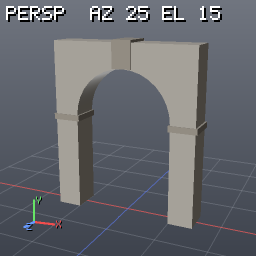

Pivot at the centre of the base (the opening is centred on x = 0, depth along Z). Pieces: arch (stone), arch_trim (stone_dark). Every piece is closed.

**Inputs**

None (generator).

**Parameters**

| name | type | default | min..max | options | aliases | description |
|---|---|---|---|---|---|---|
| `width` | float | `2` | 0.4..10 |  |  | opening width (m) |
| `height` | float | `3` | 0.5..15 |  |  | opening height at the apex (m) |
| `thickness` | float | `0.5` | 0.1..3 |  |  | masonry around the opening (m) |
| `depth` | float | `0.6` | 0.1..5 |  |  | depth along Z (m) |
| `style` | enum | `"round"` |  | `round`, `pointed`, `flat` |  | shape of the opening's top |
| `segments` | int | `16` | 4..64 |  |  | segments of the curved top |
| `keystone` | bool | `true` |  |  |  | keystone at the apex and impost blocks at the spring line |

### barrel

category: `shelf`

Wooden barrel: a bulged body of faceted staves with a recessed lid, and metal hoops.

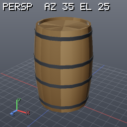

Pivot at the centre of the base, axis Y. Pieces: barrel_body (wood), barrel_hoops (metal_dark). Every piece is closed.

**Inputs**

None (generator).

**Parameters**

| name | type | default | min..max | options | aliases | description |
|---|---|---|---|---|---|---|
| `height` | float | `0.9` | 0.3..2.5 |  |  | height (m) |
| `radius` | float | `0.28` | 0.1..1.2 |  |  | radius at the ends (m) |
| `bulge` | float | `0.14` | 0..0.35 |  |  | extra radius at the middle, as a fraction of radius |
| `staves` | int | `18` | 6..48 |  |  | number of staves (facets around) |
| `hoops` | int | `4` | 0..8 |  |  | number of metal hoops |
| `seed` | int | `0` | 0..1000 |  |  | random seed of the stave tint |

### beam_truss

category: `shelf`

Planar truss in the XY plane: top and bottom chords, verticals and diagonals in Warren, Pratt or Howe layout, swept with a steel I-section or a square timber section.

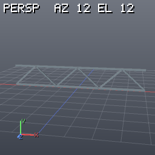

Spans x = -length/2 … length/2. Pivot at the centre of the bottom chord's underside. Pieces: truss_chords, truss_web (steel or wood_dark). Every member is closed.

**Inputs**

None (generator).

**Parameters**

| name | type | default | min..max | options | aliases | description |
|---|---|---|---|---|---|---|
| `length` | float | `8` | 1..40 |  |  | span along X (m) |
| `height` | float | `1.2` | 0.2..6 |  |  | depth of the truss, chord centre to chord centre (m) |
| `panels` | int | `6` | 2..30 |  |  | panels along the span (even counts are symmetric) |
| `member_size` | float | `0.12` | 0.03..0.6 |  |  | member section size (m) |
| `layout` | enum | `"warren"` |  | `warren`, `pratt`, `howe` |  | web layout |
| `steel` | bool | `true` |  |  |  | steel I-sections (false = square timber) |

### bench

category: `shelf`

Park bench along X: wooden seat slats and an optional reclined backrest on cast-iron side frames (two, or three on long benches).

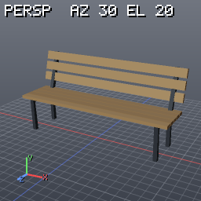

The seat faces +Z. Pivot at the centre of the base. Pieces: bench_slats (wood), bench_frames (metal_dark). Every piece is closed.

**Inputs**

None (generator).

**Parameters**

| name | type | default | min..max | options | aliases | description |
|---|---|---|---|---|---|---|
| `length` | float | `1.8` | 0.6..5 |  |  | length along X (m) |
| `seat_height` | float | `0.45` | 0.25..0.8 |  |  | seat height (m) |
| `depth` | float | `0.45` | 0.25..0.8 |  |  | seat depth along Z (m) |
| `slats` | int | `5` | 2..10 |  |  | seat slats |
| `backrest` | bool | `true` |  |  |  | add the backrest |
| `seed` | int | `0` | 0..1000 |  |  | random seed of the slat tint |

### bollard

category: `shelf`

Street bollard: a round post with a domed top or a square post with a pyramid cap, an optional reflective band and a base ring.

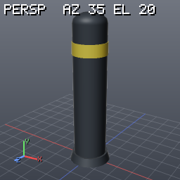

Pivot at the centre of the base. Pieces: bollard_body (metal_dark), bollard_band (reflective). Every piece is closed.

**Inputs**

None (generator).

**Parameters**

| name | type | default | min..max | options | aliases | description |
|---|---|---|---|---|---|---|
| `height` | float | `0.9` | 0.3..2 |  |  | height (m) |
| `radius` | float | `0.1` | 0.03..0.4 |  |  | post radius (half width for square) (m) |
| `style` | enum | `"round"` |  | `round`, `square` |  | post section |
| `band` | bool | `true` |  |  |  | reflective band near the top |

### brick_wall

category: `shelf`

Brick wall from x = 0 to x = length: individual bricks in running, stack, English or Flemish bond, cut to the wall ends and top, with random offset, yaw and tint, standing slightly proud of a recessed mortar core.

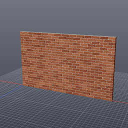

One wythe deep (headers are drawn as half bricks). Pivot at the start of the wall, on the ground, centred in thickness. Pieces: brick_wall_bricks (brick), brick_wall_mortar (mortar). Every piece is a closed box.

**Inputs**

None (generator).

**Parameters**

| name | type | default | min..max | options | aliases | description |
|---|---|---|---|---|---|---|
| `length` | float | `3` | 0.3..12 |  |  | length along X (m) |
| `height` | float | `1.8` | 0.1..5 |  |  | height (m) |
| `brick_length` | float | `0.215` | 0.1..0.5 |  |  | brick length (m); depth is half of it |
| `brick_height` | float | `0.065` | 0.03..0.3 |  |  | brick height (m) |
| `mortar` | float | `0.01` | 0.002..0.04 |  |  | joint width (m) |
| `bond` | enum | `"running"` |  | `running`, `stack`, `english`, `flemish` |  | brick pattern |
| `jitter` | float | `0.4` | 0..1 |  |  | random offset and yaw of each brick (0 = perfect) |
| `seed` | int | `0` | 0..1000 |  |  | random seed |

### bush

category: `shelf`

Low-poly bush: overlapping faceted blobs, cut flat at the ground.

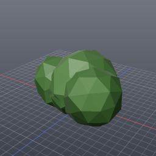

Pivot at the centre of the base. Piece: bush (foliage_dark). Open at the bottom.

**Inputs**

None (generator).

**Parameters**

| name | type | default | min..max | options | aliases | description |
|---|---|---|---|---|---|---|
| `size` | float | `1.2` | 0.2..5 |  |  | width (m) |
| `height` | float | `0.8` | 0.1..4 |  |  | approximate height (m) |
| `blobs` | int | `6` | 1..16 |  |  | number of blobs |
| `roughness` | float | `0.2` | 0..0.5 |  |  | blob displacement (fraction of the blob radius) |
| `seed` | int | `0` | 0..1000 |  |  | random seed |

### cable

category: `shelf`

Hanging cable between two points: a catenary that sags by `sag` below the straight line at mid-span, swept as a tube, with optional wooden poles (with a cross arm and insulators) standing on y = 0 under the ends.


With the default end points the pivot is the foot of the first pole. Pieces: cable (rubber), cable_poles (wood_dark), cable_insulators (ceramic). Every piece is closed.

**Inputs**

None (generator).

**Parameters**

| name | type | default | min..max | options | aliases | description |
|---|---|---|---|---|---|---|
| `start` | vec3 | `[0,5,0]` |  |  |  | first end point (m) |
| `end` | vec3 | `[10,4.6,0]` |  |  |  | second end point (m) |
| `sag` | float | `0.8` | 0..10 |  |  | drop below the straight line at mid-span (m) |
| `radius` | float | `0.015` | 0.003..0.2 |  |  | cable radius (m) |
| `segments` | int | `32` | 2..200 |  |  | segments along the cable |
| `poles` | bool | `true` |  |  |  | poles under both ends |

### cliff_block

category: `shelf`

Cliff block: a tall rock mass with ridged noise, horizontal strata ledges and banded colour, flat on the ground.

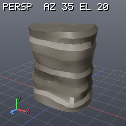

Pivot at the centre of the base. Piece: cliff (cliff_rock). Closed (watertight).

**Inputs**

None (generator).

**Parameters**

| name | type | default | min..max | options | aliases | description |
|---|---|---|---|---|---|---|
| `width` | float | `4` | 1..20 |  |  | size along X (m) |
| `height` | float | `5` | 1..30 |  |  | height (m) |
| `depth` | float | `3` | 1..20 |  |  | size along Z (m) |
| `roughness` | float | `0.5` | 0..1 |  |  | noise and ledge strength (0 = smooth block) |
| `strata` | int | `6` | 0..20 |  |  | number of strata ledges (0 = none) |
| `seed` | int | `0` | 0..1000 |  |  | noise seed |

### crate

category: `shelf`

Wooden crate: plank walls with gaps on all six sides inside a frame of edge battens.

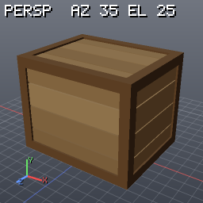

Pivot at the centre of the base. Pieces: crate_planks (wood), crate_frame (wood_dark). Every piece is a closed box.

**Inputs**

None (generator).

**Parameters**

| name | type | default | min..max | options | aliases | description |
|---|---|---|---|---|---|---|
| `width` | float | `1` | 0.3..3 |  |  | outer size along X (m) |
| `height` | float | `0.8` | 0.3..3 |  |  | outer size along Y (m) |
| `depth` | float | `0.8` | 0.3..3 |  |  | outer size along Z (m) |
| `planks` | int | `4` | 2..10 |  |  | planks per face |
| `frame_width` | float | `0.08` | 0.03..0.15 |  |  | edge batten width (m) |
| `gap` | float | `0.01` | 0..0.03 |  |  | gap between planks (m) |
| `seed` | int | `0` | 0..1000 |  |  | random seed of the plank tint |

### door_frame

category: `shelf`

Door for a wall opening: jambs and head that fill the opening (width × height), a panelled leaf hinged on the left (-X) that swings towards -Z by open_angle, and lever handles on both sides.

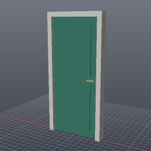

Pivot at the bottom centre of the opening, centred in depth. Pieces: door_frame (paint_white), door_leaf (door_paint), door_handle (brass). Every piece is a closed box.

**Inputs**

None (generator).

**Parameters**

| name | type | default | min..max | options | aliases | description |
|---|---|---|---|---|---|---|
| `width` | float | `1` | 0.5..3 |  |  | opening width (m) |
| `height` | float | `2.1` | 1.5..4 |  |  | opening height (m) |
| `depth` | float | `0.16` | 0.06..0.6 |  |  | frame depth along Z (m) |
| `frame_width` | float | `0.08` | 0.03..0.25 |  |  | jamb and head width (m) |
| `panels` | int | `2` | 0..5 |  |  | raised panels on each face of the leaf |
| `open_angle` | float | `0` | 0..110 |  |  | how far the leaf is open (degrees) |

### fence

category: `shelf`

Fence along a curve (input 0; without one, a straight run of `length` along +X from the origin) in three styles: picket (white pointed pickets on two rails), plank (horizontal boards) and rail (three ranch rails).


Posts at even spacing including both ends. Sits on the curve (pivot = the curve). Pieces: fence_posts, fence_infill (paint_white, wood or wood_dark by style).

**Inputs**

| # | name | optional | multi | description |
|---|---|---|---|---|
| 0 | `input0` | yes | no | curve to follow (polyline); optional |

**Parameters**

| name | type | default | min..max | options | aliases | description |
|---|---|---|---|---|---|---|
| `length` | float | `6` | 0.5..40 |  |  | run length along +X when no curve is connected (m) |
| `height` | float | `1.1` | 0.4..2.5 |  |  | fence height (m) |
| `style` | enum | `"picket"` |  | `picket`, `plank`, `rail` |  | infill style |
| `post_spacing` | float | `2` | 0.5..5 |  |  | maximum distance between posts (m) |
| `picket_spacing` | float | `0.15` | 0.08..0.5 |  |  | picket style: distance between pickets (m) |
| `seed` | int | `0` | 0..1000 |  |  | random seed of the board tint |

### forest_patch

category: `shelf`

Forest on a surface (input 0; without one, a 30 × 30 m ground patch at y = 0): trees scattered by density with a minimum spacing on faces flatter than max_slope, kept upright with random yaw and height, as packed copies of three tree_lowpoly variants (conifer, round, poplar) picked by conifer_ratio, plus optional bushes between them.

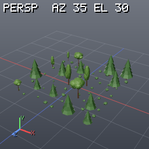

Output: packed instances (unpack for polygons); the input surface is not included. Pivot = the surface. Pieces: tree_trunk, tree_canopy, bush.

**Inputs**

| # | name | optional | multi | description |
|---|---|---|---|---|
| 0 | `input0` | yes | no | surface to plant on (polygons); optional |

**Parameters**

| name | type | default | min..max | options | aliases | description |
|---|---|---|---|---|---|---|
| `density` | float | `0.02` | 0.001..0.5 |  |  | trees per square metre before spacing |
| `min_distance` | float | `3` | 0.5..20 |  |  | minimum distance between trees (m) |
| `min_height` | float | `4` | 1..30 |  |  | smallest tree height (m) |
| `max_height` | float | `9` | 1..40 |  |  | largest tree height (m) |
| `conifer_ratio` | float | `0.5` | 0..1 |  |  | share of conifers; the rest is split between round and poplar trees |
| `max_slope` | float | `30` | 0..90 |  |  | no trees on faces steeper than this (degrees) |
| `bushes` | bool | `true` |  |  |  | scatter bushes (three times the tree density) |
| `ground_size` | float | `30` | 2..200 |  |  | size of the ground patch used when nothing is connected (m) |
| `seed` | int | `0` | 0..1000 |  |  | random seed |

### grass_clumps

category: `shelf`

Grass clumps on a surface (input 0; without one, a 4 × 4 m ground patch at y = 0): each clump is a fan of thin two-sided blades leaning outwards; clumps are scattered by density on faces flatter than max_slope and copied as packed instances of two variants with random yaw and size.

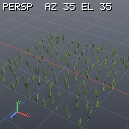

Output: packed instances (unpack for polygons); the input surface is not included. Pivot = the surface. Piece: grass (grass, double sided).

**Inputs**

| # | name | optional | multi | description |
|---|---|---|---|---|
| 0 | `input0` | yes | no | surface to grow on (polygons); optional |

**Parameters**

| name | type | default | min..max | options | aliases | description |
|---|---|---|---|---|---|---|
| `density` | float | `8` | 0.1..40 |  |  | clumps per square metre |
| `height` | float | `0.35` | 0.05..2 |  |  | blade height (m) |
| `blades` | int | `12` | 3..30 |  |  | blades per clump |
| `spread` | float | `0.5` | 0..1.5 |  |  | how far the blades lean out (fraction of the height) |
| `max_slope` | float | `45` | 0..90 |  |  | no grass on faces steeper than this (degrees) |
| `ground_size` | float | `4` | 0.5..20 |  |  | size of the ground patch used when nothing is connected (m) |
| `seed` | int | `0` | 0..1000 |  |  | random seed |

### hex_grid_floor

category: `shelf`

Hexagonal paving: flat-topped hexagonal prisms on a hex lattice filling a rectangle (tiles whose centre lies inside), with gaps and random height and tint.


Pivot at the centre of the base. Piece: hex_tiles (paving). Every tile is a closed prism.

**Inputs**

None (generator).

**Parameters**

| name | type | default | min..max | options | aliases | description |
|---|---|---|---|---|---|---|
| `size_x` | float | `5` | 0.5..40 |  |  | area size along X (m) |
| `size_z` | float | `5` | 0.5..40 |  |  | area size along Z (m) |
| `radius` | float | `0.3` | 0.05..3 |  |  | hexagon circumradius including the gap (m) |
| `gap` | float | `0.02` | 0..0.2 |  |  | gap between tiles (m) |
| `height` | float | `0.08` | 0.01..1 |  |  | tile height (m) |
| `height_jitter` | float | `0.015` | 0..0.5 |  |  | random height variation (m) |
| `seed` | int | `0` | 0..1000 |  |  | random seed |

### house

category: `shelf`

House built from a footprint polygon: one wall_segment per footprint edge (facing outward, floors stacked, a door on the first edge), topped with a roof_skeleton hip roof that follows the footprint exactly (straight skeleton: L-shapes, courtyards and any simple polygon get correct valleys and ridges).

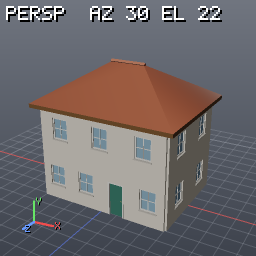

Input 0 is an optional closed polygon on the XZ ground plane; without it a width × depth rectangle is used. The walls, windows, doors and roof are the shelf generators themselves, so editing wall_segment or roof_hip changes every house. Pivot: the footprint's origin on the ground. Pieces come from the child assets (wall, window_frame, door_frame, roof).

**Inputs**

| # | name | optional | multi | description |
|---|---|---|---|---|
| 0 | `input0` | yes | no | footprint: a closed polygon on the XZ plane (optional) |

**Parameters**

| name | type | default | min..max | options | aliases | description |
|---|---|---|---|---|---|---|
| `width` | float | `8` | 3..30 |  |  | default footprint along X (m), used when no footprint is connected |
| `depth` | float | `6` | 3..30 |  |  | default footprint along Z (m) |
| `floors` | int | `2` | 1..4 |  |  | number of floors (wall segments stacked) |
| `floor_height` | float | `3` | 2.4..4.5 |  |  | height of one floor (m) |
| `window_spacing` | float | `2.5` | 1.5..6 |  |  | one window per this length of wall (m) |
| `pitch` | float | `32` | 5..65 |  |  | roof slope (degrees) |
| `overhang` | float | `0.5` | 0..2 |  |  | eave overhang (m) |
| `door` | bool | `true` |  |  |  | a door on the first footprint edge |

### lamp_post

category: `shelf`

Street lamp: a tapered pole on a flared base with 1–4 curved arms carrying shades and glowing glass (arms 0 = a lantern on top of the pole).


The first arm points along +X. Pivot at the centre of the base. Pieces: lamp_pole, lamp_arms, lamp_heads (metal_dark), lamp_glass (lamp_glass, emissive). Every piece is closed.

**Inputs**

None (generator).

**Parameters**

| name | type | default | min..max | options | aliases | description |
|---|---|---|---|---|---|---|
| `height` | float | `4.5` | 1.5..12 |  |  | height of the lamp heads (m) |
| `arm_length` | float | `1` | 0.2..4 |  |  | horizontal reach of each arm (m) |
| `arms` | int | `1` | 0..4 |  |  | number of arms (0 = lantern on top) |
| `pole_radius` | float | `0.07` | 0.03..0.3 |  |  | pole radius at the base (m) |
| `lamp_size` | float | `0.4` | 0.15..1.2 |  |  | shade diameter (m) |

### log

category: `shelf`

Felled log lying along X: a tapered trunk with ridged bark, light end grain and a few branch stubs.

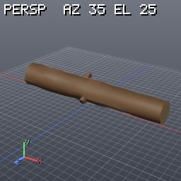

Pivot at the centre of the base (the log rests on y = 0). Pieces: log_trunk (bark, ends wood_end), log_stubs (bark). The trunk is closed.

**Inputs**

None (generator).

**Parameters**

| name | type | default | min..max | options | aliases | description |
|---|---|---|---|---|---|---|
| `length` | float | `2.4` | 0.4..8 |  |  | length along X (m) |
| `radius` | float | `0.2` | 0.05..0.8 |  |  | radius at the thick end (m) |
| `taper` | float | `0.2` | 0..0.6 |  |  | how much thinner the other end is (fraction of radius) |
| `roughness` | float | `0.12` | 0..0.3 |  |  | bark displacement as a fraction of radius |
| `stubs` | int | `3` | 0..10 |  |  | branch stubs |
| `seed` | int | `0` | 0..1000 |  |  | random seed (bark noise, stubs) |

### pallet

category: `shelf`

Block pallet (EUR style): bottom boards, a 3 × 3 grid of blocks, cross boards and a top deck.

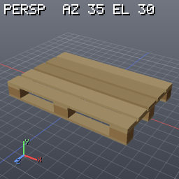

Pivot at the centre of the base; deck boards run along X. Pieces: pallet_boards (wood_light), pallet_blocks (wood). Every piece is a closed box.

**Inputs**

None (generator).

**Parameters**

| name | type | default | min..max | options | aliases | description |
|---|---|---|---|---|---|---|
| `width` | float | `1.2` | 0.6..2.4 |  |  | size along X (m), the deck board direction |
| `depth` | float | `0.8` | 0.5..2 |  |  | size along Z (m) |
| `deck_boards` | int | `5` | 3..11 |  |  | top deck boards |
| `board_thickness` | float | `0.022` | 0.015..0.05 |  |  | board thickness (m) |
| `block_height` | float | `0.078` | 0.04..0.2 |  |  | height of the blocks between the board layers (m) |
| `seed` | int | `0` | 0..1000 |  |  | random seed of the board tint |

### pillar

category: `shelf`

Classical pillar: a round, fluted or square shaft with an optional plinth base and capital.

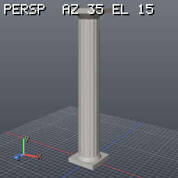

Pivot at the centre of the base. Pieces: pillar_shaft, pillar_base, pillar_capital (all stone_light). Every piece is closed.

**Inputs**

None (generator).

**Parameters**

| name | type | default | min..max | options | aliases | description |
|---|---|---|---|---|---|---|
| `height` | float | `3` | 0.5..15 |  |  | total height (m) |
| `radius` | float | `0.22` | 0.05..2 |  |  | shaft radius (half width for square) (m) |
| `style` | enum | `"fluted"` |  | `round`, `fluted`, `square` |  | shaft section |
| `flutes` | int | `16` | 6..32 |  |  | fluted style: number of flutes |
| `base` | bool | `true` |  |  |  | plinth and torus at the foot |
| `capital` | bool | `true` |  |  |  | echinus and abacus at the top |

### pipe_run

category: `shelf`

Pipe run along a polyline (input 0; without one, a default run that turns and rises): corners rounded into elbows of bend_radius, flanges at both ends and every flange_spacing metres, and floor stands under horizontal stretches.

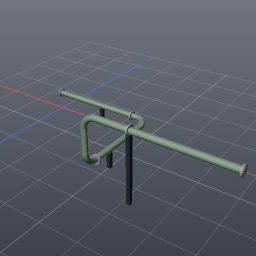

Pivot = the curve (the default run starts at the origin, 0.5 m up). Pieces: pipe (pipe_paint), pipe_flanges (steel), pipe_supports (metal_dark). Every piece is closed.

**Inputs**

| # | name | optional | multi | description |
|---|---|---|---|---|
| 0 | `input0` | yes | no | pipe centre line (polyline); optional |

**Parameters**

| name | type | default | min..max | options | aliases | description |
|---|---|---|---|---|---|---|
| `radius` | float | `0.08` | 0.01..0.6 |  |  | pipe radius (m) |
| `bend_radius` | float | `0.35` | 0..3 |  |  | elbow radius at the corners (m); 0 = mitred corners |
| `flange_spacing` | float | `2.5` | 0..20 |  |  | distance between flange joints (m); 0 = only at the ends |
| `segments` | int | `14` | 4..48 |  |  | sides of the pipe section |
| `supports` | bool | `true` |  |  |  | stands from y = 0 under horizontal stretches |
| `support_spacing` | float | `3` | 0.5..20 |  |  | distance between stands (m) |

### railing

category: `shelf`

Railing along a curve (input 0; without one, a straight run of `length` along +X from the origin): posts at even spacing including both ends, a handrail on top, lower rails and balusters.

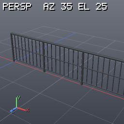

Sits on the curve (pivot = the curve). Pieces: railing_posts, railing_rails, railing_balusters (all metal_dark).

**Inputs**

| # | name | optional | multi | description |
|---|---|---|---|---|
| 0 | `input0` | yes | no | curve to follow (polyline); optional |

**Parameters**

| name | type | default | min..max | options | aliases | description |
|---|---|---|---|---|---|---|
| `length` | float | `4` | 0.5..30 |  |  | run length along +X when no curve is connected (m) |
| `height` | float | `1` | 0.4..2 |  |  | handrail height above the curve (m) |
| `post_spacing` | float | `1.5` | 0.3..6 |  |  | maximum distance between posts (m) |
| `baluster_spacing` | float | `0.15` | 0..1 |  |  | distance between balusters (m); 0 = none |
| `rails` | int | `2` | 0..6 |  |  | horizontal rails below the handrail (the lowest at 0.1 m) |
| `profile` | enum | `"round"` |  | `round`, `square` |  | tube or square section for posts and rails |

### road_strip

category: `shelf`

Road along a curve (input 0; without one, a gentle 24 m S-curve along X): an asphalt ribbon of `width` centred on the curve with solid white edge lines, dashed lane lines between `lanes` lanes, and kerbs with sidewalks on both sides.

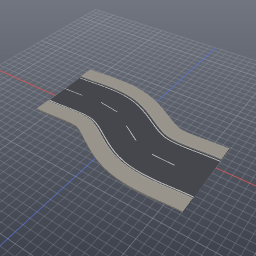

Follows the curve's height (drape the curve on a terrain first). Pivot = the curve. Pieces: road_surface (asphalt), road_markings (road_paint), road_kerbs (concrete), road_sidewalks (paving).

**Inputs**

| # | name | optional | multi | description |
|---|---|---|---|---|
| 0 | `input0` | yes | no | road centre line (polyline); optional |

**Parameters**

| name | type | default | min..max | options | aliases | description |
|---|---|---|---|---|---|---|
| `width` | float | `7` | 2..30 |  |  | asphalt width (m) |
| `lanes` | int | `2` | 1..8 |  |  | number of lanes (dashed lines between them) |
| `edge_lines` | bool | `true` |  |  |  | solid lines 0.2 m inside both edges |
| `dash_length` | float | `3` | 0.5..10 |  |  | length of the lane dashes (gaps are as long) (m) |
| `kerb_height` | float | `0.15` | 0..0.4 |  |  | kerb height above the asphalt (m); 0 = no kerbs or sidewalks |
| `sidewalk_width` | float | `2` | 0..8 |  |  | sidewalk width behind each kerb (m); 0 = none |

### rock

category: `shelf`

Low-poly rock: a noise-displaced icosphere, flattened, with faceted shading and a mottled tint.

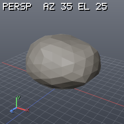

Pivot at the centre of the base (sink lowers it into the ground). Piece: rock (rock). Closed (watertight).

**Inputs**

None (generator).

**Parameters**

| name | type | default | min..max | options | aliases | description |
|---|---|---|---|---|---|---|
| `size` | float | `1` | 0.1..6 |  |  | approximate width (m) |
| `roughness` | float | `0.35` | 0..0.8 |  |  | displacement as a fraction of the size |
| `flatness` | float | `0.65` | 0.2..1 |  |  | height / width |
| `detail` | int | `2` | 1..4 |  |  | icosphere subdivision level (2 = 162 points) |
| `sink` | float | `0` | 0..0.5 |  |  | part of the height below y = 0 |
| `seed` | int | `0` | 0..1000 |  |  | shape seed |

### roof_gable

category: `shelf`

Gable roof for a width × depth footprint: two pitched slabs meeting at a ridge along X with a ridge cap, overhanging eaves and verges, and optional triangular gable walls under it.

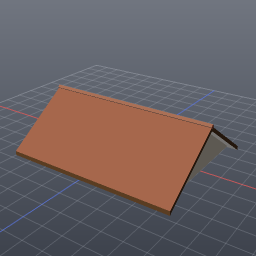

Pivot at the centre of the wall-top plane (put it on top of the walls); the eaves hang below y = 0 by overhang × tan(pitch). Pieces: roof (roof_tiles on top, wood_dark on edges and underside), roof_ridge (roof_tiles), roof_gables (plaster). Every piece is closed.

**Inputs**

None (generator).

**Parameters**

| name | type | default | min..max | options | aliases | description |
|---|---|---|---|---|---|---|
| `width` | float | `8` | 1..40 |  |  | footprint along X, the ridge direction (m) |
| `depth` | float | `6` | 1..30 |  |  | footprint along Z, the span (m) |
| `pitch` | float | `35` | 5..65 |  |  | roof slope (degrees) |
| `overhang` | float | `0.4` | 0..2 |  |  | eave and verge overhang beyond the footprint (m) |
| `thickness` | float | `0.18` | 0.03..0.6 |  |  | slab thickness (m) |
| `gable_walls` | bool | `true` |  |  |  | fill the gable triangles under the roof with wall |

### roof_hip

category: `shelf`

Hip roof for a width × depth footprint: four slopes at the same pitch meeting at a ridge along the longer side (a pyramid on a square), a fascia band and a flat soffit under overhanging eaves, and a ridge cap.


Built as one closed solid (the attic is filled); there is no straight skeleton node yet, so footprints are rectangles. Pivot at the centre of the wall-top plane; the eaves hang below y = 0 by overhang × tan(pitch). Pieces: roof (roof_tiles on the slopes, wood_dark fascia and soffit), roof_ridge (roof_tiles). Every piece is closed.

**Inputs**

None (generator).

**Parameters**

| name | type | default | min..max | options | aliases | description |
|---|---|---|---|---|---|---|
| `width` | float | `8` | 1..40 |  |  | footprint along X (m) |
| `depth` | float | `6` | 1..40 |  |  | footprint along Z (m) |
| `pitch` | float | `30` | 5..65 |  |  | roof slope (degrees) |
| `overhang` | float | `0.5` | 0..2 |  |  | eave overhang beyond the footprint (m) |
| `thickness` | float | `0.2` | 0.03..0.6 |  |  | fascia height measured square to the slope (m) |

### roof_skeleton

category: `shelf`

Straight-skeleton hip roof from an optional XZ footprint, including concave outlines and courtyard holes.

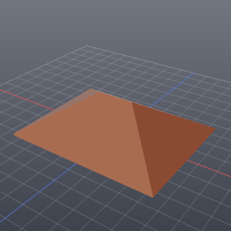

Without input it uses a width by depth rectangle. Negative offset distance adds the overhang before the roof is built; a connected extrusion gives the roof shell thickness along averaged vertex normals. Pivot is the wall-top plane. Every face carries the source contour edge as edge; the roof is one closed shell per connected footprint.

**Inputs**

| # | name | optional | multi | description |
|---|---|---|---|---|
| 0 | `input0` | yes | no | footprint: closed XZ polygons, optional |

**Parameters**

| name | type | default | min..max | options | aliases | description |
|---|---|---|---|---|---|---|
| `width` | float | `8` | 1..40 |  |  | default footprint width along X (m) |
| `depth` | float | `6` | 1..40 |  |  | default footprint depth along Z (m) |
| `pitch` | float | `32` | 5..65 |  |  | roof face slope (degrees) |
| `overhang` | float | `0.4` | 0..2 |  |  | outward footprint offset before roofing (m) |
| `thickness` | float | `0.16` | 0.03..0.6 |  |  | shell extrusion along averaged vertex normals (m) |

### sandbag_wall

category: `shelf`

Sandbag wall from x = 0 to x = length: rows of pillow-shaped bags in running bond, squashed onto each other, with random yaw, offset and tint.

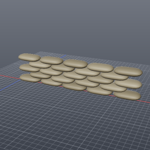

Pivot at the start of the wall, on the ground, centred in depth. Piece: sandbags (burlap). Every bag is closed.

**Inputs**

None (generator).

**Parameters**

| name | type | default | min..max | options | aliases | description |
|---|---|---|---|---|---|---|
| `length` | float | `3` | 0.6..15 |  |  | length along X (m) |
| `rows` | int | `5` | 1..10 |  |  | number of rows |
| `bag_length` | float | `0.6` | 0.3..1.2 |  |  | bag length (m) |
| `bag_height` | float | `0.16` | 0.06..0.4 |  |  | bag height (m) |
| `jitter` | float | `0.5` | 0..1 |  |  | random yaw and offset (0 = neat) |
| `seed` | int | `0` | 0..1000 |  |  | random seed |

### scaffold

category: `shelf`

Tube-and-fitting scaffold: standards (verticals) on base plates, ledgers along X and transoms along Z at every lift, zig-zag face braces on the front (+Z), board decks on the lifts and guard rails at the top.

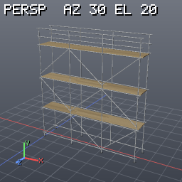

Runs along +X from x = 0. Pivot at the start, on the ground, centred in depth. Pieces: scaffold_tubes (galvanized), scaffold_boards (wood_light), scaffold_plates (metal_dark). Every piece is closed.

**Inputs**

None (generator).

**Parameters**

| name | type | default | min..max | options | aliases | description |
|---|---|---|---|---|---|---|
| `bays` | int | `3` | 1..12 |  |  | bays along X |
| `lifts` | int | `3` | 1..10 |  |  | lifts (levels) |
| `bay_width` | float | `2.1` | 0.8..3.5 |  |  | bay width along X (m) |
| `lift_height` | float | `2` | 1.2..3 |  |  | height of one lift (m) |
| `depth` | float | `1.2` | 0.6..2.5 |  |  | distance between the front and back standards (m) |
| `boards` | bool | `true` |  |  |  | board decks on every lift |
| `braces` | bool | `true` |  |  |  | diagonal braces on the front face |

### scatter_rocks

category: `shelf`

Rocks scattered on a surface (input 0; without one, an 8 × 8 m ground patch at y = 0): the slope mask keeps faces flatter than max_slope, scatter by density with a minimum spacing, rocks aligned to the surface with random yaw, tilt and scale, overlaps pruned, then packed copies of three rock variants (the shelf rock asset) sunk slightly into the ground.

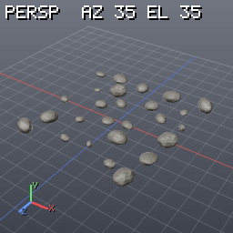

Output: packed instances (unpack for polygons); the input surface is not included. Pivot = the surface. Piece: rock (rock).

**Inputs**

| # | name | optional | multi | description |
|---|---|---|---|---|
| 0 | `input0` | yes | no | surface to scatter on (polygons); optional |

**Parameters**

| name | type | default | min..max | options | aliases | description |
|---|---|---|---|---|---|---|
| `density` | float | `0.4` | 0.01..5 |  |  | rocks per square metre before pruning |
| `min_scale` | float | `0.35` | 0.05..5 |  |  | smallest rock width (m) |
| `max_scale` | float | `1.1` | 0.05..8 |  |  | largest rock width (m) |
| `max_slope` | float | `40` | 0..90 |  |  | no rocks on faces steeper than this (degrees) |
| `ground_size` | float | `8` | 1..60 |  |  | size of the ground patch used when nothing is connected (m) |
| `seed` | int | `0` | 0..1000 |  |  | random seed |

### sign_post

category: `shelf`

Street name sign: a post with a ball cap and a green blade (two crossed blades for a corner) carrying raised white lettering on both faces, scaled to fit.

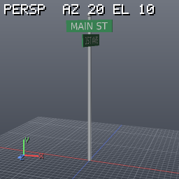

The first blade faces ±Z. Pivot at the centre of the base. Pieces: sign_post (galvanized), sign_panel (sign_green), sign_text (sign_white). Every piece is closed.

**Inputs**

None (generator).

**Parameters**

| name | type | default | min..max | options | aliases | description |
|---|---|---|---|---|---|---|
| `height` | float | `2.8` | 1..6 |  |  | post height (m) |
| `panel_width` | float | `0.9` | 0.3..3 |  |  | blade width (m) |
| `panel_height` | float | `0.22` | 0.08..1 |  |  | blade height (m) |
| `text` | string | `"MAIN ST"` |  |  |  | lettering on the first blade |
| `cross_text` | string | `"1ST AVE"` |  |  |  | lettering on the second blade (empty = one blade) |

### spiral_stairs

category: `shelf`

Spiral staircase: wedge treads turning counter-clockwise (seen from above) around a central column, with an optional helical handrail on posts.

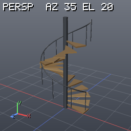

Pivot at the foot of the column. Pieces: spiral_treads (wood), spiral_column (metal_dark), spiral_railing (metal_dark). Every piece is closed.

**Inputs**

None (generator).

**Parameters**

| name | type | default | min..max | options | aliases | description |
|---|---|---|---|---|---|---|
| `steps` | int | `16` | 2..60 |  |  | number of treads |
| `rise` | float | `0.2` | 0.1..0.3 |  |  | height of one step (m) |
| `turn` | float | `22.5` | 10..45 |  |  | rotation per step (degrees) |
| `radius` | float | `1.1` | 0.5..4 |  |  | outer radius (m) |
| `column_radius` | float | `0.1` | 0.03..0.5 |  |  | column radius (m) |
| `railing` | bool | `true` |  |  |  | handrail along the outer edge |

### stairs

category: `shelf`

Straight stairs climbing along +Z: a solid concrete flight (one watertight sawtooth solid) or open wooden treads between two stringers, with optional handrails on both sides.

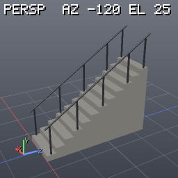

Pivot at the bottom of the first step, centred in width. Pieces: stairs_flight (concrete) or stairs_treads (wood) + stairs_stringers (wood_dark), stairs_railing (metal_dark).

**Inputs**

None (generator).

**Parameters**

| name | type | default | min..max | options | aliases | description |
|---|---|---|---|---|---|---|
| `steps` | int | `12` | 1..40 |  |  | number of steps |
| `rise` | float | `0.18` | 0.08..0.3 |  |  | height of one step (m) |
| `run` | float | `0.28` | 0.15..0.5 |  |  | depth of one step (m) |
| `width` | float | `1.2` | 0.5..5 |  |  | width along X (m) |
| `style` | enum | `"solid"` |  | `solid`, `open` |  | solid concrete flight or open treads on stringers |
| `railing` | bool | `true` |  |  |  | handrails with posts on both sides |

### tile_floor

category: `shelf`

Tiled floor: square tiles in a grid, offset (half-tile) or checker pattern with grout gaps, random height and tint, cut to the floor edges, on a grout bed.

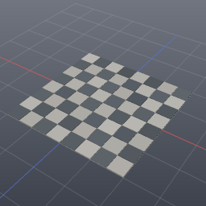

Pivot at the centre of the base; the tile tops are at the bed thickness + tile thickness. Pieces: tile_floor_tiles (tile_light; tile_dark for the checker's dark squares), tile_floor_grout (grout). Every piece is a closed box.

**Inputs**

None (generator).

**Parameters**

| name | type | default | min..max | options | aliases | description |
|---|---|---|---|---|---|---|
| `size_x` | float | `4` | 0.2..30 |  |  | floor size along X (m) |
| `size_z` | float | `4` | 0.2..30 |  |  | floor size along Z (m) |
| `tile_size` | float | `0.5` | 0.1..2 |  |  | tile edge length including the gap (m) |
| `gap` | float | `0.012` | 0..0.08 |  |  | grout gap (m) |
| `thickness` | float | `0.02` | 0.005..0.1 |  |  | tile thickness (m) |
| `pattern` | enum | `"checker"` |  | `grid`, `offset`, `checker` |  | tile layout |
| `height_jitter` | float | `0.002` | 0..0.02 |  |  | random tile height variation (m) |
| `seed` | int | `0` | 0..1000 |  |  | random seed |

### tree_lowpoly

category: `shelf`

Low-poly tree in three styles: round (a cluster of faceted blobs), conifer (stacked cones) and poplar (a tall narrow crown).

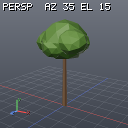

Pivot at the base of the trunk. Pieces: tree_trunk (bark), tree_canopy (foliage, or foliage_dark for conifers). Every piece is closed.

**Inputs**

None (generator).

**Parameters**

| name | type | default | min..max | options | aliases | description |
|---|---|---|---|---|---|---|
| `height` | float | `6` | 1.5..25 |  |  | total height (m) |
| `trunk_radius` | float | `0.18` | 0.04..1 |  |  | trunk radius at the base (m) |
| `canopy_radius` | float | `1.8` | 0.4..8 |  |  | crown radius (m) |
| `style` | enum | `"round"` |  | `round`, `conifer`, `poplar` |  | crown shape |
| `seed` | int | `0` | 0..1000 |  |  | random seed (blob placement, rotation, tint) |

### wall_segment

category: `shelf`

Straight wall from x = 0 to x = length with window (and an optional door) openings cut by a boolean, filled with the window_frame and door_frame shelf assets.

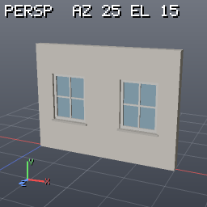

The openings are spread in equal bays; the door takes the middle bay. Modular: segments placed end to end line up. Pivot at the start of the wall, on the ground, centred in thickness (+Z = outside). Pieces: wall (plaster) plus the frames' pieces. Every piece is closed (the wall is one watertight solid).

**Inputs**

None (generator).

**Parameters**

| name | type | default | min..max | options | aliases | description |
|---|---|---|---|---|---|---|
| `length` | float | `4` | 0.5..20 |  |  | length along X (m) |
| `height` | float | `3` | 1..10 |  |  | height (m) |
| `thickness` | float | `0.25` | 0.05..1 |  |  | thickness along Z (m) |
| `windows` | int | `2` | 0..10 |  |  | number of window openings |
| `window_width` | float | `1` | 0.3..4 |  |  | window opening width (m), clamped to fit the bay |
| `window_height` | float | `1.3` | 0.3..4 |  |  | window opening height (m), clamped to fit under the top |
| `sill_height` | float | `0.9` | 0..3 |  |  | height of the window openings above the ground (m) |
| `door` | bool | `false` |  |  |  | add a 1.0 × 2.1 m door in the middle bay |
| `frames` | bool | `true` |  |  |  | fill the openings with window_frame / door_frame |

### window_frame

category: `shelf`

Window for a wall opening: a frame that fills the opening (width × height), mullions, a glass pane and a stone sill that sticks out at the front (+Z).

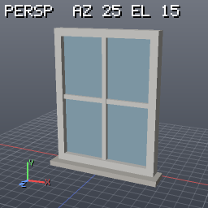

Pivot at the bottom centre of the opening, centred in depth. Pieces: window_frame (paint_white), window_glass (glass), window_sill (stone). Every piece is a closed box.

**Inputs**

None (generator).

**Parameters**

| name | type | default | min..max | options | aliases | description |
|---|---|---|---|---|---|---|
| `width` | float | `1` | 0.3..4 |  |  | opening width (m) |
| `height` | float | `1.3` | 0.3..4 |  |  | opening height (m) |
| `depth` | float | `0.12` | 0.04..0.5 |  |  | frame depth along Z (m) |
| `frame_width` | float | `0.07` | 0.02..0.25 |  |  | frame member width (m) |
| `mullions_x` | int | `1` | 0..6 |  |  | vertical glazing bars |
| `mullions_y` | int | `1` | 0..6 |  |  | horizontal glazing bars |
| `sill` | bool | `true` |  |  |  | add a sill below the opening |
| `sill_depth` | float | `0.08` | 0..0.5 |  |  | how far the sill reaches in front of the frame (m) |

## sim nodes

### drape

category: `sim` · aliases: `cloth`, `vellum_cloth`, `vellum`, `cloth_sim`

Cloth simulation (XPBD, Vellum-lite): drape a mesh over colliders and the floor, hang it from pins, blow it in the wind.

Simulates the `cloth` input for `steps` steps and outputs the final state (same points, prims and attributes; P moved, v, rest_P, N, pinned). Constraints in compliance form, so stiffnesses are physical and independent of the step size: stretch on the polygon edges (rows and columns solved as whole chains, so hanging cloth does not sag), shear on the quad diagonals, bending across edges (isometric where flat at rest, dihedral towards the rest angle of the input elsewhere), tethers to the nearest pin. Collides with the `collider` input (a static mesh; points stay `thickness` away; closed pieces push out points that get inside) and the floor plane, with friction; sharp collider corners get extra corner contacts, but a sharp collider edge can still pass between the points of a coarse cloth (use a finer cloth there). Pins: `pin_group`, a `pin` point attribute, or the nearest cloth points to the `pins` input. Typical graphs: grid above a box → drape(grid, box); grid with a pinned top edge + wind → a banner. Deterministic (bit-identical with and without the worker pool). Houdini: Vellum Cloth + Vellum Solver, run to a settled frame.

**Inputs**

| # | name | optional | multi | description |
|---|---|---|---|---|
| 0 | `cloth` | no | no | the cloth: any polygon mesh (quads are triangulated internally for the constraints; the output keeps the topology), polylines become strings |
| 1 | `collider` | yes | no | static collision geometry (its polygons; closed pieces push out points that end up inside) |
| 2 | `pins` | yes | no | pin points: the nearest cloth point to each is pinned (see pin_snap) |

**Parameters**

| name | type | default | min..max | options | aliases | description |
|---|---|---|---|---|---|---|
| `steps` | int | `100` | 0..100000 |  | `frames` | simulation steps of 1/fps s each; the output is the state after the last one (settle time = steps / fps) |
| `substeps` | int | `4` | 1..100 |  | `sub_steps` | substeps per step: more = stiffer cloth and fewer missed contacts (cost grows linearly) |
| `iterations` | int | `1` | 1..100 |  | `constraint_iterations` | constraint sweeps per substep (stretch chains solved exactly, the rest Gauss-Seidel); substeps help more than iterations |
| `fps` | float | `24` | 1.. |  |  | steps per simulated second (step length 1/fps s) *(advanced)* |
| `gravity` | vec3 | `[0,-9.81,0]` |  |  |  | gravity acceleration in m/s² |
| `stretch_stiffness` | float | `100000` | 0.. |  | `stretch`, `stiffness` | stretch stiffness of the polygon edges in N/m (≈ the sheet's 2D Young's modulus); 1e4+ is practically inextensible, 100 is rubbery; 0 = no stretch constraints |
| `shear_stiffness` | float | `1000` | 0.. |  | `shear` | shear stiffness of the quad diagonals (and inner polygon edges) in N/m; low = fabric that drapes on the bias; 0 = none |
| `bend_stiffness` | float | `0.001` | 0.. |  | `bend`, `bending` | bending rigidity in N·m (resolution independent): 1e-5 silk, 1e-4 cotton, 1e-3 canvas, 1e-2 tarp/leather; 0 = no bend constraints |
| `density` | float | `0.2` | 0.. |  |  | surface density in kg/m² for the point masses (a point float `mass` attribute overrides it); only matters relative to the stiffnesses and the wind *(advanced)* |
| `damping` | float | `0.2` | 0.. |  | `velocity_damping` | velocity damping rate in 1/s (velocities shrink by e^(-damping·t)); higher settles sooner |
| `drag` | float | `0.5` | 0.. |  | `air_drag` | air drag ½·ρ·Cd in kg/m³ on each triangle against the wind (normal component, quadratic); 0 = vacuum |
| `wind` | vec3 | `[0,0,0]` |  |  |  | wind velocity in m/s (acts through drag) |
| `thickness` | float | `0.02` | 0.. |  | `collision_thickness`, `pscale` | collision offset in m: points stay this far from colliders and the floor (and 2× apart with self_collision, which works best with about half the edge length) |
| `friction` | float | `0.4` | 0.. |  |  | Coulomb friction coefficient against colliders and the floor (0 = slippery) |
| `floor` | bool | `true` |  |  | `ground`, `ground_plane` | collide with the ground plane y = floor_height |
| `floor_height` | float | `0` |  |  | `ground_height` | height of the ground plane |
| `self_collision` | bool | `false` |  |  | `selfcollision` | point-point self collision (spatial hash, pairs found per step); effective when thickness is about half the edge length |
| `rest_scale` | float | `1` | 0.01.. |  | `restlength_scale` | multiplies the stretch and shear rest lengths: < 1 tightens the cloth (a taut tarp, a cushion that pulls in its seams), > 1 slackens it |
| `seed` | int | `0` |  |  |  | seed of a tiny deterministic jitter of the start positions (10⁻³ of the edge length) that breaks perfect symmetry |
| `pin_group` | group (point) | `""` |  |  |  | points pinned in place ("" = none); a point attribute `pin` != 0 and the nearest cloth point to each point of the `pins` input are pinned too |
| `pin_snap` | bool | `false` |  |  |  | move the cloth points pinned by the `pins` input onto those pin points first (hang a cloth from hooks) |
| `tethers` | bool | `true` |  |  |  | long-range attachments: no point gets farther from its nearest pin than along the cloth at rest, so pinned cloth does not stretch under its weight or the wind *(advanced)* |
| `keep_rest` | bool | `true` |  |  |  | write the input positions to the point attribute rest_P |
| `max_points` | int | `100000` | 1.. |  |  | refuse inputs with more points than this (cost grows with points × steps × substeps × iterations) *(advanced)* |

**Writes:** point v, rest_P (keep_rest), N, pinned (int, when anything is pinned)

**Example**

```json
{
  "nodes": {
    "cloth": {
      "type": "grid",
      "params": {
        "size": [
          2,
          2
        ],
        "divisions": [
          24,
          24
        ],
        "center": [
          0,
          1.3,
          0
        ]
      }
    },
    "table": {
      "type": "box",
      "params": {
        "size": [
          1,
          1,
          1
        ],
        "center": [
          0,
          0.5,
          0
        ]
      }
    },
    "out": {
      "type": "drape",
      "in": [
        "cloth",
        "table"
      ],
      "params": {
        "steps": 48,
        "thickness": 0.03
      }
    }
  },
  "output": "out"
}
```

### inflate

category: `sim` · aliases: `vellum_pressure`, `pressure`, `balloon`

Inflate a closed mesh with an XPBD volume constraint (Vellum pressure): cushions, balloons, bulging sacks.

Simulates the `geo` input as a closed cloth bag whose volume is driven towards `pressure` × its rest volume, against the same stretch, shear and bend constraints as drape (and the same collider, floor, pins and wind). pressure 1 keeps the volume, 1.5 puffs a box into a cushion, < 1 deflates it; pressure_stiffness sets how hard the volume pushes against the cloth (a stiff cloth caps the volume). Gravity and the floor are off by default (the shape inflates in place); turn them on to rest a cushion on the ground. Houdini: Vellum Pressure constraint.

**Inputs**

| # | name | optional | multi | description |
|---|---|---|---|---|
| 0 | `geo` | no | no | a closed polygon mesh (box, sphere, a sewn sack) |
| 1 | `collider` | yes | no | static collision geometry (its polygons; closed pieces push out points that end up inside) |
| 2 | `pins` | yes | no | pin points: the nearest cloth point to each is pinned (see pin_snap) |

**Parameters**

| name | type | default | min..max | options | aliases | description |
|---|---|---|---|---|---|---|
| `pressure` | float | `1.5` | 0.. |  | `volume_scale` | target volume / rest volume (1 = keep, 1.5 = cushion, 3 = balloon if the cloth can stretch) |
| `pressure_stiffness` | float | `10000` | 0.. |  |  | stiffness of the volume constraint in N/m (compared with stretch_stiffness: equal values split the difference); 0 = no pressure |
| `steps` | int | `60` | 0..100000 |  | `frames` | simulation steps of 1/fps s each; the output is the state after the last one (settle time = steps / fps) |
| `substeps` | int | `4` | 1..100 |  | `sub_steps` | substeps per step: more = stiffer cloth and fewer missed contacts (cost grows linearly) |
| `iterations` | int | `1` | 1..100 |  | `constraint_iterations` | constraint sweeps per substep (stretch chains solved exactly, the rest Gauss-Seidel); substeps help more than iterations |
| `fps` | float | `24` | 1.. |  |  | steps per simulated second (step length 1/fps s) *(advanced)* |
| `gravity` | vec3 | `[0,0,0]` |  |  |  | gravity acceleration in m/s² |
| `stretch_stiffness` | float | `10000` | 0.. |  | `stretch`, `stiffness` | stretch stiffness of the polygon edges in N/m (≈ the sheet's 2D Young's modulus); 1e4+ is practically inextensible, 100 is rubbery; 0 = no stretch constraints |
| `shear_stiffness` | float | `1000` | 0.. |  | `shear` | shear stiffness of the quad diagonals (and inner polygon edges) in N/m; low = fabric that drapes on the bias; 0 = none |
| `bend_stiffness` | float | `0.001` | 0.. |  | `bend`, `bending` | bending rigidity in N·m (resolution independent): 1e-5 silk, 1e-4 cotton, 1e-3 canvas, 1e-2 tarp/leather; 0 = no bend constraints |
| `density` | float | `0.2` | 0.. |  |  | surface density in kg/m² for the point masses (a point float `mass` attribute overrides it); only matters relative to the stiffnesses and the wind *(advanced)* |
| `damping` | float | `1` | 0.. |  | `velocity_damping` | velocity damping rate in 1/s (velocities shrink by e^(-damping·t)); higher settles sooner |
| `drag` | float | `0` | 0.. |  | `air_drag` | air drag ½·ρ·Cd in kg/m³ on each triangle against the wind (normal component, quadratic); 0 = vacuum |
| `wind` | vec3 | `[0,0,0]` |  |  |  | wind velocity in m/s (acts through drag) |
| `thickness` | float | `0.02` | 0.. |  | `collision_thickness`, `pscale` | collision offset in m: points stay this far from colliders and the floor (and 2× apart with self_collision, which works best with about half the edge length) |
| `friction` | float | `0.4` | 0.. |  |  | Coulomb friction coefficient against colliders and the floor (0 = slippery) |
| `floor` | bool | `false` |  |  | `ground`, `ground_plane` | collide with the ground plane y = floor_height |
| `floor_height` | float | `0` |  |  | `ground_height` | height of the ground plane |
| `self_collision` | bool | `false` |  |  | `selfcollision` | point-point self collision (spatial hash, pairs found per step); effective when thickness is about half the edge length |
| `rest_scale` | float | `1` | 0.01.. |  | `restlength_scale` | multiplies the stretch and shear rest lengths: < 1 tightens the cloth (a taut tarp, a cushion that pulls in its seams), > 1 slackens it |
| `seed` | int | `0` |  |  |  | seed of a tiny deterministic jitter of the start positions (10⁻³ of the edge length) that breaks perfect symmetry |
| `pin_group` | group (point) | `""` |  |  |  | points pinned in place ("" = none); a point attribute `pin` != 0 and the nearest cloth point to each point of the `pins` input are pinned too |
| `pin_snap` | bool | `false` |  |  |  | move the cloth points pinned by the `pins` input onto those pin points first (hang a cloth from hooks) |
| `tethers` | bool | `false` |  |  |  | long-range attachments: no point gets farther from its nearest pin than along the cloth at rest, so pinned cloth does not stretch under its weight or the wind *(advanced)* |
| `keep_rest` | bool | `true` |  |  |  | write the input positions to the point attribute rest_P |
| `max_points` | int | `100000` | 1.. |  |  | refuse inputs with more points than this (cost grows with points × steps × substeps × iterations) *(advanced)* |

**Writes:** point v, rest_P (keep_rest), N, pinned (int, when anything is pinned)

**Example**

```json
{
  "nodes": {
    "bag": {
      "type": "box",
      "params": {
        "size": [
          1,
          0.3,
          1
        ],
        "divisions": [
          8,
          3,
          8
        ]
      }
    },
    "out": {
      "type": "inflate",
      "in": [
        "bag"
      ],
      "params": {
        "pressure": 1.6,
        "steps": 30
      }
    }
  },
  "output": "out"
}
```

## texture nodes

### bake_ao

category: `texture` · aliases: `ao_bake`, `bake_ambient_occlusion`, `bake_occlusion`

Bake ambient occlusion into uv space: white = open sky, dark in gaps, corners and contact areas.

Substance Painter / Marmoset "Ambient Occlusion". Input 0 needs non-overlapping uv in 0..1 (uv_unwrap); layer "mask" holds the coverage. Each texel casts `samples` cosine-weighted rays over the hemisphere of its normal against the mesh (or the high-res input, sampled at the projected point); C = 1 - the fraction that hit within max_distance. Combine with bake_curvature for edge wear and dirt masks; pack into ORM with tex_channel.

**Inputs**

| # | name | optional | multi | description |
|---|---|---|---|---|
| 0 | `geo` | no | no | mesh to bake (needs uv without overlaps: uv_unwrap or uv_layout) |
| 1 | `high` | yes | no | optional high-res source, near the mesh (within cage) |

**Parameters**

| name | type | default | min..max | options | aliases | description |
|---|---|---|---|---|---|---|
| `resolution` | ivec2 | `[1024,1024]` | 1..8192 |  | `res`, `output_size`, `dimensions`, `image_size` | image size in pixels [width, height] (one number = square; at most 16,777,216 pixels); powers of two suit GPUs |
| `supersample` | int | `1` | 1..4 |  | `ssaa`, `antialiasing`, `subsampling` | samples per texel along each axis (2 = 4 samples averaged: smoother edges, 4× the work) |
| `padding` | int | `4` | 0..256 |  | `dilation`, `margin`, `edge_padding` | dilate islands by this many texels (no background bleeding in mipmaps) |
| `uv_attrib` | string | `"uv"` |  |  | `uv_name`, `uvattrib` | vertex or point uv attribute to bake into |
| `group` | group (prim) | `""` |  |  |  | prims to bake ("" = all); the others leave their texels empty |
| `keep_mesh` | bool | `false` |  |  | `keep_input`, `keep` | output the input mesh with the image added (off: only the image) |
| `name` | string | `"ao"` |  |  | `image_name`, `output_name` | image name (materials reference it as "image:<name>") |
| `samples` | int | `16` | 1..1024 |  | `rays`, `secondary_rays` | rays per sample (stratified; more = smoother, linear cost) |
| `bias` | float | `0` | 0.. |  |  | ray start offset along the normal against self-hits (0 = auto: 1e-4 of the bbox diagonal) |
| `seed` | float | `0` |  |  |  | random seed |
| `invert` | bool | `false` |  |  |  | write 1 - value |
| `cage` | float | `0` | 0.. |  | `cage_distance`, `max_frontal_distance`, `ray_distance` | high-res input: search distance along the cage normals on each side (metres; 0 = auto: 2% of the bbox diagonal) |
| `cage_normals` | enum | `"averaged"` |  | `averaged`, `mesh` | `ray_normals`, `average_normals` | high-res input: ray directions: averaged normals over every face at a position (no gaps at hard edges) or the mesh's own normals |
| `max_distance` | float | `0` | 0.. |  | `max_occluder_distance`, `distance`, `radius` | hits farther than this do not occlude (metres; 0 = unlimited) |
| `cone_angle` | float | `0` | 0..90 |  | `spread`, `angle` | half-angle of the ray cone in degrees (0 = auto: 90, the hemisphere) |

**Writes:** image <name> (default "ao"): C grey 0..1 (1 = open), mask

**Example**

```json
{
  "nodes": {
    "crate": {
      "type": "crate"
    },
    "uv": {
      "type": "uv_unwrap",
      "in": [
        "crate"
      ]
    },
    "ao": {
      "type": "bake_ao",
      "in": [
        "uv"
      ],
      "params": {
        "resolution": 512,
        "samples": 24
      }
    }
  },
  "output": "ao"
}
```

### bake_curvature

category: `texture` · aliases: `curvature_bake`, `bake_edges`, `edge_wear_bake`

Bake edge curvature into uv space: 0.5 flat, brighter on convex edges and bevels, darker in concave creases (edge wear and dirt masks).

Substance Painter "Curvature". Input 0 needs non-overlapping uv in 0..1 (uv_unwrap); layer "mask" holds the coverage. Measured from the mesh's dihedral angles in 3D (uv seams do not show): every edge carries its signed bend (angle / 90°, + convex), and a texel sums the bends of the edge length within `radius`, weighted (1 - d²/r²)² and normalised so a 90° edge through the texel reads 1. C = 0.5 + 0.5 × strength × value; layers "convex" and "concave" hold the two sides 0..1. Edges whose faces both turn away from a texel (the far side of a thin plank) are ignored; points are matched by position, so unwelded boxes work. tex_histogram_scan or tex_levels on "convex" make an edge-wear mask.

**Inputs**

| # | name | optional | multi | description |
|---|---|---|---|---|
| 0 | `geo` | no | no | mesh to bake (needs uv without overlaps: uv_unwrap or uv_layout) |
| 1 | `high` | yes | no | optional high-res source, near the mesh (within cage) |

**Parameters**

| name | type | default | min..max | options | aliases | description |
|---|---|---|---|---|---|---|
| `resolution` | ivec2 | `[1024,1024]` | 1..8192 |  | `res`, `output_size`, `dimensions`, `image_size` | image size in pixels [width, height] (one number = square; at most 16,777,216 pixels); powers of two suit GPUs |
| `supersample` | int | `1` | 1..4 |  | `ssaa`, `antialiasing`, `subsampling` | samples per texel along each axis (2 = 4 samples averaged: smoother edges, 4× the work) |
| `padding` | int | `4` | 0..256 |  | `dilation`, `margin`, `edge_padding` | dilate islands by this many texels (no background bleeding in mipmaps) |
| `uv_attrib` | string | `"uv"` |  |  | `uv_name`, `uvattrib` | vertex or point uv attribute to bake into |
| `group` | group (prim) | `""` |  |  |  | prims to bake ("" = all); the others leave their texels empty |
| `keep_mesh` | bool | `false` |  |  | `keep_input`, `keep` | output the input mesh with the image added (off: only the image) |
| `name` | string | `"curvature"` |  |  | `image_name`, `output_name` | image name (materials reference it as "image:<name>") |
| `radius` | float | `0` | 0.. |  | `width`, `edge_width`, `distance` | how far an edge reaches across the surface (metres; 0 = auto: 1% of the bbox diagonal) |
| `strength` | float | `1` | 0.. |  | `intensity`, `contrast` | contrast multiplier |
| `min_angle` | float | `0.5` | 0..179 |  |  | edges bending less than this (degrees) are ignored |
| `cage` | float | `0` | 0.. |  | `cage_distance`, `max_frontal_distance`, `ray_distance` | high-res input: search distance along the cage normals on each side (metres; 0 = auto: 2% of the bbox diagonal) |
| `cage_normals` | enum | `"averaged"` |  | `averaged`, `mesh` | `ray_normals`, `average_normals` | high-res input: ray directions: averaged normals over every face at a position (no gaps at hard edges) or the mesh's own normals |

**Writes:** image <name> (default "curvature"): C grey (0.5 = flat), convex, concave, mask

**Example**

```json
{
  "nodes": {
    "box": {
      "type": "box"
    },
    "bevel": {
      "type": "poly_bevel",
      "in": [
        "box"
      ],
      "params": {
        "offset": 0.06,
        "divisions": 3
      }
    },
    "uv": {
      "type": "uv_unwrap",
      "in": [
        "bevel"
      ]
    },
    "curv": {
      "type": "bake_curvature",
      "in": [
        "uv"
      ],
      "params": {
        "resolution": 512
      }
    }
  },
  "output": "curv"
}
```

### bake_height

category: `texture` · aliases: `height_bake`, `bake_displacement`, `displacement_bake`

Bake the height of a high-res mesh (input 1) above the low mesh along its normals: a displacement / height map.

Substance Painter "Height". Input 0 needs non-overlapping uv in 0..1 (uv_unwrap); layer "mask" holds the coverage. Rays along the low normals within ±cage find the high surface; layer "distance" holds the signed distance in metres (0 on a miss) and C maps it to 0..1: mode cage = 0.5 + d / (2 cage) (0.5 = on the low surface), normalize = the min..max of the hits (stats height_min / height_max). Feed tex_normal_from_height or use it as displacement.

**Inputs**

| # | name | optional | multi | description |
|---|---|---|---|---|
| 0 | `geo` | no | no | mesh to bake (needs uv without overlaps: uv_unwrap or uv_layout) |
| 1 | `high` | yes | no | optional high-res source, near the mesh (within cage) |

**Parameters**

| name | type | default | min..max | options | aliases | description |
|---|---|---|---|---|---|---|
| `resolution` | ivec2 | `[1024,1024]` | 1..8192 |  | `res`, `output_size`, `dimensions`, `image_size` | image size in pixels [width, height] (one number = square; at most 16,777,216 pixels); powers of two suit GPUs |
| `supersample` | int | `1` | 1..4 |  | `ssaa`, `antialiasing`, `subsampling` | samples per texel along each axis (2 = 4 samples averaged: smoother edges, 4× the work) |
| `padding` | int | `4` | 0..256 |  | `dilation`, `margin`, `edge_padding` | dilate islands by this many texels (no background bleeding in mipmaps) |
| `uv_attrib` | string | `"uv"` |  |  | `uv_name`, `uvattrib` | vertex or point uv attribute to bake into |
| `group` | group (prim) | `""` |  |  |  | prims to bake ("" = all); the others leave their texels empty |
| `keep_mesh` | bool | `false` |  |  | `keep_input`, `keep` | output the input mesh with the image added (off: only the image) |
| `name` | string | `"height"` |  |  | `image_name`, `output_name` | image name (materials reference it as "image:<name>") |
| `cage` | float | `0` | 0.. |  | `cage_distance`, `max_frontal_distance`, `ray_distance` | high-res input: search distance along the cage normals on each side (metres; 0 = auto: 2% of the bbox diagonal) |
| `cage_normals` | enum | `"averaged"` |  | `averaged`, `mesh` | `ray_normals`, `average_normals` | high-res input: ray directions: averaged normals over every face at a position (no gaps at hard edges) or the mesh's own normals |
| `mode` | enum | `"cage"` |  | `cage`, `normalize` | `range` | how distances map to 0..1 |

**Writes:** image <name> (default "height"): C grey 0..1, distance (metres), mask

**Example**

```json
{
  "nodes": {
    "low": {
      "type": "box",
      "params": {
        "divisions": [
          2,
          2,
          2
        ]
      }
    },
    "uv": {
      "type": "uv_unwrap",
      "in": [
        "low"
      ]
    },
    "smooth": {
      "type": "subdivide",
      "in": [
        "low"
      ],
      "params": {
        "levels": 3
      }
    },
    "high": {
      "type": "noise_displace",
      "in": [
        "smooth"
      ],
      "params": {
        "amplitude": 0.05,
        "frequency": 6
      }
    },
    "height": {
      "type": "bake_height",
      "in": [
        "uv",
        "high"
      ],
      "params": {
        "resolution": 256,
        "cage": 0.4
      }
    }
  },
  "output": "height"
}
```

### bake_island_id

category: `texture` · aliases: `island_id_bake`, `bake_id`, `id_bake`, `bake_uv_islands`

Bake uv islands as random flat colours (an ID map for masking per island), with the island number in layer "id".

Substance Painter "ID" (by uv island). Input 0 needs non-overlapping uv in 0..1 (uv_unwrap); layer "mask" holds the coverage. Islands are triangles connected through corners that share a point and a uv. C is a random colour per island (seed), layer "id" the island number 0..n-1 (the stat islands counts them).

**Inputs**

| # | name | optional | multi | description |
|---|---|---|---|---|
| 0 | `geo` | no | no | mesh to bake (needs uv without overlaps: uv_unwrap or uv_layout) |

**Parameters**

| name | type | default | min..max | options | aliases | description |
|---|---|---|---|---|---|---|
| `resolution` | ivec2 | `[1024,1024]` | 1..8192 |  | `res`, `output_size`, `dimensions`, `image_size` | image size in pixels [width, height] (one number = square; at most 16,777,216 pixels); powers of two suit GPUs |
| `supersample` | int | `1` | 1..4 |  | `ssaa`, `antialiasing`, `subsampling` | samples per texel along each axis (2 = 4 samples averaged: smoother edges, 4× the work) |
| `padding` | int | `4` | 0..256 |  | `dilation`, `margin`, `edge_padding` | dilate islands by this many texels (no background bleeding in mipmaps) |
| `uv_attrib` | string | `"uv"` |  |  | `uv_name`, `uvattrib` | vertex or point uv attribute to bake into |
| `group` | group (prim) | `""` |  |  |  | prims to bake ("" = all); the others leave their texels empty |
| `keep_mesh` | bool | `false` |  |  | `keep_input`, `keep` | output the input mesh with the image added (off: only the image) |
| `name` | string | `"island_id"` |  |  | `image_name`, `output_name` | image name (materials reference it as "image:<name>") |
| `seed` | float | `0` |  |  |  | random seed |

**Writes:** image <name> (default "island_id"): C RGBA, id (island number), mask

**Example**

```json
{
  "nodes": {
    "crate": {
      "type": "crate"
    },
    "uv": {
      "type": "uv_unwrap",
      "in": [
        "crate"
      ]
    },
    "ids": {
      "type": "bake_island_id",
      "in": [
        "uv"
      ],
      "params": {
        "resolution": 256
      }
    }
  },
  "output": "ids"
}
```

### bake_mask

category: `texture` · aliases: `mask_bake`, `bake_group`, `bake_attribute`, `attribute_bake`

Bake a mask into uv space from a prim group (1 inside) or a numeric attribute (its value), e.g. to paint per-part materials.

Substance Painter "ID" (by group / attribute). Input 0 needs non-overlapping uv in 0..1 (uv_unwrap); layer "mask" holds the coverage. mask_group (a prim group pattern) gives 1 on its prims and 0 elsewhere; else attrib (point, vertex, prim or detail; component picks one of a vector, -1 = luminance) is interpolated as it is; with neither, C is the coverage itself.

**Inputs**

| # | name | optional | multi | description |
|---|---|---|---|---|
| 0 | `geo` | no | no | mesh to bake (needs uv without overlaps: uv_unwrap or uv_layout) |

**Parameters**

| name | type | default | min..max | options | aliases | description |
|---|---|---|---|---|---|---|
| `resolution` | ivec2 | `[1024,1024]` | 1..8192 |  | `res`, `output_size`, `dimensions`, `image_size` | image size in pixels [width, height] (one number = square; at most 16,777,216 pixels); powers of two suit GPUs |
| `supersample` | int | `1` | 1..4 |  | `ssaa`, `antialiasing`, `subsampling` | samples per texel along each axis (2 = 4 samples averaged: smoother edges, 4× the work) |
| `padding` | int | `4` | 0..256 |  | `dilation`, `margin`, `edge_padding` | dilate islands by this many texels (no background bleeding in mipmaps) |
| `uv_attrib` | string | `"uv"` |  |  | `uv_name`, `uvattrib` | vertex or point uv attribute to bake into |
| `group` | group (prim) | `""` |  |  |  | prims to bake ("" = all); the others leave their texels empty |
| `keep_mesh` | bool | `false` |  |  | `keep_input`, `keep` | output the input mesh with the image added (off: only the image) |
| `name` | string | `"mask"` |  |  | `image_name`, `output_name` | image name (materials reference it as "image:<name>") |
| `mask_group` | group (prim) | `""` |  |  | `from_group`, `mask_prims` | prims that read 1 (e.g. "planks", "@P.y>0.5") |
| `attrib` | string | `""` |  |  | `attribute`, `from_attrib` | numeric attribute to bake when mask_group is empty |
| `component` | int | `0` | -1..15 |  |  | vector component of attrib (-1 = luminance of the first three) |

**Writes:** image <name> (default "mask"): C grey, mask

**Example**

```json
{
  "nodes": {
    "box": {
      "type": "box"
    },
    "uv": {
      "type": "uv_unwrap",
      "in": [
        "box"
      ]
    },
    "top": {
      "type": "bake_mask",
      "in": [
        "uv"
      ],
      "params": {
        "resolution": 256,
        "mask_group": "@P.y>0.4",
        "name": "top_mask"
      }
    }
  },
  "output": "top"
}
```

### bake_normal

category: `texture` · aliases: `normal_bake`, `bake_tangent_normal`, `bake_normal_map`

Bake a tangent-space normal map from a high-res mesh (input 1) onto the uv of the low mesh: OpenGL or DirectX.

Substance Painter / Marmoset "Normal". Input 0 needs non-overlapping uv in 0..1 (uv_unwrap); layer "mask" holds the coverage. For each texel a ray from cage above the low surface along -N finds the high-res surface (within cage below); its interpolated normal is written in the low mesh's tangent frame (N interpolated, T from the uv per triangle, B by handedness) as 0.5 + 0.5 n. Misses and a missing input 1 give the flat (0.5, 0.5, 1). glTF and Blender read OpenGL; Unreal DirectX (or flip green on import).

**Inputs**

| # | name | optional | multi | description |
|---|---|---|---|---|
| 0 | `geo` | no | no | mesh to bake (needs uv without overlaps: uv_unwrap or uv_layout) |
| 1 | `high` | yes | no | optional high-res source, near the mesh (within cage) |

**Parameters**

| name | type | default | min..max | options | aliases | description |
|---|---|---|---|---|---|---|
| `resolution` | ivec2 | `[1024,1024]` | 1..8192 |  | `res`, `output_size`, `dimensions`, `image_size` | image size in pixels [width, height] (one number = square; at most 16,777,216 pixels); powers of two suit GPUs |
| `supersample` | int | `1` | 1..4 |  | `ssaa`, `antialiasing`, `subsampling` | samples per texel along each axis (2 = 4 samples averaged: smoother edges, 4× the work) |
| `padding` | int | `4` | 0..256 |  | `dilation`, `margin`, `edge_padding` | dilate islands by this many texels (no background bleeding in mipmaps) |
| `uv_attrib` | string | `"uv"` |  |  | `uv_name`, `uvattrib` | vertex or point uv attribute to bake into |
| `group` | group (prim) | `""` |  |  |  | prims to bake ("" = all); the others leave their texels empty |
| `keep_mesh` | bool | `false` |  |  | `keep_input`, `keep` | output the input mesh with the image added (off: only the image) |
| `name` | string | `"normal"` |  |  | `image_name`, `output_name` | image name (materials reference it as "image:<name>") |
| `cage` | float | `0` | 0.. |  | `cage_distance`, `max_frontal_distance`, `ray_distance` | high-res input: search distance along the cage normals on each side (metres; 0 = auto: 2% of the bbox diagonal) |
| `cage_normals` | enum | `"averaged"` |  | `averaged`, `mesh` | `ray_normals`, `average_normals` | high-res input: ray directions: averaged normals over every face at a position (no gaps at hard edges) or the mesh's own normals |
| `format` | enum | `"opengl"` |  | `opengl`, `directx` | `convention` | green channel convention |

**Writes:** image <name> (default "normal"): C RGBA, mask

**Example**

```json
{
  "nodes": {
    "low": {
      "type": "box",
      "params": {
        "divisions": [
          2,
          2,
          2
        ]
      }
    },
    "uv": {
      "type": "uv_unwrap",
      "in": [
        "low"
      ]
    },
    "high": {
      "type": "subdivide",
      "in": [
        "low"
      ],
      "params": {
        "levels": 3
      }
    },
    "nrm": {
      "type": "bake_normal",
      "in": [
        "uv",
        "high"
      ],
      "params": {
        "resolution": 512,
        "cage": 0.4
      }
    }
  },
  "output": "nrm"
}
```

### bake_position

category: `texture` · aliases: `position_bake`, `bake_world_position`

Bake world position into uv space as RGB (bbox-normalised by default): gradients, masks by height or direction.

Substance Painter "Position". Input 0 needs non-overlapping uv in 0..1 (uv_unwrap); layer "mask" holds the coverage. mode bbox maps each axis of the bounding box to 0..1 (R = X, G = Y, B = Z), uniform maps the largest axis to 0..1 and keeps the proportions (centred), world writes metres as they are (data, beyond 0..1). Feed tex_channel extract (channel g) for a bottom-to-top gradient.

**Inputs**

| # | name | optional | multi | description |
|---|---|---|---|---|
| 0 | `geo` | no | no | mesh to bake (needs uv without overlaps: uv_unwrap or uv_layout) |

**Parameters**

| name | type | default | min..max | options | aliases | description |
|---|---|---|---|---|---|---|
| `resolution` | ivec2 | `[1024,1024]` | 1..8192 |  | `res`, `output_size`, `dimensions`, `image_size` | image size in pixels [width, height] (one number = square; at most 16,777,216 pixels); powers of two suit GPUs |
| `supersample` | int | `1` | 1..4 |  | `ssaa`, `antialiasing`, `subsampling` | samples per texel along each axis (2 = 4 samples averaged: smoother edges, 4× the work) |
| `padding` | int | `4` | 0..256 |  | `dilation`, `margin`, `edge_padding` | dilate islands by this many texels (no background bleeding in mipmaps) |
| `uv_attrib` | string | `"uv"` |  |  | `uv_name`, `uvattrib` | vertex or point uv attribute to bake into |
| `group` | group (prim) | `""` |  |  |  | prims to bake ("" = all); the others leave their texels empty |
| `keep_mesh` | bool | `false` |  |  | `keep_input`, `keep` | output the input mesh with the image added (off: only the image) |
| `name` | string | `"position"` |  |  | `image_name`, `output_name` | image name (materials reference it as "image:<name>") |
| `mode` | enum | `"bbox"` |  | `bbox`, `uniform`, `world` | `normalize` | how positions map to colour |

**Writes:** image <name> (default "position"): C RGBA, mask

**Example**

```json
{
  "nodes": {
    "crate": {
      "type": "crate"
    },
    "uv": {
      "type": "uv_unwrap",
      "in": [
        "crate"
      ]
    },
    "pos": {
      "type": "bake_position",
      "in": [
        "uv"
      ],
      "params": {
        "resolution": 256
      }
    }
  },
  "output": "pos"
}
```

### bake_thickness

category: `texture` · aliases: `thickness_bake`, `bake_thick`

Bake thickness into uv space: rays into the mesh measure how thick it is under each texel (white = thick).

Substance Painter "Thickness". Input 0 needs non-overlapping uv in 0..1 (uv_unwrap); layer "mask" holds the coverage. Each texel casts `samples` rays in a cone around its inward normal; C = the mean distance to the far side divided by max_distance (misses count as max_distance). invert gives white where thin (translucency, subsurface masks).

**Inputs**

| # | name | optional | multi | description |
|---|---|---|---|---|
| 0 | `geo` | no | no | mesh to bake (needs uv without overlaps: uv_unwrap or uv_layout) |
| 1 | `high` | yes | no | optional high-res source, near the mesh (within cage) |

**Parameters**

| name | type | default | min..max | options | aliases | description |
|---|---|---|---|---|---|---|
| `resolution` | ivec2 | `[1024,1024]` | 1..8192 |  | `res`, `output_size`, `dimensions`, `image_size` | image size in pixels [width, height] (one number = square; at most 16,777,216 pixels); powers of two suit GPUs |
| `supersample` | int | `1` | 1..4 |  | `ssaa`, `antialiasing`, `subsampling` | samples per texel along each axis (2 = 4 samples averaged: smoother edges, 4× the work) |
| `padding` | int | `4` | 0..256 |  | `dilation`, `margin`, `edge_padding` | dilate islands by this many texels (no background bleeding in mipmaps) |
| `uv_attrib` | string | `"uv"` |  |  | `uv_name`, `uvattrib` | vertex or point uv attribute to bake into |
| `group` | group (prim) | `""` |  |  |  | prims to bake ("" = all); the others leave their texels empty |
| `keep_mesh` | bool | `false` |  |  | `keep_input`, `keep` | output the input mesh with the image added (off: only the image) |
| `name` | string | `"thickness"` |  |  | `image_name`, `output_name` | image name (materials reference it as "image:<name>") |
| `samples` | int | `16` | 1..1024 |  | `rays`, `secondary_rays` | rays per sample (stratified; more = smoother, linear cost) |
| `bias` | float | `0` | 0.. |  |  | ray start offset along the normal against self-hits (0 = auto: 1e-4 of the bbox diagonal) |
| `seed` | float | `0` |  |  |  | random seed |
| `invert` | bool | `false` |  |  |  | write 1 - value |
| `cage` | float | `0` | 0.. |  | `cage_distance`, `max_frontal_distance`, `ray_distance` | high-res input: search distance along the cage normals on each side (metres; 0 = auto: 2% of the bbox diagonal) |
| `cage_normals` | enum | `"averaged"` |  | `averaged`, `mesh` | `ray_normals`, `average_normals` | high-res input: ray directions: averaged normals over every face at a position (no gaps at hard edges) or the mesh's own normals |
| `max_distance` | float | `0` | 0.. |  | `distance`, `radius` | thickness that maps to 1 (metres; 0 = auto: 25% of the bbox diagonal) |
| `cone_angle` | float | `0` | 0..90 |  | `spread`, `angle` | half-angle of the ray cone in degrees (0 = auto: 30) |

**Writes:** image <name> (default "thickness"): C grey 0..1, mask

**Example**

```json
{
  "nodes": {
    "ring": {
      "type": "torus"
    },
    "uv": {
      "type": "uv_unwrap",
      "in": [
        "ring"
      ]
    },
    "thick": {
      "type": "bake_thickness",
      "in": [
        "uv"
      ],
      "params": {
        "resolution": 256,
        "samples": 16
      }
    }
  },
  "output": "thick"
}
```

### bake_vertex_color

category: `texture` · aliases: `vertex_color_bake`, `bake_color`, `bake_cd`, `color_bake`

Bake a colour attribute (Cd, with Alpha) into uv space as an RGBA image.

Substance Painter "Color Map from Mesh". Input 0 needs non-overlapping uv in 0..1 (uv_unwrap); layer "mask" holds the coverage. attrib (point, vertex, prim or detail; 1 or 3+ floats) is interpolated across the triangles; alpha_attrib fills A when present. Values are written as they are, the same numbers the renderer shows.

**Inputs**

| # | name | optional | multi | description |
|---|---|---|---|---|
| 0 | `geo` | no | no | mesh to bake (needs uv without overlaps: uv_unwrap or uv_layout) |

**Parameters**

| name | type | default | min..max | options | aliases | description |
|---|---|---|---|---|---|---|
| `resolution` | ivec2 | `[1024,1024]` | 1..8192 |  | `res`, `output_size`, `dimensions`, `image_size` | image size in pixels [width, height] (one number = square; at most 16,777,216 pixels); powers of two suit GPUs |
| `supersample` | int | `1` | 1..4 |  | `ssaa`, `antialiasing`, `subsampling` | samples per texel along each axis (2 = 4 samples averaged: smoother edges, 4× the work) |
| `padding` | int | `4` | 0..256 |  | `dilation`, `margin`, `edge_padding` | dilate islands by this many texels (no background bleeding in mipmaps) |
| `uv_attrib` | string | `"uv"` |  |  | `uv_name`, `uvattrib` | vertex or point uv attribute to bake into |
| `group` | group (prim) | `""` |  |  |  | prims to bake ("" = all); the others leave their texels empty |
| `keep_mesh` | bool | `false` |  |  | `keep_input`, `keep` | output the input mesh with the image added (off: only the image) |
| `name` | string | `"vertex_color"` |  |  | `image_name`, `output_name` | image name (materials reference it as "image:<name>") |
| `attrib` | string | `"Cd"` |  |  | `attribute`, `color_attrib` | colour attribute |
| `alpha_attrib` | string | `"Alpha"` |  |  |  | alpha attribute (missing = 1) |

**Writes:** image <name> (default "vertex_color"): C RGBA, mask

**Example**

```json
{
  "nodes": {
    "ball": {
      "type": "sphere",
      "params": {
        "rows": 12,
        "cols": 24
      }
    },
    "tint": {
      "type": "color",
      "in": [
        "ball"
      ],
      "params": {
        "mode": "ramp",
        "attrib": "P.y"
      }
    },
    "uv": {
      "type": "uv_unwrap",
      "in": [
        "tint"
      ]
    },
    "cd": {
      "type": "bake_vertex_color",
      "in": [
        "uv"
      ],
      "params": {
        "resolution": 256
      }
    }
  },
  "output": "cd"
}
```

### bake_world_normal

category: `texture` · aliases: `world_normal_bake`, `bake_worldspace_normal`

Bake world-space normals into uv space as RGB (0.5 + 0.5 n): the mesh's own, or the high-res input's along the cage.

Substance Painter "World Space Normal". Input 0 needs non-overlapping uv in 0..1 (uv_unwrap); layer "mask" holds the coverage. Without input 1 the mesh's interpolated vertex normals (N, else computed with a 60° cusp); with a high-res input its normals where the cage rays hit it. Green-channel masks (tex_channel extract g) give "facing up" for dust and snow.

**Inputs**

| # | name | optional | multi | description |
|---|---|---|---|---|
| 0 | `geo` | no | no | mesh to bake (needs uv without overlaps: uv_unwrap or uv_layout) |
| 1 | `high` | yes | no | optional high-res source, near the mesh (within cage) |

**Parameters**

| name | type | default | min..max | options | aliases | description |
|---|---|---|---|---|---|---|
| `resolution` | ivec2 | `[1024,1024]` | 1..8192 |  | `res`, `output_size`, `dimensions`, `image_size` | image size in pixels [width, height] (one number = square; at most 16,777,216 pixels); powers of two suit GPUs |
| `supersample` | int | `1` | 1..4 |  | `ssaa`, `antialiasing`, `subsampling` | samples per texel along each axis (2 = 4 samples averaged: smoother edges, 4× the work) |
| `padding` | int | `4` | 0..256 |  | `dilation`, `margin`, `edge_padding` | dilate islands by this many texels (no background bleeding in mipmaps) |
| `uv_attrib` | string | `"uv"` |  |  | `uv_name`, `uvattrib` | vertex or point uv attribute to bake into |
| `group` | group (prim) | `""` |  |  |  | prims to bake ("" = all); the others leave their texels empty |
| `keep_mesh` | bool | `false` |  |  | `keep_input`, `keep` | output the input mesh with the image added (off: only the image) |
| `name` | string | `"world_normal"` |  |  | `image_name`, `output_name` | image name (materials reference it as "image:<name>") |
| `cage` | float | `0` | 0.. |  | `cage_distance`, `max_frontal_distance`, `ray_distance` | high-res input: search distance along the cage normals on each side (metres; 0 = auto: 2% of the bbox diagonal) |
| `cage_normals` | enum | `"averaged"` |  | `averaged`, `mesh` | `ray_normals`, `average_normals` | high-res input: ray directions: averaged normals over every face at a position (no gaps at hard edges) or the mesh's own normals |

**Writes:** image <name> (default "world_normal"): C RGBA, mask

**Example**

```json
{
  "nodes": {
    "ball": {
      "type": "sphere",
      "params": {
        "rows": 8,
        "cols": 16
      }
    },
    "uv": {
      "type": "uv_unwrap",
      "in": [
        "ball"
      ]
    },
    "nrm": {
      "type": "bake_world_normal",
      "in": [
        "uv"
      ],
      "params": {
        "resolution": 256
      }
    }
  },
  "output": "nrm"
}
```

### heightfield_to_tex

category: `texture` · aliases: `heightfield_to_image`, `hf2tex`, `heightfield_texture`

Bridge: a heightfield layer becomes a grey image of the same sample count (normalised to 0..1 by default).

Sample (i, j) → pixel (i, j) (the −Z row at the top). normalize fits the layer's min..max to 0..1 (the range is recorded as the stats range_min / range_max); off writes raw values. Feed tex_normal_from_height or tex_height_to_ao for terrain maps, or bake terrain masks into textures.

**Inputs**

| # | name | optional | multi | description |
|---|---|---|---|---|
| 0 | `heightfield` | no | no | geometry with a heightfield |

**Parameters**

| name | type | default | min..max | options | aliases | description |
|---|---|---|---|---|---|---|
| `layer` | string | `"height"` |  |  |  | heightfield layer |
| `normalize` | bool | `true` |  |  | `fit` | fit min..max to 0..1 |
| `keep` | bool | `false` |  |  |  | keep the input (heightfield and all) and add the image; off outputs only the image |
| `name` | string | `""` |  |  | `image_name`, `output_name` | image name ("" = the layer name) |

**Writes:** image <name> (default: the layer name): C grey

**Example**

```json
{
  "nodes": {
    "hf": {
      "type": "heightfield"
    },
    "hills": {
      "type": "heightfield_noise",
      "in": [
        "hf"
      ],
      "params": {
        "amplitude": 3
      }
    },
    "out": {
      "type": "heightfield_to_tex",
      "in": [
        "hills"
      ],
      "params": {
        "name": "height"
      }
    }
  },
  "output": "out"
}
```

### tex_blend

category: `texture` · aliases: `blend`, `composite`, `cop_blend`, `layer_blend`, `mix_images`

Blend a foreground image over a background with a mode (normal, add, multiply, screen, overlay, min, max, difference …), opacity and an optional mask.

Substance: Blend; Houdini COP: Blend / Composite. result = mix(background, mode(background, foreground), opacity × mask × foreground alpha). The foreground and mask are resized to the background. A grey and an RGBA input give RGBA; alpha is the background's. clamp keeps the result in 0..1.

**Inputs**

| # | name | optional | multi | description |
|---|---|---|---|---|
| 0 | `background` | no | no | image A (its geometry passes through) |
| 1 | `foreground` | no | no | image B |
| 2 | `mask` | yes | no | grey mask: where B applies (optional) |

**Parameters**

| name | type | default | min..max | options | aliases | description |
|---|---|---|---|---|---|---|
| `mode` | enum | `"normal"` |  | `normal`, `add`, `subtract`, `multiply`, `screen`, `overlay`, `min`, `max`, `difference`, `divide` | `blend_mode`, `operation` | blend mode |
| `opacity` | float | `1` | 0..1 |  | `amount`, `alpha`, `weight` | strength of the foreground |
| `clamp` | bool | `true` |  |  |  | clamp the result to 0..1 |
| `image` | string | `""` |  |  | `input_image`, `source_image` | which image of the input to process ("" = the first) |
| `layer` | string | `""` |  |  | `plane`, `channel_layer` | layer to process ("" = the main layer "C"; others: "id", "mask", …) |
| `foreground_image` | string | `""` |  |  |  | image of input 1 ("" = first) |
| `foreground_layer` | string | `""` |  |  |  | layer of the foreground ("" = main) |
| `mask_layer` | string | `""` |  |  |  | layer of the mask image ("" = main) |
| `tileable` | bool | `true` |  |  | `wrap`, `seamless` | resizing wraps at the borders |
| `name` | string | `""` |  |  | `image_name`, `output_name` | rename the result ("" = keep the input image name) |

**Writes:** the background image with the blended layer

**Example**

```json
{
  "nodes": {
    "a": {
      "type": "tex_noise",
      "params": {
        "resolution": 256
      }
    },
    "b": {
      "type": "tex_pattern",
      "params": {
        "resolution": 256
      }
    },
    "out": {
      "type": "tex_blend",
      "in": [
        "a",
        "b"
      ],
      "params": {
        "mode": "multiply"
      }
    }
  },
  "output": "out"
}
```

### tex_blur

category: `texture` · aliases: `blur`, `cop_blur`, `blur_hq`, `gaussian_blur`

Blur an image: gaussian or box, separable; tileable images blur across their borders (the mean is preserved).

Substance: Blur HQ; Houdini COP: Blur. radius in pixels (gaussian: radius = 2 sigma, three box passes of running sums, so the cost does not depend on the radius).

**Inputs**

| # | name | optional | multi | description |
|---|---|---|---|---|
| 0 | `image` | no | no | geometry holding the image to process (everything else passes through) |

**Parameters**

| name | type | default | min..max | options | aliases | description |
|---|---|---|---|---|---|---|
| `radius` | float | `4` | 0.. |  | `intensity`, `size` | blur radius in pixels |
| `mode` | enum | `"gaussian"` |  | `gaussian`, `box` | `type`, `filter` | filter shape |
| `tileable` | bool | `true` |  |  | `wrap`, `seamless` | the image tiles: filters read across the opposite border (keep a tileable texture tileable) |
| `image` | string | `""` |  |  | `input_image`, `source_image` | which image of the input to process ("" = the first) |
| `layer` | string | `""` |  |  | `plane`, `channel_layer` | layer to process ("" = the main layer "C"; others: "id", "mask", …) |
| `name` | string | `""` |  |  | `image_name`, `output_name` | rename the result ("" = keep the input image name) |

**Example**

```json
{
  "nodes": {
    "bricks": {
      "type": "tex_pattern",
      "params": {
        "resolution": 256
      }
    },
    "out": {
      "type": "tex_blur",
      "in": [
        "bricks"
      ],
      "params": {
        "radius": 2
      }
    }
  },
  "output": "out"
}
```

### tex_cells

category: `texture` · aliases: `voronoi_texture`, `cells`, `worley`, `cellular`, `crystals`, `cop_worley`

Voronoi cells image: distance to the cell site, cell edges, random id per cell or crackle; tileable.

Substance: Cells / Voronoi / Crystal; Houdini COP: Worley Noise. Layer C holds the chosen output and layer "id" a random 0..1 per cell (per-cell colour or height). edges is 0 on the cell borders rising to 1 at edge_width (a fraction of a cell): stones, scales, cracked mud. crackle (F2 - F1) is bright along the borders. Runs in chunks on the worker pool for large images.

**Inputs**

None (generator).

**Parameters**

| name | type | default | min..max | options | aliases | description |
|---|---|---|---|---|---|---|
| `resolution` | ivec2 | `[512,512]` | 1..8192 |  | `res`, `output_size`, `dimensions`, `image_size` | image size in pixels [width, height] (one number = square; at most 16,777,216 pixels); powers of two suit GPUs |
| `output` | enum | `"edges"` |  | `distance`, `edges`, `id`, `crackle` | `mode`, `type` | what C holds |
| `scale` | float | `8` | 0.01.. |  | `frequency`, `freq`, `count` | cells across the image width (whole numbers when tileable) |
| `jitter` | float | `1` | 0..1 |  | `randomness`, `disorder` | randomness of the sites (0 = square grid) |
| `edge_width` | float | `0.1` | 0.001..1 |  | `width`, `border` | edges: border width (fraction of a cell) |
| `metric` | enum | `"euclidean"` |  | `euclidean`, `manhattan`, `chebyshev` |  | distance metric (manhattan = diamond cells, chebyshev = square cells) |
| `tileable` | bool | `true` |  |  | `tile`, `tiling`, `seamless` | repeat seamlessly at the image borders |
| `seed` | float | `0` |  |  |  | random seed |
| `name` | string | `"cells"` |  |  | `image_name`, `output_name` | image name (materials reference it as "image:<name>") |

**Writes:** image <name>: C grey (the chosen output), id grey random per cell

**Example**

```json
{
  "type": "tex_cells",
  "params": {
    "output": "edges",
    "scale": 10,
    "edge_width": 0.08
  }
}
```

### tex_channel

category: `texture` · aliases: `channel_pack`, `pack_channels`, `rgba_merge`, `rgba_split`, `channel_shuffle`, `orm_pack`, `cop_channelcopy`

Pack grey images into the R, G, B, A channels of one RGBA image (e.g. ORM for glTF/Unreal: occlusion, roughness, metallic), or extract one channel as grey.

Substance: RGBA Merge / RGBA Split / Channel Shuffle; Houdini COP: Channel Copy. pack: inputs 0..3 fill R, G, B, A (their luminance); unconnected channels take fill (default [1, 0.5, 0, 1]: occlusion 1, roughness 0.5, metallic 0, alpha 1, the ORM convention of glTF and Unreal). The size is the first connected input's; others are resized. extract: one channel of input 0 as a grey image (keeps the input, replacing the layer).

**Inputs**

| # | name | optional | multi | description |
|---|---|---|---|---|
| 0 | `r` | yes | no | red source (pack) or the image to split (extract) |
| 1 | `g` | yes | no | green source |
| 2 | `b` | yes | no | blue source |
| 3 | `a` | yes | no | alpha source |

**Parameters**

| name | type | default | min..max | options | aliases | description |
|---|---|---|---|---|---|---|
| `mode` | enum | `"pack"` |  | `pack`, `extract` |  | pack inputs into RGBA, or extract a channel of input 0 |
| `channel` | enum | `"r"` |  | `r`, `g`, `b`, `a`, `luminance` |  | extract: which channel |
| `fill` | vec4 | `[1,0.5,0,1]` |  |  |  | pack: values of unconnected channels |
| `name` | string | `""` |  |  | `image_name`, `output_name` | pack: the new image's name ("" = "packed"); extract: rename the result ("" = keep) |

**Writes:** pack: a new RGBA image <name> (default "packed"); extract: input 0 with the channel as its layer

**Example**

```json
{
  "nodes": {
    "ao": {
      "type": "tex_noise",
      "params": {
        "resolution": 256,
        "scale": 3
      }
    },
    "rough": {
      "type": "tex_cells",
      "params": {
        "resolution": 256
      }
    },
    "orm": {
      "type": "tex_channel",
      "in": [
        "ao",
        "rough"
      ],
      "params": {
        "name": "orm",
        "fill": [
          1,
          0.5,
          0,
          1
        ]
      }
    }
  },
  "output": "orm"
}
```

### tex_colorize

category: `texture` · aliases: `colorize`, `gradient_map`, `colourize`, `color_ramp`, `tint`

Colorize: map a grey image through a colour ramp (gradient map) into RGBA.

Substance: Gradient Map; Houdini COP: Ramp lookup. ramp keys [[pos, colour], …] with colours as [r, g, b] or "#hex"; the image holds those numbers as they are, so a "#a5462e" key comes out of the PNG as #a5462e. RGBA input uses its luminance.

**Inputs**

| # | name | optional | multi | description |
|---|---|---|---|---|
| 0 | `image` | no | no | geometry holding the image to process (everything else passes through) |

**Parameters**

| name | type | default | min..max | options | aliases | description |
|---|---|---|---|---|---|---|
| `ramp` | ramp | `[[0,"#000000"],[1,"#ffffff"]]` |  |  | `gradient`, `colors`, `colours` | colour ramp [[pos, colour], …] |
| `image` | string | `""` |  |  | `input_image`, `source_image` | which image of the input to process ("" = the first) |
| `layer` | string | `""` |  |  | `plane`, `channel_layer` | layer to process ("" = the main layer "C"; others: "id", "mask", …) |
| `name` | string | `""` |  |  | `image_name`, `output_name` | rename the result ("" = keep the input image name) |

**Example**

```json
{
  "nodes": {
    "n": {
      "type": "tex_cells",
      "params": {
        "resolution": 256,
        "output": "distance"
      }
    },
    "out": {
      "type": "tex_colorize",
      "in": [
        "n"
      ],
      "params": {
        "ramp": [
          [
            0,
            "#3b2316"
          ],
          [
            0.5,
            "#8a4b2a"
          ],
          [
            1,
            "#c9845a"
          ]
        ]
      }
    }
  },
  "output": "out"
}
```

### tex_curves

category: `texture` · aliases: `tone_curve`, `cop_lookup`, `lookup_texture`, `texture_curve`

Curves: map every value through a ramp (a tone curve).

Substance: Curve; Houdini COP: Lookup. ramp keys [[in, out], …] interpolated linearly (input clamped to 0..1). Applies to grey or RGB (alpha untouched); a colour ramp maps through its luminance.

**Inputs**

| # | name | optional | multi | description |
|---|---|---|---|---|
| 0 | `image` | no | no | geometry holding the image to process (everything else passes through) |

**Parameters**

| name | type | default | min..max | options | aliases | description |
|---|---|---|---|---|---|---|
| `ramp` | ramp | `[[0,0],[0.5,0.5],[1,1]]` |  |  | `curve`, `lut` | tone curve [[in, out], …] |
| `image` | string | `""` |  |  | `input_image`, `source_image` | which image of the input to process ("" = the first) |
| `layer` | string | `""` |  |  | `plane`, `channel_layer` | layer to process ("" = the main layer "C"; others: "id", "mask", …) |
| `name` | string | `""` |  |  | `image_name`, `output_name` | rename the result ("" = keep the input image name) |

**Example**

```json
{
  "nodes": {
    "n": {
      "type": "tex_noise",
      "params": {
        "resolution": 256
      }
    },
    "out": {
      "type": "tex_curves",
      "in": [
        "n"
      ],
      "params": {
        "ramp": [
          [
            0,
            0
          ],
          [
            0.4,
            0.1
          ],
          [
            0.6,
            0.9
          ],
          [
            1,
            1
          ]
        ]
      }
    }
  },
  "output": "out"
}
```

### tex_edge_detect

category: `texture` · aliases: `edge_detect`, `edges_texture`, `sobel`, `cop_edge`

Edge detection: Sobel gradient magnitude of the (grey) image, scaled and optionally thickened.

Substance: Edge Detect; Houdini COP: Edge Detect. A 0 → 1 step gives about 1 at strength 1; width grows the lines by that many pixels (max filter).

**Inputs**

| # | name | optional | multi | description |
|---|---|---|---|---|
| 0 | `image` | no | no | geometry holding the image to process (everything else passes through) |

**Parameters**

| name | type | default | min..max | options | aliases | description |
|---|---|---|---|---|---|---|
| `strength` | float | `1` | 0.. |  | `intensity`, `contrast` | multiplier of the gradient magnitude |
| `width` | float | `0` | 0..64 |  |  | thicken the edges by this many pixels |
| `tileable` | bool | `true` |  |  | `wrap`, `seamless` | the image tiles: filters read across the opposite border (keep a tileable texture tileable) |
| `image` | string | `""` |  |  | `input_image`, `source_image` | which image of the input to process ("" = the first) |
| `layer` | string | `""` |  |  | `plane`, `channel_layer` | layer to process ("" = the main layer "C"; others: "id", "mask", …) |
| `name` | string | `""` |  |  | `image_name`, `output_name` | rename the result ("" = keep the input image name) |

**Example**

```json
{
  "nodes": {
    "bricks": {
      "type": "tex_pattern",
      "params": {
        "resolution": 256
      }
    },
    "out": {
      "type": "tex_edge_detect",
      "in": [
        "bricks"
      ],
      "params": {
        "width": 1
      }
    }
  },
  "output": "out"
}
```

### tex_gradient

category: `texture` · aliases: `gradient`, `ramp_texture`, `gradient_linear`, `gradient_radial`, `cop_ramp`

Gradient image: linear, mirror, radial, angular or diamond, 0..1.

Substance: Gradient Linear / Radial / Axial; Houdini COP: Ramp. linear runs along angle (0 = left → right, 90 = bottom → top) and spans the image corner to corner; mirror rises to 1 in the middle; radial and diamond grow from center over radius (uv units); angular sweeps once around center.

**Inputs**

None (generator).

**Parameters**

| name | type | default | min..max | options | aliases | description |
|---|---|---|---|---|---|---|
| `resolution` | ivec2 | `[512,512]` | 1..8192 |  | `res`, `output_size`, `dimensions`, `image_size` | image size in pixels [width, height] (one number = square; at most 16,777,216 pixels); powers of two suit GPUs |
| `mode` | enum | `"linear"` |  | `linear`, `mirror`, `radial`, `angular`, `diamond` | `type` | gradient shape |
| `angle` | float | `0` |  |  | `rotation`, `direction` | direction in degrees (linear, mirror) or start angle (angular) |
| `center` | vec2 | `[0.5,0.5]` |  |  |  | centre in uv (radial, diamond, angular) |
| `radius` | float | `0.5` | 0.001.. |  |  | radial / diamond: distance (uv) where the gradient reaches 1 |
| `name` | string | `"gradient"` |  |  | `image_name`, `output_name` | image name (materials reference it as "image:<name>") |

**Writes:** image <name>: C grey 0..1

**Example**

```json
{
  "type": "tex_gradient",
  "params": {
    "resolution": 256,
    "mode": "radial",
    "radius": 0.5
  }
}
```

### tex_height_to_ao

category: `texture` · aliases: `height_to_ao`, `hbao`, `ao_from_height`, `texture_ao`

Ambient occlusion of a height image (horizon based): white = open, dark in pits, gaps and mortar.

Substance: Ambient Occlusion (HBAO). For each pixel, `directions` rays march `steps` samples up to radius (a fraction of the image width) and keep the highest horizon; depth sets how tall a height of 1 is (in image widths).

**Inputs**

| # | name | optional | multi | description |
|---|---|---|---|---|
| 0 | `image` | no | no | geometry holding the image to process (everything else passes through) |

**Parameters**

| name | type | default | min..max | options | aliases | description |
|---|---|---|---|---|---|---|
| `radius` | float | `0.05` | 0.0001..1 |  |  | search radius as a fraction of the image width |
| `depth` | float | `0.05` | 0.. |  | `height_depth` | height of a value of 1 in image widths (larger = deeper shadows) |
| `directions` | int | `8` | 1..32 |  | `dirs` | directions per pixel |
| `steps` | int | `6` | 1..64 |  |  | samples along each direction |
| `tileable` | bool | `true` |  |  | `wrap`, `seamless` | the image tiles: filters read across the opposite border (keep a tileable texture tileable) |
| `image` | string | `""` |  |  | `input_image`, `source_image` | which image of the input to process ("" = the first) |
| `layer` | string | `""` |  |  | `plane`, `channel_layer` | layer to process ("" = the main layer "C"; others: "id", "mask", …) |
| `name` | string | `""` |  |  | `image_name`, `output_name` | rename the result ("" = keep the input image name) |

**Example**

```json
{
  "nodes": {
    "bricks": {
      "type": "tex_pattern",
      "params": {
        "resolution": 256
      }
    },
    "out": {
      "type": "tex_height_to_ao",
      "in": [
        "bricks"
      ],
      "params": {
        "radius": 0.03,
        "name": "brick_ao"
      }
    }
  },
  "output": "out"
}
```

### tex_histogram_scan

category: `texture` · aliases: `histogram_scan`, `histogramscan`, `scan`

Histogram scan: slide a threshold through a grey image (position) with adjustable hardness (contrast); the classic mask maker.

Substance: Histogram Scan. position 0 = black, 1 = white, 0.5 with contrast 0 = unchanged; contrast 1 = a hard cut at 1 - position. Use on noise or a curvature bake to grow wear or dirt masks.

**Inputs**

| # | name | optional | multi | description |
|---|---|---|---|---|
| 0 | `image` | no | no | geometry holding the image to process (everything else passes through) |

**Parameters**

| name | type | default | min..max | options | aliases | description |
|---|---|---|---|---|---|---|
| `position` | float | `0.5` | 0..1 |  |  | how much is white (0 = none, 1 = all) |
| `contrast` | float | `0.5` | 0..1 |  |  | hardness of the transition (1 = hard cut) |
| `image` | string | `""` |  |  | `input_image`, `source_image` | which image of the input to process ("" = the first) |
| `layer` | string | `""` |  |  | `plane`, `channel_layer` | layer to process ("" = the main layer "C"; others: "id", "mask", …) |
| `name` | string | `""` |  |  | `image_name`, `output_name` | rename the result ("" = keep the input image name) |

**Example**

```json
{
  "nodes": {
    "n": {
      "type": "tex_noise",
      "params": {
        "resolution": 256,
        "scale": 4
      }
    },
    "out": {
      "type": "tex_histogram_scan",
      "in": [
        "n"
      ],
      "params": {
        "position": 0.4,
        "contrast": 0.8
      }
    }
  },
  "output": "out"
}
```

### tex_invert

category: `texture` · aliases: `invert`, `cop_invert`, `negate`

Invert: 1 - value (grey or RGB; alpha untouched).

**Inputs**

| # | name | optional | multi | description |
|---|---|---|---|---|
| 0 | `image` | no | no | geometry holding the image to process (everything else passes through) |

**Parameters**

| name | type | default | min..max | options | aliases | description |
|---|---|---|---|---|---|---|
| `image` | string | `""` |  |  | `input_image`, `source_image` | which image of the input to process ("" = the first) |
| `layer` | string | `""` |  |  | `plane`, `channel_layer` | layer to process ("" = the main layer "C"; others: "id", "mask", …) |
| `name` | string | `""` |  |  | `image_name`, `output_name` | rename the result ("" = keep the input image name) |

**Example**

```json
{
  "nodes": {
    "n": {
      "type": "tex_noise",
      "params": {
        "resolution": 256
      }
    },
    "out": {
      "type": "tex_invert",
      "in": [
        "n"
      ]
    }
  },
  "output": "out"
}
```

### tex_levels

category: `texture` · aliases: `levels`, `cop_levels`, `remap_texture`, `contrast`

Levels: remap the input range, apply gamma, remap to the output range (contrast, brightness, inversion).

Substance: Levels; Houdini COP: Levels. value = out_low + (out_high - out_low) × ((value - in_low) / (in_high - in_low))^(1/gamma). Applies to grey or RGB (alpha untouched).

**Inputs**

| # | name | optional | multi | description |
|---|---|---|---|---|
| 0 | `image` | no | no | geometry holding the image to process (everything else passes through) |

**Parameters**

| name | type | default | min..max | options | aliases | description |
|---|---|---|---|---|---|---|
| `in_low` | float | `0` |  |  |  | input black point |
| `in_high` | float | `1` |  |  |  | input white point |
| `gamma` | float | `1` | 0.01..10 |  | `mid` | midtones (> 1 brightens) |
| `out_low` | float | `0` |  |  |  | output black |
| `out_high` | float | `1` |  |  |  | output white |
| `clamp` | bool | `true` |  |  |  | clamp to 0..1 |
| `image` | string | `""` |  |  | `input_image`, `source_image` | which image of the input to process ("" = the first) |
| `layer` | string | `""` |  |  | `plane`, `channel_layer` | layer to process ("" = the main layer "C"; others: "id", "mask", …) |
| `name` | string | `""` |  |  | `image_name`, `output_name` | rename the result ("" = keep the input image name) |

**Example**

```json
{
  "nodes": {
    "n": {
      "type": "tex_noise",
      "params": {
        "resolution": 256
      }
    },
    "out": {
      "type": "tex_levels",
      "in": [
        "n"
      ],
      "params": {
        "in_low": 0.3,
        "in_high": 0.7,
        "gamma": 1.2
      }
    }
  },
  "output": "out"
}
```

### tex_noise

category: `texture` · aliases: `noise_texture`, `perlin_noise`, `clouds`, `fractal_sum`, `cop_noise`, `fractalnoise`

Noise image: perlin, simplex, value or worley, layered as fbm, ridged or turbulence; tileable by default.

Substance: Perlin Noise / Clouds / Fractal Sum; Houdini COP: Noise. Grey 0..1 in layer C. scale = cells across the image width at the first octave; each octave multiplies the frequency by lacunarity and the amplitude by roughness. tileable rounds every octave to whole cells (simplex samples 4D noise on a torus) so the image repeats seamlessly. Runs in chunks on the worker pool for large images.

**Inputs**

None (generator).

**Parameters**

| name | type | default | min..max | options | aliases | description |
|---|---|---|---|---|---|---|
| `resolution` | ivec2 | `[512,512]` | 1..8192 |  | `res`, `output_size`, `dimensions`, `image_size` | image size in pixels [width, height] (one number = square; at most 16,777,216 pixels); powers of two suit GPUs |
| `noise` | enum | `"perlin"` |  | `perlin`, `simplex`, `value`, `worley` | `type`, `basis`, `noise_type` | base noise |
| `fractal` | enum | `"fbm"` |  | `none`, `fbm`, `ridged`, `turbulence` |  | octave layering (ridged = sharp crests, turbulence = billows) |
| `scale` | float | `4` | 0.01.. |  | `frequency`, `freq`, `element_size` | cells across the image width at the first octave (whole numbers when tileable) |
| `octaves` | int | `5` | 1..12 |  |  | number of octaves |
| `roughness` | float | `0.5` | 0..1 |  | `persistence`, `gain` | amplitude gain per octave (persistence) |
| `lacunarity` | float | `2` | 1..4 |  |  | frequency gain per octave |
| `jitter` | float | `1` | 0..1 |  |  | worley: randomness of the feature points (0 = regular grid) |
| `offset` | vec2 | `[0,0]` |  |  |  | shift in cells (vary or animate without changing the seed) |
| `tileable` | bool | `true` |  |  | `tile`, `tiling`, `seamless` | repeat seamlessly at the image borders |
| `seed` | float | `0` |  |  |  | random seed |
| `name` | string | `"noise"` |  |  | `image_name`, `output_name` | image name (materials reference it as "image:<name>") |

**Writes:** image <name>: C grey 0..1

**Example**

```json
{
  "type": "tex_noise",
  "params": {
    "resolution": 512,
    "scale": 6,
    "fractal": "ridged",
    "seed": 2
  }
}
```

### tex_normal_from_height

category: `texture` · aliases: `normal_from_height`, `height_to_normal`, `normal_map`, `bump_to_normal`, `cop_bumptonormal`

Normal map from a height image (Sobel): tangent-space RGBA, OpenGL (+Y up) or DirectX (Y down).

Substance: Normal (from height); Houdini COP: Bump to Normal. strength 1 tilts the normal 45° where the height rises by 1 over 1/64 of the image width (the same look at any resolution). A flat image gives (0.5, 0.5, 1). glTF and Blender use OpenGL; Unreal uses DirectX (or flip green on import).

**Inputs**

| # | name | optional | multi | description |
|---|---|---|---|---|
| 0 | `image` | no | no | geometry holding the image to process (everything else passes through) |

**Parameters**

| name | type | default | min..max | options | aliases | description |
|---|---|---|---|---|---|---|
| `strength` | float | `1` |  |  | `intensity`, `height_scale` | slope scale (negative inverts the relief) |
| `format` | enum | `"opengl"` |  | `opengl`, `directx` | `convention` | green channel convention |
| `tileable` | bool | `true` |  |  | `wrap`, `seamless` | the image tiles: filters read across the opposite border (keep a tileable texture tileable) |
| `image` | string | `""` |  |  | `input_image`, `source_image` | which image of the input to process ("" = the first) |
| `layer` | string | `""` |  |  | `plane`, `channel_layer` | layer to process ("" = the main layer "C"; others: "id", "mask", …) |
| `name` | string | `""` |  |  | `image_name`, `output_name` | rename the result ("" = keep the input image name) |

**Example**

```json
{
  "nodes": {
    "bricks": {
      "type": "tex_pattern",
      "params": {
        "resolution": 256
      }
    },
    "out": {
      "type": "tex_normal_from_height",
      "in": [
        "bricks"
      ],
      "params": {
        "strength": 3,
        "name": "brick_normal"
      }
    }
  },
  "output": "out"
}
```

### tex_output

category: `texture` · aliases: `texture_output`, `rename_image`, `image_output`, `cop_null`

Name an image (rename), or copy one of its layers out as a new image (e.g. the "id" layer of a pattern).

Substance: Output node; Houdini COP: Null / Output. With layer "" the image is renamed to `name`; with a layer, a new image `name` holds that layer as C and the original stays. An image already called `name` is replaced. keep_only drops every other image (and the mesh) from the output.

**Inputs**

| # | name | optional | multi | description |
|---|---|---|---|---|
| 0 | `image` | no | no | geometry holding the image to process (everything else passes through) |

**Parameters**

| name | type | default | min..max | options | aliases | description |
|---|---|---|---|---|---|---|
| `name` | string | `"image"` |  |  | `image_name`, `output_name` | the image name (materials reference it as "image:<name>") |
| `image` | string | `""` |  |  | `input_image`, `source_image` | which image of the input to process ("" = the first) |
| `layer` | string | `""` |  |  |  | copy this layer out as a new image ("" = rename the whole image) |
| `keep_only` | bool | `false` |  |  |  | output only this image |

**Example**

```json
{
  "nodes": {
    "bricks": {
      "type": "tex_pattern",
      "params": {
        "resolution": 256
      }
    },
    "out": {
      "type": "tex_output",
      "in": [
        "bricks"
      ],
      "params": {
        "name": "brick_id",
        "layer": "id"
      }
    }
  },
  "output": "out"
}
```

### tex_pattern

category: `texture` · aliases: `tile_generator`, `bricks`, `brick`, `checker`, `tiles_pattern`, `cop_pattern`

Tiling pattern image: bricks, tiles, checker, stripes, hex, dots or grid lines, with gap (mortar), bevel and per-cell random id.

Substance: Tile Generator / Bricks / Checker; Houdini COP: Pattern. C is a height-like profile: 1 on the cells, 0 in the gaps, a smooth bevel between (feed tex_normal_from_height for bricks with depth). Layer "id" holds a random 0..1 per cell (tex_colorize it with layer "id" for per-brick colour). count = cells along u (columns) and v (rows); bricks and dots shift every other row by offset (keep the row count even for seamless tiling); hex uses offset for its staggered rows. gap and bevel are fractions of the smaller cell side; variation darkens cells randomly.

**Inputs**

None (generator).

**Parameters**

| name | type | default | min..max | options | aliases | description |
|---|---|---|---|---|---|---|
| `resolution` | ivec2 | `[512,512]` | 1..8192 |  | `res`, `output_size`, `dimensions`, `image_size` | image size in pixels [width, height] (one number = square; at most 16,777,216 pixels); powers of two suit GPUs |
| `pattern` | enum | `"bricks"` |  | `bricks`, `tiles`, `checker`, `stripes`, `hex`, `dots`, `grid` | `type`, `mode` | pattern |
| `count` | ivec2 | `[4,8]` | 1..4096 |  | `tiles`, `repeat`, `cells` | cells along u (columns) and v (rows) |
| `offset` | float | `0.5` | 0..1 |  | `row_offset`, `stagger` | bricks / hex / dots: shift of every other row (fraction of a cell) |
| `gap` | float | `0.06` | 0..1 |  | `mortar`, `spacing` | mortar / gap width as a fraction of the smaller cell side (dots: 1 - diameter) |
| `bevel` | float | `0.08` | 0..1 |  | `smooth`, `roundness` | bevel width as a fraction of the smaller cell side (0 = hard antialiased edge) |
| `variation` | float | `0` | 0..1 |  | `height_variation`, `luminance_random` | random darkening per cell (0 = all cells 1) |
| `seed` | float | `0` |  |  |  | random seed |
| `name` | string | `"pattern"` |  |  | `image_name`, `output_name` | image name (materials reference it as "image:<name>") |

**Writes:** image <name>: C grey profile, id grey random per cell

**Example**

```json
{
  "type": "tex_pattern",
  "params": {
    "pattern": "bricks",
    "count": [
      4,
      8
    ],
    "gap": 0.05,
    "bevel": 0.1
  }
}
```

### tex_scratches

category: `texture` · aliases: `scratches`, `scratch_generator`, `directional_scratches`, `strokes`, `cracks`

Seeded scratches: thin tapered strokes along a direction with random spread, length and intensity.

Substance: Scratches Generator / Directional Scratches. Strokes are slightly bent, thin at both ends, combined with max; they wrap at the borders (tileable). length and width are fractions of the image width. Blend over a roughness or base colour map with tex_blend.

**Inputs**

None (generator).

**Parameters**

| name | type | default | min..max | options | aliases | description |
|---|---|---|---|---|---|---|
| `resolution` | ivec2 | `[512,512]` | 1..8192 |  | `res`, `output_size`, `dimensions`, `image_size` | image size in pixels [width, height] (one number = square; at most 16,777,216 pixels); powers of two suit GPUs |
| `count` | int | `200` | 0..100000 |  | `number`, `amount` | number of strokes |
| `length` | vec2 | `[0.05,0.25]` | 0.. |  |  | stroke length range (fractions of the image width) |
| `width` | float | `0.003` | 0.. |  |  | stroke width (fraction of the image width; at least about one pixel) |
| `angle` | float | `20` |  |  |  | mean direction in degrees (0 = along u) |
| `spread` | float | `30` | 0..180 |  |  | random deviation from angle in degrees |
| `curvature` | float | `0.1` | 0..1 |  |  | sideways bend as a fraction of the length |
| `intensity` | vec2 | `[0.4,1]` | 0.. |  |  | intensity range of a stroke |
| `tileable` | bool | `true` |  |  | `tile`, `wrap` | strokes wrap at the borders |
| `seed` | float | `0` |  |  |  | random seed |
| `name` | string | `"scratches"` |  |  | `image_name`, `output_name` | image name (materials reference it as "image:<name>") |

**Writes:** image <name>: C grey 0..1

**Example**

```json
{
  "type": "tex_scratches",
  "params": {
    "resolution": 512,
    "count": 150,
    "angle": 45,
    "seed": 3
  }
}
```

### tex_shape

category: `texture` · aliases: `shape_texture`, `cop_shape`, `polygon_shape`, `disc_texture`

Shape image: disc, square, polygon, star or ring with a soft falloff, optionally repeated in a grid.

Substance: Shape; Houdini COP: Shape. 1 inside, 0 outside; falloff (fraction of the radius) ramps the edge inward, so falloff 1 gives a cone or pyramid usable as a height stamp. size is the radius relative to half a tile. tile repeats the shape (a tileable stud or rivet grid). Use as a mask, a stamp for tex_tile_sampler, or a bump through tex_normal_from_height.

**Inputs**

None (generator).

**Parameters**

| name | type | default | min..max | options | aliases | description |
|---|---|---|---|---|---|---|
| `resolution` | ivec2 | `[512,512]` | 1..8192 |  | `res`, `output_size`, `dimensions`, `image_size` | image size in pixels [width, height] (one number = square; at most 16,777,216 pixels); powers of two suit GPUs |
| `shape` | enum | `"disc"` |  | `disc`, `square`, `polygon`, `star`, `ring` | `type` | shape |
| `size` | float | `0.8` | 0.001..2 |  | `radius`, `scale` | radius as a fraction of half a tile (1 touches the tile border) |
| `sides` | int | `6` | 3..64 |  |  | polygon / star: sides or points |
| `inner_radius` | float | `0.5` | 0..1 |  | `inner` | star: inner / outer radius; ring: hole / outer radius |
| `rotation` | float | `0` |  |  | `angle`, `rotate` | rotation in degrees (counter-clockwise) |
| `falloff` | float | `0` | 0..1 |  | `softness`, `blur` | soft edge as a fraction of the radius (0 = antialiased hard edge, 1 = a cone) |
| `tile` | ivec2 | `[1,1]` | 1..512 |  | `tiling`, `repeat`, `count` | repeats along u and v |
| `name` | string | `"shape"` |  |  | `image_name`, `output_name` | image name (materials reference it as "image:<name>") |

**Writes:** image <name>: C grey 0..1

**Example**

```json
{
  "type": "tex_shape",
  "params": {
    "shape": "star",
    "sides": 5,
    "falloff": 0.3,
    "tile": [
      4,
      4
    ]
  }
}
```

### tex_splatter

category: `texture` · aliases: `splatter`, `blobs`, `stains`, `dirt_map`, `grunge`

Seeded splatter: ragged soft blobs (stains, dirt, paint drops) scattered over the image.

Substance: Splatter / Dirt / Grunge Map. irregularity makes the outlines ragged (0 = discs); softness is the edge blur as a fraction of the radius; blobs wrap at the borders (tileable) and combine with max, or add (clamped to 1). For strokes use tex_scratches.

**Inputs**

None (generator).

**Parameters**

| name | type | default | min..max | options | aliases | description |
|---|---|---|---|---|---|---|
| `resolution` | ivec2 | `[512,512]` | 1..8192 |  | `res`, `output_size`, `dimensions`, `image_size` | image size in pixels [width, height] (one number = square; at most 16,777,216 pixels); powers of two suit GPUs |
| `count` | int | `60` | 0..100000 |  | `number`, `amount` | number of blobs |
| `size` | vec2 | `[0.02,0.08]` | 0.. |  | `radius` | radius range (fractions of the image width) |
| `irregularity` | float | `0.6` | 0..1 |  | `roughness`, `disorder` | ragged outline (0 = discs) |
| `softness` | float | `0.4` | 0..1 |  | `falloff`, `blur` | edge blur as a fraction of the radius |
| `intensity` | vec2 | `[0.5,1]` | 0.. |  |  | intensity range of a blob |
| `combine` | enum | `"max"` |  | `max`, `add` | `blend` | how overlapping blobs combine |
| `tileable` | bool | `true` |  |  | `tile`, `wrap` | blobs wrap at the borders |
| `seed` | float | `0` |  |  |  | random seed |
| `name` | string | `"splatter"` |  |  | `image_name`, `output_name` | image name (materials reference it as "image:<name>") |

**Writes:** image <name>: C grey 0..1

**Example**

```json
{
  "type": "tex_splatter",
  "params": {
    "resolution": 512,
    "count": 40,
    "size": [
      0.03,
      0.1
    ],
    "seed": 2
  }
}
```

### tex_text

category: `texture` · aliases: `text_texture`, `label_texture`, `stencil`

Text image: a line (or lines) of text from the bundled font (or a named one), filled and antialiased.

Substance: Text. Uses the text node's glyph outlines (bundled DejaVu Sans by default, identical on every machine), fits the text block's height to `size` (a fraction of the image height, shrunk to fit the width) and places its centre at `position` (uv). Labels, stencils, decals, serial numbers.

**Inputs**

None (generator).

**Parameters**

| name | type | default | min..max | options | aliases | description |
|---|---|---|---|---|---|---|
| `resolution` | ivec2 | `[512,512]` | 1..8192 |  | `res`, `output_size`, `dimensions`, `image_size` | image size in pixels [width, height] (one number = square; at most 16,777,216 pixels); powers of two suit GPUs |
| `text` | string | `"TOPOTOPO"` |  |  |  | text (use \\n for new lines) |
| `font` | string | `""` |  |  |  | font file or family ("" = the bundled DejaVu Sans) |
| `size` | float | `0.2` | 0.001.. |  | `height`, `font_size` | height of the text block as a fraction of the image height (shrunk to fit the width) |
| `position` | vec2 | `[0.5,0.5]` |  |  | `center` | centre of the text in uv |
| `align` | enum | `"center"` |  | `left`, `center`, `right` |  | horizontal alignment of lines |
| `name` | string | `"text"` |  |  | `image_name`, `output_name` | image name (materials reference it as "image:<name>") |

**Writes:** image <name>: C grey 0..1

**Example**

```json
{
  "type": "tex_text",
  "params": {
    "resolution": [
      512,
      128
    ],
    "text": "EXIT",
    "size": 0.7
  }
}
```

### tex_threshold

category: `texture` · aliases: `threshold`, `cop_threshold`, `binarize`

Threshold: grey 1 where the value (luminance) is above threshold, else 0, with an optional soft band.

**Inputs**

| # | name | optional | multi | description |
|---|---|---|---|---|
| 0 | `image` | no | no | geometry holding the image to process (everything else passes through) |

**Parameters**

| name | type | default | min..max | options | aliases | description |
|---|---|---|---|---|---|---|
| `threshold` | float | `0.5` |  |  | `level`, `value` | cut value |
| `softness` | float | `0` | 0..1 |  | `smooth`, `falloff` | width of the smooth transition around threshold |
| `image` | string | `""` |  |  | `input_image`, `source_image` | which image of the input to process ("" = the first) |
| `layer` | string | `""` |  |  | `plane`, `channel_layer` | layer to process ("" = the main layer "C"; others: "id", "mask", …) |
| `name` | string | `""` |  |  | `image_name`, `output_name` | rename the result ("" = keep the input image name) |

**Example**

```json
{
  "nodes": {
    "n": {
      "type": "tex_noise",
      "params": {
        "resolution": 256
      }
    },
    "out": {
      "type": "tex_threshold",
      "in": [
        "n"
      ],
      "params": {
        "threshold": 0.55,
        "softness": 0.05
      }
    }
  },
  "output": "out"
}
```

### tex_tile_sampler

category: `texture` · aliases: `tile_sampler`, `tilesampler`, `scatter_texture`, `stamp_scatter`

Tile sampler: scatter an image (a shape, a brick, a pebble) N × M times with random offset, rotation, scale and intensity; optional mask.

Substance: Tile Sampler / Splatter Circular. One instance per grid cell: position jitter (fraction of a cell), rotation ± degrees, scale range relative to a cell, intensity range; with a mask (input 1), a cell keeps its instance with probability mask(cell centre). Instances wrap at the borders (tileable) and combine with max or add. Output grey (the source's luminance).

**Inputs**

| # | name | optional | multi | description |
|---|---|---|---|---|
| 0 | `pattern` | no | no | image to scatter (e.g. tex_shape) |
| 1 | `mask` | yes | no | grey mask: probability of a cell keeping its instance |

**Parameters**

| name | type | default | min..max | options | aliases | description |
|---|---|---|---|---|---|---|
| `resolution` | ivec2 | `[512,512]` | 1..8192 |  | `res`, `output_size`, `dimensions`, `image_size` | image size in pixels [width, height] (one number = square; at most 16,777,216 pixels); powers of two suit GPUs |
| `count` | ivec2 | `[8,8]` | 1..1024 |  | `tiles`, `x_y_amount` | grid cells along u and v (one instance each) |
| `scale` | vec2 | `[0.8,1]` | 0.. |  | `instance_size` | instance size range relative to a cell |
| `rotation` | float | `180` | 0..180 |  | `rotation_random` | random rotation ± degrees |
| `jitter` | float | `0.5` | 0..2 |  | `position_random` | random position offset (fraction of a cell) |
| `offset` | float | `0` | 0..1 |  |  | shift of every other row (fraction of a cell) |
| `intensity` | vec2 | `[0.6,1]` | 0.. |  | `luminance_random` | intensity range per instance |
| `combine` | enum | `"max"` |  | `max`, `add` | `blend` | how overlapping instances combine |
| `seed` | float | `0` |  |  |  | random seed |
| `image` | string | `""` |  |  | `input_image`, `source_image` | which image of the input to process ("" = the first) |
| `layer` | string | `""` |  |  | `plane`, `channel_layer` | layer to process ("" = the main layer "C"; others: "id", "mask", …) |
| `name` | string | `"tiles"` |  |  | `image_name`, `output_name` | image name (materials reference it as "image:<name>") |

**Writes:** a new image <name>: C grey

**Example**

```json
{
  "nodes": {
    "stamp": {
      "type": "tex_shape",
      "params": {
        "resolution": 128,
        "shape": "disc",
        "falloff": 0.6
      }
    },
    "out": {
      "type": "tex_tile_sampler",
      "in": [
        "stamp"
      ],
      "params": {
        "count": [
          12,
          12
        ],
        "scale": [
          0.3,
          0.9
        ]
      }
    }
  },
  "output": "out"
}
```

### tex_to_heightfield

category: `texture` · aliases: `image_to_heightfield`, `texture_to_heightfield`, `tex2hf`

Bridge: an image (grey or luminance) becomes a heightfield of the same sample count (u → +X, v → −Z).

Both are 2D grids: image pixel (i, j) becomes heightfield sample (i, j) (row 0 = the image top = −Z side), height = value × height_scale + height_offset + center.y. size sets the extent in metres along X (Z follows the image aspect). Use texture generators as terrain stamps, or heightfield_to_tex to go back. Writing another layer (layer_name "mask") keeps height at center.y + height_offset.

**Inputs**

| # | name | optional | multi | description |
|---|---|---|---|---|
| 0 | `image` | no | no | geometry holding the image to process (everything else passes through) |

**Parameters**

| name | type | default | min..max | options | aliases | description |
|---|---|---|---|---|---|---|
| `size` | float | `20` | 0.001.. |  |  | extent along X in metres |
| `height_scale` | float | `1` |  |  | `amplitude` | metres per unit of image value |
| `height_offset` | float | `0` |  |  |  | added height (metres) |
| `center` | vec3 | `[0,0,0]` |  |  | `t`, `translate`, `position`, `pos`, `origin` | center position |
| `layer_name` | string | `"height"` |  |  | `hf_layer` | heightfield layer to write ("height" or a mask layer) |
| `image` | string | `""` |  |  | `input_image`, `source_image` | which image of the input to process ("" = the first) |
| `layer` | string | `""` |  |  | `plane`, `channel_layer` | layer to process ("" = the main layer "C"; others: "id", "mask", …) |

**Writes:** heightfield volume (layers height, mask)

**Example**

```json
{
  "nodes": {
    "n": {
      "type": "tex_noise",
      "params": {
        "resolution": 129,
        "fractal": "ridged",
        "scale": 3
      }
    },
    "hf": {
      "type": "tex_to_heightfield",
      "in": [
        "n"
      ],
      "params": {
        "size": 40,
        "height_scale": 6
      }
    }
  },
  "output": "hf"
}
```

### tex_transform

category: `texture` · aliases: `transform_texture`, `transformation_2d`, `offset_texture`, `tile_texture`, `cop_transform`

Offset, rotate, scale and tile an image (2D transform with wrap).

Substance: Transformation 2D; Houdini COP: Transform. The content is repeated `tile` times, scaled by `scale` (> 1 enlarges), rotated about the centre and shifted by offset (uv). With tileable the source repeats, else the outside is 0. Whole-number tiling and offsets keep a tileable image tileable; other rotations generally do not.

**Inputs**

| # | name | optional | multi | description |
|---|---|---|---|---|
| 0 | `image` | no | no | geometry holding the image to process (everything else passes through) |

**Parameters**

| name | type | default | min..max | options | aliases | description |
|---|---|---|---|---|---|---|
| `offset` | vec2 | `[0,0]` |  |  | `translate`, `t` | shift in uv (0.5 = half the image) |
| `rotate` | float | `0` |  |  | `rotation`, `r`, `angle` | rotation in degrees (counter-clockwise) |
| `scale` | vec2 | `[1,1]` |  |  | `s`, `zoom` | zoom (> 1 enlarges the content) |
| `tile` | vec2 | `[1,1]` | 0.001.. |  | `tiling`, `repeat` | repeats of the content along u and v |
| `tileable` | bool | `true` |  |  | `wrap`, `seamless` | repeat the source outside 0..1 (else black) |
| `image` | string | `""` |  |  | `input_image`, `source_image` | which image of the input to process ("" = the first) |
| `layer` | string | `""` |  |  | `plane`, `channel_layer` | layer to process ("" = the main layer "C"; others: "id", "mask", …) |
| `name` | string | `""` |  |  | `image_name`, `output_name` | rename the result ("" = keep the input image name) |

**Example**

```json
{
  "nodes": {
    "star": {
      "type": "tex_shape",
      "params": {
        "resolution": 256,
        "shape": "star"
      }
    },
    "out": {
      "type": "tex_transform",
      "in": [
        "star"
      ],
      "params": {
        "rotate": 45,
        "tile": [
          4,
          4
        ]
      }
    }
  },
  "output": "out"
}
```

### tex_warp

category: `texture` · aliases: `warp`, `directional_warp`, `vector_warp`, `cop_displace`, `distort`

Warp an image by a second image: directional, along its slope, or by an RG vector map.

Substance: Warp / Directional Warp / Vector Warp; Houdini COP: Displace. intensity is the largest offset as a fraction of the image width: directional moves each pixel by intensity × warp value along angle; slope along the warp image's gradient (normalised so the steepest slope moves intensity); vector by (R, G) × 2 − 1 of an RGBA warp image.

**Inputs**

| # | name | optional | multi | description |
|---|---|---|---|---|
| 0 | `image` | no | no | image to warp (its geometry passes through) |
| 1 | `warp` | no | no | grey (directional, slope) or RGBA (vector) warp image |

**Parameters**

| name | type | default | min..max | options | aliases | description |
|---|---|---|---|---|---|---|
| `mode` | enum | `"slope"` |  | `directional`, `slope`, `vector` | `type` | how the warp image moves pixels |
| `intensity` | float | `0.02` |  |  | `amount`, `strength` | largest offset as a fraction of the image width |
| `angle` | float | `0` |  |  |  | directional: direction in degrees (0 = +u) |
| `tileable` | bool | `true` |  |  | `wrap`, `seamless` | the image tiles: filters read across the opposite border (keep a tileable texture tileable) |
| `image` | string | `""` |  |  | `input_image`, `source_image` | which image of the input to process ("" = the first) |
| `layer` | string | `""` |  |  | `plane`, `channel_layer` | layer to process ("" = the main layer "C"; others: "id", "mask", …) |
| `warp_layer` | string | `""` |  |  |  | layer of the warp image ("" = main) |
| `name` | string | `""` |  |  | `image_name`, `output_name` | rename the result ("" = keep the input image name) |

**Example**

```json
{
  "nodes": {
    "bricks": {
      "type": "tex_pattern",
      "params": {
        "resolution": 256
      }
    },
    "n": {
      "type": "tex_noise",
      "params": {
        "resolution": 256,
        "scale": 4
      }
    },
    "out": {
      "type": "tex_warp",
      "in": [
        "bricks",
        "n"
      ],
      "params": {
        "mode": "slope",
        "intensity": 0.03
      }
    }
  },
  "output": "out"
}
```

### texture_to_material

category: `texture` · aliases: `texture_material`, `material_textures`, `attach_textures`, `apply_textures`

Attach images as texture maps (base colour, normal, roughness, ORM) to a named material and assign it; the images travel with the geometry and exporters embed them.

Input 0 is the mesh (with uv), input 1 the images (merge several texture branches first). Each slot names an image of input 1 (or input 0); it is copied into the output and the material table entry gets "image:<name>" in that slot. orm is a packed occlusion (R) / roughness (G) / metallic (B) map (tex_channel pack), written to glTF as the metallicRoughness and occlusion textures and to USD through the r/g/b outputs; occlusion and metallic images given separately are packed into "<material>_orm" (missing channels from the material: occlusion 1, its roughness and metallic; a roughness image goes in too). The material is created with defaults when missing (or updated) and assigned to the prims of `group` ("" = every prim when the material is new, none when it exists). render {textures: true} shows base colour maps on the mesh; views "texture" shows the images.

**Inputs**

| # | name | optional | multi | description |
|---|---|---|---|---|
| 0 | `geo` | no | no | mesh to texture (needs uv) |
| 1 | `images` | yes | no | geometry holding the images (merge texture branches) |

**Parameters**

| name | type | default | min..max | options | aliases | description |
|---|---|---|---|---|---|---|
| `material` | string | `"material"` |  |  | `material_name`, `shop_materialpath` | material name (created when missing) |
| `base_color` | string | `""` |  |  | `basecolor`, `albedo`, `diffuse`, `color` | image for the base colour (written as sRGB) |
| `normal` | string | `""` |  |  | `normal_map` | image for the tangent-space normal map (OpenGL convention) |
| `roughness` | string | `""` |  |  | `roughness_map`, `rough` | image for roughness (grey) |
| `metallic` | string | `""` |  |  | `metalness` | image for metallic (grey; packed into the ORM map) |
| `occlusion` | string | `""` |  |  | `ao` | image for ambient occlusion (grey; packed into the ORM map) |
| `orm` | string | `""` |  |  | `orm_map`, `packed` | packed occlusion / roughness / metallic image (R, G, B) |
| `group` | group (prim) | `""` |  |  |  | prims that get the material ("" = all prims when the material is new, else none) |
| `base_color_tint` | color | `[1,1,1]` |  |  | `tint` | base colour factor of a new material (glTF writes white under a base colour map) |
| `roughness_value` | float | `0.8` | 0..1 |  |  | roughness of a new material (the ORM green channel when no roughness image is given) |
| `metallic_value` | float | `0` | 0..1 |  |  | metallic of a new material (the ORM blue channel when no metallic image is given) |

**Writes:** prim "material", detail "materials" with image:<name> texture slots, the referenced images as image volumes

**Example**

```json
{
  "nodes": {
    "box": {
      "type": "box"
    },
    "uv": {
      "type": "uv_project",
      "in": [
        "box"
      ],
      "params": {
        "method": "box"
      }
    },
    "bricks": {
      "type": "tex_pattern",
      "params": {
        "resolution": 256,
        "name": "brick_height"
      }
    },
    "color": {
      "type": "tex_colorize",
      "in": [
        "bricks"
      ],
      "params": {
        "ramp": [
          [
            0,
            "#6b6b66"
          ],
          [
            0.5,
            "#7a3424"
          ],
          [
            1,
            "#a5462e"
          ]
        ],
        "name": "brick_color"
      }
    },
    "nrm": {
      "type": "tex_normal_from_height",
      "in": [
        "bricks"
      ],
      "params": {
        "strength": 2,
        "name": "brick_normal"
      }
    },
    "maps": {
      "type": "merge",
      "in": [
        "color",
        "nrm"
      ]
    },
    "out": {
      "type": "texture_to_material",
      "in": [
        "uv",
        "maps"
      ],
      "params": {
        "material": "brick",
        "base_color": "brick_color",
        "normal": "brick_normal"
      }
    }
  },
  "output": "out"
}
```
